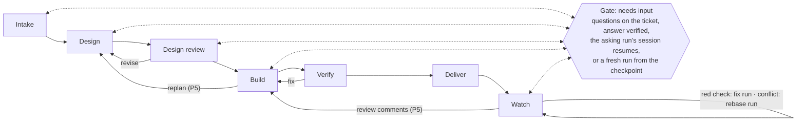
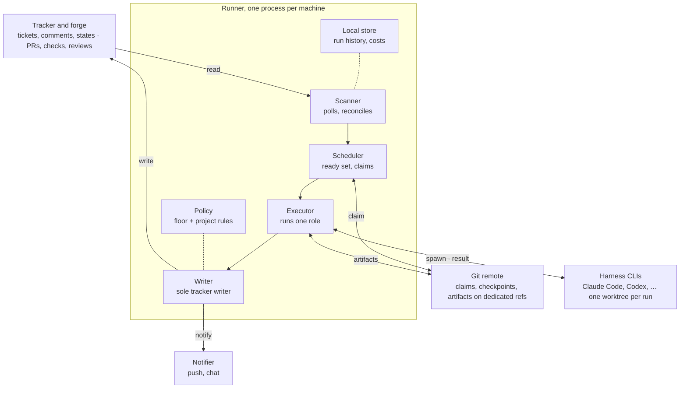

# Owlshift — design & architecture

Status: draft, 2026-09-27. Companion documents: [scenarios](scenarios.md), [runtime & operations](runtime-and-operations.md), [roadmap](roadmap.md), [build plan](build-plan.md), [visual identity](visual-identity.md).

Owlshift is an open-source runner that works a team's existing backlog continuously with coding agents, and brings a human in only where a decision is theirs, on the ticket, in the tracker they already use.

## 1. Purpose & positioning

The bottleneck of agentic development is no longer writing code, it is human attention: questions buried in terminals, work that waits because nobody noticed a blocker cleared, parallel agents colliding on the same files, sessions a person has to babysit.

**What it is.** A runner that:

1. pulls ready tickets in priority order, respecting dependencies and conflicts with all work in flight, human work included;
2. takes each ticket through a multi-stage pipeline (intake, design, review, build, verify, deliver, watch), each stage on the harness and model that fits it;
3. stops and asks on the ticket whenever a decision belongs to a human, checks that the answer actually answers, and resumes, as many rounds as needed;
4. delivers a verified pull request. Humans merge, unless the project opted into merge on green, where the runner merges a pull request it follows once it is green (D14, section 5, "Merge on green").

**What it is not.** Not an IDE, a chat or a new board: the team's tracker stays the interface. Not an auto-merger by default: merge on green is off until a project turns it on, and no agent ever merges. Not a hosted service: it runs on a developer's machine or a team's server.

**Landscape, as of 2026-09-27.** Ticket-to-agent orchestration became a category in 2026. The two closest projects:

| Project | Shape | Human decisions mid-run | Blockers and conflicts | License |
| --- | --- | --- | --- | --- |
| [Symphony](https://github.com/openai/symphony) (OpenAI) | A [spec](https://raw.githubusercontent.com/openai/symphony/main/SPEC.md) plus an Elixir reference implementation, engineering preview; drives the Codex app-server; in-memory state | A run "MUST NOT stall" on user input: each implementation auto-fails, surfaces to an operator or auto-approves; the run ends in a handoff state such as Human Review | `blocked_by` is passed to the prompt, not enforced by the scheduler; no conflict avoidance | Apache-2.0 |
| [Sortie](https://github.com/sortie-ai/sortie) | Go single binary with SQLite; GitHub, GitLab, Gitea, Linear, Jira; Claude Code, Codex, Copilot, OpenCode, Kiro, Gemini; a `WORKFLOW.md` per project ([docs](https://docs.sortie-ai.com/)) | A handoff state at the end of the run; no documented question loop during it | Not documented beyond isolated workspaces | Apache-2.0 |

Parallel-agent workspaces such as [Vibe Kanban](https://vibekanban.com/) manage agents from their own board, supervised by a person: a different lane.

**Where this product differs: three bets.**

1. **The human decision loop is the product.** Questions are posted on the ticket at any stage (before code, during it, after the PR), answers are verified before anything resumes, and there is no limit on rounds.
2. **Scheduling is enforced, not advisory.** Blockers gate dispatch. Declared resources (code zones, migration chains, the one browser) keep two in-flight tickets from colliding, whether an agent or a person holds them.
3. **A ticket is a pipeline, not a session.** Plan before code, independent review by fresh runs on another model (of another family when one is configured), each stage routed to the harness and model that fits it, cost measured per ticket.

Owlshift is built from scratch rather than on top of Sortie (decision D1, section 12).

## 2. Design principles

Nine rules; every later choice in this document derives from one of them.

1. **The tracker is the human interface, git is the machine's memory.** No new board to adopt. Everything a person needs to see or answer lives on the ticket; everything the runner needs to resume lives in the repository.
2. **No LLM sits idle, and none orchestrates.** Scheduling, state and policy are deterministic code. A model is called only to run a role, for as long as that role takes. At rest the runner costs zero tokens.
3. **An agent that needs a human stops.** It leaves a checkpoint, a question and its session's transcript, and once its questions are decided or answered the stage resumes that session, or a fresh run resumes from the checkpoint when the session cannot be (section 4, "Resuming the asking run's session", OWL-394). No process waits for the answer: the transcript waits on disk, and a resume a few minutes later reads it from the prompt cache.
4. **Ask as early as possible.** The dominant latency is the human's, so questions surface at intake, before a ticket can block anything.
5. **Silence is never consent; in doubt, ask again.** An unanswered or ambiguous reply never starts work.
6. **Nothing enters the work queue without a human gesture.** The runner only pulls tickets a person admitted; follow-ups it proposes wait in an inbox.
7. **Guardrails are enforced by the runner, not requested of the model.** Agents have no tracker write access and cannot merge, deploy or change state, by construction.
8. **Neutral by contract.** Tracker, forge, harness, model and stack are adapters behind capability contracts. A contract is frozen only after three implementations exist, one of them possibly on paper.
9. **Subscription first.** Owlshift drives the Claude and Codex CLIs on the user's own subscription: Codex through the login the user configured, Claude Code agent runs through a token of that subscription made with `claude setup-token` and stored by `owlshift init`, never the user's own Claude Code login. It never asks for, stores or passes a model API key, and the user's own Claude Code configuration does not reach an agent run: a Claude Code agent run is billed to the subscription through that token, and a Codex run on an API-key login is the one API-billed case expected ([runtime and operations](runtime-and-operations.md)).

## 3. Core model

Ten concepts, owned by the product and independent of any tracker, harness or stack.

| Concept | Definition | Lives in |
| --- | --- | --- |
| Ticket | A unit of work read from the tracker, admitted to the queue by a human gesture | Tracker |
| Pipeline | A declarative sequence of stages a ticket goes through; a project ships variants (`trivial`, `standard`, `risky`) | Project config |
| Stage | One step of a pipeline: a role to run, its entry condition, its exit contract, its gates | Project config |
| Role | What a stage executes: a prompt, required capabilities (browser, network), a permission level (read-only, write in worktree) | Product; a project adds rules to it or overrides it |
| Run | One execution of a role on one harness, in one worktree; returns a validated `result.json` and a measured cost | Runner, logged to git |
| Gate | A point where a human decision may be needed: clarification, arbitration or approval | Ticket (questions and answers) |
| Artifact | What a stage leaves for the next: plan, step ledger, review findings, delivery report | Git (dedicated refs) |
| Resource | Something two in-flight tickets cannot hold at once: a code zone, a migration chain, the browser, a port range | Declared at intake, held by claims |
| Policy | A non-configurable floor plus per-project rules: what may be decided without a human, budgets, caps | Product floor + project config |
| Adapter | The boundary to an outside system, declaring its capabilities: tracker, forge, harness, notifier, stack profile | Product (built-in) or plugin |

A project adopts the product with one committed file (the project config) plus one uncommitted file per developer (identity, installed harnesses, local caps).

## 4. Default pipeline & gates

A ticket moves through seven stages; four loop back, and five can stop at a gate where a human decides.

Dashed links mark the stages that stop for a human in the default pipeline: Intake (clarification, a false premise), Design (an open point, a false premise), Design review (plan approval), Build (an open point, the plan invalidated) and Watch (a prerequisite, a reversed decision). A human merges after Watch, or, on a project that opted in, the runner does (section 5, "Merge on green", D14). Since OWL-377 a review finding is never a question by itself: it goes to the role that owns the work, so Design review stops only for the plan's approval and Verify never stops for a human (section 5, "A finding goes to its author"). Section 5, "The quality pipeline", sets the rules of Design, Design review and Verify (OWL-296).

| Stage | Does | Leaves behind |
| --- | --- | --- |
| Intake | Understands the ticket, checks its external premises live, declares resources, picks the variant and the routing | Routing record, resources, questions |
| Design | Writes the plan: approach, files, test strategy, risks, success criteria | Plan |
| Design review | Independent reviewers, on another model than the author's when the configuration names one; their number follows the variant (section 5, "The quality pipeline") | Findings, approval |
| Build | Implements step by step, one commit and one ledger entry per step; runs the checks that cover its change, while the runner runs the project's full gate (lint, formatter, tests) once on the commit it delivers (OWL-355) | Commits, ledger |
| Verify | Reviews the diff against the plan and criteria, on another model than the author's when the configuration names one, before the PR opens; the complete CI result is Watch's (OWL-296); browser QA when declared, a later step than P6 (roadmap, P6's readings) | Findings; a bounded fix loop |
| Deliver | The runner opens the PR and posts the delivery report on the ticket | PR, report |
| Watch | Reacts to CI regressions and merge conflicts with fix and rebase runs of its own, which keep the ticket at Watch (section 5, "Watch after delivery"); human review comments on the PR loop back to Build from P5; on a project that opted in, merges the pull request once it is green (section 5, "Merge on green") | Fix runs, rebases, gates, the merge |

**Variants.** `trivial` skips Design and Design review and uses one reviewer. `standard` is the diagram. `risky` adds reviewers and makes human plan approval mandatory. Intake picks the variant; a label on the ticket forces one. The roster of each is in section 5, "The quality pipeline" (OWL-296).

**Gate policy.**

- **Resolver first.** Every question a role raises goes through a resolver run, except those the runner sends straight to the decider (below). What is discoverable (the ticket, the repository, the docs, a verifiable fact) is decided and logged on the ticket as a reversible decision; the rest goes to a human. Decided on 2026-10-03 (OWL-138): the runner routes each question by its category, so an always-human one never reaches the resolver; the resolver is a read-only run, since OWL-344 with Bash inside the read-only confinement, whose network stays open, on the standard tier below delegation level `all` and the deep tier at `all` (section 9), so a verifiable fact is one it can check in the repository and its history or, since OWL-415, with its web tools on the web, cited with its source and date (section 8); each decision is a DECISION comment, kept in the ticket ref, from which alone a later run reads it, and the decider's word overrides it. When every question of a run is decided, the stage runs again without a stop, at most `policy.resolver_passes` runs in a row in one command (5 by default since OWL-328, below; 3 before) before the questions go to the decider, or, at `all` since OWL-375, are taken on the asking run's recommendation ("Resolver passes", below). No harness takes over from the resolver, P6's fallback being the review roles' alone (section 5, "Parallel", "Usage limits"), so a resolver that cannot give its result sends every question to the decider ([build plan](build-plan.md), "The resolver"). Decided on 2026-10-04 (OWL-144): a question the asking run files under the wrong category still reaches the resolver, so the resolver labels each question it decides with a category of its own, read from the question's text and context without seeing the asking run's, and the runner logs the decision only when neither label is always-human and the resolver's is a well-formed token; otherwise the question goes to the decider. The runner draws that consequence; recognising the topic stays a model's judgment, and what remains is plain: a floor-topic question both runs label as something else is still decided, reversible like any decision and listed in the delivery report; a project's own always-human categories are told to both runs since OWL-151 (decided 2026-10-04), in the brief's `always_human`, so each labels with them, but recognising a topic stays a model's judgment and a question on one both runs label otherwise is still decided; decisions kept before this check stay as they were. Decided on 2026-10-07 (OWL-176): the Build run takes no decision of its own. A choice of what the work delivers (its content, behaviour, interface or wording) that nothing above plainly settles, and every point the ticket leaves open, is a question, so the resolver decides what is discoverable and the floor applies; the runner refuses a Build result that lists `decisions` ([build plan](build-plan.md), "Build takes no decision of its own"). Decided on 2026-10-07 (OWL-186): the Build run told of that refusal may not end `done`, so it asks the refused choices or stops ([build plan](build-plan.md), "A retry after refused decisions asks"). Decided on 2026-10-08 (OWL-192): that hold and the refusal's reason are kept in the ticket ref until a Build run asks, so a park, a usage limit or a later command never drops them ([build plan](build-plan.md), "A Build refusal kept across commands"). Decided on 2026-10-11 (OWL-222): a question the asking run names as reopening a choice the runner refused (`refused_choices_asked`, OWL-193) goes to the decider and never to the resolver, whatever its category, so a choice refused for being taken without a human is never settled without one; the routing stays per question, so the run's other questions go through the resolver as before ([build plan](build-plan.md), "A retry asks every refused choice"). The cost is a question for the decider when the thread, a rule or the repository settles the choice since, which the run's `context` names. Rejected: the resolver deciding such a question, reversibly, as before, which is the settling the refusal stopped, by another model; and the resolver running on it with its decision refused, a run whose only outcome is the decider's question. The runner sees only what a run reports: a choice a run makes without recording or asking it stays unseen. Decided on 2026-10-11 (OWL-146): the decider reverses a decision by replying to its DECISION comment. Before delivery, the next run follows the reply over the decision, and a reply to the resolver's plan approval returns the ticket to Design (OWL-345, below); after it, watch starts a correction run on the pull request (section 5, "A reversed decision"). Decided on 2026-10-15 (OWL-296): three more questions go to the decider without the resolver, a finding two review passes left at Design review or Verify, the plan-approval question, and a `replan` question on an approved plan (section 5, "The quality pipeline"); the question of a false premise already does, since only the decider can re-scope or close a ticket. Superseded on 2026-10-18 (OWL-342, "Every question through the resolver" below): those questions, the one reopening a refused choice (OWL-222) and every other a role raises reach the resolver, which decides itself what it answers and what it passes on. Decided on 2026-10-19 (OWL-351): a resolver run's decisions are one DECISION comment, one short line each, numbered D1..Dn, their reasoning in the ticket's "Decisions" document where the tracker holds documents and folded in the comment otherwise; a reply naming `D2` reverses that decision alone, a reply naming none every decision of the comment ([build plan](build-plan.md), "One DECISION comment per run"). Rejected: one comment per decision, which buried the thread (43 on 9 tickets in one drain), and a section of the plan's document, rewritten only with a PLAN.
- **Always human.** Security, data loss, money, legal wording, irreversible external actions and scope changes, by default. Security and irreversible external actions are part of the floor: they reach a human at every delegation level. The other four go to a human unless the project's delegation level hands them to the resolver (below). A project may add categories (`policy.always_human`), which stay human at every level.
- **Delegation level.** Decided with the maintainer on 2026-10-17 (OWL-328), after LOC-1407's first question, filed `scope`, reached the decider though the ticket's text settled it. `policy.resolver_delegation` sets what the resolver may decide, from nothing to everything but the floor:

  | Level | The resolver decides | Always to the decider |
  | --- | --- | --- |
  | `none` | nothing: no resolver run | every question |
  | `facts` | what it observes in the repository and its history: a file, an existing pattern, a documented behaviour; since OWL-415, a public fact it checked on the web, cited with its URL and date | the rest |
  | `discoverable` (default) | facts, and what the ticket, the decider's comments, earlier decisions and the project's rules settle | data loss, money, legal, scope, the floor |
  | `ticket` | the same, and a `scope` question the ticket's own text answers, quoted | data loss, money, legal, the floor |
  | `all` | everything but the floor, on its own judgment where nothing settles a question (OWL-342) | security, irreversible |

  The project's added categories go to the decider at every level; since OWL-342 a question reopening a refused choice and a blank category reach the resolver (below). The runner enforces the level, never the resolver's prompt alone: each decision names the kind of its basis (`fact`, `settled`, `ticket` or, at `all` only, `judgment`; at `all`, the runner's own `recommendation` at a chain's bound, which no resolver may give, OWL-375), a basis above the level is refused, and a `ticket` basis must quote text the runner finds in the ticket's title or description or a comment of its decider. Both labels of a decided question (OWL-144) are held to the level's always-human set. The level shows wherever a decision does: `owlshift doctor` names it, and each DECISION comment and delivery report says which level allowed it.
- **Resolver passes.** `policy.resolver_passes` bounds the runs in a row a resolver unblocks in one command: a whole number from 1 to 50, 5 by default, or `"unlimited"`. An unlimited chain is bounded by money instead: `"unlimited"` requires `policy.resolver_budget_usd`, a dollar ceiling on what the resolver runs of one chain cost (the `cost_usd` they reported since the command's last stop), past which the next run's questions go to the decider. A resolver run whose cost is not reported ends the chain, since the ceiling could not be checked. The ceiling may also be set with a number of passes; whichever is reached first ends the chain. Decided on 2026-10-19 (OWL-376): the ceiling counted the asking runs too (Design, the design reviewers, Build, Verify), and on the 2026-10-18 drain one Build cost $9.70, a design review pass $2 to $3 and a resolver run $0.11 to $0.70, so a $5 ceiling was spent by the work itself in one or two loops, and its questions went to the decider for `budget` in at least 13 of the 30 rounds of 2026-10-17 to 19. The key now bounds the delegation, as its name says. The runs a chain unblocks are bounded each by its harness's `budget_usd` ([runtime & operations](runtime-and-operations.md#configuration)), and in number by the pass limit only. What the asking runs whose questions reached the resolver cost is measured, on each `gate` event of the resolver, and bounds nothing. What a whole ticket costs, every run counted and across its commands, which a ceiling per chain would not give, since a chain ends at every stop, is bounded since OWL-378 by `policy.ticket_budget_usd` ("Ticket budget", below), which leaves this ceiling as it is. Rejected: no bound but the failed-run limit, which a chain of successful runs never reaches; a high fixed ceiling of runs, which says nothing of what a run costs; the asking runs in the ceiling, which made a key read as a bound on the resolver cap the whole pipeline.
  - *The bound at `all`.* Decided on 2026-10-20 (OWL-375). From 2026-10-17 to 19, 30 rounds reached the maintainer on 9 tickets run at `all`, at least 13 of them `pass_limit` for `budget`, and 28 of the 29 replies took every recommendation: a bound meant to cap what the resolver costs had become "ask the human everything". At `all`, a bound reached (the pass limit, the ceiling, or a resolver run's cost unreported) still starts no resolver run, and the runner takes the asking run's recommendation on each question it would have given the resolver, a decision of the kind `recommendation`: one DECISION comment for the run, whose lead line names the bound, kept in the ticket ref and reversible as any decision (OWL-146). The stage then runs again; a plan approval under `on-fork` is approved on its recommendation, option A, kept as the resolver's approval is. Still the decider's: a question the asking run filed under the level's always-human set or `policy.always_human`, as always; one whose category is blank or not a token, which only the resolver's label would route; one reopening a refused choice (OWL-222); the questions of a `premise_false` result, whose closure is the decider's; one without a recommendation, which only a question the runner wrote could be. The loop that reached the bound stops: an asking role takes recommendations once per chain, so a role that took them and asks again in the same chain sends its questions to the decider, as before OWL-375; the next stage of the chain (Design review after Design, Build after it) takes its own once, a step forward and not the loop. The DELIVERY report lists such decisions first, under a heading of their own that says how to reverse one. Like any kept decision, one taken on a recommendation is an earlier decision that later runs follow until the decider reverses it. Below `all` nothing changes, `ticket` included: taking a recommendation follows the asking run's own weighing of a choice, which only `all` delegates (the `judgment` kind is `all`'s alone) and a maintainer at `ticket` kept. Accepted residual: no resolver labels the question (OWL-144), so the floor rests on the asking run's category alone. A question touching the floor that the run filed under another word is taken on its recommendation, and the approval is taken whatever the plan's forks touch, since forks carry no category: a departure from the ticket's "unless a fork is in the floor". Each such decision is reversible, shows as a DECISION on the ticket and under its own heading in the DELIVERY report, and a person merges the pull request; `plan_approval = "always"`, which `risky` forces, keeps the approval the decider's. Rejected: a resolver run at a cheaper tier past the bound, which spends what the bound caps; a label-only run to keep the second label, the same cost and a role mode of its own; a scan of the questions' words for the floor's, noisy on a project whose tickets name security everywhere; higher default bounds, which move the problem.
- **Every question through the resolver.** Decided with the maintainer on 2026-10-18 (OWL-342). With `all` and unlimited passes on Locary and Owlshift, the decider still answered seven rounds on LOC-1406, three on OWL-330 and two on OWL-339 overnight: half the rounds never reached the resolver (the bypasses of OWL-222, OWL-139, OWL-296, OWL-306 and the fix and rebase runs'), and the resolver passed on every question it was given, five runs deciding nothing, since even at `all` it needed a written basis and a trade-off has none; read-only, it could not run Bash either, so not even `grep`. The rule now: at every level but `none`, every question every role raises reaches a resolver run, and the resolver decides, question by question, what it answers and what it passes on. That includes Intake's and Design's, a finding two review passes left at Design review or Verify, the plan-approval question, a `replan` on an approved plan, a `premise_false` result's question, a question reopening a refused choice, the run's after late comments, fix, rebase and correction runs' (section 5, "Watch after delivery"), and a question with a blank category, which the resolver's own label then routes (OWL-144). The level still bounds what it may decide (above), and the runner enforces it: Superseded in part on 2026-10-19 (OWL-377, section 5, "A finding goes to its author"): no review finding becomes a question by itself, so a finding two review passes left is no longer among these questions; one a role turns into a question of its own is that role's, routed as any.
  - *Still the decider's.* A question the asking run files under the floor (`security`, `irreversible`) or a category of `policy.always_human` goes to the decider without a run, since no decision on it could be logged; a resolver label on either refuses the decision, as since OWL-144. Under `pipeline.plan_approval = "always"`, which `risky` forces, the plan-approval question is the decider's: the setting names a human. A `premise_false` question's closure is the decider's act in the tracker, so the resolver decides only the re-scope, a `scope` decision under its level's rule, or passes on. The runner's own question after a second late comment (section 4, "No premature resume") stays the decider's: it is the runner stopping, not a role asking.
  - *The `judgment` basis.* At `all`, a fourth kind: a decision resting on the resolver's own weighing when nothing settles the question, a trade-off, a priority, an intent the ticket does not state. It names the option chosen, the reasons, the cost of the choice, and what in the thread, the earlier answers and the rules makes it the one the decider would likely take; the asking run's recommendation may be followed, never as the reason on its own. Below `all` it is refused, as any kind above the level. The resolver still passes on what it cannot weigh: an option that goes against an earlier answer of the decider, a prerequisite only a person can supply (a secret, an account, infrastructure), a check its web tools cannot make (one behind an account or a credential, or any web check when the operator turned its web tools off, OWL-415). A judgment decision is reversible like any (OWL-146); its DECISION comment says it rests on judgment on its visible line, and the delivery report lists such decisions first, so the decider sees which ones to read. The runner's `recommendation` kind ("Resolver passes", "The bound at `all`") is not this: no resolver weighs it, the runner takes the asking run's recommendation as written once the chain's bound stops resolver runs, which is why it is a kind of its own.
  - *Plan approval.* At `all`, under `on-fork`, the resolver approves the plan or picks one of a fork's other options. An approval keeps its DECISION comment (shared, since OWL-351, with the run's other decisions) and the plan's hash in `plan.json`, where the decider's keeps their comment, and the core's hold on the plan's hash is unchanged (OWL-32); a change returns to Design, as the decider's would, and so does the decider's reply reversing it (OWL-345: the kept approval is dropped before Design runs; section 5, "A reversed decision").
  - *A review finding.* A `blocker` or `major` finding still confirmed after the second pass reaches the resolver with the arbiter's ruling and the plan or diff it is about. The resolver may have its fix applied, take another option or drop it, on any basis its level allows; the next Design or Build run follows the decision. Superseded on 2026-10-19 (OWL-377): such a finding goes to its author for one last run and is listed, never asked (section 5, "A finding goes to its author"). Since 2026-10-20 (OWL-379) a ref written before that is no longer read for such a decision or question (section 5, "Records written before").
  - *What the resolver is given.* At `all`, the deep tier and the ticket's effort, since judgment is the hardest call a run makes; below, the standard tier (section 9). A 30-minute deadline. Bash, inside the read-only confinement, whose network is left open as every run's is (section 8), the decider accepting it on OWL-344, so that it reads the code and its history as Build does (`git log`, `git blame`, `grep`), checked live on macOS and Linux on 2026-10-20 ([build plan](build-plan.md), "The resolver"); its result is its last message. Since OWL-415 (decided by the maintainer on 2026-10-21) its web tools too, WebSearch and WebFetch, unless the operator turns them off, so that a CLI flag, an API's behaviour or a library's version is a fact it checks and cites with its URL and date, rather than a question for the decider (section 8, "Untrusted input"). Beside its questions, the asking run's own output: its summary, its draft plan, the findings and the arbiter's rulings, and the branch's diff from its base.
  - *Cost.* A resolver run on each round that had none, on the deep tier at `all`; `policy.resolver_passes` and `policy.resolver_budget_usd` bound the chain as before, the ceiling counting the resolver runs alone (OWL-376), past which, at `all`, the runner takes the asking runs' recommendations (OWL-375), and a round reaching the decider says how many questions were decided. The ticket's budget, checked first, bounds every run of the ticket, the resolver's included ("Ticket budget", below, OWL-378).
  - Rejected: a separate level for judgment, since `all` is the level a maintainer sets to delegate everything they can; keeping the bypasses as an option, which leaves the knob the maintainer turned without effect; the resolver deciding the floor or a project's added categories, which the maintainer kept human; the resolver closing a ticket on a false premise, an act in the tracker.
- **Ticket budget.** Decided with the maintainer on 2026-10-20 (OWL-378), the question OWL-376 left open. `policy.ticket_budget_usd`, a dollar amount, bounds what one ticket's runs cost. Every run the runner starts for the ticket is counted once as it ends, at the `cost_usd` its harness reports: Intake, Design, each reviewer, the arbiter, Build, Verify, the resolver, the answer check, and Watch's fix, rebase and correction runs. The spend is kept in the ticket ref (`cost.json`) right after each run, so the count goes on across every command and stop, whatever stops it (OWL-397, *Kept after every run* below). Before a run starts, the runner compares what the ticket's runs cost since its last restart with the budget; at or past it, no run starts and the ticket parks where it stands, waiting for input if it was, its PARKED comment giving the spend and the budget (park reason `TicketBudget`). A person's `owlshift continue` restarts it, the budget then counting from the restart, as a restart resets the breakers' counts; the ticket's whole spend stays for the record. `owlshift do` on a parked ticket counts on, and so does a ticket `owlshift forget` started over, which keeps `cost.json`. At a resolver routing the budget is checked first: reached, no resolver run starts, as at a chain's bounds. At `all`, the asking run's recommendations are then taken ("The bound at `all`") and the next run parks the ticket; below, the questions go to the decider in a round that names the budget and says that once answered the ticket stops until a person's `owlshift continue`, so the decider answers and a person restarts it once. Its `gate` event is `pass_limit` with `reason` `ticket_budget`.
  - *With `resolver_budget_usd`.* Both apply, whichever is reached first, each with its own consequence: the chain's ceiling counts the resolver runs of one chain and ends the chain, the ticket's budget counts every run of the ticket and parks it. `"unlimited"` passes still require `resolver_budget_usd`: each key keeps one meaning, and no project file breaks.
  - *The value.* No budget when absent, the behaviour before OWL-378. This repository sets 100 USD, above every ticket's spend the maintainer's event log showed on 2026-10-20 for the tickets run since 2026-10-14: OWL-330 79 USD (still open), OWL-339 57, OWL-336 45, OWL-160 42, OWL-344 24, OWL-340 19, OWL-345 15.
  - *The figures.* Each `usage` event gives `ticket_spent_usd`, the ticket's whole spend after its run. Each resolver `gate` event gives `ticket_spent_usd` and `ticket_unreported_runs`, and, with a budget, `ticket_budget_usd` and `budget_spent_usd`, the spend since the last restart, which the budget counts. `owlshift config show` and `owlshift doctor` (`budget`) show the key.
  - *Accepted residuals.* A run that reports no cost adds nothing and is counted apart, which the PARKED comment and the round say, where a resolver run without a cost ends a chain: a run cut off at its deadline reports none, and the failed-run breaker bounds those. A runner killed during a run never reads its report, so that run is not counted at all. Until OWL-397 a third residual stood, a run whose command wrote nothing after it, or of a ticket with no ref yet, not keeping its cost (*Kept after every run*, below).
  - *Kept after every run.* Decided with the maintainer on 2026-10-20 (OWL-397). Until then the spend rode on the next write of the ref that kept something else, since watch read any move of the ref as progress, holding a ticket whose continue left it as it was (section 5, "A comment whose state is not kept"); so a run whose command wrote nothing after it (one cut by a usage limit, a crash, a refused stop, a failed delivery) and the runs of a ticket with no ref yet lost their cost, in the very failures that run again. Now the runner writes the ticket ref right after each run's report, before anything else the command does: the record as the ref keeps it, only `cost.json` new. Watch reads a ticket ref's progress without `cost.json` (section 5, "A move that is only the spend"), so that write lifts no hold. A write that fails (the ref locked, or moved by a run that broke isolation) is a `warning` event (`what` `cost_not_kept`), never a stop: the spend stays in the command and rides on its next write that keeps something else, as before. A ticket without a ref gets one at its first run's end, holding what `owlshift forget` leaves of a ticket at round 0 (Ready, nothing asked) and `cost.json`, which every reader takes for a ticket that keeps nothing: `do` starts from Ready, `continue` refuses it as it refuses a forgotten ticket, the drain takes it in, watch leaves it alone. The ticket has a ref from then on, so the rest of the command keeps its state at each step as for any ticket with a ref, which changes three things for a ticket a person's `owlshift do` started:
    - *Its stops keep their state.* A park is kept with the stage's counters, and its PARKED comment names `owlshift continue`, which restarts the stage it parked at, where it named `owlshift do`, which started again from the first stage with fresh counters; `continue` after a usage limit or a refusal resumes the stage, where it answered that Owlshift keeps nothing on the ticket.
    - *A running watch takes it.* Its ref at Design, Design review, Build or Verify is resumed by `owlshift watch` while the tracker shows it working, as section 5's "The next step" says of a `do` that a stop left there, which until now reached only a `do` whose ticket a round, a decision, a refusal or `forget` had given a ref.
    - *It holds the slot.* That ref holds the project's one slot (section 5, "One at a time"), so `owlshift watch --drain` dispatches no other ticket until it is delivered or parked; `owlshift doctor` names the holder.

    "Makes no ticket ref until a round opens" ([build plan](build-plan.md), OWL-122) is superseded, and with it the exceptions listed against it. Each run adds one commit to the ticket ref. Rejected: the spend in a ref of its own, which watch never reads, at the cost of a second ref per ticket and of `cost.json`, kept in the ticket ref since OWL-378, moved; the spend written only when a command stops, which a crash after a run misses and every stop path would have to carry; the loss accepted as bounded, though a usage limit cuts a run at each of its windows on a ticket watch resumes; the ref made under the stage the run ran in, as a refused Build result makes it, which the command's next write of its state does anyway, where the record `forget` leaves keeps a write of the spend changing nothing else for every reader; and tickets without a ref left out, a residual of one run per command for a `do` typed by hand, but of every cut first intake under the drain.
  - Rejected: summing the local event log, per machine and not the ticket's state; the spend in `state.json`, which every rebuild of the state would have to carry; a bound at the resolver's routing alone, which leaves the loops that pass counts bound spending past it; parking without posting the asking run's questions, whose restart runs that run again to ask them; the spend written after every run, whose moves of the ref would lift watch's holds (since OWL-397 it is, watch reading the ref's progress without it); a park inside the round, a second comment and a second stop for one event, and none for a re-ask.
- **Resuming the asking run's session.** Decided with the maintainer on 2026-10-20 (OWL-394), on live check C18 of that day ([build plan](build-plan.md#results)). On the P5 gate's drains, 93 Design and Build runs, 532 minutes and 85 USD, did nothing but restart a stage from zero after a question round, 40 of them after a resolver decision that came within minutes. Now the stage resumes the Claude Code session of the run that asked, with `claude -p --resume`, instead of starting a fresh run.
  - *Which stops.* A Design run at Design and a Build run at Build whose questions are all settled. That happens when the resolver decides every question of the run, the stage running again in the same command, or when the answer check settles the round the run opened, whatever command or watch step then runs the stage. It applies past the cache's hour as within it: C18 measured a resume 90 seconds after the asking run at 0.018 USD against 0.211 USD for a fresh run of the same task, and one 69 minutes after it at 0.207 USD, with no file read again in either. Intake, the reviewers, the arbiter, the resolver, the answer check and Watch's fix, rebase and correction runs stay fresh runs.
  - *What the resumed run is given.* Its brief, written anew as for any run: its thread holds the DECISION comments, the answers and the RESUME comment. A short prompt tells it to read the brief again and carry on, and to end as its role says, with a new `result.json`. The role's prompt is already in the session and is not sent again. The brief and the result keep their formats.
  - *When a fresh run starts instead,* as before OWL-394, the reason in the run's `run_started` event (`fresh`):
    - its questions are not settled, or the session is another role's or stage's;
    - the harness or its model changed, since the cache is per model;
    - the ticket's branch head moved since the asking run ended. The run reads its branch, not the base, so this is how "the base moved" is read;
    - the session's total cost at the asking run's end is unknown (*Its cost*, below);
    - the transcript is missing, unreadable or larger than 64 MiB, the most the runner copies. Transcripts are kept on the machine that ran the asking run, so a command on another machine starts fresh;
    - a cold resume of too large a context. A resume an hour or more after the asking run ended, past the prompt cache's hour (C18 saw only `ephemeral_1h` writes), writes the whole context to the cache again, about 3.7 USD per million tokens on Sonnet 5.5 in C18. So a cold resume needs a context of at most 200,000 tokens, as the asking run's last request reported it: about 0.75 USD, under half of a restarted Build's 1.6 USD average on the P5 gate. Past it, the rewrite alone nears what a restart costs. A context of unknown size is not resumed cold either. A warm resume reads the context at a tenth of that price, so the cap does not apply to it.
    - The asking run was quarantined or its result refused: it leaves no session to resume.
  - *What holds across a resume.* The resumed run is a new run in everything but its conversation: its own run directory, temporary folder, empty configuration folder, isolation snapshot and check, and `result.json` judged as any. The guardrail flags come from its own command line, and C18 saw them hold on a resume: no MCP server, skill or slash command, the permission mode asked. Only the transcript crosses runs. The executor copies the session's `.jsonl` out of the asking run's configuration folder once its processes are stopped, through no link, into that run's directory, which the sandbox hides from runs. It copies it into the resumed run's empty configuration folder at the same place, and nothing else of the folder outlives a run, as OWL-94 has it. The transcript holds what the run's stdout log already holds. A copy that fails starts the run fresh, with a `warning` (`session_not_resumed`), and the run's `run_ended` says `resumed=false`. A resume the CLI itself refuses is a failed run, and the next run is fresh, the session being spent.
  - *Its cost.* C18 found that a resumed session reports `total_cost_usd` for the whole session, the earlier runs included. So the runner keeps the session's total at the end of each run that asked and counts a resumed run's own cost as the reported total minus that one, in the ticket's budget, `cost.json` and the `usage` event. A total below the kept one is counted whole, with a warning. `--max-budget-usd` counts the current run only (C18).
  - *Where it is kept.* The session's id is one Owlshift chooses for a fresh run, derived from its run, and a resume keeps it. The ticket ref holds the latest asking run's session in `session.json`: its run, session id, role, stage, harness and model, the branch head and time at its end, the session's total cost, its context, the round its questions opened, and whether they are settled. Every write of the ref keeps it, watch does not read it as progress, `owlshift forget` drops it, and the next Design or Build run spends it, resumed or not. `owlshift logs` shows a resumed run's `run_started` with `resumes=<run>` and `session=<id>`, and its `run_ended` with `resumed=true`.
  - Rejected: a configuration folder kept for the whole ticket, where everything the CLI writes would outlive the run; `--fork-session` on each resume, a new id per run for nothing; a process left waiting for the answer; resuming only within the cache's hour, which C18 showed costs no more past it than a fresh run, while keeping the run's own understanding of its work.
- **Plan approval** is set per project: `always`, `on-fork` (only when the design has a real fork) or `never`; the `risky` variant forces `always`.
- **Who decides.** One person, the ticket's decider: only their answers unblock the ticket; other people's comments are context. Decided on 2026-10-02 (OWL-33), reading "the assignee by default" literally: the decider is the ticket's assignee whenever it has one. A ticket without an assignee falls back on the owners the project names for its code zones (`[zones]` in the project file, [runtime & operations](runtime-and-operations.md#configuration)). Each zone the ticket declared belongs to the owner of the deepest owned zone that contains it; a declared zone no owned zone contains has no owner, even when owned zones lie inside it, so a ticket declaring `backend` while `backend/billing` has an owner touches no owned zone, and declaring the narrower zones is the fix. Decided on 2026-10-20 (OWL-412): a ticket declares the zones of its `zone:` labels and, once its intake ended, those of its intake record (section 5, "Declared at intake"), each counted for its own owner, so a label inside an intake zone keeps its owner, where the held set keeps only the outer zone; a ticket without an intake record declares its labels' alone, and an intake that names no zone, which holds the whole repository, adds none, since the whole repository has no owner. A record kept for an earlier text of the ticket still counts until an intake replaces it, as it still gives what the ticket holds: the decider of a ticket in flight does not change with an edit of its text, and the zones it counts were declared by an intake, so an edit cannot choose an owner. Intake's zones never count for an intake run, a first one or one again: intake runs only on a ticket that its assignee or its labels give a decider, so labels, or an assignee, stay required to get a ticket through intake. Intake's zones can then add an owner to its labels', which leaves the ticket without a decider, never replace theirs, and choose the owner alone only for a ticket whose assignee was removed after its intake; they name no one the project file does not, and whoever edits the ticket's text, labels or assignee stays who chooses its zones. Declined with the maintainer on 2026-10-20 (OWL-413): letting a ticket without an assignee or an owning label through intake so that its zones alone choose the decider. An intake run's output, read from the ticket's text, would then choose who instructs every such ticket with no person's gesture, where an assignee or a label is one; the saving would be that one gesture, which the admitter can make on the ticket they are admitting and which the drain's waiting line asks for; and this repository's `owlshift.toml` names no zone owner. Rejected with it: the admitter answering intake's questions until its zones name the owner, a third decider rule in `questions.json` and two deciders in turn on one ticket; and parking a ticket whose intake must ask a person, which stops the intake at every question that reaches a person and needs a brief without a decider. Zones without an owner are left out: when the owned zones the ticket touches all belong to one person, that person decides; when they belong to several, or the ticket touches no owned zone, the ticket has no decider, and the runner says why instead of picking one. The decider is resolved when the command that asks starts, from the assignee and the zones declared then, and stays the decider of that ask; owners are read from the project file at the base commit, never from a run's worktree, so a run cannot choose who instructs it. Rejected: the zone owner before the assignee, which would change a ticket's decider once intake declares its zones and keep the person who delegated it from unblocking it; and several deciders on one ticket, which would leave the answer check without a single last word.
- **Answer check.** Questions are numbered, their options lettered, and each carries a recommendation, so the decider may answer `Q1: B`, a bare letter when one question is asked, or `ok` for every recommendation (decided on 2026-10-16, OWL-324; [build plan](build-plan.md), "The QUESTIONS layout"). Before any resume, a small run classifies each one, save a thumbs-up (below): answered, partial, unanswered, or a counter-question. The runner then resumes, re-asks only what is missing, or replies in the thread. Each check has exactly one of these outcomes, by precedence (decided on 2026-10-01, OWL-114): a counter-question on any question gets the reply and nothing else, so nothing is re-asked and the round does not count toward the re-ask limit, and the next check, after the decider's next reply, classifies every question of the same ask again; otherwise any partial or unanswered question is re-asked, or the ticket parks once the re-ask limit is reached; only when every question is answered does the ticket resume. The answer check writes the reply (decided on 2026-10-02, OWL-115): the run that recognises the counter-question already holds what answers it, the question's context, options and recommendation, the decider's comments and the ticket, so each `counter_question` verdict carries its own reply, and the runner posts it as written, flattened to one line like every text a model writes. Rejected: the resolver, which would add a run per counter-question and a repository-wide context to explain a question already asked, and whose job is to decide, not to talk with the decider; and a reply the runner composes itself, which cannot say what an option means. The reply rests on the brief alone, so it cannot carry repository content the brief does not; when the brief does not hold the answer, the reply says so. Decided on 2026-10-19 (OWL-371): a thumbs-up answers a question asked alone. When the latest ask holds one question, a `+1` reaction its decider puts on that ask's own comment (the round's QUESTIONS comment, or the RE-ASK) is the answer `ok`. It waits through the quiet window as a typed `ok` does, never ending with `go`; one removed before it counts answers nothing; once it counts, the runner resumes the ticket on the question's recommendation itself, the one resume no answer check classifies, since a thumbs-up has no other reading. Nobody else's reaction counts, an app user's included, nor any other emoji, nor a thumbs-up on another comment or on an ask of several questions, where a thumbs-up meaning "seen" would take every recommendation at once. Words win: when the decider also commented since the ask, the check reads their words ([build plan](build-plan.md), "A thumbs-up answers a one-question round"). Rejected: the answer check run on a thumbs-up, which needs a brief format and a role change to classify what can only mean `ok`; Linear's agent-session choices (OWL-354), which need a webhook and show outside the issue's thread.
- **No premature resume.** The runner waits for a quiet window after the decider's last edit (10 minutes by default, `policy.quiet_window_minutes` in `owlshift.toml` sets it per project, from 1 to 1440) unless the reply ends with `go`, and re-reads the thread before delivery for late comments. Decided on 2026-10-03 (OWL-127): the window holds whoever notices the answer, a person typing `owlshift continue TICKET` as much as `watch`, since the person typing it is often not the decider and an answer checked before it is finished can spend a re-ask. The reply is the decider's comment with the newest last edit, and it ends with `go` when its last word is `go` in any case, punctuation trimmed. Rejected: a typed command skipping the window, and a flag to override it, which would let the operator overrule a decider still writing. Decided on 2026-10-04 (OWL-139): for a ticket whose ticket ref keeps an ask, the runner re-reads the comments once a Build run is done and its gate passed, before the push; a late comment is the decider's (the decider of the latest ask) whose last edit is newer than the newest one that run's brief held, so a comment posted between the answer check and the Build start is not late, since the Build read it as an instruction. A late comment gets one more Build run, its thread holding the comment, and that run judges it against the work in front of it: `done` integrates it and delivers, recorded as a decision in the delivery report; questions send the ticket back to needs-input, straight to the decider without the resolver, in a round that names the late comments. A comment the run can follow is integrated, even one that reverses an earlier answer, since the decider's latest word is the instruction; "contradicts the work" means the run cannot integrate it without the decider. One such run per delivery: a further late comment after it opens a round of one always-human question naming them, and nothing is pushed. Rejected: the answer check, whose classes say whether a question of the latest ask is settled and which reads the brief alone, never the work; and a dedicated classification role, which needs a role, a result shape and a contract format of its own, judges the work without it, and still needs the Build run to integrate. The build role is told so (`roles/build.md`, "Resuming"): a decider comment newer than the runner's latest RESUME comment is integrated, steps added or revised even when every step is done, or asked about when the run cannot follow it without the decider; the decision in the delivery report still shows the reviewer that late comments were given to a run. A ticket without a question round is delivered without a re-read.
- **Pull request reviews are an input channel.** A human review comment sends the ticket back to Build or opens a gate, like a ticket comment.
- **A parked ticket shows it.** Decided on 2026-10-04 (OWL-148): when the runner parks a ticket, the PARKED comment is followed by a move of its visible stage to the state the project maps under `[tracker].states.parked`, an optional key; a project that names none shows a parked ticket as needs input, and the PARKED comment says why. So the stage alone does not say that questions are open: the comments and the ticket ref do, and nothing reads the stage back. A restart moves the stage to what the ticket then waits for: needs input when it was parked while questions waited, working when Build runs again. Rejected: a required key, which would break every existing project file and ask every tracker for a workflow state of its own; and needs input alone, which leaves a parked ticket indistinguishable from one waiting for an answer.

## 5. Architecture overview

One deterministic runner per machine serves every adopted project; models only ever run inside a harness, one role at a time. Agents never touch the tracker: the runner is its only writer.

One event, end to end:

1. **Scanner** polls the tracker and the forge (webhooks are an optional speed-up, never required) and turns changes into events: ticket admitted, answer posted, PR merged, check failed.
2. **Scheduler** computes the ready set (admission, blockers, resources, caps, budget) and claims a ticket with an atomic push of a git ref, so two machines never take the same ticket.
3. **Executor** creates the worktree, writes the brief, launches the harness CLI for one role, then validates `result.json` against its schema and checks isolation (main checkout untouched, diff inside the worktree, right branch). An exit code is never taken as proof.
4. **Writer** applies the result: comments, state transitions, follow-up proposals, the PR. It is the only component with write access to the tracker and forge, and it asks **Policy** before each write.
5. Artifacts and the checkpoint go to the git remote; cost and run history go to the **Local store** (SQLite); the **Notifier** fires only when a human has become the blocker.

**The brief's thread** (OWL-357, decided 2026-10-19). A brief carries the ticket ref's record once: the plan in `plan`, each ask as its round's entry, each decision of the resolver as a decision entry. Owlshift's own comments that only repeat it read in the thread as their header line, their time and their comment id: PLAN, RESUME and DELIVERY. What the record does not carry, a PARKED or INTAKE comment and an ask or a decision it no longer keeps, is cut to 4 KiB, and a REPLY stays whole, since the decider's next answer is read against it. A person's comment is always whole. A comment counts as Owlshift's when it is marked from its header to its footer and was never edited, Owlshift editing none; a person who posts a whole copy of one has it read short as well ([build plan](build-plan.md), "The brief's thread"). What is settled reads short too (OWL-359, decided 2026-10-19): a round the decider answered, every question's latest verdict `answered`, is one `answered` entry giving each question's text and what the answer check understood of the answer, its options being on the ticket; a decision's question is its id and text, the decision saying what was chosen, unless the decider replied to it. The ask an answer check judges is always whole.

**Deployment.** One service process per machine, `owlshift daemon`, serves several projects, the machine-wide caps (concurrent runs, each subscription's usage) shared through the files P6 keeps. Since P7 it supervises one `owlshift watch --drain` per served project rather than running their passes itself (section 5, "The background service"); comparing two projects' priorities, the single browser slot and port ranges wait for a later step. A local API serving the CLI, the local web UI (P8) and the desktop app (P11) comes with P8. The same binary runs on a team server; since shared state lives in the tracker and git, moving from a laptop to a server needs no migration.

**Folded when superseded** (OWL-353, decided 2026-10-19). A ticket that goes through several rounds kept every PLAN, QUESTIONS and RESUME comment expanded: on the 2026-10-18 drain, OWL-160 had 13 comments and OWL-336 had 14, most of them out of date. On a tracker that can resolve a comment (section 6), when the runner posts a comment that supersedes one of its own, it resolves the older one, which the tracker then shows folded: a PLAN is folded by a later PLAN, whole or the pointer to the plan's document, or by a DELIVERY; a QUESTIONS or RE-ASK comment of a round by the RESUME of that round or the QUESTIONS of another round; a RESUME by the QUESTIONS or the RESUME of another round. So only the latest round and the live PLAN stay expanded. A DECISION is never folded, since a threaded reply to it reverses it; nor a REPLY, an INTAKE, a PARKED or a DELIVERY comment, nor a person's comment: a comment counts as Owlshift's by the rule of "The brief's thread" above, for this ticket, and only a top-level one, since Linear resolves no reply. The comments to fold are read from the thread, as the ticket ref keeps no id of a PLAN or a RESUME and its format does not change. A comment that a comment posted in between already folds is left, so each is resolved once, and a person who unfolds one keeps it open; one whose fold failed stays expanded. A fold that fails is a warning, never a stop, and a folded comment is still read as before: every run, check and report reads it as it did. A tracker without the capability, the Markdown tracker among them, folds nothing.

**Watch mode, before the runner process.** Decided on 2026-10-04 (OWL-152): `owlshift watch`, roadmap P3, is a loop in the foreground of a terminal that does what a person typing `owlshift continue` does once the decider has answered, for one project, the repository of the current directory, whose configuration and secrets it reads once at start.

- **Which tickets.** Those whose ticket ref, in the project's dedicated checkout, keeps a state waiting for the decider's answers and not parked; and, since OWL-208, those at Watch whose delivered pull request Owlshift still follows ("Watch after delivery", below). The ticket refs are the one list of the tickets Owlshift asked questions on or delivered, and a ticket without one has nothing to answer or follow. A parked ticket stays parked until a person types `continue`, or since OWL-420 `continue --to-watch`, which leaves the driving to watch ("A restart handed to watch", below), even once its decider has answered: the restart is the person's gesture ([build plan](build-plan.md), OWL-122), a deliberate reading of the roadmap's "without typing `continue`". Since OWL-243, a park at Watch also ends when its pull request is merged, closed or pushed to by someone else, which restarts nothing ("A park the pull request outlives", below): only a person's `continue` restarts a run. A ticket left at Build, by a usage limit, a failed delivery or a refused push, before any question round (round 0) also waits for `continue`: resuming it once the harness's limit resets is P6's pause until reset. Since OWL-273, a ticket an answered intake round left at Intake, its second intake cut off, is an exception: watch resumes it while it shows needs input ("Intake", below). Since OWL-340, so is a ticket left at Design, Design review, Build or Verify with an answered round (round > 0), as the next paragraph says; since OWL-367, whatever its round, a Build left at round 0 and a `do` typed by hand that a stop left there included, since watch works each ticket one stage step a pass and leaves every ticket it works at such a stage between two passes ("One step a pass", below). A ticket at Intake keeps OWL-273's rule, an answered round only. These restarts stay the person's: P3's exit gate, reworded on 2026-10-10 (OWL-208, [roadmap](roadmap.md) P3), records each with its reason instead of failing on it. Rejected: reading the event log, which is append-only and does not say whether a ticket still waits, and naming the tickets on the command line, which would miss a round a `do` opens meanwhile in another terminal.
  - *A stage left after an answered round.* Decided on 2026-10-18 (OWL-340). Seen live on 2026-10-17 on pitchopp/locary, ticket LOC-1406: the answer check passed, `continue`'s path posted the RESUME, kept the ticket at Design in round 3 and showed it In Progress, and then the dispatch's first forge read (the open pull request of the branch) was answered with a transient HTTP 401, so no run started. Watch listed no such ref (it takes waiting refs only), the answer check had no comment newer than `checked_through` to read, and the hold was lifted because the ref had moved; a refusal notifies no one ([runtime and operations](runtime-and-operations.md), "Notifications"), so the ticket stayed In Progress with nothing running and nothing retrying until a typed `continue`. Anything else `dispatch` or the run refuses before it starts leaves the ticket the same way. Watch now resumes a ticket whose ref is at Design, Design review, Build or Verify with an answered round (round > 0) while the tracker, read again under the project's lock, still shows it working, through `continue`'s own path (`OnDemand::continue_shown`), held as any continue is: ten minutes after a resume that left the ref as it was, until the reset of a usage limit, until a person acts on a state not kept. The rule is OWL-273's, widened: the ref's stage and round tell the case, with no marker. From such a ref `continue` runs no answer check and posts no RESUME, since it checks answers only from a waiting ref, so a forge that keeps refusing costs neither at any pass, only the retry every ten minutes. The stage is read without the lock first, and a ticket shown in another stage (moved by a person, or in the ready column) is left alone and its stage not read again for ten minutes unless its ref moves. While another command holds the project's lock (a run in flight, whose ticket shows working too), a pass ends at its snapshot with the busy line before it reads any ticket: no stage read, no resume, no hold and no comment, and the first pass after the lock is released resumes the ticket, with no ten-minute wait. A ticket a review loop (OWL-307) left at Build or Verify, a followed delivery whose ticket is at those stages, is resumed the same way once its pull request, read for an end, has not ended the loop; `continue` reads it again first under the lock, and an end it finds moves the ref, so no hold is set. The bound is the stage's: a resumed run that returns `failed` moves the ref and is retried at the next pass until two failed runs park the ticket, which only a person's `continue` restarts, while a refusal that leaves the ref as it was and a usage limit count nothing. This also resumes, ahead of P6's pause until reset (OWL-160), a Build with an answered round that a usage limit, a failed delivery or a refused push left, once the limit's reset has passed. A ticket at those stages at round 0 is not taken, a review loop's Build left before its question round included: it still needs `owlshift continue`, since taking it would take the drain's tickets (scenario S6 holds the slot at round 0 until a person types `continue`); a Build left at round 0 is not resumed by this rule. Reversed on 2026-10-19 (OWL-367, "One step a pass", below): the drain's own tickets now wait at those stages between two steps, so watch resumes a ticket there whatever its round, and S6's Build cut by a usage limit is resumed once the limit has reset. Accepted residuals: a restarted watch forgets a usage limit's reset, so its first pass resumes a limited Build once, which meets the limit again and pauses; and a ticket whose move to working failed after the RESUME (a `stage_not_moved` warning) shows needs input with the ref at Design, which the rule leaves alone; since OWL-367 a watch that ran that answer check moves it to working at its next pass and resumes it, one restarted since still leaving it alone. Rejected: `continue` making the dispatch's reads (the forge read, `configuring_base`, `rules_at`) before the answer check, which cannot cover a refusal only `drive` raises and reorders `dispatch` and `check_answers` for a case the resume already covers, and both together, for the same reason (either can follow in its own ticket); a marker in the ticket ref saying a refusal left the ticket, the format change OWL-273 rejected for what the visible stage and the round already say; a retry of a 401 in the GitHub adapter before it reports `Unauthorized`, which would have hidden this instance but not the gap and changes how many calls a revoked token makes, so a ticket of its own; and counting each resume as a failed run, which would park a ticket on a usage limit.
  - *A restart handed to watch.* Decided on 2026-10-21 with the maintainer (OWL-420), found at P6's exit gate on Locary (OWL-408), where three tickets parked by a base-side gate failure each needed `owlshift continue` once the cause was fixed: `continue` restarts a park and then drives the ticket in the foreground to its next stop, an hour of Build, gate and Verify in a terminal tab held open beside the operator's `owlshift watch --drain`, where Ctrl-C quarantines the project ("How it stops"). Since watch already drives every ticket it resumes, the person's part is only the restart gesture (OWL-122). `owlshift continue --to-watch TICKET` does what `continue` does up to where it would start driving: the same reads first (a review loop's pull request read for an end, the empty gate), the restart under the ticket's lock and the project's sections, the budget counted afresh (OWL-378), the restart's `decision` event with `to_watch` and what watch does with the ticket (`takes`: `resume`, `answers` or `follow`), the visible stage, and `carry.json` dropped as for any person's `continue`; then it returns, with exit status 0 and no notification, and starts no run and makes no admission check: watch's next pass takes the ticket under its usual rules (the slot's turn, `max_in_flight`, collisions, machine slots, usage limits). It hands a ticket only to what watch already takes: a park at Design, Design review, Build or Verify, restarted at that stage and shown working, which watch resumes ("The next step"); a park at Watch whose pull request is still followed, shown in review, which watch follows; a park while a round waited, back to needs input, whose answers watch checks once the decider's reply counts. Refused, naming plain `continue`, with nothing written: a park at Intake that restarts to Intake itself, which goes on showing parked while intake runs (OWL-248), so watch, which resumes an Intake ticket only while it shows needs input, would never take it; a Verify whose Build is no longer the one to push (`verify_resumable`), a review loop's included, which plain `continue` builds again; and any other state watch does not take. On a ticket that is not parked the flag restarts nothing and writes nothing: it succeeds, saying what watch does with the ticket, when watch takes it as it stands (a round waiting, a stage shown as watch's resume requires, a followed delivery), and is refused otherwise; it says what watch is eligible to do, a hold watch keeps on the ticket ("Errors", "A comment whose state is not kept") standing until its own end. The ticket's acceptance line "An answered round waiting for the decider behaves as today with or without the flag" is read that way: such a round is handled as today, by watch, the flag running no answer check. Without a watch on the project the command still succeeds and says that nothing drives the ticket until `owlshift watch` starts: watch, plain or `--drain`, holds a shared lock on `watch.lock` in the project's data directory while it runs, which the command tries once to take exclusively; the kernel drops a dead watch's lock. Two orders keep the handoff safe. The visible stage moves before the ticket ref is written, unlike plain `continue`: a pass that read the restarted ref while the tracker still showed parked would leave the ticket alone for ten minutes as one shown elsewhere, while a pass between the two writes reads a parked ref, which it leaves alone with no hold; a stage that cannot be moved refuses the restart with nothing written, and a ref write that fails moves the stage back to parked when the ref, read again, is still the one the command started from. And the command holds the ticket's lock until it returns, so a step of watch's that starts meanwhile finds the ticket busy, which holds nothing, and runs at a later pass. `owlshift why` names a ticket handed for a resume as restarted for watch, until watch's own wait or the ticket's run replaces it. Accepted residuals: a watch whose shared lock is tried at the very moment of the command's probe runs without it after a few tries, warned of, and the flag then says no watch runs; a ref write that fails after the ref moved (its run file not saved) leaves the stage shown working, which the error names. Rejected: a move of the ticket from parked to working on the board as the restart gesture (option B), which a stray drag would trigger; a request file that watch reads, a channel and a format for what the ticket ref already says; and plain `continue`'s order, ref then stage, for the ten-minute gap above.
- **The drain.** Since OWL-244, `owlshift watch --drain` also reads the ready column at each pass and takes admitted tickets in, intake first and one Build at a time ("The drain", below).
- **Poll interval.** 60 seconds after the end of a pass in which no ticket took a stage step; at once after a pass in which one did, its ticket ref moved, or in which the ticket whose turn the slot was left it (OWL-367, "One step a pass", below). A pass works the tickets one at a time, each for one stage step at most, so the others wait for the run in progress, not for a whole pipeline: an answer that counts is picked up once that run ends, or within a minute when nothing runs, at about one comments request per waiting ticket per pass, and since OWL-265 one stage request per ticket at Watch whose delivery is followed ("The stage while a repair runs", below), against Linear's 2,500 requests an hour (check C4). Since OWL-367 each step also reads its ticket and its stage, a few requests per step. Until OWL-367, while one ticket's answer check and its whole pipeline ran in a pass, the others waited, for hours once a Build and Verify loop ran long. Rejected for now: an interval of the project's or the operator's choosing, and waking at the very time a reply counts, which saves less than a minute.
- **The same resume.** Whether the decider's reply counts is decided by the function `continue` uses: an answer newer than the latest ask, left unedited for the project's quiet window by this machine's clock or ending with `go` (section 4). When it counts, a `decision` event records that watch continues the ticket, and the ticket goes through `continue`'s own path: answer check, RESUME, RE-ASK or REPLY, Build, delivery, park. Its outcome is printed, and notifies the operator, as `continue`'s is. Since OWL-367 that path stops once the RESUME is kept, and what it resumes runs at the next pass, one stage step a pass ("One step a pass", below).
- **One step a pass.** Decided on 2026-10-19 (OWL-367). On 2026-10-18 the maintainer answered five tickets within two minutes; watch took OWL-160's answer and, in the same pass, ran its answer check, Design, a Build of 85 minutes, Verify, a Build of 23 minutes, Verify, the resolver and a Build, until a park 3 h 27 later, reading no other ticket's thread meanwhile. On 2026-10-19, OWL-339's Build and Verify loop held the answers of OWL-336 and OWL-344 unread for more than an hour. "A pass works the tickets one at a time" cost little while a Build took minutes.
  - *A step.* Watch works each ticket for one stage step a pass, then goes on to the next ticket. A continue stops once its answer check's RESUME is kept (a round back at Ready excepted, which runs nothing); a resume, the drain's dispatch and a review loop stop once the run of their ticket's stage is kept, its state in the ticket ref (`Stop::Stepped`). A step ends at each change of the core state's stage: after a Design run, a Design review pass (to Design, to Build, or a round the resolver decided), the pass of Design's last revision, which runs no reviewer (OWL-377), a Build with the Verify pass of its commit, a Verify pass that sends the ticket back to Build (a fix or the last fix). This is the reading of "at most one agent run per ticket per pass": a step is one stage's run, with the runs that settle it in the same step, a review pass's reviewers and its arbiter, a failed run's one more run with the failure in its brief, the resolver's run and the runs again after it decided all of a run's questions, the one Build run that integrates late comments, and the delivery. A Build and its Verify pass stay one step: a decider comment between them would make `continue` at Verify refuse to run the pass (OWL-304), leaving a ticket that holds the slot with nothing to resume it. `owlshift do` and a person's `continue` run to the end, as before.
  - *The next step* runs at a later pass, which comes at once after a step ("Poll interval"). Watch resumes the ticket as "A stage left after an answered round" says, whatever its round: every ticket at Design, Design review, Build or Verify that the tracker shows working, held as any resume is (ten minutes after a refusal that leaves the ref as it was, until a usage limit's reset, until a person acts on a state not kept). So a `do` typed by hand that a stop left at round 0 is picked up by a running watch too. The step into Build is the dispatch to Build, outside a review loop: the base fetched again and a branch with no commits of its own fast-forwarded to it (OWL-274), as when one command runs from Design review to Build; a person's `continue` keeps OWL-331's rule.
  - *What a step carries.* What a command keeps in memory to bound its runs crosses the steps: the resolver's chain (`policy.resolver_passes` and its ceiling, section 4), which alone bounds the rounds of review passes the resolver decides in a row, each buying one more pass, with, since OWL-375, the asking roles that took recommendations at its bound, and whether a Build run of the delivery already integrated late comments (OWL-139, once). Watch keeps them for the ticket's next step and drops them at any other outcome. Since OWL-411 it keeps them with the ticket ref's progress (OWL-397) after the step, and the next step uses them only while the ref still shows that progress: a command that keeps anything in the ref between two steps, a person's `do` or `continue`, moves its progress and the next step starts afresh as a typed `continue` would, while a move of the spend alone does not; a ref that cannot be read after a step drops them too. Since OWL-399 they are kept on disk, in `carry.json` ("Parallel", "What it carries", below), tied to the ticket-ref commit the step left as its lock read it, rather than to that progress: between two steps of a ticket that holds the slot only a person's command writes its ref, and `do` and a person's `continue` remove the file, so the next step starts afresh as before; a step that ran nothing (a busy project, a stale envelope, the pull request cap, a gesture that does not admit) leaves it as it was.
  - *The slot's turn.* Between two passes several ticket refs may hold the slot ("One at a time", below): a ticket whose answer counted while another's steps ran is at its stage, working, from its RESUME. Watch's steps that need the slot, at Design, Design review, Build and Verify, run in the turn of the first `policy.max_in_flight` holders by dispatch time (OWL-401, "Three counts" below), one whose ref keeps no dispatch time first, then in identifier order; none while a ticket ref cannot be read (`schedule::slot_turn`, in `owlshift-core`). Until OWL-401 the turn's previous holder kept it while its ref held the slot; the dispatch-time order replaced that rule, so at a capacity of one a ticket dispatched earlier, whose answered round brings it back, takes the turn at the next step boundary of a ticket dispatched later: finishing comes before starting. A ticket whose ref comes to hold the slot during a pass takes the turn while fewer than the capacity hold it. The others wait: one `decision` event (`watch` = `waits`, `reason` = `slot`, the holders in `tickets`) and one line, once per holder. The drain, its dispatch's admission and `owlshift doctor` read every such ref as holding, as before, so nothing is dispatched from Ready while the capacity is held. A review loop's start is a repair at Watch, which needs no capacity (OWL-401); its next steps wait for their turn. A person's `do` or `continue` makes the drain's check since OWL-401 (section 5, "Parallel", "Admission, one transaction").
  - *Every answer at every pass.* Each pass still reads every waiting ticket's thread first. When the reply counts, the answer check runs, the RESUME is posted and the stage moves to working even while the turn is another ticket's; the RESUME then ends with a line naming the first holder of the turn when the ticket, by its dispatch time, would not be among them (OWL-401): the work starts once its turn comes. A RESUME whose move to working failed (a `stage_not_moved` warning) is moved at the next pass by the watch that ran its answer check, while the tracker still shows needs input and the ref is the one the check left, then resumed.
  - *Accepted residuals.* A restarted watch forgets the RESUMEs it ran: a RESUME whose move failed before the restart stays as OWL-340 left it; the turn, read from the refs' dispatch times since OWL-401, is the same after a restart. Until OWL-399 it forgot what the steps carry too, a chain starting again from zero as at a person's `continue`; since then that is kept in `carry.json`, so its next step goes on from what its ticket's last step left. The RESUME names the turn as its pass found it: one taken later is told in watch's events and lines only. Each step costs a fetch, a ticket read, a stage read and the dispatch's forge read.
  - *Rejected.* One agent run a pass to the letter, each reviewer, the arbiter, the resolver and a failed run's second run at a pass of its own, which needs a review pass's partial findings, a failed run's gate output and the late-comment bound kept in the ticket ref, format changes, for runs of minutes; a pause between a Build and its Verify pass (above); the answer checks run beside the stage runs, which is running several tickets at once, P6's.
- **The project lock.** Watch takes the lock `do` and `continue` take for short moments only: a snapshot, which checks the marker of a run whose isolation check did not pass and reads the ticket refs, and each continue; since OWL-265, also the move of a stage a stop left at working ("The stage while a repair runs", below). It reads the tracker and sleeps without it, so a command typed by hand meanwhile runs; one typed while watch continues a ticket is told the project is busy, and a pass that finds the project busy is skipped. A quarantined project is reported once and nothing in it is continued until a person clears it; since OWL-368 its operator is notified once per marker and each ticket it holds up is told once (section 8, "The quarantine"). A continue runs only if the ticket ref, read again under the lock, is still the one the snapshot read, so a ticket that a command typed meanwhile parked or resumed is never restarted or built by watch. A refresh of the GitHub App's token takes the account lock, never the project lock (section 8, "The GitHub App's tokens"). From P6 each ticket has a lock of its own, and since OWL-401 the project lock is held for short sections only (section 5, "Parallel", "Locks"): a command typed meanwhile runs beside watch's steps, and a snapshot finds the lock busy for those moments alone.
- **Errors.** A ticket ref or a ticket's comments that cannot be read is a `warning` event, once until a read succeeds again, and the pass goes on to the next ticket; a snapshot that fails is printed. Nothing ends the loop but the operator. A continue that leaves the ticket ref as it was, such as one refused, or whose RESUME the tracker refused after the answer check ran, is not tried again for 10 minutes, unless the decider edits a comment or the ref moves meanwhile; so a tracker refusing writes costs at most one answer check per ticket every 10 minutes. A refusal that comes after the RESUME was kept leaves the ref at the stage it runs, which watch resumes with an answered round (round > 0), held the same way and with no answer check (OWL-340, "Which tickets"); since OWL-367 whatever its round, a Build left at round 0 included ("One step a pass"). A usage limit holds its harness's runs until it ends, on the whole machine since OWL-404 (section 5, "Parallel", "Usage limits"). A ticket whose answer check failed is tried again at the next pass, since the failure is kept, as typing `continue` again would, and a second failure parks it, save a refused result the check was not told of, which never spends the last attempt (OWL-190, [build plan](build-plan.md), "A refused answer check at the last attempt").
- **A comment whose state is not kept.** Decided on 2026-10-04 (OWL-158): a continue that posted a RE-ASK, a REPLY or a PARKED comment and then failed to keep the ticket's state in its ref (`Stop::NotKept`, OWL-149) is held until a person acts, with no end time, instead of for 10 minutes: retried, it would run the answer check again and post the same comment again, every 10 minutes for as long as the ref stays unwritable. Since OWL-159, a park whose PARKED comment could not be posted either is such a stop too, held the same way: retried, it would run the answer check and park again, notifying the operator each time. The comment asks a person to act, and that act lifts the hold: the decider editing a comment (answering the re-ask, replying to the REPLY), or a command typed by hand that moves the ticket ref. A ref that cannot be read after the continue, or at a later pass, keeps the hold, since it is no reason to post again; one read moved lifts it. Watch prints one line when it sets the hold, and the operator was already notified by the stop. Accepted residuals, each one more post at most: any comment of the decider, a "thanks" too, lifts the hold; an answer posted between watch's read of the comments and the answer check's is held against the older answer, so the next pass checks it again; a person typing `continue` on a ticket whose PARKED comment was not kept runs the check again, since the ref still says it waits for answers, and may park it again; a person typing `continue` on a ticket whose RESUME was not kept runs the check again and posts the RESUME again before Build resumes; and restarting watch forgets every hold. Since OWL-169 (decided 2026-10-10), a RESUME whose state was not kept is such a stop too (`Landed::Resume`), held the same way and lifted by the same acts: retried, it would run the answer check and post the RESUME again every 10 minutes, since the ref still says the ticket waits for answers. It asks the decider nothing, but Build did not resume and nothing resumes it but a person, the operator typing `continue` once the ref can be written, so it notifies the operator ([runtime and operations](runtime-and-operations.md), "Notifications"), which OWL-149 had not done for it. Watch's hold line for it names that `owlshift continue` (OWL-214), where the line for the other kinds waits on the decider. A RESUME the tracker refused stays a refusal under the 10-minute retry, since nothing reached the ticket. QUESTIONS under watch come only after a RESUME whose state was kept, so the ref has moved and the ticket is at Build: watch resumes it with an answered round (round > 0), as "Which tickets" says since OWL-340, and since OWL-367 whatever its round. Rejected for OWL-169: watch telling a not-kept RESUME apart from a refusal by its message, a second path beside `Stop::NotKept` that reads text; and a finite hold, such as an hour, which still posts the RESUME again at each end. Rejected: finding the already-posted comment before posting, since the comment comes out of an answer check run again at each retry, at an agent run's cost, whose verdict may differ (a second check may resume Build while a re-ask waits on the ticket), and since telling a posted comment from a new one means rebuilding the ask from the ticket's comments rather than from its ref; and stopping watch for the ticket for good, which leaves it stuck once the decider answers.
- **A move that is only the spend.** Decided on 2026-10-20 (OWL-397). The runner keeps a ticket's spend in its ref right after every run (section 4, "Ticket budget"), so wherever this section reads a moved ticket ref as progress (the 10-minute hold, the hold until a person acts, the next pass due at once, a stage shown elsewhere or left at working, the move to working after a RESUME), watch compares what the ref keeps but `cost.json` (`ticket_ref::Progress`): a run that changed nothing else, an answer check whose RESUME the tracker refused or a resume cut by a usage limit whose reset has passed, leaves the ticket held as before, and an absent ref counts as the one a first run makes for its cost alone. The reads under the lock that make sure no command moved the ref since the snapshot still compare its commit, so a command that wrote only the spend meanwhile makes the next pass read the ticket again, with nothing run. Rejected: the commit compared, which every run's cost then moves, lifting these holds at the next pass.
- **How it stops.** Until OWL-161, Ctrl-C, like closing the terminal or SIGTERM, ended it through the policy every command shares ([runtime and operations](runtime-and-operations.md)): between passes nothing runs; during an agent run, the run is stopped and the project is refused until a person looks, as when `continue` is stopped. Since OWL-161 a watch stops by degrees instead: ending after the current steps, a stop that checks the runs it cuts, and that policy only as the last degree (section 5, "The background service", "Three ways to stop").

**Watch after delivery.** Decided on 2026-10-10 (OWL-208): from P3, watch also follows each pull request Owlshift delivered until a person merges or closes it (or, since D14, the runner merges it: "Merge on green", below), and repairs it with runs of its own, a fix run on a red check and a rebase run on a conflict (scenario S9, roadmap P3). Since OWL-146, a correction run also follows the decider's replies to a DECISION comment ("A reversed decision", below). The ticket stays at Watch while they run, shown as working from their start and as review again once they end (OWL-259, "The stage while a repair runs", below), and their questions return to Watch. Watch loops back to Build only for human review comments, from P5. The forge was checked live that day wherever this session could reach it, by read-only REST calls ([build plan](build-plan.md), "The GitHub forge adapter"). The three checks it could not run are written below as pending, each the first step of the ticket whose code depends on it.

- **Which pull requests.**
  - *The list.* Every delivery keeps a `delivery.json` in the ticket's ref beside `state.json`. A ticket with no ref yet gets one, holding a `questions.json` with no ask; this is one more exception to "makes no ticket ref until a round opens" (superseded on 2026-10-20 by OWL-397: a ticket has a ref from its first run's end, section 4, "Ticket budget"). `delivery.json` holds:
    - the pull request (number and link), the branch and the base branch;
    - `pushed`, the commit Owlshift last pushed there;
    - `base_at_push`, the base branch's head at that push;
    - `rebased_onto`, the base commit the last rebase run whose push landed rebased onto (OWL-210);
    - `pushing` while a push is under way;
    - `ended` once watch stops following, with why and when.

    The core state moves to Watch at delivery. Watch already lists the ticket refs, so a pull request a `do` delivered in another terminal is followed from the next pass.
  - *Owlshift's own pushes.* Before each push the ref keeps `pushing`, the commit and its kind (delivery, fix, rebase or, since OWL-146, correction). Once the forge shows that commit as the head, it becomes `pushed`. A head equal to `pushing` is Owlshift's push whose bookkeeping a crash, a Ctrl-C or a failed ref write cut short: the next pass adopts it as if the run had ended there. Since OWL-218 (2026-10-11), a fix or rebase run's `pushing` also keeps what its DELIVERY report says (`report`: the summary, the gate's commands, the checks a fix answered, the follow-ups), and a landed or adopted fix or rebase push leaves its report `owed` until a pass posts it; `delivery.json` went to format 2 for both, and a format-1 one is still read without them. Since OWL-146 a correction run's push does the same, its report naming the questions of the decisions it follows the replies to; `delivery.json` went to format 3 for it, and formats 1 and 2 are still read without one. Since OWL-236 (2026-10-12) the first delivery's report and a correction's that pushed nothing are owed too ("The owed report"); `delivery.json` went to format 4 for them, formats 1 to 3 are still read without them, and an older binary refuses a format-4 ref by its format.
    - *As built (OWL-209, 2026-10-11).* `pushing` also keeps `base`, the base head read just before the push (`git ls-remote`), which becomes `base_at_push` once the push is adopted; when that read fails, the base the Build was dispatched on stands in, with a `warning`. A delivery's `pushing` is written with the state already kept (Verify, Build having completed); the write after the head is read back keeps the pull request, `pushed`, `base_at_push` and Watch in one commit. A delivery cut short between the two has no pull request in its ref yet, so watch cannot follow or adopt it: `owlshift do` finishes it, finding the open pull request and pushing nothing new. Watch adopts the `pushing` head of a delivery that already has its pull request, which fix and rebase pushes (OWL-112, OWL-210) are.
  - *Leases.* Every push to a followed branch carries `--force-with-lease=refs/heads/<branch>:<pushed>`. A branch a person pushed to or deleted is therefore never overwritten or recreated. A fix run's commits descend from `pushed`, so its push stays a fast-forward. Only a rebase run's push replaces history, which section 8's floor bounds.
  - *Older deliveries.* Pull requests delivered before this change are not followed. None was open on 2026-10-10 when this was checked.
  - *When one leaves.* Watch stops following, recording why in `ended` and as one event, keeping the ref, when:
    - the pull request is merged (core `Merged`), by a person or by the runner's merge on green, which ends the following the same way ("Merge on green", below);
    - it is closed unmerged (`Withdrawn`);
    - its head is neither `pushed` nor `pushing`. A person pushed (the maintainer fixed [#89](https://github.com/pitchopp/owlshift/pull/89) by hand), and watch never pushes over their commits. The delivery already waits until the forge shows the pushed commit as the head (OWL-20), so another head is someone else's.

    A round waiting at Watch ends with the following and the ticket comes back to Watch ("Back to the decider", "A round the pull request outlives"), and so does a park at Watch (OWL-243, "A park the pull request outlives"). The ref is written first, then the event: a crash between the two loses the event, never the end. `owlshift forget` drops `delivery.json` with the rest of the record (OWL-209): the ticket starts over at Ready, nothing is followed, and `do` is no longer refused.
  - *A ticket a person moved.* Before any run the ticket is read, and its stage must be one the project maps for working, needs input, review or parked. A ticket a person moved elsewhere (done, canceled, back to the backlog) gets no run while it stays there, and is followed again once it is back. This is the one place the runner reads the stage back before it acts (section 4, OWL-148); it also reads it before the moves that close a round or end a park the pull request outlived (OWL-242, OWL-243) and before moving a repair's working back to review (OWL-259).
    - *Recorded once (OWL-219).* The `stage_moved` decision event is recorded when the stage read differs from the one last recorded for the ticket, not at each repair attempt: a ticket left in a foreign stage records one event however many passes find it there, and moving it elsewhere records another. Watch keeps the stage in memory (`Following`, beside the other "once per kind" records), forgets it when the ticket is read in a stage Owlshift works in at a repair, and when it stops being followed. Residuals, by design: a restart of watch records the event again for each ticket still there; `owlshift continue`, a single explicit attempt with a memory of its own, always records it; the stage is read only when a repair is decided, so a ticket moved back and out again between two repairs records once; the correction of a reversed decision reads the stage too but records nothing.
  - *`do` and `continue`.* `owlshift do` refuses a ticket whose ref follows an open pull request, naming it. `owlshift continue` on a ticket at Watch does what watch does for that ticket once: after its answers, or after restarting it when parked. It prints what the read found and decided and exits 0, with no notification; a separate command shares none of watch's memory, so it reads the forge even while a running watch holds its reads for a rate limit.
- **Polling and the forge's budget.**
  - *The pass.* Followed pull requests share the pass, the 60-second interval and the project lock with the tickets whose questions wait. Forge reads are made without the lock. One that finds the GitHub App's token expired, or is refused it while a refresh token is stored, takes the account lock for the refresh alone, not the project lock, then reads once more; `doctor`'s token line does the same (section 8, "The GitHub App's tokens"). A run takes the lock as a continue does, and starts only if, read again under it after the fetch, the ticket ref is the one the snapshot read, the pull request is still open, and its head is still `pushed` or `pushing`.
  - *Pausing.* Watch runs keep the continues' rules: a busy project skips them, a quarantined one runs none, and a usage limit with a reset time paused them with every continue until P6 (an `Interrupted` run spends nothing); since OWL-404 a limit holds the runs of its own harness only, on the whole machine, and a step that runs no model first goes on (section 5, "Parallel", "Usage limits"). A run that left the ticket ref as it was is held for 10 minutes. A fix or rebase run holds the pass as a continue's Build does, so an answer that counts meanwhile is picked up after it.
  - *What is read.* Each pass reads, per followed pull request whose ticket is at Watch and neither waits nor is parked, the adapter's one checks query: the complete check set, mergeability and state. A red pull request adds one read of the base branch's checks, its head and `base_at_push` in one query, and a fix run reads its failed jobs' logs. Since OWL-242, a ticket whose round waits at Watch has its pull request read by the same one query, never the base's, for whether the following ended ("A round the pull request outlives"), and since OWL-243 so has a ticket parked at Watch ("A park the pull request outlives").
  - *Cost.* By GitHub's documented formula a query costs 1 point, as observed on 2026-10-12 (check (a), below). A personal token's documented budget is 5,000 points an hour, and so was the GitHub App's user token's (`X-RateLimit-Limit`, [build plan](build-plan.md#results) C11, 2026-10-19), so a followed pull request costs about 60 points an hour, and 120 while it is red.
  - *Rate limits.* A rate-limited answer holds every forge read until the reset it gives, with one `warning` event, while tracker reads and continues go on. A rate-limited answer is a GraphQL `RATE_LIMITED` error, or HTTP 403 or 429 with no budget left or a `Retry-After`; these shapes are documented, not observed. Checked live on 2026-10-10: every REST answer carries `X-RateLimit-*`, and the budget is the credential's, shared with whatever else uses it. The remaining count fell by 49 between two calls a minute apart, used by other sessions on the same credential. So a token taken from `gh auth token` shares `gh`'s budget, as a personal token of the expert option may (section 6, "GitHub credentials"). Whether the app's user token shares the user's budget with their other credentials was not checked (C11, 2026-10-19).
  - *Live check (a): the checks query's real cost.* Checked live on 2026-10-12 (OWL-217), from the maintainer's machine, the cloud sessions of OWL-208 and OWL-209 having been refused GraphQL (HTTP 403, "GitHub GraphQL is not available from Claude Code sessions"). Watch's pull request read reported `rateLimit { cost: 1 }` each time: red, conflicting and merged, with 2 to 4 checks. Reading the base's checks cost 1 point per query too, so 6 for a recording made one check per page on purpose: the base head's 3 checks and `base_at_push`'s 4 took one first query and five page queries. At the adapter's page size of 100, both commits fit the first query, and a red pull request's base read is 1 point. The budget left fell from 4,670 to 4,659 across the run, unrecorded polls included, on a `gh` token with 5,000 an hour. The interval holds.
    - *Recorded.* The fixtures of watch's queries replay those answers: `follow-red.json` and `follow-conflicting.json` from `records_watch_reads` (`crates/owlshift-adapters/tests/github_live.rs`), on a disposable repository whose workflow has a failing job; `follow-merged.json` and `base-checks.json` from `record_watch_fixtures` (`tests/github.rs`), read-only on this repository. `rate-limited.json` alone stays made up, so the rate-limited shapes above remain documented, not observed.
    - *Which queries report it.* `rateLimit` is in watch's own queries, the ones polled every pass: the pull request's read and the base's checks. Delivery's one-shot queries keep the text their fixtures were recorded live with, so their cost, a few points per delivery, is spent on the shared budget without being reported. A rate-limited answer is recognised on every query. One whose reset is unknown holds the forge reads for 5 minutes.

What a read decides, in this order (a pure function in `owlshift-core`, OWL-209; the runner does the reading):

| The read finds | Watch does |
| --- | --- |
| The pull request merged, or closed unmerged | Stops following (`Merged`, `Withdrawn`) |
| A head neither `pushed` nor `pushing` | Stops following: a person pushed |
| The head is `pushing` | Adopts it, then decides on the rest of the read |
| Mergeability `UNKNOWN` | Waits: no run until GitHub has computed it |
| `CONFLICTING` | A rebase run; or, when the base head is still `rebased_onto`, the base a rebase was pushed onto, a failed run of that rebase, so a second rebase onto the same base head never runs |
| A failed check beside one still unfinished | Waits. If watch first read a failure on that head 60 minutes ago or more, it records a `warning` and goes on below, the unfinished check listed as such |
| Failed checks, none failed by the code: `CANCELLED`, `STALE`, `STARTUP_FAILURE`, `ACTION_REQUIRED` or a value the adapter does not know | Parks: a person re-runs the check, then types `continue` |
| Every failed check failed or still running on the base head (a check absent there counts as running while any base check is unfinished) | Waits: the red is the base's, nothing is run or counted |
| Every failed check failed on `base_at_push` and passes on the base head now | A rebase run onto that head, a refresh: CI does not run again when the base moves |
| Any other failed check, every check finished | A fix run |
| Checks running and none failed, or no check at all | Waits |
| Green | Clears the fix passes (below); on a project that opted in, may merge ("Merge on green", below) |

As built (OWL-209, 2026-10-11; OWL-112 runs the fix and parks on a red no run fixes, "The fix run" below): `owlshift_core::follow::decide`. The time watch first read a failure on a head is kept in its memory, so restarting watch restarts the 60 minutes; it is forgotten once a read of that head finds no failed check, and when the following ends. Checks of the same name count as their worst (failed, then running, then passed), on the pull request and on the base alike. A `base_at_push` whose checks cannot be read rules out the refresh row, so the read goes on to a fix run. Whether a rebase is trivial is decided by OWL-210, from `git merge-tree`. In OWL-209 a fix, a rebase or a park is decided and recorded as a `decision` event only; OWL-112 and OWL-210 act on it.

A code failure is a check run concluding `FAILURE` or `TIMED_OUT`, or a commit status `FAILURE` or `ERROR`. A conflict comes first because a conflicting pull request's checks say nothing of the merge that will be made; GitHub also documents that `pull_request` workflows do not run then, which was not observed here.

Checked live on 2026-10-10. The first head of [#89](https://github.com/pitchopp/owlshift/pull/89) holds four check runs: `check (ubuntu-latest)` and the aggregate `ci` concluded `failure`, the macOS and Windows legs `success`. `main`'s head showed a leg `in_progress` with no conclusion. The aggregate `ci` exists only once the matrix has ended, which is why an absent check counts as running. The run tested the merge of the head into the base of its time: "HEAD is now at e88d79f Merge cb7963e… into c0c0867…". Closed unmerged pull requests still answer the mergeability they had (`true`, `clean`), and merged ones `null`, so the state is read before anything else, as `CheckSet::verdict` does.

- **The fix run.**
  - *Role and routing.* It is the build role on the ticket's Build routing (the standard tier until P5), not the fast tier: a red check is not known to be mechanical.
  - *Its brief: `check_failure`, a new brief format.* It gives the pull request, the head the checks ran on, and the base CI merged it with when known. For each failed check:
    - its name and kind: a check run with its app and workflow, or a commit status;
    - the forge's conclusion, whether the check is required, and its link;
    - its state on the base head;
    - an excerpt.
  - *Excerpts.*
    - For a GitHub Actions check run, its job's log: `GET actions/jobs/<id>/logs`, the check run's id being the job's. Timestamps and ANSI escapes are removed, and the excerpt is the 16 KiB ending with the first `##[error]` line, or the log's end when there is none, as the gate keeps 16 KiB (OWL-16).
    - For another app's check run, its output's title, summary and text, cut to 16 KiB.
    - For a commit status, its description.
  - *Limits.* At most 64 KiB in all, checks in the forge's order, the rest listed without excerpt. A log that cannot be read is listed with why. Everything in the excerpt is data, never an instruction.
  - *Checked live on 2026-10-10 on #89's red leg.*
    - The check run id was the job id, and its log URL answered a redirect to a signed storage URL, which the runner follows without the token.
    - The log held 708 lines (54,038 bytes). Its first `##[error]` line, the 692nd, came right after clippy's error, followed by sixteen lines of cleanup.
    - The annotations said only "Process completed with exit code 101", so the log is what tells the run why.
    - Other apps' output and commit statuses follow GitHub's schema; this repository has neither.
  - *Pending live check (c): the token's permission.* A fine-grained token needs "Actions: read" to download a job log, on top of OWL-17's permissions. This session's credential is not the personal token Owlshift stores. It is OWL-112's first step, with the maintainer's token.
    - *Still pending after OWL-112 (2026-10-11).* Its cloud session holds no personal token either: the maintainer's is in their keychain. With the session's own credential, a GitHub App user token, `GET repos/pitchopp/owlshift/commits/cb7963e/check-runs` answered 200 (`check (ubuntu-latest)`, id 110572493177, `failure`) and `GET repos/pitchopp/owlshift/actions/jobs/110572493177/logs` answered 302 to a signed storage URL, as on 2026-10-10: nothing new on the permission itself. The maintainer agreed to build on GitHub's documentation, which names "Actions: read", and the runner fails closed without it (below). `reads_a_failed_jobs_log` in `crates/owlshift-adapters/tests/github_live.rs`, ignored, settles it with the stored token (build plan, "Watch after delivery").
    - *Settled for the GitHub App's token (2026-10-19, OWL-336).* The app asks Actions (read), and its user token got the 302 and then the log ([build plan](build-plan.md#results) C11). For a personal token, the expert option, the check stays pending as above.
  - *Delivery.* The run's commits descend from the red head and pass the project gate. The runner pushes them and posts a new DELIVERY report naming the pass. A `done` that adds no commit is a failed run.
  - *A failure outside the branch.* The role is told that a failure outside the branch (a flaky test, a missing secret, an outage) is asked about, not committed around, and a person re-runs the check.
  - *As built (OWL-112, 2026-10-11).*
    - *When.* A read deciding a fix run, or a red no run fixes, starts the repair: in watch through `OnDemand::repair_seen`, which takes the project's lock, fetches, and goes on only while the ticket ref is the one the snapshot read; in `continue` at Watch after its look. Under the lock the pull request is read again, with the base when the table needs it, and the table decides again on that read: a check re-run or gone green meanwhile spends no pass. Then the ticket's stage is read ("A ticket a person moved"): it must be the state the project maps for working, needs input or review, or its parked state when it names one; otherwise nothing runs, and the ticket is held as a continue that changed nothing is.
    - *Before the run.* A red no run fixes gives `ForgeBlocked`; a fix gives `FixDue`, which parks at a bound. The ticket's branch, when Owlshift's checkout has it, must descend from `pushed`; a missing one starts there.
    - *The brief.* `check_failure` (brief format 12) gives the pull request, the head read, `base_at_push` as the base CI merged it with when the ref keeps it, the checks still unfinished when the hour ran out, and each failed check in the forge's order: name, kind (check run with its app and workflow, or commit status), conclusion, whether required, link, its state on the base head (`owlshift_core::follow::base_state`, the table's own reading), and its excerpt or why there is none. The forge's read adds each check run's `databaseId` and each status's `description`. A GitHub Actions job's log is streamed, never held whole: the window is the 16 KiB of lines ending with the first `##[error]` line, or the last 16 KiB; the first `##[error]` line can be a non-fatal annotation printed before the real error, which the run then reads past. Another app's output is read by REST (`check-runs/<id>`) for its failed checks only, never on every pass. An error quoting a URL loses its query string, which signs the storage URL.
    - *Failing closed on the token.* When no failed check got an excerpt and a log was refused for its permission (HTTP 401 or 403 without a spent budget), nothing runs: an hour of agent time on no failure text would spend a fix pass on a guess. The command says the token needs "Actions: read". A rate-limited read holds the same way until its reset.
    - *The run.* The build role at Watch, as Build runs (`OnDemand::run_build_once`): a failed run or a refused result counts against `MAX_FAILED_RUNS`, the next run told the gate's failure. A `done` whose gate passed on a commit other than `pushed` is pushed; a `done` that adds no commit is a failed run.
    - *Questions.* Since OWL-211 (2026-10-12), a fix run that asks, or finds a premise false with questions, opens a round that returns to Watch, as do rebase and correction runs, which share its runs' loop ("Back to the decider"). Until then they parked the ticket (`Blocked`), their PARKED comment listing the questions.
    - *The push.* The ref keeps `pushing` (kind `fix`) first. `Writer::push_branch` with a lease refuses, before git runs, a commit that does not descend from the lease, since `--force-with-lease` alone would let a rewritten history through. The `pushing` written before the push keeps the run's report (OWL-218). A push that lands gives `FixPushed`; the ref keeps `pushed`, `base_at_push`, no `pushing` and the report `owed` in one write; then the DELIVERY report names the pass ("Fix pass N of 2 after delivery") and the checks it answers, and a second write keeps it as posted. A push git rejects is told apart by `git ls-remote` of the branch, never by git's text: still at `pushed`, the forge refused Owlshift's own push, and the ticket parks (`ForgeBlocked`) with git's answer; anything else is someone's push, and the next read ends the following. A push with no verdict (network, credentials) is a failed run, and the next repair pushes the kept `pushing` commit again without a run. Adopting a `fix` push a crash cut short applies `FixPushed` and leaves its report owed, with what the run kept for it (a ref written before OWL-218 kept nothing, and the report says its summary was not kept); the pass that adopts it posts it.
    - *Limits.* After the push lands, a DELIVERY report the tracker refuses, or a head that does not show the commit in time, is a `warning` and a stop. Since OWL-218 (2026-10-11) the report is not lost: a refused one stays owed in the ref, and a head read late is adopted by the next read, which owes its report.
    - *The owed report (OWL-218, 2026-10-11).* Each watch pass over a followed pull request, and `continue` at Watch, posts the report the ref owes once its look is kept and before any repair, under the project's lock, then keeps it as posted. Exactly once: a crash between the post and that write cannot be read from the ref, so the post first reads the ticket's DELIVERY comments, and one that already names the same fix pass or rebase line and the same pull request head counts as posted (`Writer::post_repair_report`). Since OWL-231 (2026-10-12) the first delivery's report follows the same rule (`Writer::post_delivery_report`, which both names now share): a DELIVERY comment naming the same pull request and head with no lead line, the fix pass, rebase or correction line, counts as posted, whatever its checks said, so a repair's report on the same head never stands in for it, nor it for theirs. Since OWL-236 (2026-10-12) the first delivery's report is owed as a fix's is, from the very write that keeps the pull request and Watch, then posted and kept as posted, so a refusal, a crash or a Ctrl-C between that write and the post leaves it for the next pass instead of losing it: `do` is refused at Watch, and nothing else would post it. Its kept `report` holds the delivering run's summary, gate and follow-ups and, as `notes`, the runner's own note of late comments (OWL-139), which `questions.json` does not keep; the resolver's decisions are read from `questions.json` when it is posted. A correction whose run pushed nothing owes its report the same way (`unchanged`), from the write that keeps its replies as followed, and posts it only while the pull request is still open at `pushed`. Every DELIVERY report goes through the same post (`OnDemand::post_owed`), so a retried post renders as the first try did. Only a ticket ref rewound or restored to the push under way can deliver the same head again; that `do` then posts no second report. The report reads the head's checks when it is posted; one that cannot be read is told so in the report, as at the push. Since OWL-238 (2026-10-12) checks read at a head that moved since the pass's read of the pull request, or since the push, post nothing: at a watch pass the report stays owed with no warning and the pass ends, with no repair or correction on its read; `continue` at Watch stops there the same way; and after a push (the first delivery's, a fix's, a rebase's or a correction's, an unchanged one included) the command stops with it owed, until the next read of the pull request ends the following, which drops it, adopts Owlshift's push under way, which replaces it, or reads the head back at `pushed`, which posts it. A report still refused stays owed, with a `{fix,rebase,correction}_report_unposted` warning when it is first refused and again only when the refusal's reason (the tracker error's text) or the report's commit changes, not at each pass, so a tracker outage reads as one warning in the event log (OWL-232); the memory is watch's, so a restarted watch warns once more, and it is reset when the report is posted or dropped. A newer fix, rebase or correction push replaces it, whether the command saw that push land or a later read of the pull request adopted it (OWL-239), with a `{delivery,fix,rebase,correction}_report_replaced` warning named after the replaced report, which carries its commit and its count and is told once the ticket ref keeps the replacement (a refused write tells nothing, and the next read adopts the push and tells it), since the newer report tells the pull request as it now is; when the following ends (merged, closed, someone else's push), the report still owed is dropped with a `{fix,rebase}_report_dropped` warning, not posted. A correction run's report (OWL-146) is owed the same way, its warnings named `correction_report_*`, and counts no fix pass; the first delivery's are named `delivery_report_*` (OWL-236), and a newer report that replaces it lists the resolver's decisions but not its notes. `do` and `continue` keep no watch memory, so a refusal they meet is warned of once more at watch's first refused pass.
- **The bound.**
  - *Fix passes.* A fix pass is a fix run whose push landed. There are at most two since the pull request was last read green (`MAX_FIX_PASSES`), so a red read after two passes parks the ticket.
  - *Repairs.* All pushed fix and rebase runs of one delivery count as repairs, at most six (`MAX_REPAIRS`). Green does not clear this count, so a flaky check or a busy base cannot loop without end. A correction run is neither a fix pass nor a repair ("A reversed decision", below).
  - *Clearing.* A person's restart clears both counts.
  - *Failures inside a pass.* `MAX_FAILED_RUNS` still bounds them (a crash, a red gate, a refused result, a fix run's `done` with no commit): one more run, then a park. A run whose push landed clears the failed runs, and so does a correction run that changes nothing.
  - *OWL-55's question: no gate-specific counter.* The one red gate of the P1 and P2 deliveries (OWL-174's timing flake, OWL-177) passed at its single retry. "Two review passes" in S9, before P5's review roles, means these two fix passes ([roadmap](roadmap.md) P3).
  - *Notification.* A park from watch notifies as every park does ([runtime and operations](runtime-and-operations.md), "Notifications").
- **Conflicts and the rebase run.**
  - *Detection.* A conflict is `mergeable` `CONFLICTING` in the checks query. `UNKNOWN` is read again at the next pass, since GitHub computes mergeability in the background.
  - *Live check (b): a real conflicting pull request.* Checked live on 2026-10-12 (OWL-217), on a disposable repository: a pull request whose base then took a conflicting commit read `mergeable` `CONFLICTING` and `mergeStateStatus` `DIRTY`, its failed check still listed, after reading `MERGEABLE` and `UNSTABLE` while only that check failed. The read is recorded as `follow-conflicting.json`. A merged pull request reads `UNKNOWN` for both.
  - *Trivial or not.* After a fetch, the runner runs `git merge-tree --write-tree -z <base head> <head>`. The conflict is trivial when every record other than `Auto-merging` is `CONFLICT (contents)`, every conflicting path has a version in the merge base, and at most three paths conflict.
    - Git documents `--write-tree`, `-z` and `--name-only` from 2.38.0 (absent at 2.37.0). At 2.39.0, Owlshift's floor (OWL-199), each `-z` record is `<count>NUL<paths>…<type>NUL<message>NUL`, its type a "stable string", and the exit status 0 for a clean merge and 1 for a conflict (`Documentation/git-merge-tree.txt` at those tags, read on 2026-10-10). Without `--name-only`, the conflicted paths come before the records as `<mode> <object> <stage> <filename>`, one entry per stage, NUL-terminated under `-z` (the same file at 2.39.0, read on 2026-10-11).
    - Run live with git 2.43.0: exit 1, the paths, then `CONFLICT (contents)` and `CONFLICT (modify/delete)` records; exit 0 and the tree alone once clean.
    - *Add/add is not trivial* (OWL-230, decided 2026-10-11). Both sides adding the same path is rarely a mechanical merge, so the fast tier does not get it. Git types it `CONFLICT (contents)`; only its message says add/add, and messages are not promised stable. The runner reads it instead from the stage entries: a conflicting path with no stage 1, the merge base's version, is an add/add. Checked live with git 2.43.0 on 2026-10-11: a path both sides add has stages 2 and 3 and a path both sides edit has 1, 2 and 3. The same holds across a criss-cross history with two merge bases. The rule is relative to the base merge-tree uses, as git's own add/add label is: a path already in a virtual merge base is a contents conflict to both. Rejected: matching "add/add" in the message (not stable), and a second read of the merge base with `git merge-base` and `git ls-tree` (two more calls, and a single base that can differ from merge-tree's virtual one).
    - Any other exit status, or no conflict where GitHub reports one, counts as non-trivial.
  - *The run.* A trivial conflict gets the `rebase` role on the fast tier (`[models].fast`); any other goes to the `rebase` role on the Build routing at once. A fast run that fails is retried once on the Build routing, and a second failure parks. The role rebases onto the base commit resolved after the fetch, without `--update-refs` (OWL-49's isolation check), and the project gate runs on the result. The same role rebases a Build held on a broken base before any delivery, otherwise: no pull request, an empty gate, no push, its worktree kept, one attempt ("Parallel", "A broken base", "Leaving a broken commit", OWL-427).
  - *The push.* The runner pushes the rebase with its lease.
  - *A refused push.* Of any run, a refused push is not a failed run. The head is read again: a person's head ends the following. Otherwise the forge refuses Owlshift's own push (a branch rule against force pushes, a hook), and the ticket parks with git's answer quoted, never retrying every pass.
  - *As built (OWL-210, 2026-10-11).*
    - *When.* A read deciding a rebase (a conflict, or the refresh row) goes to the repair OWL-112 built, through the same read again under the lock and the same stage check ("The fix run", "As built"). Then `RebaseDue`, which parks at the repairs' bound. A rebase whose push had no verdict is pushed again without a run, against the base the ref kept for it.
    - *The base.* The run rebases onto the base commit resolved after the fetch, which is what the brief, the isolation check (`Snapshot::take_rebase`, refused unless it is the run's own base) and the push guard name, and what `rebased_onto` keeps. The ref keeps it in the push under way (`pushing.onto`, kind `rebase` only) and as `rebased_onto` once the push lands or a read adopts it, beside `base_at_push`, the base head read just before the push, which is newer when the base moved during the run. A conflict read against `rebased_onto` is therefore a rebase that was pushed and still conflicts: a `RunFailed` with no run, counted with the ticket's other failed runs, so the second such read parks; a parked rebase restarted with `continue` rebases again. A head that already contains the base, which only a refresh can meet, gets no run.
    - *Trivial or not, as run.* `owlshift_runner::rebase` applies the rule to `git merge-tree`'s records, with the forge's conflict: a clean merge is trivial for a refresh, which reports none, and non-trivial when the forge reports a conflict. Checked live with git 2.43.0 on 2026-10-11: a binary file gives a `CONFLICT (binary)` record, so it is not trivial; both sides adding the same path is typed `CONFLICT (contents)` (only the message says add/add), so it was, until OWL-230 read the stage entries ("Add/add is not trivial", above).
    - *The tiers.* The first run of a trivial conflict is on `[models].fast`, or the standard tier's model when the project names no fast one: the retry on the Build routing is then the same model again. Any other run is on the Build routing. Each run's tier is a `decision` event (`watch` = `rebase_run`, with `attempt`, `tier`, `trivial`, `refresh`, `onto` and the conflicting paths). The retry is the core's `MAX_FAILED_RUNS`: a failed run carried from earlier, which only a run that stopped without a push leaves, spends it.
    - *Each attempt from Owlshift's last push.* Before each run the runner removes the ticket's worktree folder (the file system alone, no git running in it), prunes it from the dedicated checkout and moves the ticket's branch to `pushed`; the executor adds the worktree again. A rebase that does not push leaves the branch there too, so a fix run can start from it, save after a breach, whose worktree stays for the person who looks. The Build role's plan and ledger in the worktree are gone after a rebase run.
    - *The push guard.* `Writer::push_rebased` keeps the lease on `pushed` and adds, before git runs, `rebase_keeps_delivery`: the commit descends from the base, is not the base, its tree differs from the base's, and every path the delivery changed since it parted from the base still differs from it. A run that reset the branch to the base, kept the base's side of every conflict or dropped a delivered file passes the isolation check, but its push would lose delivered work: the repair counts it as a failed run, and the Writer refuses it again at the push. A delivery whose change on a path the base now carries identically is refused too, and parks once both runs are spent: a person decides. Only this push reads git's forced update (`+`) as landed (`read_forced_push_parts`); every other push still reads it as a failure.
    - *After the push.* `RebasePushed`, then a DELIVERY report naming the base and the repair ("Rebased onto `main` at `abc1234` after delivery, repair 1 of 6"). Adopting a `rebase` push a crash cut short applies `RebasePushed` when the repairs allow it, keeps `rebased_onto`, and leaves its report owed; a refused report stays owed too, posted at the next pass, once (OWL-218, "The fix run", "The owed report").
- **Back to the decider.**
  - *Who answers.* A fix or rebase run that asks, or finds a premise false with questions, sends its questions to the decider without the resolver, as the run after late comments does (section 4). S9's cases, a prerequisite (an environment variable, a flag, infrastructure) or a finding to arbitrate, are acts and choices the agent cannot make. Superseded on 2026-10-18 (OWL-342, section 4, "Every question through the resolver"): they reach the resolver, which passes on a prerequisite only a person can supply and may arbitrate a finding.
  - *The round.* It opens as any round (QUESTIONS · round N, the answer check, re-asks, replies), with Watch as its return stage. S9's "returning to review" is the same thing: Watch's visible stage is review, shown again once the answer resumes it.
  - *After the answer.* Nothing resumes a remembered run. Watch's next pass, or a `continue`, reads the pull request again and decides by the table above. A fix run, if one is due, has the round and its answers in its brief's thread; a pull request gone green meanwhile gets none.
  - *OWL-158's sentence.* Since OWL-208, QUESTIONS under watch also come from these runs, so the sentence in "A comment whose state is not kept" that they come only after a RESUME no longer holds. Their round is kept in the ref like any other, and that bullet's holds apply to them unchanged.
  - *As built (OWL-211, 2026-10-12).*
    - *The round.* `OnDemand::repair_runs`, the loop fix, rebase and correction runs share, applies the core's `Questions` at Watch and posts the run's questions through `ask`, as a Build's round is posted, with no resolver run. The QUESTIONS comment's summary starts "The fix run of pull request #N asks before it can go on." (rebase or correction likewise). The fix passes and the repairs are kept across the round. A false premise with no question asks nothing and parks the ticket (`Blocked`), as before, so watch does not run the repair again at each pass. A correction that asks keeps its replies unfollowed, so the read after the answer corrects again.
    - *The RESUME.* At Watch it says "Watch reads the pull request again, and a repair still due starts with this understanding:" in place of "The work resumes from its checkpoint", since no run resumes. The visible stage after it is review: `VisibleStage::of` shows Watch as review, which a parked ticket restarted at Watch now shows too.
    - *A round not kept.* Watch kept the holds of waiting tickets only, so a repair's hold was dropped at the next pass; it now keeps a followed ticket's too, and a round posted under a repair whose state was not kept is not posted again at each pass. Such a hold is lifted by a command moving the ticket ref, not by the decider's comment, since watch reads no comments for a repair: the not-kept message names `owlshift continue <ticket>`, which reads the pull request again and asks again once the ref can be written.
  - *A round the pull request outlives* (OWL-242, decided 2026-10-13). The decider may settle the matter without answering: merge or close the pull request, or push to its branch. Watch then closes the round, so no ticket stays at needs input for a pull request that is gone.
    - *The read.* Each pass reads the pull request of a ticket whose round waits at Watch, before its comments, with the one checks query and never the base's checks. Only an end acts, by the three reasons that end any following ("When one leaves"): a pull request still open is left to the answer, and the comments are read as before. A pass whose read ended it reads no comment, so an answer that arrives with the merge starts nothing.
    - *The stage first.* The tracker's stage is read, and moved to review when it still shows the project's needs input state, review being what a ticket whose following ended shows. A stage a person or an integration moved (done at the merge) is kept. A stage read or move that fails is a warning, once until it changes, and the round waits for the next pass, so the ticket is never left showing needs input once the round is closed. A move made between the stage's read and its write is not seen: the tracker has no conditional write.
    - *Then the ref.* One write under the lock, while the ref is the one the pass read, keeps the end (`ended`) and the core's `FollowingEnded`: the ticket is back at Watch, its round closed unanswered, its counts kept, and the questions stay in its record as asked. A refused write leaves the round waiting, its stage already at review, and the next pass writes it. The `ended` decision event names the closed round (`round`). A report the ref still owes is dropped as when any following ends.
    - *Nothing is posted.* No comment tells the decider: a following that ends posts nothing today, and even drops the report it owes, and the decider is usually the person who merged, closed or pushed. A push of someone else's ends the round too, since nothing would ever act on its answer once the following ended.
    - *What remains.* `owlshift continue` on the waiting ticket still checks the answers, as it did. A ticket parked at Watch was not read until OWL-243 (below).
  - *A park the pull request outlives* (OWL-243, decided 2026-10-13). A park at Watch (the fix passes' or the repairs' bound, a red no run fixes, a refused push, a blocked or failed run, the re-ask limit of a round that waited there) waits for a person to look. When that person merges or closes the pull request, or pushes to its branch, nothing is left for the park to wait on, and a project that maps no parked state would otherwise show the ticket at needs input for good. Watch then ends the park as it closes a waiting round, by the same steps.
    - *The read.* Each pass reads the pull request of a ticket parked at Watch whose delivery is still followed, with the one checks query, never the base's. Only an end acts, by the three reasons that end any following: an open pull request whose head is still Owlshift's push changes nothing, and someone else's push ends the park.
    - *The stage first.* It is moved to review while it still shows the state the park set, the project's parked state or needs input when it maps none, and kept otherwise (done at the merge, or a stage a person chose). A stage read or move that fails is a warning, once until it changes, and the park waits for the next pass.
    - *Then the ref.* One write under the lock, while the ref is the one the pass read, keeps the end (`ended`) and the core's `FollowingEnded`, which is valid from a park at Watch too: the ticket is back at Watch, its round count kept (a round that waited is closed unanswered), its re-asks and failed runs cleared, since the park they led to is over, and its fix passes and repairs kept. No run starts and no bound is reset: only a person's `continue` restarts a run, and once the pull request has ended there is nothing left to restart, so `continue` says so and `do` starts the ticket over. The `ended` decision event says `parked`, and names the round (`round`) when the park waited for answers. A report the ref still owes is dropped as when any following ends.
    - *Nothing is posted*, and no one is notified: the person who merged, closed or pushed is the one the park waited for.
    - *Rejected.* The core's `Restarted`, which is a person's restart, clears the fix passes and repairs, and would record a restart nobody made; a new core event, a second name for the observation OWL-242 already maps; and moving the stage alone, which leaves the ref parked while the tracker shows review, so `do` would still be refused for a park that waited for answers.
    - *What remains.* `owlshift continue` on a parked ticket restarts it first, then reads, as before. A quarantined project is not read at all. A park whose own move to the parked stage failed shows another stage, which is kept.
- **A reversed decision.** Decided on 2026-10-11 (OWL-146), scenario S7: "Replying to that comment reverses it and starts a correction run."
  - *What reverses.* A comment of the decider's threaded under a DECISION comment the ticket ref keeps, the decider being the one of a brief's thread: the decider of the latest ask before the reply, else the ticket's decider. Linear lists replies among an issue's comments, each naming its `parent` (checked live on 2026-10-11, [build plan](build-plan.md), "The resolver"); the Markdown tracker keeps a `reply_to` in the comment file's front matter. The DECISION comment says to reply. Since OWL-351 one DECISION comment holds a resolver run's decisions, D1..Dn: a reply reverses those it names (`D2`, or `Q2` taken as `D2`, anywhere in it), and every decision of the comment when it names none ([build plan](build-plan.md), "One DECISION comment per run").
  - *Which replies.* Each kept decision keeps a reversal (`questions.json` format 10): the newest last edit among the replies a run followed, of those that reverse it (OWL-351: a reply naming one decision of a comment is followed for that one only). Only a newer reply starts a run, so a second reply gets a second correction. The Build that delivers keeps the replies its brief held, so a reply made before delivery, which that Build followed over the decision, starts nothing; the exception is a reply the return below serves, which the Build leaves unfollowed outside a review loop (a reply still settling then reaches the correction run after delivery instead of being marked followed unserved), and in a review loop the Build keeps every reply as before.
  - *Before delivery (OWL-345).* Decided on 2026-10-18 (OWL-345). A reply to a decision the resolver took on the plan's approval used to reach the next Build only: the plan stayed approved in `plan.json`, the core's hold on its hash still opened Build, and Design did not run again, although a change to an approved plan returns to Design (section 4, "Every question through the resolver"). Now the reply returns the ticket to Design:
    - *The resolver's plan approval* (the decision on the approval question whose DECISION comment is the kept approval's `approval.comment`, whatever option it took, so a fork choice kept as the approval counts; the run's other decisions sharing that comment do not): the kept approval is dropped and the ticket returns to Design, from Design review, Build or Verify. The new plan is reviewed by the roster and its approval asked again, the resolver first under `on-fork`, as after a `replan`; the old passes stay in `review.json`.
    - *Any other decision* (Intake's, Design's or Build's, an approval-question decision that is not the kept approval, a residue decision a ref written before OWL-377 holds): the next run follows the reply as before. Since OWL-377 no residue decision is taken (a finding goes to its author and is never asked, section 5, "A finding goes to its author"), and since OWL-379 a ref written before is no longer read for one, so no reply to a residue decision returns the ticket ("Records written before", below).
  - *When it returns.* The runner checks when a command starts or restarts the ticket, at the top of each iteration of the loop that drives it from its stage to delivery (`OnDemand::drive`), which `do`, `continue` and watch's resume all reach, so a ticket waiting on a usage limit, a park that was restarted or a stop between two runs sees the reply. The check serves a ticket at Design, Design review, Build or Verify; it does not run between the Build, Verify and Verify fix runs of one `build` call, which stay inside that call. Under `owlshift watch`, since OWL-367, a Verify pass and its fix run are two stage steps ("One step a pass"), so the check runs before each Build step, and only a Build and its Verify pass stay inside one call. The replies count as an answer does (the quiet window, or ending with `go`), a reply still settling being left unfollowed for a later check. The reply is marked followed in the same write as the move and the dropped approval, so the run that follows is given the decision as `reversed` with the reply in its thread (`roles/design.md` and `roles/build.md` already follow it over the decision). The one destination is Design, reached from Design review, Build or Verify. One core event carries the move, `ReversedToDesign`, which counts no review pass; `trivial` has no Design to return to, so nothing returns for it, a `trivial` ticket having no plan approval either. The kept decision records no asking role: `questions.json` format 14 to 16 kept it as `asked_by` to tell a Design review residue question from a Verify one, and format 17 (OWL-379) drops it, the formats before being read without it.
  - *After delivery.* Decided on 2026-10-18 (OWL-345): the return applies before delivery only. A ticket in a review loop is after delivery, with its pull request open, and the core has no way back from Design to Watch, so the check does nothing there, with no new path from Watch to Design or Build. In a review loop the loop's Build follows the reply from its brief and marks it followed, as before, so the correction run below covers only the replies it did not read (a reply posted after that Build, or after delivery outside a loop). The cost: after delivery, a reversed approval does not run Design review again; the Build of the loop, or the correction run, changes the pull request to follow the reply.
  - *When.* At a pass whose read of the pull request asks for no repair (green, checks running, or a red the base's): a conflict or a red is repaired first. The replies count as an answer does, once the newest is left unedited for the quiet window or ends with `go`. Watch reads the comments of each followed ticket that keeps a decision, and the ticket only once a reply is found; a ticket whose zones' owners decide is checked under the lock. `owlshift continue` at Watch does the same once.
  - *The run.* The build role at Watch on the Build routing, as a fix run is: under the lock, after the fetch, the pull request and the ticket's stage read again. Its brief's `correction` (brief format 14) gives each reversed decision's question, the decision and the decider's replies; the thread shows such a decision as `reversed`, which no run follows. The run commits on top of Owlshift's last push and passes the gate.
  - *The push.* As a fix's: leased on `pushed`, kind `correction` in `pushing` (`delivery.json` format 3), adopted after a crash as `Corrected`, then a DELIVERY report naming the decisions, owed as a fix's is (OWL-218, "The owed report") until a pass posts it, once, by its lead line, "Corrected after delivery", which no fix pass or rebase shares. `Corrected` clears the failed runs and counts neither a fix pass nor a repair: each correction answers a reply. A `done` with no new commit means the pull request already follows the replies: nothing is pushed, and the DELIVERY report says so, since the decider would otherwise see nothing come of the reply; that report is owed from the write that keeps the replies as followed (OWL-236, "The owed report").
  - *Kept once landed.* The replies are kept as followed only once the push has landed, or on a `done` with no commit. A refused push, a push with no verdict or a crash keeps them unfollowed, so a reply is never lost; a push with no verdict is pushed again at the next correction, without a run.
  - *Failures and questions.* `MAX_FAILED_RUNS` bounds the runs, then the ticket parks. A correction run that asks goes to the decider as a fix run's questions do, in a round that returns to Watch (OWL-211, "Back to the decider"); since OWL-342 through the resolver first, a run whose questions it all decides running again (section 4, "Every question through the resolver").
  - *Events.* A `decision` event `watch` = `correction`, with `outcome` `pushed` or `unchanged`, the question ids and the replies.
  - *What remains.* A reply posted while a stage run is in flight, between the Build, Verify and Verify fix runs of one `build` call, or after the last check and before the push, is not returned: no check sees it, it stays unfollowed (a Build run that read it in its brief integrates it, then the correction run after delivery follows it as well), and it starts the correction run. A reply still inside the quiet window at a `continue` or a watch resume is not returned either: the hook does not stop with `Stop::Settling`, as the answer check and the correction run do, so the stage runs, the decision stays unfollowed, and the correction run after delivery follows the reply if nothing returns the ticket sooner. A top-level comment that contradicts a decision starts no correction: any later Build still follows it over the decision. A stranger's threaded reply makes watch read the ticket at each pass, and costs a look under the lock every 10 minutes when the decider is a zone owner. Decided on 2026-10-11 (OWL-233): the DELIVERY report of a correction, pushed or unchanged, lists the decisions it follows the replies to as reversed, from the questions its `report` names, so the decider reads their reversal taken in the very report that answers it. Only the report says so: the durable mark stays set once the push has landed, since moving it earlier would let a crash lose the reply, and a crash before the push still leaves the reply unfollowed.
  - *Rejected.* Any decider comment after a DECISION, with the run judging what it reverses: every comment at Watch would cost a run, and human feedback looping back at Watch waits for P5. A loop back to Build, which "Rejected" below sets aside for fix runs.
- **The stage while a repair runs** (OWL-259, decided 2026-10-13). Found at P3's exit gate (OWL-212): a fix run pushed to its pull request for minutes while the tracker showed review, so a person who trusts the stage could review or merge a pull request an agent is still changing. Every run of `OnDemand::repair_runs`, the fix, rebase and correction runs alike, now shows its ticket as working (`[tracker].states.working`) and review again once it ends. The core state stays at Watch: only the visible stage moves.
  - *From the run's start.* The move to working is made through the Writer once the stage was read as one Owlshift works in ("A ticket a person moved"), just before the first attempt, so a park or a look decided before any run moves nothing to working: the bounds (`FixDue`, `RebaseDue`), a red no run fixes, a conflict with the base of the last rebase, a head that already contains the base. A refused move is a `stage_not_moved` warning and the run goes on, as for the other moves.
  - *Back to review.* Every way the runs end leaves a stage that tells the truth, never working: a push that lands, whatever its report did; a correction that changed nothing; a push whose head is not read back in time; a push rejected because someone pushed, which the next read ends; a push with no verdict, pushed again later; a usage limit; questions that could not be posted; and any error that stops the command. Each moves the ticket back to review. A round the run opened shows needs input and a park shows parked, as before, each moved where it is made; a round or a park on the ticket whose ref write failed keeps the stage that move set.
  - *Only from working.* The move back reads the stage first and moves it only while it still shows working, so a stage a person or an integration set during the run is kept: Linear moves the ticket to done when the pull request is merged, which may happen during a run. A read or a move that fails is a `stage_not_moved` warning, never a stop.
  - *A push pushed again without a run.* A push with no verdict, pushed again at the next repair (`Repaired::again`), runs no agent and moves nothing to working, but it ends as a run does: back to review while the stage shows working, which a crash during the earlier run's push left.
  - *An adopted push.* Once the ref keeps a push the next read adopted (a `pushing` head a crash or a Ctrl-C left), the stage moves back to review while it shows working, by the same rule, in watch's pass and in `continue` at Watch. Accepted: a ticket a person moved to working themselves is shown as review then, since Owlshift's push has landed.
  - *A stage a stop left* (OWL-265, decided 2026-10-14). A hard stop before any push (a kill, a crash, a Ctrl-C), a park or a round whose own move the tracker refused, and a move back that failed leave the ticket at working with no run working it. Each pass of watch now reads the stage of every ticket at Watch whose delivery it follows, waiting for nothing, for an answer or parked, before its pull request is read.
    - *No run working it.* A repair holds the project's lock from its move to working to its move back, and a stop releases it (a `flock`, which the kernel drops with the process). A stage read as working is therefore moved only under the lock, while the project is not quarantined and the ticket ref is the one the pass read, and only while a second read under the lock still shows working; a busy project or a moved ref leaves it to the next pass. A stop during a run leaves the project quarantined (the `unverified` marker), so the stage is moved at the first pass after a person clears it. An agent a kill orphaned holds no lock, but no forge credential either.
    - *Where to.* The stage the ticket ref shows (`VisibleStage::of`): review at Watch, needs input for a round waiting there, parked for a park (needs input when the project maps no parked state), so a park or a round whose own move failed shows what it waits for, not review.
    - *Once per ticket ref.* Once moved, the stage is not read again until the ticket ref moves, so a person who moves a ticket at Watch to working themselves is shown as review at most once per ticket ref, as for an adopted push. A move the tracker refuses is a `stage_not_moved` warning, once until its reason changes, and is tried again 10 minutes later, not at each pass.
    - *Cost.* One stage request per such ticket per pass, about 60 an hour each, besides the comments requests above; a moved stage costs a second read and a write.
    - *Rejected.* Reading only after a stop watch itself saw, which misses a `continue` typed in another terminal and stopped there; a mark in the ticket ref around the working window, a new format for what only the tracker shows, with two more ref writes per repair; and reading the event log for Owlshift's last stage write, which would make a log whose appends may fail the state.
  - *What remains.* A second stop on the same ticket ref, after watch already moved its stage once, leaves it at working until the ref moves or watch restarts: restarting watch forgets what it moved, so a person's working is moved once more. A ticket whose delivery watch no longer follows, merged or closed, is not read: the merge moves it to done on Linear, a closed pull request leaves a stage a stop left. A move made between the second read and the write is not seen: the tracker has no conditional write. A repair run from another machine holds another lock.
  - *Rejected.* A core status for a running repair, which `VisibleStage::of` would show as working: a new state in the ticket ref for what only the tracker shows. A move back at each exit: about ten places, where one missed is the very defect fixed here.
- **What P3 leaves.** These wait, and the [roadmap](roadmap.md) records them under P3 as its deviation from S9:
  - a confirmed finding and review passes (P5's review roles);
  - human review comments on the pull request (P5, with P10's identity map between tracker and forge accounts);
  - the residue as a proposed follow-up (P4): beyond the bound, P3 parks. P4 keeps that park for a red check ("The drain", "Follow-ups", OWL-244): checks that pass are part of the ticket's own acceptance, which S13 forbids deferring to a follow-up, so only a confirmed finding of P5's review roles leaves a residue to propose. Since OWL-377 the runner proposes none: a finding goes to its author, and a Build may defer a `minor` to a follow-up of its own (section 5, "A finding goes to its author").
- **Rejected.**
  - *Fix and rebase runs looping back to Build,* as section 4's diagram had it. A question would return to Build rather than review, and the run resumed after an answer would be a remembered fix even once the checks turned green. A rebase would run at the Build stage, and each fix would replay Verify and Deliver.
  - *The list from a forge query on `owlshift/*` branches.* It would follow a person's branch of that name, lose the counts across restarts, and miss the ticket's identifier, which the branch keeps lower-cased.
  - *The fast tier for fix runs:* a red check is not known to be mechanical.
  - *The resolver for these questions:* they are acts and arbitrations the agent cannot settle. Reversed on 2026-10-18 (OWL-342): they go through it, which passes the acts on.
  - *Merging the base instead of rebasing,* which OWL-49 and OWL-210 settle.
  - *Acting on a red while checks still run, without the time limit,* which would spend a pass before every failure is known.
  - *Re-running checks through the forge,* which needs the token's Actions write permission.
  - *A commit Owlshift makes to restart CI,* which a project signing off its commits (DCO) needs a person to sign.

**Merge on green.** Decided on 2026-10-23 with the maintainer (D14): a project may let the runner merge the pull request watch follows once it is green, so a ticket nobody needs to judge any more does not wait for a click. Off by default. The merge is the Writer's, through the forge adapter, like every other write; no agent merges, holds the token or can turn it on (section 8, "The floor"). GitHub's native auto-merge was rejected: it needs a repository setting and branch protection with required checks, which not every repository has, and it would merge whatever head is there when the checks pass, not the head Owlshift checked.

- **The switch.** `[forge] merge` in `owlshift.toml`: `never` (the default), `labeled` (only a ticket carrying the tracker label `owlshift:merge`, a fixed name) or `all`. It is read at the base branch's head at each pass, as `[forge].reviewers` is ("Whose", section 5), so a ticket's own branch cannot turn it on, and a pull request that changes it changes it for the next pass once merged. The personal file cannot set or loosen it. `[forge] merge_method` is `squash` (the default), `merge` or `rebase`. `labeled` trusts whoever can label a ticket on the tracker, as admission trusts its admitters; a ticket `[tracker].exclude` keeps out is never merged, label or not.
- **When.** At a pass whose read decides `Green` ("What a read decides", above) and asks for nothing else, the merge is due when all of these hold; `owlshift_core` decides it in a pure function beside `decide`, `merge_due`, from the policy and the facts the runner read (the label, the categories the ticket's questions were asked under, the stage, the base head), and `Green` keeps its meaning:
  - *Nothing is due first.* The DELIVERY report the ref owes is posted, and no correction, review loop, decider reply or human review comment is due or running: the same pass reads them first, and the merge waits for the pass after they end ("A reversed decision", "Whose"). The pass's own conditions hold as for any run: the ticket is at Watch, no round waits, it is not parked, the project is not quarantined, and the ticket ref is read again under the project lock.
  - *Green twice.* The previous green read of the same head is at least 60 seconds old. Watch keeps the time of the first green read of a head in its memory (`Following`), so a restart only delays the merge. A check whose workflow registers after both reads is not covered: the protection against it is the repository's required checks.
  - *The base the checks ran on.* The base head read at this pass is `base_at_push`, the base CI merged the head with. A base that moved since (a sibling merged, a person pushed) gets a refresh rebase run, as a red the base fixed does in "What a read decides", whose checks then have to be green twice again: the pull request's checks ran on a merge with the old base.
  - *The stage.* The ticket's stage is still one the project maps for review ("A ticket a person moved"). A ticket a person moved to done, canceled or back to the backlog is not merged.
  - *No human category.* No question of the ticket was asked under a category the project sends to a human: the always-human set, `policy.always_human`, and those the delegation level keeps (section 4, "Delegation level"), matched with the whole-word token rule of section 8. Such a ticket stays for a person, whatever the switch.
  - *Not a draft.*
  - A failed read of the label, the stage or the questions means no merge at that pass, with one `warning` event, and is retried at the next pass.
- **The last read.** Decided on 2026-10-24 (OWL-446): GitHub's merge pins the head only. It merges onto whatever base is there, merges a closed pull request, and lets an administrator's token past a required review the branch protection does not enforce for administrators ([check C19](build-plan.md#results)). So once `merge_due` says merge, and only then, the runner reads the pull request once more, right before the call, and `owlshift_core`'s `confirm_merge` decides on it; a pass that does not merge makes no such read. The merge goes on only when all of these hold, in this order:
  - *Open, at the pushed head.* A person who closed or merged it, or a push, stops the merge; the next pass reads what happened.
  - *The same base.* The pull request still targets the base branch Owlshift pushed onto, and that branch's head is still `base_at_push`. A base that moved since the checks ran is handled as above, a refresh rebase at the next pass; a base retargeted elsewhere, even onto a branch at the same commit, is no merge.
  - *Not a draft.*
  - *A review that clears.* GitHub's own review decision for the pull request (`reviewDecision`) is approved or none required. It reads review required whatever the token may bypass: under a branch protection not enforced for administrators and under a ruleset alike (C19). So Owlshift, not the token's rights, keeps the repository's required review, and no protection setting is asked of the project. A review required or changes requested is a refusal that will not pass (below). A decision GitHub gives that Owlshift does not know counts as a review required.
- **The call.** `PUT /repos/{owner}/{repo}/pulls/{number}/merge` with `sha` set to `pushed` and the project's method, made right after the last read, itself after the stage read under the lock; a person who moves the ticket in between still gets the merge, an accepted window. GitHub refuses the call when the head is no longer that commit (HTTP 409, [check C19](build-plan.md#results)), so a push between the read and the call stops it. Before the call, `delivery.json` keeps `merging` with that commit, as `pushing` does for a push (a format bump); a `Merged` read with `merging` set is the runner's merge, which writes its event and comment even after a crash between GitHub's answer and the ref write, the comment posted once as the owed report is.
- **Its answers.**
  - *Merged* (HTTP 200). The following ends as for any merge (`Merged`, "When one leaves"); the `merged` event and a MERGED comment on the ticket say which head and method. No notification: a merge is progress, and the operator is not the blocker ([runtime and operations](runtime-and-operations.md), "Notifications").
  - *No verdict* (a timeout, a reset connection, a 5xx). Not a refusal: the next read says whether it merged. A 401 refreshes the token and retries once, since a refused token ran nothing (section 8, "The GitHub App's tokens").
  - *A refusal that may pass* (the base was modified, mergeability not computed yet). An event, and the merge is tried again at a later pass under the same conditions.
  - *A refusal that will not* (a review the branch protection requires, a draft, a method the repository forbids, a missing permission, any other 4xx; and, from the last read, a review required or changes requested). One `merge_refused` event and one notification, since a person is now the blocker, and no new attempt on that head until the head, the base or a person's `continue` changes, or, for a review the last read found missing, until the review decision clears on that same head: a review is a person's gesture, so the next pass may merge. A review refused again on that head after it cleared is notified again; until it clears, each pass makes the last read again, and no call. Kept in watch's memory: a restart may try once more and notify once more, a documented residual. A person's `continue` runs in another process than watch's, so it reaches watch through the ticket ref (OWL-445): `delivery.json` keeps `merge_retry`, the time of the latest `continue` at Watch on a project whose `[forge] merge` is not `never`, and watch tries a refused head again once `merge_retry` is newer than its refusal. It is a person's asking, not a refusal kept: the refusal itself stays in watch's memory.
- **`continue` at Watch** never merges: it has no earlier read to count as the first green one, and its path notifies nothing. It says that the next pass of watch would merge. On a project whose switch is not `never`, it keeps `merge_retry` (above), and says, from `merge_due` on the facts it reads, its earlier green read taken as a minute old, whether watch's next pass would merge or what holds the merge back.
- **Who merges, on GitHub.** The App's user token acts as the user who signed in, so the merge shows that person as its author (`merged_by`, C19). The token needs Contents (read and write) for it, which the App asks since D14; an installation that has not accepted that permission refuses the merge, a final refusal, and `owlshift doctor` names the missing permission when `[forge] merge` is not `never`.
- **Known limits.** Branch protection binds an administrator only where the repository enforces it for administrators: Owlshift's own conditions, not the protection, are the guarantee, the review among them since OWL-446. The last read narrows the base and the closed pull request to a short window, it does not pin them: a sibling merged, a person's close or a retarget between the last read and GitHub's merge still gets this pull request merged, since neither GitHub merge call (REST, or GraphQL's `mergePullRequest`) refuses a closed pull request or takes a base to expect (C19). A 401 on the call stretches that window by the token's refresh before its one retry. The branch is not deleted: the repository's "automatically delete head branches" setting does that. OWL-427's rebase of held branches does not touch a followed pull request, so it cannot race the merge.
- **As built** (OWL-445). The merge is a step of watch's own process at the end of a followed pull request's pass (`watch/merge.rs`), after the owed report, the correction's and the reviews' reads; a failed read of either, a reply within its quiet window or a run held back waits, as a run that started does. The switch is read in the dedicated checkout at the base branch's head, which one light query (`GitHubForge::branch_head`, the expression the base checks query reads) gives once a pass; the checkout is fetched only when it does not hold that commit, and a commit's switch is kept in watch's memory. A project at `never` reads nothing more. The pass's read of the pull request does not say whether it is a draft (its query's text is pinned by fixtures recorded live, OWL-217), so the merge reads it with the last read's query once every condition before it holds. A base that moved gets the refresh rebase as a repair step (`StepKind::Repair` with `merge_refresh`), whose repair rebases onto the base it fetched when its own read is green. Events: `pr_merged` (`watch` `merged`, the pull request, head and method, and the merge's commit when GitHub's answer gave it), a `decision` with `watch` `merge_refused` (`final`, `status`, `reason`), and the warnings `merge_facts_unread` (`fact`: `base`, `switch`, `label`, `stage` or `questions`, and `pull_request` or `merge` for a read or a call the forge failed otherwise than by a spent budget, which pauses the forge reads as a look's does; once until every fact reads), `merge_unanswered` (no verdict), `merged_unposted` (the MERGED comment was not posted, so the end waits for the next read) and `merge_unkept` (a ref write failed). The MERGED comment names the pull request and head, by which a later post finds it. `merging` stays across an open read of its head, since a merge with no verdict may still land; a read or push of another head clears it, and so does an end. Known limits: a `merging` left set (a crash before the call, or no verdict) followed by a person's merge of that same head reads as the runner's merge; a crash between the end's write and the `pr_merged` event loses the event, as any event recorded once its write is done; a draft is never sent to GitHub, so it is no refusal and notifies no one. Scenario S18: `owlshift-testkit`'s `merge_scenarios.rs`.

**The drain.** Decided on 2026-10-13 (OWL-244), roadmap P4, scenarios S3, S4, S6, S12 and S13: Owlshift picks its own work, one ticket at a time. `owlshift watch --drain` does what watch does, then, in the same pass, takes in the admitted tickets of the ready column: intake first, then a dispatch to Build when a ticket is ready and nothing else of the project is being built. From P5 the dispatch takes the ticket to the first stage of its variant after Ready, Design for `standard` and `risky`, and the one slot is held from that dispatch until delivery (section 5, "The quality pipeline"). Since OWL-367 the dispatch runs that first stage's step only, and watch takes the next ones, one a pass ("One step a pass", above). Without `--drain`, watch is P3's and picks nothing. The Linear and GitHub facts below were checked live that day, read-only ([build plan](build-plan.md), "P4 · The drain"), except the writes, which are pending checks, each the first step of the work that writes.

- **Admission.**
  - *The gesture* is the project's `[tracker].admit`, as before: a label (`{ label = "agent" }` on Owlshift's own backlog) or a state (`"ready"`, or `{ state = … }`). A state gesture is the move to the ready column itself, so `"ready"` names it without repeating it, and `{ state = … }` must name `[tracker].states.ready`, the configuration being refused otherwise. Decided on 2026-10-16 by the maintainer (OWL-322), while setting up Locary's file: the two values can only be equal, so the unit form is read as the state gesture on `states.ready` when the file is parsed, and nothing downstream tells the two forms apart; a file using it requires an Owlshift that reads it; doctor's tracker states line checks it with the other states (OWL-155). `"delegation"` is not built: decision D8's app takes no delegation scope, so nothing can delegate to it, and `--drain` refuses to start on it, which doctor warns of.
  - *By whom.* `[tracker].admitters` lists the tracker accounts whose gesture admits, by identifier written exactly, as zone owners are (section 4, "Who decides"), and is read from `owlshift.toml` at the base commit, as they are. Without it `--drain` refuses to start; `owlshift do` needs no admission, as before, since the person typing it makes the gesture. The account of a label gesture is the actor of the latest history entry that added the label, or the ticket's creator when no entry did, since Linear records no history entry for a label set at creation. An app user (Owlshift's own, D8) never admits. Like OWL-74's ticket author, an issue created through a person's API key is theirs: a tool holding the operator's key admits as the operator.
  - *A state gesture* is read past the runner's own moves. Decided on 2026-10-14 by the maintainer (OWL-263): the runner moves a ticket back to the ready column through the app ("Back to the ready column", below), so once `owlshift forget` drops the intake record, the latest move to ready would be the app's, and the ticket would never be admitted again until a person moved it by hand. So the moves of state Owlshift's own app user made are skipped, and the latest move left decides: to the ready state, its actor is the gesture's account, whoever it is, so a later move by someone not listed replaces an earlier admitter's, and another app's never admits; anywhere else, by a person, a bot or another app, the ticket was taken out of the column and the gesture is nobody's until a person moves it back. With no move left, the creator made the gesture when the ticket was created in the ready state, which the oldest move's origin tells, or no move at all; otherwise nobody did. Skipping Owlshift's move can only reach a move to ready that nothing but Owlshift followed, so a withdrawn admission never counts. Only Owlshift's own app user is skipped, decided on 2026-10-14 by the maintainer (OWL-270), overturning OWL-263's first rule, which skipped every app user: another app with write access, such as a coding agent's app that takes a ticket to In Progress and later puts it back, would leave a person's earlier admission standing for a ticket no person put back. The app user's id comes from the check Owlshift already makes through the app when it opens the tracker (`viewer`), so no request is added; without an app, Owlshift writes as the API key's account and no move is skipped. Checked live on 2026-10-14, read-only: the app's moves (OWL-256, OWL-257, OWL-258) carry an actor with `app` true and the states moved from and to; the GitHub integration's carry a bot actor. Checked live on 2026-10-14 at 11:02 UTC (OWL-270), read-only, through a token of the app revoked right after: `viewer` answers `app` true and an id, and each of the ten moves of state by an app actor on those three issues has that id as its actor's. Residuals: a bot's move out of the column, such as the GitHub integration's at a pull request, fails closed, which the runner's moves back to ready, all made before a dispatch, do not meet; once the app is replaced, the former app's moves are another app's, so a ticket whose gesture is read again afterwards (its text edited, or its intake record forgotten) and whose latest move is one of them waits, failing closed, until a person moves it back to ready. The Markdown tracker is not concerned: its gesture is the ticket's author, and it keeps no history. Rejected: documenting the gap and leaving the move to the person, which silently drops from the drain every ticket of a state gesture that went through a round and was forgotten; skipping every app user, which reads another app's move out of the column and back as no move at all.
  - *Exclusion* (S12). `[tracker].exclude`, an optional label: a ticket carrying it is never taken in, whatever else it carries. A ticket already dispatched is stopped by its stage, never by a label ("A ticket a person moved", above).
  - *Recorded once.* The gesture's account is read just before the ticket's first intake and kept in its intake record (below). Later passes ask only that the gesture is still on the ticket. Accepted residual: a label taken off and put back by someone not listed is not read again, labels being trusted as ticket metadata as zone labels are.
  - *Not admitted.* A gesture from an account not listed is a `warning` event (`not_admitted`), once per ticket and account, and a line; nothing is posted on the ticket, since a stranger's ticket gets no answer from Owlshift.
  - *Rejected.* Admission open to any account of the tracker, which section 8 forbids and a public tracker would turn into anyone's queue; the key required in every project file, which breaks the existing ones (OWL-148's reason); the assignee as admitter, since assigning a ticket to a person is not handing it to an agent.
- **Picking.**
  - *The ready column* is the state `[tracker].states.ready` names (`Todo` on Owlshift's backlog). Each pass reads it once, after watch's own work: the team's tickets in that state carrying the admission label (all of them for a state gesture), 50 a page to the last, each with its priority, creation time, assignee, labels, title, description, and the tickets that block it with the type of their state. That query cost 171 of Linear's complexity points on 2026-10-13, so a pass a minute spends about 10,000 of the 3,000,000 an hour, and one request of the 2,500. A ticket whose intake round waits is not in the column; watch continues it as any round ("Back to the ready column", below).
  - *Order.* Priority first: urgent, high, medium, low, then none (Linear's 1, 2, 3, 4, then 0). Ties go to the ticket created first, then the lower identifier. The runner sorts, never the tracker: Linear's priority sort put roughly the newest first among equals, and ascending meant low first, both observed that day; the Markdown tracker has no sort. Rejected: Linear's manual order, which the Markdown tracker lacks, and the newest first.
  - *Blockers* come from two sources, whose union counts: the tracker's relations (on Linear a `blocks` relation whose `relatedIssue` is the ticket; the Markdown tracker's `blocked_by`) and the text convention, read by a pure function in `owlshift-core`. The convention is a line of the description that starts, after a list marker, heading marks or emphasis, with `Blocked by` in any case; every identifier on that line is a blocker (on Linear and the Markdown tracker `KEY-n`; `#n` for GitHub Issues in P9). Twelve Owlshift tickets used the phrase on 2026-10-13. Nine name their blockers on that line ("Blocked by OWL-203.", "Blocked by OWL-33 and OWL-122."), and those whose relations were read (OWL-118, OWL-124, OWL-223) have exactly those. "Blocked by the remaining P2 work", a heading with the identifier on the next line, and "follow-ups blocked by this issue" give nothing, which is intake's work (below). A blocker releases the ticket once the tracker shows it completed (on Linear, a state of type `completed`; on the Markdown tracker, the stage `Done`), or once its ticket ref records its pull request merged. A canceled or duplicate blocker does not: the ticket waits, its wait naming the blocker, until a person removes the relation or the line. Rejected: releasing on cancellation, which starts work whose prerequisite was dropped without a person saying it still makes sense. An identifier that names no ticket is decided on 2026-10-14 (OWL-264). The convention reads any `KEY-n` token, so "Blocked by OWL-1 (not UTF-8 related)" also names `UTF-8`, and a ticket can name itself. The ticket's own identifier is ignored, by relation or by line, since a ticket is never its own prerequisite. An identifier the tracker answers it does not know (on Linear, `Entity not found: Issue`; on the Markdown tracker, no ticket folder) holds the ticket, its wait naming it, until a person corrects the line, as a canceled blocker does. Only that answer makes it unknown: a read that fails otherwise counts the blocker open for the pass, so it never releases the ticket. Rejected: dropping an unknown identifier with a `warning` event, which dispatches before a prerequisite named in another tool or mistyped, the warning reaching no one before the work starts; reading only the team's key, which drops a real blocker of another team of the workspace without a word and leaves a missing `OWL-n` and the ticket itself as they were. Intake drops an unknown dependency and the ticket itself ("Dependencies to relations", below) because its dependencies are a model's reading, shown in the INTAKE comment; a "Blocked by" line is a person's statement, which the drain does not overrule.
  - *Unblocked by a merge* (S4). The pass reads the followed pull requests before it picks, so a merge watch reads ends the following and releases the ticket it blocked in the same pass. Linear's GitHub integration also moves the merged ticket to Done (OWL-242 moved at its merge on 2026-10-13, by the GitHub integration actor). The branch starts from the base fetched at the dispatch, so from the merge.
    - *How the branch reaches that base* (OWL-274, decided 2026-10-14). The ticket's intake ran in an earlier pass, through the executor on the ticket's branch, so the worktree and `owlshift/<id>` already exist at the base of that pass, and the executor reuses a kept worktree as it is. So at every dispatch to Build from Ready, the drain's and `do`'s alike (from P5 at the dispatch from Ready, whichever stage follows, and again at the dispatch to Build; section 5, "The quality pipeline"), before the `dispatch` event, `Executor::start_from_base` brings a kept branch with no commits of its own to the base fetched then. A branch whose head is an ancestor of that base is fast-forwarded: in its worktree, once the checks the executor makes of a kept worktree pass, by `git merge --ff-only --no-squash --no-autostash --no-overwrite-ignore`, or by `git branch -f` when it has no worktree. Moving a branch from an ancestor to a descendant loses no commit, since every commit of the old head is reachable from the new one, and the merge carries uncommitted work along, Build's plan and ledger included. Any other branch is kept as it is: one with commits of its own, a person's or a delivery's, even on an older base, and one ahead of the base. Local changes the fast-forward would overwrite, tracked, untracked or ignored, refuse the dispatch with git's message, nothing moved; the drain holds the ticket for ten minutes as after any refusal, and a person clears the way. Checked live on 2026-10-14 with git 2.54.0 in a linked worktree: that merge moves the branch and keeps an untracked file and an edit the base does not touch; it stops with exit 1, nothing moved, on an edit to a file the base changes, on an untracked file where the base adds one, and on an ignored file where the base adds one, which a merge without `--no-overwrite-ignore` replaced; `merge.autostash` and `branch.<name>.mergeOptions=--squash` do not take over; `git branch -f` refuses a branch a worktree has checked out. The executor's tests play it on the three platforms. Rejected: intake not keeping its branch, which leaves every other kept branch, such as a Build a usage limit cut off before its first commit, on its old base; making the worktree anew at the base as before a rebase run, which deletes uncommitted work and the Build's checkpoint; dispatching on the old branch with a warning when the fast-forward is refused, a Build without its blocker's code.
    - *Which commit configures a run* (OWL-331, decided 2026-10-17 by the maintainer). A branch with commits of its own stays on the base it was made from, so the code a resumed Build works on and the default branch can differ. Found on Locary's LOC-1407 during OWL-309: `continue` ran a gate that the new base added, `sh ci/owlshift/gate.sh`, on a branch made from an older base without that script, so the Build stopped `blocked` (exit 127) until the branch was rebased by hand. A run's configuration therefore follows its code. At each dispatch, the runner takes the project file (`owlshift.toml`) and the rule files at the commit the ticket's branch was made from: `git merge-base` of the branch and the base just fetched, in the dedicated checkout. That covers `stack.gate`, `stack.setup` (OWL-330), `stack.rules` and `[roles.<role>].rules`, and the executor's own gate run takes the same gate and setup. A branch that does not exist yet takes the fetched base, as it starts there; a rebase run takes the base it rebases onto. A fix, a correction, a review loop and a resumed intake take their branch's merge-base. That commit is always one the default branch held, never one of the branch's own, which agents write. The commit's project file wins over the person's own, on a first Build too, so a gate edited in the person's checkout applies once merged. The person's file is used only when that commit has none, as in a project adopting Owlshift. Zone owners, admitters and `[forge].reviewers` stay read at the fetched base, since they say who decides, not what the code runs; the policy, the pipeline, the models, `stack.gate_env` and `stack.caches` (OWL-330) stay the person's file's. The `dispatch` event names the commit (`configured_at`) and the file's source (`project_file`: `commit` or `local`). A branch that shares no history with the base refuses the dispatch. Accepted residual: the agent environment is made once per command from the person's `stack.gate_env`, so a commit declaring other names is a `warning` event (`gate_env_differs`) and the run goes on with the person's names. Likewise the sandbox opens the caches of the person's `stack.caches`, checked against `allow_caches` when the configuration is loaded, so a commit declaring other caches is a `warning` event (`caches_differ`), which `owlshift gate` prints, and the run goes on with the person's caches. Changes merged during the ticket reach it once it is delivered: CI runs the new gate on the pull request, and Watch's rebase run ("Conflicts and the rebase run") repairs a conflict or a check that fails. A branch with no commits of its own that a person's `continue` resumes is not fast-forwarded, and keeps the configuration of its older base too; watch's step into Build fast-forwards it, as the dispatch to Build does (OWL-367, "One step a pass"). Rejected: rebasing the branch onto the new base before the Build resumes, which costs an agent run on nearly every resume, sends a conflict to the decider in the middle of a Build, and rewrites the commits the Build's ledger names, so that finished steps would be redone. A Build held on a broken commit is the one exception (OWL-427): it is rebased once a newer head passes, since it cannot go on otherwise ("Parallel", "A broken base", "Leaving a broken commit"). Also rejected: reading the gate on the ticket's branch, where a run could choose the gate that judges it, and keeping the person's checkout as the source, which a long `watch` reads once and which can be at any commit.
  - *Ready, without a model* (S3). A ticket is dispatched when, in this order: it is admitted and not excluded; it has a decider (section 4); its intake record holds its current text; it neither waits nor is parked, and its ticket ref is at Ready, or at Watch with its following ended, which `do` would restart from Ready too; every blocker released it; the open pull requests are under their cap; and the slot is free. The core's ready set computes it from plain data, with one reason per waiting ticket.
  - *One at a time.* From P6 the one slot is a count, `policy.max_in_flight`, 1 when absent, so this rule is a project's that does not set it (section 5, "Parallel"). The slot is taken by any ticket of the project whose ref is at a stage after Ready and before Watch, whatever command dispatched it. A ticket left at Build by a usage limit, a failed delivery or a refused push keeps it until a person types `continue`, or until watch resumes it, which since OWL-367 it does whatever its round (OWL-340 resumed one with an answered round only; "Which tickets", above). A ticket waiting for an answer, parked or at Watch does not hold it, so one question never stalls the drain. Since OWL-367 watch works a ticket one stage step a pass, so several refs may hold the slot between two passes, a ticket whose answer counted while another's steps ran among them: they all hold it here, so no ticket is dispatched from Ready meanwhile, and watch runs their steps in one ticket's turn ("One step a pass", above). A ticket that becomes ready while another is built waits for the first pass after the slot frees; nothing is preempted, so a more urgent one is simply first in line. A ref that cannot be read, or whose state does not read, holds it too, since nothing tells it does not. Decided on 2026-10-15 (OWL-291), after four refs left at Verify since P2's gate held it for 13 minutes of the P4 gate with nothing naming them: the wait names the tickets that hold the slot ("Why a ticket waits", below), and `owlshift doctor`'s `drain slot` line warns of every ticket ref that holds it, read from the dedicated checkout without the lock, naming each with its stage and the command that clears it: `owlshift continue` for one left at Build, `owlshift do` to run one at another stage again, `owlshift forget` to start any of them over, the only one for a ref that does not read. One a command is working on now is named too, so the warning says so. Since OWL-401 it warns only once the refs that hold the slot reach `policy.max_in_flight`, when a `do` of another ticket waits too. Open: whether the slot should ignore a ref whose ticket the tracker shows completed or canceled.
  - *The dispatch.* At most one a pass until OWL-401, a list since, up to the project's capacity, each through `do`'s own path, its first stage step only since OWL-367 ("One step a pass", above), with its admission (section 5, "Parallel", "Admission, one transaction"), and only while the ticket ref is still the one the snapshot read and the ticket, read again, still shows the ready state and the gesture. Its `dispatch` event names `command` = `drain`.
  - *Why a ticket waits.* Each change of a ticket's reason is one `decision` event (`drain` = `waits`, with the reason) and one line, not one per pass, as `stage_moved` is (OWL-219); `owlshift why` (P6, section 5, "Parallel") reads them, a collision among their reasons from P6. The tickets a reason names are in the event's `tickets`, in identifier order, and on the line: the blockers that hold it, or the tickets that hold the slot, the one dispatched in the same pass included (OWL-291), so a change of holder is told again.
  - *Told on the ticket* (OWL-419, decided 2026-10-21). A ticket in flight whose next stage step watch holds back shows In Progress, as one whose run works, so the wait is also said on the ticket: one short WAITING comment per change of reason, in plain words (`owlshift why`'s phrase), naming what it waits on, and saying that it goes on by itself. Found on Locary's LOC-1425 during OWL-408, held back by a collision with LOC-1011 over `backend/leases` with no sign on the tracker. Three reasons post one, each a wait that can last a run or more: a collision, with the holder and the resource; the project's capacity, with the tickets that hold it, a change of holders being a change of reason as for the `decision` events; a harness at its usage limit, with the reset time known when it was first told, the harness alone being the reason, so a probe's new deadline every 30 minutes posts nothing. Since OWL-418 a fourth does: a broken base, the commit alone being the reason, so a re-check that still fails posts nothing ("A broken base", below). The rest post none: the work outside Owlshift that could not be read, a read failure the operator sees, which leaves the comment shown as it is; a machine slot (OWL-409), seconds; a busy lock; the holds after a refusal. The reason's kind gates it, not a time threshold. A ticket that waits at Ready posts nothing: it shows ready, and a blocker, which holds a ticket only at Ready (the dispatch checks it, not the stage steps), is a relation the tracker shows; only the quarantine tells a ready ticket, and folds that comment once cleared (section 8, OWL-423). The WAITING comment shown is kept in the ticket's folder (`waiting.json`: the reason and the comment's id), written once it is posted and removed once it is folded, so a watch started again posts nothing for a reason already shown and folds one whose wait ended meanwhile. A new reason posts its comment and folds the one shown; the end of the wait, when the step goes on or the ticket leaves the in-flight set, folds it and posts nothing (on Linear, resolved as superseded comments are, "Folded when superseded"; a tracker that cannot fold leaves it expanded). Each comment is resolved once at most. A comment that could not be posted is a `warning` event and is not tried again until the reason changes. The visible stage stays In Progress. Rejected: editing one comment in place, which needs a tracker write the runner does not make and makes the comment one the runner no longer takes as its own; recognising the comment again from its text after a restart, which cannot tell a folded comment from a shown one; a time threshold, which needs a clock per ticket and still posts a wait that ends a pass later.
- **Intake** (S3).
  - *When.* For an admitted ticket with a decider, in the ready column, not excluded, whose ref is absent, at Ready, or at Watch with its following ended and holds no intake record or one for another text: a SHA-256 of the title, a NUL byte and the description; or whose ref is at Intake, whatever its record. The state is put back at Intake keeping its round count, as `do` puts it back at Ready, so the core's rule that a ticket at Intake has asked no round becomes a rule on the rounds asked since; a ref already at Intake keeps its state, its failed runs counting against the stage's bound as under `continue`. Decided on 2026-10-14 (OWL-275): a ref at Intake is an intake that has not ended, since one that ends `done` leaves the ref at Ready and one that asks leaves it waiting, so a record holding the text there is a round's, not an ended intake's. In the column, it is the drain's own intake cut off, or a ticket an answered round left at Intake that a person moved back to the ready column, the person's gesture that restarts it ("Which tickets", OWL-122), whatever the round. The core's ready set never dispatches it (its ref is not at Ready); the drain takes it in first. One intake a pass, before the dispatch, highest priority first, whatever its blockers and the caps, so its questions reach the decider before the ticket can block anything (principle 4). Once dispatched, a ticket's text is read by every Build brief, and intake does not run again.
  - *The run.* The `intake` role (`roles/intake.md`), read-only and without network, on the standard tier (section 9), in a worktree at the base commit. Its brief holds the ticket, its thread, its decider, the project's rules and, since brief format 26 (OWL-416), the ticket's relations on the tracker: the tickets that block it, those it blocks and those related to it, each with its title and its state's name and type. Only intake's brief holds them. They are read for each run through `Tracker::links`, a page of each direction on Linear, and a read that fails gives the run none, with a `warning` event (`relations_not_read`), since they inform the role and decide nothing. It ends `done` or `questions`, both carrying its record: the variant, the routing verdict (harness, tier, effort) and the dependencies it found, each a ticket identifier with the words that name it. A dependency named in prose without an identifier is a question, never a guess, unless a ticket that blocks it by relation covers it by its title: the relation settles it. Decided on 2026-10-21 (OWL-416): on Locary, five intakes that day asked the decider "which ticket provides X" for prerequisites Linear already held as `blocks` relations, each costing a round and a ticket in Needs Input. A ticket it blocks or one related to it is never a dependency because of that link. `blocked` and failed runs go as any run's, and the second failed run parks the ticket at Intake, which `continue` restarts by running intake again. A false premise (S8) ends `premise_false`, with no record, and is a round or a park as section 5's "A false premise" says.
  - *Its questions* go through the resolver first, as Build's do, then to the decider in a round whose return stage is Intake. The record is kept with the round, its dependencies related, and once the round is answered intake runs again, the answers in its thread, before the ticket goes back to the ready column: that run's record replaces the round's, its dependencies checked and related as any kept verdict's ("Dependencies to relations", below). The Build reads the answers in its thread. Decided on 2026-10-14 by the maintainer (OWL-269): a prerequisite the decider names only in an answer ("it is OWL-12, it must land first"), the very answer intake asks for when the text names one without its identifier, was recorded nowhere, so no relation held the ticket and the drain could dispatch it before its blocker; the text convention reads the description's "Blocked by" lines, never a comment. It costs one more intake run, on the standard tier, per answered round, whose answers may refine the variant and the routing too. While it runs the ref is at Intake, never dispatched, and the ticket keeps the needs-input stage, as a park at Intake keeps its stage, until the record is kept and the ticket is moved back. A usage limit or a refusal before then leaves it there, out of the column the drain reads; `do` would skip intake. Decided on 2026-10-14 (OWL-273): watch resumes it, with or without `--drain`, with no `continue` typed. A ticket whose ref is at Intake after a question round, and which the tracker, read again under the project's lock, still shows as needs input, has its intake run again through `continue`'s path, held as any continue is: ten minutes after a resume that left the ref as it was, until the reset of a usage limit, until a person acts on a state not kept. A ticket at Intake shown otherwise is left alone: in the ready column it is the drain's, taken in again whatever its record ("When", above, OWL-275), and plain watch leaves it as it leaves the column; moved elsewhere by a person, it is theirs; parked, a person restarts it. Its stage is read without the lock first, and once it shows another stage, not again for ten minutes or until its ref moves. The bound stays the stage's, as below: a failed run of the resume counts, a usage limit does not, a refusal moves nothing. A crash still leaves the project's marker, which a person clears first. Unlike a Build left at round 0 until OWL-367, which only `owlshift continue` resumed (OWL-340 widened this rule to the later stages with an answered round (round > 0), OWL-367 to every round, "Which tickets", above), this ticket shows needs input while nothing is asked of anyone, so nothing told a person to act. Accepted residuals: on a project with no `parked` state, parked shows as needs input, so watch also resumes an intake that a person's `continue` of a park at Intake started and a usage limit cut off; a usage limit with no reset time keeps the state, which moves the ref, so the resume runs again at the next pass rather than ten minutes later, as the drain's own intake does. Rejected: the drain's pass resuming it, which plain watch, having run the answer check that started the intake, could not finish, and which the drain cannot see out of its column; watch telling the case from the ref alone, its record holding the current text, which loses a ticket whose text was edited during the round and cannot tell the drain's own cut-off intake on a ticket with earlier rounds (the drain, OWL-275, need not tell them apart: in its column both are due); a marker in the ticket ref, a format change for what the visible stage already says; counting each resume as a failed run, which parks a ticket on a usage limit. Rounds are unlimited, as at any stage (S2): the role asks again only what the answers leave open. A failed run counts against the stage's bound across the round, as at Build: a failed intake run or answer check before the answer and one failed run after it park the ticket at Intake. A relation written for the round's record stays when the next record no longer names the dependency, since the runner never removes one: a person does. A ref whose round was asked at Intake before OWL-269 returns to Ready, as it did, without the run. Rejected: the answer check listing the prerequisites the answers name, which gives the check a second job, a result field of its own, and the rule of what a prerequisite is in two prompts; intake run again with the ref left at Ready, which a cut-off leaves dispatchable; leaving it to the Build (P5), which is dispatched before the blocker, the failure itself; asking the decider to write a "Blocked by" line in the description, which an edit already turns into a new intake that the drain reads each pass, but which loses without a word an answer given in a comment.
  - *The record* is `intake.json` in the ticket ref: the text's hash, the gesture and its account, the routing verdict and the dependencies with what became of each. An `[owlshift] INTAKE` comment shows the verdict and the dependencies on the ticket, as section 9 asks of the verdict. In P4 the verdict is recorded and shown, and the Build runs as `do`'s does; per-ticket routing follows it from P5, labels overriding it then.
  - *Dependencies to relations.* For each dependency the runner reads the ticket named. It writes a `blocks` relation from it to the ticket through the Writer, unless one exists, the identifier is unknown or the ticket itself, the dependency is already done, or it is already blocked, directly or through its own blockers up to ten deep, by the ticket, a cycle. Each case but the first is named in the INTAKE comment, and no relation is written. Agents never write one: they hold no tracker credential. A dependency has two sources since OWL-416, decided on 2026-10-21 by the maintainer: the verdict, each one quoted from the text, and the tickets that already block the ticket by relation, which the runner adds itself after the verdict's, compared by the tracker's identifiers, with the outcome "relation already there" and the quote "a blocks relation on the tracker", read with the ticket's own blockers after the run. The record holds at most 64; blockers past that are left out of it with a `dependencies_cut` warning, the tracker still holding them. The result format and the refusal of a dependency the text does not name stay as they were: a relation needs no quote, and the role does not copy what the runner knows. Rejected: the role recording them with a `relation` source and no quote, which needs a result format, a wider refusal, and a model copying the runner's read. The check is made on the verdict intake keeps, at its end or its round, never on one the resolver's decisions send back to a new run, so the record never holds a dependency `pending`. A read or a write that fails otherwise than with the tracker's "not found" is a failed intake run, with a `warning` event (`relations_not_written`) giving the reason, decided on 2026-10-14 (OWL-249): one more run, then the ticket parks at Intake, as any failure inside a pass. The second run is a model run spent on a tracker failure, the price of a bound. Rejected: refusing the pass and running intake again at the next, which, intake going first by priority each pass, starves every other ticket's intake while the failure lasts; recording the dependency `pending` for the drain to hold and retry, which changes the ready set's input.
  - *`do`* skips intake, as before: a person's explicit run is no scheduler's dispatch.
  - *Rejected.* Intake at the ticket's turn only, which holds its questions until then; no INTAKE comment, which leaves the verdict off the ticket; following the verdict in P4, which is P5's per-ticket routing.
- **Back to the ready column.** An intake that ends at Ready, a `done` run, the one after an answered round included (OWL-269), or the RESUME of a round asked before it, moves the ticket's visible stage back to `[tracker].states.ready`, so the drain reads it again. These are the only moves to ready the runner makes, the exception to the rule "Ready is a person's gesture, never the runner's" (`VisibleStage`): they restore the stage the person chose, which a round or a park took away, and a state gesture is read past them ("A state gesture", above). So the move is made only while the tracker still shows the state the runner set, needs input or parked, as watch's move to review is (OWL-242): a ticket already in the column gets no write, and a stage a person chose meanwhile, Canceled or Done, is kept. Decided on 2026-10-13 by the maintainer (OWL-248), widening the RESUME alone, after which a ticket parked at Intake and restarted by `continue` stayed out of the column. Rejected: showing it as working, which says In Progress of a ticket that waits for its turn, and takes it out of the column the drain reads; leaving the move after a park to the person, which leaves a ticket that passed its intake out of the drain with nothing saying why.
- **Back-pressure** (S6).
  - *The cap.* `policy.max_open_prs` in `owlshift.toml`, a whole number from 1 to 20, 3 when absent. The count is the project's ticket refs whose delivery is still followed, an open pull request Owlshift delivered, whatever its ticket's state: waiting and parked tickets count. No forge call: watch ends a following at the merge or the close. It counts on every such end being read, a parked ticket's included, which OWL-243 settles. "Awaiting review" means open: GitHub's `reviewDecision` was empty on this repository's open pull request on 2026-10-13, since no review is required.
  - *At the cap* no ticket is dispatched; intake goes on. That reads S6's "nothing new starts" as no new Build: intake opens no pull request, and its questions are better asked while the decider reviews. One `decision` event (`drain` = `pr_cap`, with the count) and one line when the cap is reached, none per pass. No notification: S6's list has no cap, and the daily digest is P7's.
  - *Rejected.* Counting the forge's open pull requests, which counts a person's own; a notification at the cap.
- **Follow-ups** (S13).
  - *Which.* The `followups` of the delivering Build, and of fix, rebase and correction runs whose push landed.
  - *Owed, then filed.* They are kept in the ticket ref (`proposals.json`) as owed, in the very write that keeps the delivery or the repair, as its report is ("The owed report"). After the push, before the DELIVERY report, the runner files each and keeps it as filed, so the report names what became of them; a filing the tracker refuses stays owed, with one warning until its reason changes, and a later pass files it, posting no second report. Filing comes after the push, so it never delays the ticket. Exactly once: before filing, the runner looks for the proposal's fingerprint, and one already on the tracker whose footer names the same parent counts as filed, a crash having cut the write that keeps it. As built (OWL-253, 2026-10-14): every owed proposal is searched before any is filed, so one a crash left unkept takes its place among the three, and a search that fails holds its place, nothing being filed into it that pass. A push a watch pass adopts owes its follow-ups from its owed report at that pass's filing, before the report is posted, since `follow::changed` keeps no proposals; `do` and `continue` owe them in the write that keeps the push, with those of the unposted report it replaces. A tracker without a proposals inbox owes nothing: its report lists the follow-ups as not filed, as before; the Markdown tracker has one since OWL-267 ("Where", below). A ticket ref keeps at most 64 proposals in 512 KiB; a follow-up past either is not owed, and its report says it is not filed. The pass that reads the end of the following still files what is owed; a filing refused then stays owed, since no pass reads the ticket again. Residuals: a report adopted and replaced before any pass owed its follow-ups, which takes two pushes cut short in a row, loses them; a proposal filed, not kept, and completed before the next pass is filed again, since the search leaves completed tickets out.
  - *Where.* The tracker's proposals inbox: on Linear, the team's state of type `triage` (team `OWL` has Triage on); without one, the team's first backlog state with an `agent:proposed` label (section 6). Issue creation straight into Triage through the API key was checked for C4 (OWL-141). The Writer refuses, as part of the floor, a proposal in the ready state or carrying the admission label, so a proposal never enters the queue without a person (principle 6), and no intake runs before one promotes it. As built (OWL-253): the floor refuses every proposal when the admission label is `agent:proposed` in any case, the one label a proposal may carry, since the Writer cannot know beforehand whether the inbox is the labelled backlog; the ready state is refused by the adapter, which knows the target state, before any write. On the Markdown tracker (OWL-267, decided 2026-10-14), the inbox is the stage `Triage`, a name fixed as `Done` is, since its stages have no types: a proposal is a new ticket folder after its parent's key's highest number, authored `owlshift`, its `related` front-matter key naming the parent and its `blocked_by` the parent when it needs its code ([build plan](build-plan.md), "The test tracker"). The folder lands in the tree the tracker reads, the checkout for `do` and `watch`, for the person to commit, as comments do. A ready state named `Triage` is refused by the adapter, and doctor warns of it. The Markdown gesture being the ticket's author, the person who accepts a proposal also makes it theirs by setting `author`; until then it is never admitted. Rejected: a `[tracker].states.triage` key, a contract change for a test tracker; the footer alone as the relation to the parent, which a scenario cannot read as one.
  - *What.* The title, why, evidence (`file:line`), source (agent, reviewer, CI) and definition of done, the parent ticket and its pull request, a line `**Blocked by** <parent>, whose code it needs.` when the proposal needs its code (OWL-268, below), and a footer `[owlshift] PROPOSAL · <parent> · fingerprint <12 hex digits>`; one relation to the parent, a `blocks` relation from it when the proposal needs its code, else a `related` one; the parent's project. No label, priority or estimate: the person who accepts it sets them. One relation, since Linear keeps one between two issues: checked on 2026-10-15 (OWL-292, [build plan](build-plan.md), part I), a `related` and a `blocks` write on the same pair each answered success, in either order, and only the later one was left, which is how the P4 exit gate's proposals lost their `related` relation. The Markdown tracker's `related` and `blocked_by` keys are independent, so it writes both ("Where", above). Rejected: writing both, `related` first, which leaves `blocks` alone while the runner believes it wrote two; `blocks` first, whose `related` write replaces the relation the drain reads.
  - *A relation lost after filing* (OWL-268, decided 2026-10-14). On Linear the relation is a write of its own once the issue exists, `IssueCreateInput` having no relation field (checked 2026-10-13, OWL-252), so it can fail after the proposal is filed; the Markdown tracker writes `related` and `blocked_by` with the ticket folder. A relation not written is a `proposal_incomplete` warning, and the proposal counts as filed, since the search would find it at the next pass. The runner never writes a lost relation again. A lost `blocks` relation is the one that matters, and the description does its work: the `**Blocked by**` line names the parent, which the drain reads as a blocker ("Blockers") whatever became of the relation. A proposal in the inbox is not in the ready column, so nothing needs to hold it there; once a person promotes it, the drain holds it until its parent is completed or its pull request merged, as the relation would. The person triaging reads the dependency on the proposal itself, where the warning, in the event log of an unattended drain, reaches no one. Its intake reads the line as a prerequisite (`roles/intake.md`), and the runner writes the missing relation as it relates any dependency ("Dependencies to relations", OWL-249), unless the parent is done by then, when the line releases the ticket anyway; were intake not to name it, the line alone still holds the ticket. A lost `related` relation, that of a proposal not needing its parent's code, loses nothing the description does not say: its "Proposed by" line and its footer name the parent. The cost: a person who drops a proposal's dependency on a canceled parent removes the line as well as the relation, as on any ticket. Rejected: writing a lost relation again on a later pass, which needs a new format of `proposals.json` to keep what is missing, a `related` write the tracker contract lacks and a retry with its warnings, still loses the relation once the parent's following ends, since no pass reads that ticket again, and leaves open the time between the failure and the repair, in which a person may promote the proposal; naming the lost relation in the parent's DELIVERY report, which the person triaging does not read beside the proposal and which needs the same new format.
  - *Not twice.* The fingerprint is a SHA-256 of the title, lowercased, with every run of characters other than ASCII letters and digits made one space and the spaces at either end dropped (OWL-253), its first 12 hexadecimal digits. A proposal is a duplicate when a ticket of the team not completed has the same title in any case, or carries the same fingerprint in its description: open, in Triage, or declined, Linear's decline being a canceled or duplicate state. A completed one does not stop it, since the issue came back after it was done. A duplicate is named in the parent's report ("already proposed as OWL-n"), never commented on: Owlshift only touches the tickets it took. At most three are filed per parent, over all its runs; the rest are listed in the report. These are exact matches: a theme worded otherwise passes, and the person declines it in one gesture as a duplicate.
  - *The residue of a red check* past P3's bound stays a park (above): a check that must pass is the ticket's own acceptance, and S13 forbids deferring that. The build role keeps the rule that its own acceptance criteria are questions, never follow-ups; the runner cannot see a breach of it.
  - *The free plan.* Linear's free plan holds 250 active issues; Owlshift's workspace held 234 on 2026-10-13, 217 of them closed, which the team archives a month after they close. A proposal the plan refuses stays owed, as any refusal.
  - *Rejected.* A model run per proposal to find duplicates worded otherwise, which spends a run on what the person triaging settles in one gesture (P5 may add one to its review roles); a comment on the existing ticket; filing before the push.

**The quality pipeline.** Decided on 2026-10-15 (OWL-296), roadmap P5, scenarios S8, S9 and S17, with the maintainer for the four forks marked below. From P5 a ticket goes through the stages of its variant (section 4) instead of the Build alone, so that its pull request is at least as good as those of the `/parallel` workflow that built Owlshift's own backlog until P4: a plan before code, the plan and the diff reviewed by fresh runs on another model, and each finding settled before delivery. What depends on Codex or GitHub below is a pending live check, the first step of the part that depends on it ([build plan](build-plan.md), "P5 · Quality pipeline").

- **The roster.**

  | Variant | Design | Design review | Verify |
  | --- | --- | --- | --- |
  | `trivial` | none | none | one reviewer: the critic |
  | `standard` | one run | two: the critic and conformance | one: the critic |
  | `risky` | one run | three: the critic, conformance and debt | two: the critic and conformance |

  Every reviewer of the table runs on Claude Code (OWL-347, below); a project may add one Codex reviewer to each pass (OWL-348, below).

  - *The mandates.* The critic looks for what breaks the work: a premise that does not hold, a case left out, a simpler way. Conformance checks the plan or the diff against the ticket's criteria, the decider's answers and the project's rules. Debt looks at what the change does to the code around it: a primitive duplicated, a pattern bypassed, a test that tests nothing. They are the three mandates of the `/parallel` workflow's review panel, which runs two of them on a standard ticket and all three on a risky one. A critic alone in its pass holds conformance too.
  - *The variant* is intake's verdict; a `variant:<name>` label on the ticket overrides it, read at dispatch.
  - *Another model.* Every reviewer, the critic included, runs on Claude Code, as Design and Build do (decision D4), on another model than the author's when the configuration names one: the `deep` tier's, or the `standard` tier's when the author ran on `deep`. When both name the author's model or none, as with a configuration that names no model, the reviewer is a fresh run of the same model, and the report says so.
  - *Codex.* Decided by the maintainer on 2026-10-18 (OWL-347): Owlshift must not require subscriptions with several providers, so no review needs Codex. From OWL-303 to OWL-347 the critic ran on Codex, a reviewer of another model family than the author's, and stood in on Claude Code where Codex was not usable; on 2026-10-18 a Codex quota ran out and four tickets waited at their design review for more than two hours while Claude Code had capacity. Runs no longer look for Codex: a missing, logged-out or rate-limited Codex changes no review, and no report names a stand-in. The Codex harness ("The Codex harness", below) and its guards stay in the code, unwired from the roster, so that a reviewer of another family can come back as an opt-in complement (OWL-348) under S17's rule, whenever one is available and configured.
  - *The opt-in Codex reviewer.* Decided on 2026-10-20 (OWL-348): `pipeline.codex_reviewer = true` in `owlshift.toml`, off when absent, adds one Codex reviewer to every Design review and Verify pass, after the table's Claude Code seats, which it never replaces. It holds the critic's mandate, S17's reason for a reviewer of another family, so it may raise what the Claude Code critic raises too; its findings are numbered after theirs, at most what `MAX_PASS_FINDINGS` leaves, and confirmed or answered with them. It runs with the stage's own prompt on Codex's standard tier at the ticket's effort ("Per-ticket routing", below). Whether Codex can serve is asked at each command's start: `codex` on the `PATH` when the process started, its login file, the machine's requirements allowing `danger-full-access` ("The Codex harness", below) and the harness's own check. A Codex that cannot serve, or whose run cannot start, fails, stops at its usage limit, returns a refused or `blocked` result or asks, drops the seat for that pass: no run again, no failed run counted, no stop, and after a usage limit the command's later passes run without it too, a later command trying again; since OWL-404 a later command finds Codex held by the machine's usage state until the limit's end, and drops the seat before any run, told to no one. Each such pass keeps why in `review.json` (its `dropped`), in the runner's words, never Codex's output; a `warning` event says it, the PLAN comment (or the plan's document) and the DELIVERY report list each pass without it. Two rules stay any run's: the ticket's budget is checked before the run, and a run that breaks isolation quarantines the ticket; what every run shares, a credential within the agent's reach or the ticket's worktree, stops the command as for any run. Codex reports no cost: its runs count as runs without a cost in the ticket's spend and stay out of the review chain's sum, and only the ticket's budget and the run's deadline bound one, the personal file's `budget_usd` being Claude Code's. A `continue` that runs a pass cut short again runs its Codex seat again. `owlshift doctor` reports the option and whether Codex can serve it. Rejected: a Codex seat inside the table, which brought back the machine parameter OWL-347 removed for a seat that is not the variant's, and Codex taking a Claude Code seat when usable, the arrangement OWL-347 ended.
- **Design.**
  - *The run.* The `design` role, read-only, with its web tools unless the operator turns them off (section 8, OWL-415), on the ticket's routing (below), in a worktree at the base commit fetched when the ticket is dispatched from Ready: OWL-274's fast-forward of the base is made at the dispatch from Ready, whichever stage follows it, and again at the dispatch to Build. Its brief holds the ticket, its thread, its decider, the rules and, after a review pass, the confirmed findings.
  - *The plan* it returns: the goal, the success criteria taken from the ticket, the approach and the alternatives set aside, the files, ordered steps each with its test, the risks, what is out of scope, and its `forks`.
  - *Forks and questions.* What the work delivers (content, behaviour, interface, wording) and every point the ticket leaves open stays a question, through the resolver, as for Build (section 4, OWL-176): the design decides none of it. A fork is a choice of how, between approaches that would each deliver the ticket, which the design makes and names with the alternatives and its reason; `on-fork` plan approval reads them.
  - *Kept and shown.* The runner keeps the plan in the ticket ref (`plan.json`), with the hash of the ticket's text and the base commit it was written on, and posts it on the ticket as a `[owlshift] PLAN` comment: the approach, the steps, the forks, the findings left and the reviewers who ran. Since OWL-350, on a tracker that holds documents, the plan whole and its review log (each Design review pass of the loop, its reviewers, the findings left and those rejected with their reasons) go in one document attached to the ticket, "Plan · <ticket>", created at the first PLAN comment and updated in place at each one after, its id kept in `plan.json`; the PLAN comment is then a pointer of about 800 characters at most: the plan's version (a new one only when the plan's text changed) and the pass, the link to the document, what changed since the previous version in at most three bullets naming the parts of the plan, the number of forks and of findings open, and the next step. A comment thread of 40,000 to 65,000-character PLAN comments, re-posted at each pass, could not be followed or answered (OWL-160 on 2026-10-18). A tracker without documents gets the whole plan in the comment, as before; a document that cannot be published stops the command as a PLAN comment that cannot be posted does. The approval binds the plan in `plan.json`, never the document, which no run reads back. The Build's brief carries the plan and its base commit, without the plan's `forks` and `alternatives` since OWL-365 (decided with the maintainer on 2026-10-19): they record how the design chose among approaches, while the choice itself is in the approach and the steps, which the design writes so that they stand without them, and the approval round's answers are in the plan Design revised before it was approved. A Build that cannot follow the plan asks its `replan` (below); the resolver that decides it and the Design run that follows read the plan whole, forks, options and reasons included, as do the reviewers, Verify, the arbiter and the answer check. The Build itself starts from the base fetched when it is dispatched, as OWL-274 has it, so a base that moved during a long approval is seen by the Build and does not invalidate the plan by itself.
- **Design review.** Each reviewer of the roster reads the plan, the ticket, its thread, the rules and the repository at the plan's base commit, read-only, with its web tools where its harness has them and the operator leaves them on (section 8, OWL-415; the opt-in Codex reviewer has none, "The Codex harness", below), and returns findings: a severity (`blocker`, `major`, `minor`), the claim, its evidence (a `file:line`, a step of the plan, a line of the ticket), the success criterion it bears on if any, and what would settle it. The findings are confirmed (below); confirmed `blocker` and `major` ones send the ticket back to Design, which revises the plan with them in its brief and answers each ("A finding goes to its author", below), and the revised plan is reviewed again by the same roster, on what changed ("A pass after a revision", below).
  - *Minor findings* (OWL-356, decided 2026-10-19). A confirmed `minor` never sends the plan back to Design, at any pass: it is a note for the Build. The arbiter rules on it as on any finding, a rejected one listed with its reason; the PLAN comment and the plan's document list the notes of every pass of the loop; the Build's brief carries them, findings mode `note`, which the Build weighs while it builds and answers none, its brief showing Owlshift's PLAN comment as its header line only (OWL-357). A pass whose only confirmed findings are `minor` passes, to the approval round or to Build. On the 2026-10-18 drain, fresh reviewers kept finding new minor points on each revised plan, up to 7 passes on OWL-339.
  - *The bound.* At most two review passes, S9's bound (`MAX_REVIEW_PASSES` in the core). A `blocker` or `major` finding still confirmed after the second goes back to Design for one last revision, which answers it as any revision does, and no review pass follows that revision: the plan goes to its approval round or to Build (OWL-377, "A finding goes to its author", below); a `minor` one is a note, as at every pass. Until OWL-377 it went to the decider in a question round, one question per finding, through the resolver first since OWL-342.
  - *After a round.* A round the design run asks, or an approval round whose answer changes the plan, returns to Design: the design role runs with the answers in its thread, and its plan gets one more review pass, not counted against the two. A `blocker` or `major` confirmed in that pass goes to one last revision, as after the second (OWL-377), rounds being unlimited (S2) while each answer buys one pass; a `minor` one is a note.
- **Plan approval.**
  - *When.* Once the review passes are over, by `GatePolicy::plan_approval_required`: always for `risky`; for `standard`, the project's `pipeline.plan_approval` (`on-fork`: the plan names a fork); never for `trivial`, which has no plan.
  - *How.* A question round straight to the decider (since OWL-342, through the resolver first under `on-fork`, which may approve at `all`; under `always` straight to the decider): one question, whether they approve the plan the PLAN comment shows (whole, or through its document's link), with its forks as the options to change; on a tracker with documents, two options, approve or change it, with the forks listed beneath and their options in the document (OWL-352; [build plan](build-plan.md), "The QUESTIONS layout"). Their answer goes through the answer check as any answer. The round returns to Design: the design role runs with the reply in its thread. An approval leaves the plan as it was and records it in `plan.json` (the decider's comment and the plan's hash), and the ticket goes to Build. A change revises the plan, which gets one review pass under "After the round" above and is asked again. Rounds are unlimited, as at any stage (S2).
  - *Held by the core.* When approval is required, a Build is never dispatched on a plan whose hash is not the approved one (OWL-32).
  - *A plan invalidated during Build.* A Build that cannot follow the plan (a step impossible, the approach wrong) asks, its question marked `replan`. On an approved plan it goes to the decider without the resolver, otherwise through the resolver; since OWL-342 always through the resolver. Once a `replan` question is answered or decided, whatever the answer, the runner sends the ticket back to Design, whose new plan is reviewed again, and approved again when approval is required; the new design run judges what the answer changes. On `trivial`, which has no Design, `replan` is read as a plain question and the round returns to Build.
- **Verify.**
  - *Before the pull request* (fork 1). Once the Build's gate has passed under the runner, and after the re-read for late comments (section 4, OWL-139) with the Build run it may add, before the push, the Verify roster reads the diff from the Build's base commit to the head, which the runner writes to a file named in the brief with that base (OWL-302), the plan, the ticket, its thread and the rules, read-only, with its web tools where its harness has them and the operator leaves them on (section 8, OWL-415), and returns findings of the same shape. The complete CI result stays Watch's, through P3's fix runs on a red check: Verify reviews the work, CI tests it. Watch's fix, rebase and correction runs keep P3's rules and get no Verify pass.
  - *The fix loop.* A confirmed `blocker` or `major` before the last pass sends the ticket back to Build: a Verify fix run, on the same branch with the pass's confirmed findings in its brief, its `minor` ones included, which it answers ("A finding goes to its author", below), then the gate, then Verify again. Its questions go as a Build's. At most two review passes.
  - *Minor findings* (OWL-356, decided 2026-10-19). A pass whose only confirmed findings to fix are `minor`, at any pass, a last one included, sends the ticket back to Build for one last fix: a Verify fix run given them, then the runner's gate, then the delivery, with no Verify pass after it (`Event::LastFix` in the core); the DELIVERY report lists them as given to the last Build. A `minor` on a success criterion goes the same way: it is fixed, not deferred, so S13 holds. The exemption covers that Build alone: when it asks a question, decided or answered, takes late comments, or follows a decider's reply to a DECISION comment, the review record drops its mark (`last_fix` in `review.json`) and a Verify pass follows, as after any fix run. So the resolver never sees a `minor` finding as a question: no round asks one, none spends a resolver pass (`policy.resolver_passes`, section 4) or reaches the decider, and the resolver's configuration is unchanged. On OWL-160's run of 2026-10-18, minor findings started two more Build, gate and Verify rounds of about 35 minutes each, the second ones asked and decided "apply the fix". Since OWL-377 the last pass's `blocker` and `major` findings join that last fix ("The residue", below).
  - *The residue* (OWL-377). A `blocker` or `major` finding still confirmed after the second pass goes, with the pass's `minor` ones, to the last fix above: one last Build given them, which answers each, then the runner's gate and the delivery, with no Verify pass after it. The DELIVERY report lists what that Build answered, and every finding a Build of the loop disagreed with or deferred, with its reason; the runner proposes no follow-up from a finding ("A finding goes to its author", below). Until OWL-377 a `blocker`, or a `major` on a success criterion, went to the decider in a question round, through the resolver first since OWL-342, and any other `major` became a proposed follow-up with the reviewer as its source.
  - *Rejected.* Pushing a draft pull request first and reviewing once its CI is complete, which adds a draft state and a CI wait to every pass for what Watch already repairs.
- **A pass after a revision** (OWL-356, decided 2026-10-19, its scope with the maintainer). Pass 2 and every later pass of a loop review what changed since the pass before, not the whole plan or diff again. The review brief's `since` gives, at Design review, the plan's parts that changed, the steps whose text is new, matched by content so that a step an insertion renumbers is not new, and how many steps of the previous plan have a text no longer there; at Verify, the diff from the commit the previous pass reviewed to the head, beside the whole diff. Its `earlier` gives every finding of the loop's earlier passes as the review record keeps it, with its outcome and the arbiter's ruling or the author's response, rejected ones included. A reviewer raises findings only on what changed, what that change breaks elsewhere included, and on whether the findings fixed since are settled; a rejected, noted, disagreed or deferred point is not raised again unless the change brings new evidence (OWL-377); an earlier `blocker` or `major` with no outcome is still open and checked again. For that, each pass keeps what it reviewed: the commit at Verify, a hash of each part and each step of the plan at Design review, `plan.json` holding only the current plan. The pass of Design's last revision (OWL-377) reviewed nothing and keeps no print: the pass after it, after an approval round that changed the plan, reviews what changed since the last pass that kept one. A pass whose previous one kept nothing of the kind (a record written before OWL-356), or whose previous commit is not an ancestor of the head, reviews whole, as before. The arbiter's brief is unchanged.
  - *Rejected.* A `state.json` flag for the last fix, a format change for what the review record holds; the previous plan whole in a later pass's brief, which doubles briefs of 40,000 to 65,000 characters when the steps' hashes name the new ones; `MAX_REVIEW_PASSES` at 1, which drops the second pass a `major` keeps; a `blocker` raised anywhere at a later pass, a safety valve the maintainer declined, fresh reviewers reopening the loop being what OWL-339 showed.
- **A finding goes to its author** (OWL-377, decided 2026-10-19 with the maintainer; designed with OWL-356, "Minor findings" and "A pass after a revision" above, which bound how often a review runs while this sets who owns a finding). In the `/parallel` workflow that built Owlshift's backlog, a reviewer's finding is the worker's business: it revises its plan for the blockers and the important ones, folds the nits into its risks or accepts them, and keeps its own choice with a recorded reason when it disagrees; a finding is never a question for the user. Owlshift asked instead: a finding two passes left was a question round through the resolver, and a decision to apply the fix restarted Design or Build and a new pass, which raised new findings. On 2026-10-18 and 19 that made up to 8 design review passes for one plan (OWL-339) and 3 Verify passes, and 28 of the decider's 29 replies over three days were "ok" or "take every recommendation".
  - *The rule.* A confirmed finding, the arbiter's or one the author did not reject (`pipeline.findings = "author"`), goes to the role that owns the work, with its severity: Design for the plan, Build for the code. No finding becomes a question by itself, and the runner asks none.
  - *What the author answers.* A run given findings to fix answers each one in its `finding_responses`, and the runner refuses a `done` result that leaves one out (`result.json` format 13), its retry told why (`result_refusal`, OWL-430, as for every refused design or review run): `fixed`; `disagreed`, the role keeping its choice, with a reason resting on what shows the finding wrong or not worth its cost (a `file:line`, a criterion, the decider's word), at any severity; or, from the Build and for a `minor` that bears on no success criterion, `deferred`, its reason saying where the point goes, a follow-up the run proposes or a note for the report. A `blocker` or `major` is fixed or disagreed with, and so is a `minor` on a criterion, never deferred (S13). At Design review a `minor` stays a note for the Build (OWL-356), which answers none. In author mode the answers stay `fixed` or `rejected`, the author being the only judge. A disagreement is not a rejection: the arbiter confirmed the finding, so it is listed as a choice the author kept against its reviewers, which the decider may read and overrule.
  - *Seen by the next pass.* The answer is kept with the finding in `review.json`, beside the arbiter's ruling, and the next pass's reviewers read it in their brief's `earlier` (brief format 22): a disagreed or deferred point is not raised again unless the change brings new evidence ("A pass after a revision").
  - *At the bound.* After the last pass (`MAX_REVIEW_PASSES`), the `blocker` and `major` findings left go to their author for one last run with no review pass after it. At Design review it is the last revision: Design runs once more given them, and the runner keeps its plan with one more Design review pass in `review.json` that names the design run (`revision`) and has no reviewer, no finding and no plan's print, so that the approval round after it reads as one after a passed pass; the Design review stage then runs no reviewer, posts the PLAN comment and goes to the approval round or to Build. At Verify it is the last fix (above). What the author answered is listed, never asked: the PLAN comment and the plan's document list the findings the last revision answered, with its reasons, and every finding a revision of the loop disagreed with; the DELIVERY report lists the findings the last Build answered and every finding a Build of the loop disagreed with or deferred, with their reasons. A last run that asks a question drops its mark, as OWL-356's last fix does: the round buys a reviewed pass.
  - *A real choice.* A role may still ask when a finding uncovers a choice that is the decider's: scope, a product trade-off, the floor. That question is the role's, Design's or Build's, routed as any (section 4, "Every question through the resolver"): one filed `scope` at a level that keeps scope goes to the decider without a run, any other to the resolver first, whose decision the level bounds, a resolver labelling it `scope` included. The `residue` event keeps its `asked` list, now empty: what a role asks is in its own run's events.
  - *Records written before.* Decided on 2026-10-20 (OWL-379), the decider answering that refs written before OWL-377 need no more reading: P5 is unreleased, so no period keeps them. A ref is no longer read for a residue decision or a residue question. A residue decision it holds is an ordinary kept decision, its reply followed by the next run as any other's (section 5, "A reversed decision"), and the resolver's brief has no per-question finding. A residue round still waiting when the runner is upgraded takes no special path: its author is run through the last-fix path every ticket takes, given the pass's findings to fix as at the bound (`design_input`, `verify_input`). The `asked` and `proposed` outcomes of `review.json` stay readable, the reports listing them, and this rule does not touch them.
  - *Rejected.* Listing the last pass's findings with no run of their author, which leaves the role neither fixing nor disagreeing with them; the resolver deciding a residue question, still a run, and a round whenever it passes the question on; `rejected` for the author's disagreement in arbiter mode, which hides from the decider that the arbiter confirmed the finding; a third review pass after the last revision, the loop OWL-339 showed.
- **Confirming a finding** (fork 2). `pipeline.findings` in `owlshift.toml`: `"author"`, the default since 2026-10-20 (OWL-391), or `"arbiter"`.
  - *Why the author.* The P5 exit gate's drains (2026-10-16 to 20, 11 tickets) ran the arbiter 90 times for 22 USD, 7% of the 330 USD spent, and it confirmed 498 findings and rejected 18 (3.5%): it almost never filters. Since OWL-377 the author answers every finding it is given, with a reason, so the arbiter's ruling and the author's answer judged the same finding twice; the `/parallel` workflow that built the backlog has no arbiter either. Decided by the maintainer on 2026-10-20; a project that wants the second judge sets `"arbiter"`.
  - *Arbiter (opt-in).* One `arbiter` run per review pass judges all its findings at once: read-only, with its web tools unless the operator turns them off (section 8, OWL-415), on the standard tier of the author's harness, a fresh run that wrote neither the work nor the findings. It merges the duplicates across reviewers and marks each finding `confirmed` or `rejected`, with a reason resting on what it checked in the repository; a reason that does not cite evidence confirms the finding. The rejected ones are listed, with their reasons, in the PLAN comment or the DELIVERY report.
  - *Author (default).* The next Design run or Verify fix run gets every finding and answers each one, fixed or rejected with its reason; the runner refuses a result that leaves one unanswered. A finding the author rejects is not raised again by the next pass's runner. Every one it rejects stays listed, with its reason, in the PLAN comment or the DELIVERY report as the arbiter's rejections are, so the decider can read and overrule it; in arbiter mode, a finding the author disagrees with or defers is listed with its reason as a choice it kept (OWL-377). A ticket whose review record holds the arbiter's rulings keeps them when the runner is upgraded: a finding the arbiter rejected stays rejected whatever the mode now.
  - *Rejected.* Every `blocker` and `major` finding fixed without a judgment, which spends fix passes on a reviewer's false positives, seen in `/parallel` runs.
- **Review comments on the pull request** (fork 3), roadmap P3's deferral.
  - *Whose.* `[forge].reviewers` in `owlshift.toml`, read at the base commit as admitters are, maps each forge login whose reviews are read to its tracker account. A review is an instruction when that account is the ticket's decider, resolved when the review is read, as for an answer (section 4, "Who decides"). A listed reviewer who is not the decider is context: their review starts nothing, reaches the briefs of the next review loop's runs, its Build and its Verify fix runs and, since OWL-396, its Verify reviewers and its arbiter, as quoted data, as a ticket comment of theirs would (section 8), and is recorded as answered with that loop's push or report. Decided by the maintainer on 2026-10-16 (OWL-307), narrowing "the brief of the next run on the ticket": P3's fix, rebase and correction runs read no review, and a context review alone waits for the decider's next review. Anyone else's review is ignored, neither instruction nor context: on a public repository anyone can review. P10's identity map replaces the list.
  - *Which.* A review submitted on a pull request Owlshift follows, after its delivery, with a body or inline comments, whose id the ticket ref has not recorded as answered. Its state does not matter: these pull requests are opened through the maintainer's own GitHub account, on which GitHub lets its owner comment but neither approve nor request changes (checked live on 2026-10-16, build plan check (c)). A review with neither body nor inline comment starts nothing; a body Owlshift wrote never counts. A submitted review is already a batch the reviewer chose to send, so no quiet window applies; a single comment on the pull request's conversation is not read, the ticket being the conversation.
  - *When.* At a pass of watch, for a ticket at Watch and not parked, once the pass found no fix or rebase due: P3's repairs come first, and a review waits for the next pass with none due.
  - *What it does.* It sends the ticket back to Build: in the same pass, as `continue` would, one Build run on the delivered branch for every review due, their ids recorded together, with the reviews' comments in its brief as the decider's instructions on the change, the gate, Verify, a fast-forward push to the same pull request and a DELIVERY report that names the review. A Build that commits nothing ends the loop with its summary in that report, and is no failure. The review's id is recorded as answered once its push lands or its report is posted. What it asks is a Build question, through the resolver as any, returning to Build. While the ticket is at Build or Verify, or waits or is parked there, with a followed delivery, watch still reads its pull request's merge, close and foreign push, which end the following as at Watch; such a Build holds the drain's slot as any Build. The loop is a person's doing: its push counts neither as a fix pass nor as a repair under P3's bounds, and each of its Verify passes is bounded as above. Since OWL-367 the loop starts only in a free turn of the slot, its Build and Verify pass are one stage step, and a Verify fix run is a later pass's ("One step a pass", above).
  - *As built* (OWL-307, 2026-10-16).
    - *The read.* One GraphQL query a pull request, at each pass whose read asks for no repair and runs no correction (a correction first): the newest 100 submitted reviews with their first 100 inline comments, every submitted state named so the token owner's pending review is never read; an inline comment a later push made outdated has no line. `owlshift continue` at Watch reads them too. Watch judges with `[forge].reviewers` as it loaded them and the ticket's assignee, read only once a listed reviewer's review is due; the loop judges again under the lock with the reviewers at the base commit and the decider resolved then, zone owners included. A login listed at the base but not in watch's working tree is ignored until watch restarts.
    - *After its delivery.* `delivery.json` keeps `delivered_at`, set when the first delivery's push is kept under way and kept by its retry and every later push; a delivery made before OWL-307 is dated by the first read of its reviews, and nothing is due at that pass.
    - *The loop.* Its start keeps the reviews due in `review.json` (`answering`) with the move to Build, so every Build run of the loop, after a round, a park or a usage limit, gets the same reviews, classified when they were read; their ids move to `answered_reviews` in the write that keeps its push landed, or its unchanged report owed. Its Verify passes review the loop's own change: the diff from Owlshift's last push, the commit its Build started from. Its push goes as a fix run's does, leased on that push; one the forge refuses, or one with no answer, leaves the ticket at Verify for `continue`, as a first delivery's does. A Build that commits nothing goes back to Watch with no Verify pass and no push, its summary in a report that says nothing changed. A `replan` question in the loop is a plain one, since its round returns to Build.
    - *The following kept.* The core's `FollowingEnded` also ends a loop at Build or Verify, working, waiting or parked there, back to Watch with its round closed or its park ended, its reviews not answered; watch applies it under the project's lock, so a `continue` running the loop is never touched, and it adopts a push of the loop's own a crash cut short, as `continue` on the loop does first. A loop whose Verify pass cannot run again (a decider comment its Build did not read) runs its Build again with the same reviews, `do` being refused while the pull request is followed. Parked there, it is a person's restart first, as any park's (OWL-424): an empty gate refused before anything is written (OWL-332), then, once the branch is ready, the restart's `decision` event and the budget counted afresh (OWL-378), before the loop's `rebuild` event.
    - *Doctor.* A `forge reviewers` line: a warning without `[forge]`, which blocks nothing, else the count of reviewers listed.
  - *Verify and the arbiter* (OWL-396, decided 2026-10-20, from OWL-395's pull request #348: the decider asked for a list grouped under two subheadings, a Verify reviewer raised the grouping as work the ticket did not ask for, and the arbiter rejected it on a weaker ground). A review loop's Verify reviewers, the opt-in Codex reviewer included, and its arbiter are given the loop's `answering` reviews in `pull_request_reviews` (brief format 25), beside the ticket: the decider's are the decider's word on the change, any other listed reviewer's quoted data. A change a decider's review asked for is not a finding against the ticket, and a finding that contradicts it is rejected on that review, which the arbiter cites as evidence; a review instructs nothing else, it cannot lift a rule or tell a reviewer what not to examine. Every Verify pass of the loop gets them, a pass after a Verify fix included; Design review, its arbiter, and a Verify pass outside a loop get none, and their briefs are unchanged. Rejected: a Verify-only field, for a second shape of the same data.
  - *Rejected.* Waiting for P10's identity map, which leaves the maintainer's reviews unread for five more steps; only `CHANGES_REQUESTED` reviews, which the owner of the pull request cannot send; a listed reviewer's review as an instruction whoever decides the ticket, which section 8 forbids.
- **Per-ticket routing.** The harness, tier and effort of a run are resolved in section 9's order: the project default, the role (no key maps a role to a harness in P5), the ticket's verdict with a `tier:<name>` or `effort:<level>` label overriding it, read at dispatch, then what the machine has, which changes nothing in P5 since every run is on Claude Code (OWL-347), but the opt-in Codex reviewer, which a Codex that cannot serve drops (OWL-348). Design, Build, the Verify fix run, the Build of a review loop and Watch's fix runs follow the ticket's tier and effort. Decided on 2026-10-15 by the maintainer (OWL-301): every reviewer of Design review and Verify follows the ticket's effort too, the verdict's or its `effort:` label's, on the tier "The roster" gives it; the arbiter, intake, the resolver, the answer check and the rebase run take none, the harness's default. The authoring roles stay on Claude Code in P5 (D4): a verdict naming Codex for them is recorded, shown in the INTAKE comment as not followed, and the run goes to Claude Code. Until OWL-347 the Codex critic ran on the standard tier, with the effort levels mapped to Codex's own: one to one on `gpt-6-astra`, Codex's default model, which takes `low` to `max` (check C2, 2026-10-15); the opt-in Codex reviewer runs so since OWL-348, on `[models].standard.codex` or Codex's default.
- **A false premise** (fork 4, S8).
  - *What.* Intake or Design ends `premise_false` when the repository or its documents contradict what the ticket rests on: a file, a symbol, an endpoint or a behaviour that is not there; Build already may.
  - *What follows.* The run's question carries the evidence and two options, a re-scope it proposes or a closure, and goes to the decider; nothing is built. A `premise_false` without a question parks the ticket, as since P2. As built (OWL-306): every question of the round goes to the decider, none to the resolver, and the round returns to the stage that asked. Since OWL-342 the question reaches the resolver, which may decide the re-scope under its level's `scope` rule and passes the closure on. An intake round keeps no intake record, since the record is the result of a `done` or `questions` run. Once the decider has answered, the stage runs again with the answer in its thread: when it picks the re-scope, the role works from the re-scoped text; when it picks the closure, which is the decider's act in the tracker, the role ends `blocked` and the ticket parks, so that no run builds on a premise the decider rejected.
  - *Offline in P5.* Intake keeps no network: a premise only the outside world can show (a CLI flag, an external API, a price) is a question to the decider, never a guess. Recording the dated finding in the project's facts file waits for a key that names one; P5 adds none.
  - *Rejected.* Web tools for intake, a role that reads text written by anyone the tracker lets write a ticket.
- **The Codex harness.** Since OWL-347 no role runs on Codex; since OWL-348 the opt-in Codex reviewer does, through the adapter as built for the critic, with its guards. Codex ran the critic only, through `codex exec` with `--ephemeral`, `--json`, `--ignore-user-config` (OWL-130, OWL-131), `--disable apps` (OWL-132), `--disable image_generation` and `-c web_search="disabled"` (OWL-316: no image generation or web search for a critic; no flag takes the sub-agent tools away, and the runner stops and refuses a run that calls them, OWL-317, OWL-319), `-c skills.include_instructions=false` and `-c project_doc_max_bytes=0` (OWL-131), `--output-schema` and `-o`, the runner writing `result.json` from the run's last message, validated as any result.
  - *Its sandbox.* Codex's own sandbox is Seatbelt on macOS, and `sandbox-exec`, which already confines every run (section 8), does not nest. So the adapter turns Codex's sandbox off inside Owlshift's own, and read-only comes from Owlshift, through the executor's read-only profile (OWL-298), which a harness asks for: every other run gets its worktree and the repository's git folder read and written, and its brief and `result.json` live in the worktree. The read-only profile leaves the worktree and the git folder unwritable, on `sandbox-exec` and on `bwrap`, writes nothing in the worktree, and puts the brief and the harness's result file (`-o`'s) in a folder of the run's own temporary folder, read and written by the run and removed with it; the brief's `result_path` does not apply there. It is refused to a brief whose permissions let the role write the worktree, and to a harness asking to write a folder that holds or lies in the worktree or the git folder. The isolation check runs unchanged; it does not compare the worktree's files, so the sandbox is what keeps a review from changing them. In P5 it serves Codex runs only: Claude Code's read-only roles keep their mapping through tool lists, which writes `result.json` in the worktree. Check C2 (2026-10-15) ran Codex with its sandbox off under that profile, on `sandbox-exec` and, logged out, on `bwrap`: writes to the worktree and the git folder were refused. It showed two needs:
    - Codex does not start without a writable `CODEX_HOME`, which it writes on every run, and a ChatGPT login refreshes its `auth.json` there. The goal stays that no run's write to `CODEX_HOME`, its `.env` above all, routes the next run (OWL-130). Decided with the maintainer on 2026-10-15 (OWL-298): each Codex run gets a `CODEX_HOME` of its own, in its run's files folder, holding only a copy of the user's `auth.json`; after the run, the runner copies `auth.json` back only if it changed and still parses as a ChatGPT login of the same account, and otherwise drops it with a warning. Nothing else a run writes there outlives it, and the user's `AGENTS.md`, skills and configuration stay out. As built (OWL-299): the copy is read back with links refused once the run's processes are stopped, whatever the run came to; it is written back, atomically and with the user's file's permissions, only when it is still `auth_mode` `chatgpt` with no `OPENAI_API_KEY`, its three tokens and the same `tokens.account_id`, adds no key the user's file lacked, and the user's file is neither a link nor changed since the copy. Otherwise it is dropped, with a warning that says to log Codex in again if it then reports being logged out: two Codex runs that refresh the login at once keep one refresh only, a known limit. The copy's tokens are hidden in the run's logs and refused in its result, as Claude Code's token is. This settles OWL-130's goal for Codex. The copy and the write-back are the adapter's (OWL-299). Rejected: the user's `CODEX_HOME` kept writable with `.env` and the rest closed, a surface that moves between releases, which `bwrap` cannot close for a file not yet there, and where a run's writes reach the operator's own Codex.
    - On macOS the profile must let Codex verify certificates. The sandbox closes the Keychain server (`com.apple.SecurityServer`), which Codex's certificate check asks (isolated on 2026-10-15, build plan "C2"), and it stays closed. So on macOS a read-only harness command gets `SSL_CERT_FILE=/etc/ssl/cert.pem`, the system bundle, when the agent environment names none and the file is there; an operator's own `SSL_CERT_FILE` wins, and Linux is left as it is.
    - A run that cannot connect retries without end, so the executor's timeout bounds it.
  - *Its network.* Without Codex's sandbox, Owlshift cannot take the network away from a Codex run, as it cannot from any run (section 8's known limits), and the shell Codex reads the repository with can reach the internet: "without network" does not hold for the critic on Codex. Codex's own web search tool, which searches on the operator's account, is turned off all the same (OWL-316). Accepted, as for every agent: the critic holds no credential, and what it can read it could already send.
  - *Its sub-agents* (OWL-317, decided with the maintainer on 2026-10-16). Codex keeps offering the critic its collaboration tools (`spawn_agent`, `wait_agent` and the rest), which no flag removes (OWL-316). A sub-agent runs outside the review's roster and its routing, may pick its own model and effort, and its tokens are most likely not in the run's usage. So the runner refuses a critic run whose `--json` stream carries a `collab_tool_call` item, whatever its tool: the run fails as a harness failure naming the tools, its last message is not used, and the failure counts as any failed run (`MAX_FAILED_RUNS`: one more run, then a park). It does not wait for the run's end (OWL-319): at the first such item the stream's reader stops the run's whole process tree, the `codex` Node wrapper and the native binary it starts (a process group on Unix, a Job Object on Windows), and the reason adds that Owlshift stopped the run at that call; a run so stopped is never counted as timed out, even when the deadline passed in the same moment. A usage limit Codex reported stays an interruption, and a run Codex reported failed before any such item keeps its reason with the tools added. What the stream shows sets the guard's reach, checked live with codex-cli 0.154.0 (build plan, OWL-317's entry):
    - `spawn_agent` and `list_agents` leave no event; `wait_agent` shows as a `collab_tool_call` item. A sub-agent's own commands and messages leave none in the critic's stream either (OWL-320). A critic that starts a sub-agent and never waits for it is not seen: its sub-agent costs what it costs until the turn ends or the executor's timeout stops the run, and its work reaches the review only through what the critic reads back some other way.
    - In five of the eight checked runs that waited (OWL-317, OWL-320), the run stopped writing events right after its `wait` and never ended its turn. Since OWL-319 that hang never starts: the run is stopped at its `wait` item rather than at the executor's timeout.
    - `-c agents.max_depth=0` does not refuse a spawn: checked live on 2026-10-16 (OWL-320), a sub-agent started and ran a command under it as it did without it. It is not passed.
    - Rejected: a warning that keeps the result, which enforces nothing; asking the critic in its prompt not to start sub-agents, a guardrail requested of a model. Stopping the run at its first `collab_tool_call` item, once rejected for want of a way to stop the run's whole process tree from the stream's reader, is built (OWL-319): the executor hands the harness's driver a stop on the run's tree.
  - *Its rules.* The runner injects the rules itself (section 6, "Harness contract"), so the adapter also passes `--ignore-rules`, which drops execpolicy `.rules` files only (C2). `-c project_doc_max_bytes=0` drops the worktree's `AGENTS.md` and `-c skills.include_instructions=false` its skills, which load whatever the other flags say: the ticket's branch, which agents write, gives the critic no instruction, as the worktree gives Claude Code none (OWL-53, OWL-131). A run's own `CODEX_HOME` holds no `AGENTS.md`. OWL-132's paths are closed before a Codex run reviews anything. A reached usage limit shows as an `error` event and `turn.failed` whose message gives the reset time as local wall-clock text, with exit status 1 (C7's Codex part).

**Parallel.** Decided on 2026-10-20 (OWL-398), roadmap P6, scenarios S5, S10, S16 and S17's fallback part, with the maintainer, and revised the same day after a review of the merged text (the step's envelope, the three counts, widening before delivery, the publication of a ticket's record, the usage episodes, the order of the parts): several tickets of a project at once, and several projects on one machine, without two of them colliding, before the background service of P7. Until now one ticket of a project is worked at a time ("One at a time", "The slot's turn", above) and a command holds the project's lock for its whole length, its runs included. P6 keeps `owlshift watch --drain`, one process per project, and runs each step of a ticket in a child process; the [build plan](build-plan.md), "P6 · Parallel", says who builds what, the live checks and the exit gate.

- **The step, in a child process.**
  - *What runs there.* Every step that may run an agent or the gate, as "One step a pass" defines it: an intake; an answer check and its RESUME, the stage step a counted answer starts being the next step; a dispatch's first stage step; a resumed stage step; a repair at Watch (a fix, a rebase, a correction, a review loop's step). A step that runs no model, such as a RESUME already decided or a move of a stage, stays watch's own. The child is `owlshift continue <TICKET>` with a hidden argument that carries the step's envelope and makes it stop at `Stop::Stepped`: `continue`'s own path (`OnDemand::continue_shown`) and the dispatch's, never a command of its own.
  - *The envelope.* What watch decided the step is, so that a child never applies a stale decision: the kind of step, the ticket ref's commit and the visible stage watch read, an attempt id, and the generation of the ticket's carried state. Under the ticket lock the child reads the ref and the stage again and refuses, spending nothing, when either moved, as `continue_shown` refuses a stale read today.
  - *What it carries* ("What a step carries", above): the resolver's chain and the asking roles that took recommendations at its bound (OWL-375), and the late-comment bound (OWL-139), kept in `<data>/tickets/<id>/carry.json` with the ticket-ref commit it belongs to and a generation. A child reads it when its ref is that commit and starts from zero otherwise, as a person's `continue` does; it writes the new one after the ticket ref it moved, so a child that dies between the two leaves a carry that no longer matches and the next step starts its chain again (an accepted residual: one more chain at most). `do` and a person's `continue` remove it.
  - *Its outcome.* One JSON record per attempt, `<data>/tickets/<id>/outcome-<attempt>.json`, written by the child last: the `Stop` kind, the hold it calls for and its end, and the ticket-ref commit it left. Watch reads it when it reaps the child and removes it; a watch that starts reads those its predecessor left, and applies a hold only when the record's commit is still the ticket's ref. Events go to the event log, whose appends several processes already share; the child's output is piped to watch, which prints each line prefixed by its ticket; the child notifies as any command does.
  - *Stopping.* Each child is a process tree of watch's (`ProcessTree`, its own process group, registered with watch's sentinel), and each of its runs a tree of the child's, so the existing machinery holds at both levels: a stop "now" ends watch through the policy every command shares, which stops every child's tree; a watch killed outright has its sentinel stop them. A child stopped mid-run leaves its run's obligation, so the project is refused until a person looks (section 8, "Isolation among steps"), as a `do` stopped mid-run is today ("How it stops", above). Since P7, a watch can also end after its current steps, or stop them and check their runs before it exits (section 5, "The background service", "Three ways to stop"); only a stop "now" or a hard kill leaves an obligation.
- **Locks.**
  - *The ticket lock.* `<data>/tickets/<id>/lock`, a `flock` taken with try-lock: held by a step, by `do` and by `continue` for their whole length, and by watch for each write it makes of that ticket's ref (an admission, `write_seen` of "Watch after delivery", a stage's move). Busy is answered at once to watch, and to a command once the lock stayed held for 250 ms ("A lock just released", below); watch tries again at a later pass. Two commands never work one ticket.
  - *The project lock.* Until the isolation among steps and the collisions were built (the build plan's parts 1 to 6), every child held it for its whole length, as `continue` did, so the project ran one step at a time while the process boundary, the ticket locks and the slots were put in place. As built (OWL-401), it is held only for short sections: the look at the quarantine, the fetch and the reads of the ticket ref and its run file, an admission, a branch's and a worktree's creation or removal, the delivery's collision check; never across a harness run, a gate or a call to the forge or the tracker but the ticket's read in the command's preparation. A command waits for it, a bounded loop over try-lock, every 10 ms for a minute, through the helper the account lock already shares with it (section 8, "The GitHub App's tokens"), and answers busy past it, as during a first clone. A section never takes another in one process: a second take of the lock waits on the first. Watch's own takes stay single tries. `owlshift forget`, `owlshift unquarantine` and `owlshift gate` hold it for their whole length; `gate`, whose check is a run's alone, also answers busy while any ticket's lock is held, so that no step runs beside it (section 8). "The project lock" above describes the lock before P6.
  - *Their order.* A ticket lock is taken before the project lock and released after it. Watch, which writes a ticket's ref under the project lock at an admission, takes that ticket's lock with try-lock and gives up when busy, so the reverse order never waits and two locks never wait on each other.
  - *Machine run slots.* `concurrent_runs` files `<state>/slots/<n>.lock` in the user's state directory, `n` from 0 to `concurrent_runs` − 1, shared by every project's watch on the machine. Watch counts those held (a probe, never a hold) into the scheduler's `Load.runs`, so a step it cannot start waits with `Wait::RunCap`. The child takes one with try-lock before its first run and keeps it to its step's end, the gate included; when none is free, since another project's watch was faster, it ends with a "no slot" outcome before touching anything, and watch tries again. Lock files are opened close-on-exec, so neither a harness nor a gate inherits them, and the kernel drops a dead holder's lock. Who holds a slot is written beside it (OWL-417): once the child holds `<n>.lock`, it replaces `<n>.holder` (project, ticket, pid, since) with its own, whole, best effort, and removes it before it lets the lock go. A record under a free lock is a dead holder's: it is never read, and a probe that finds the slot free removes it while it holds the slot. Rejected: naming holders from the runs the event log shows open, since a run that died leaves no `run_ended`, a slot is held through its step's gate with no run open, and a person's `do` runs without a slot. Accepted residual: a probe in the moment between a take and its record's write reads no record, or the record of a holder that died, and names that one.
  - *A lock just released* (OWL-414, checked on 2026-10-20; [build plan](build-plan.md), check (e)). Close-on-exec is not instant on macOS: a child the standard library starts through `posix_spawn`, its path for a command that does not set `PATH`, as the runner's git, can keep the parent's descriptors for some milliseconds after the spawn returned, up to about 40 ms under load, even once it ended and was reaped; the fork-and-exec path and Linux showed none. A lock whose holder ran git under it can so look held for a moment after its release, and the next taker, such as a step child watch starts right after an admission, was told busy in 8 of 3,000 tries at a load of about 130. So a command (`do`, `continue`, a step, `gate`, `forget`, `unquarantine`) takes the project lock and the ticket lock through a bounded loop over try-lock, every 10 ms for 250 ms, before it answers busy: a project or ticket that is really busy answers a quarter of a second later. A continue watch runs in its own process takes them as `continue` does. Watch's own takes never wait, in either order: its snapshot, its notes of a quarantine and its writes of a ticket's ref make one try each, and so does `owlshift doctor`'s look at the marker. Accepted residuals: one of watch's tries, or its count of the run slots (a probe), can see a lock or a slot just released as held, which costs that ticket or that dispatch one pass, as a real holder does; a child's take of a slot already tries three times 50 ms apart. The bound is not a requirement of its own: it outlasts the window measured six times over, and part 7's wait for the project lock, a minute (OWL-401), replaces it for that lock.
- **Three counts.** Kept apart, each with its own predicate in the core:
  - *Holding resources* (the collision rule, below): every ticket from its dispatch until its pull request ends, waiting and parked tickets included. Amended on 2026-10-22 (OWL-428): from its Build's admission, a ticket holding nothing before ("Resources admitted at Build", below).
  - *The project's capacity*, `policy.max_in_flight` in `owlshift.toml`, 1 to 10, 1 when absent: the tickets whose ref holds the slot as today (`schedule::holds_slot`: after Ready and before Watch, neither waiting nor parked). It bounds the dispatches from Ready and, as "The slot's turn" does for one, the stage steps at Design, Design review, Build and Verify: when more refs hold it than the cap, which an answered round can make happen, the steps run for the first `max_in_flight` holders by dispatch time and the others wait (`Wait::Slot`). An answer check, a RESUME, an intake and a repair at Watch need no capacity: an answer is always read and resumed, and the work it starts waits for its turn.
  - *The machine's slots*, `concurrent_runs` in the personal file, 1 to 16, 2 when absent: every child, whatever its project and its kind.
  - `policy.max_open_prs` ("Back-pressure") is unchanged. A ticket left at Build by a usage limit holds its capacity and no machine slot.
- **Admission, one transaction.** A ready set computed from a pass's reads is not admission: a person's `do` or another step can take a ticket or a resource between the read and the spawn. So a dispatch from Ready is one section under the ticket's lock and the project lock, inside the dispatch's own step. Amended on 2026-10-21 (OWL-401, approved with the maintainer): the step's child takes its machine slot first, then the ticket's lock, then, in one of the project's sections, the project's ticket refs are read again, the caps (the open pull requests' cap, the project's capacity) and the ticket's resources checked against them and the pass's reads of the forge and the tracker, which watch hands the step (`outside-<attempt>.json` in the ticket's folder; read afresh when it is missing), and the ticket ref written (its stage, its held set, its dispatch time) with its run file (section 8), before the step's first run; then the project lock is released and the step goes on. A child that gets no machine slot touches nothing, and the ticket waits at Ready for a later pass. A dispatch the check holds back runs nothing and records no `dispatch` event, and the next pass, reading the refs again, tells why it waits. `do` and a person's `continue`, before a stage runs, make the same check for their ticket, reading the forge and the tracker themselves, a failed read refusing; a refusal says why the ticket waits as `owlshift why` does. The check weighs what each ticket holds with the operator's project file's named resources, as the pass does. Rejected: watch admitting in its own process before it spawns the child, which duplicates the dispatch's preparation in watch for the same rule. Accepted residuals: what the pass read of the forge and the tracker is as old as the pass, at most the poll interval; a `do` admitted before a dispatch's child takes the capacity or the zone first, and that dispatch runs nothing. Amended on 2026-10-22 (OWL-428): a dispatch from Ready checks the caps alone and writes no held set; the same section, with the ticket's resources checked and written, runs at its Build's admission ("Resources admitted at Build", below).
- **Order.** Within a project, steps of tickets already dispatched first, by dispatch time: repairs at Watch, answer checks, resumes; then one intake, none started while one runs (OWL-401); then dispatches from Ready by the drain's order. Finishing comes before starting. Between projects, the first watch to take a free slot runs: two projects' priorities are not compared before P7's single runner (S16, roadmap's P6 reading). The scheduler's `ReadySet.dispatch` is the list of tickets dispatched in a pass. As built (OWL-401), `owlshift watch --drain` starts each step's child without waiting for it and leaves its ticket alone until it ends; each pass first applies the end of every child that ended, and between passes watch waits for the first to end, or the poll interval. Plain `owlshift watch` and the test bench keep stepping in watch's own process, one step after another.
- **What a ticket holds.**
  - *Its resources.* Zones (folders, written as `[zones]` keys are), named resources (the keys of `stack.resources`, whose values are patterns over repository paths: `*` one part, `**` any number, checked when the file is loaded) and files. `Resource::Browser` exists in the core and nothing takes it in P6: browser QA is a later step of its own (roadmap). Zones and files conflict by containment, part by part and in any ASCII case (a file is the zone of its own path); a named resource conflicts with itself and with any zone or file its pattern can reach.
  - *Declared at intake.* The intake record (`intake.json`) gains `zones` and `resources`: the folders the ticket will change, at the coarsest level the role can honestly name, and the named resources of the project's list, which the brief gives with their patterns. An intake that names no zone holds the whole repository, so a ticket whose reach is unknown collides with everything rather than nothing. A `zone:` label ("Zones a ticket declares, until intake", [runtime and operations](runtime-and-operations.md)) adds a zone; labels never remove one. A declared zone that a named resource's pattern can reach holds that resource too. The INTAKE comment shows them, and the brief's `zones` lists what the ticket holds (since OWL-428, intake's zones with the labels' until its Build's admission, below). Once intake ended, its zones also join the labels' in choosing the decider of a ticket without an assignee (section 4, "Who decides", OWL-412). Since OWL-428 a ticket holds intake's zones only when no plan names its files: a variant without Design, a plan without files, a ticket dispatched straight to Build ("Resources admitted at Build", below).
  - *Kept in the ticket ref.* `held.json`, a new file of the ticket ref (its format bumped): the declared zones and resources, the files the ticket's branch has changed, and the times of its dispatch, of each widening and of its delivery. Not in `intake.json`, which belongs to the ticket's text and is replaced by the next intake. The held set never shrinks while the ticket holds resources. A ticket dispatched before P6, whose ref has no `held.json`, holds the whole repository until its pull request ends: a transient cost, never a guess. Since OWL-428 the dispatch writes `held.json` with its time and nothing admitted, and the Build's admission writes what it admits and the admission's time, its format bumped; a `held.json` of the earlier format keeps holding what its dispatch declared ("Resources admitted at Build", below).
  - *Widened as its branch moves.* After every run that may change the branch (a Build, a fix, a correction, a rebase, a review loop's Build) and before the step goes on, the runner lists the files the branch changed against its merge-base with the base, renames and copies on both sides (`git diff --name-only --no-renames -z`), and adds each to `held.json`, with the named resources whose patterns match it. A file holds itself, never its folder, so a lockfile at the root does not hold the whole repository.
- **The in-flight set.** Read at each pass:
  1. Owlshift's tickets: every ticket ref of the project from its dispatch (its Build's admission since OWL-428) until its following ends at Watch, waiting and parked tickets included, each with its `held.json` and, while its pull request is open, the files that pull request changes, since a person may push to it.
  2. The repository's other open pull requests, a person's, another bot's, a draft: the files each changes, a rename's old and new paths both, read through the forge (on GitHub, the pull request's files, at most 3,000), kept by head commit, base branch and base commit, so a pull request is read again when it moved or was retargeted. A list that cannot be read whole holds the whole repository.
  3. People's tickets: those in the tracker's working state (`[tracker].states.working`) that no Owlshift ticket ref of this project holds (since OWL-428, that no ref of the project owns from its dispatch on, a ticket in Design holding nothing being Owlshift's all the same), a ticket a person moved to working from Ready or from an ended Watch included, with their `zone:` labels. Their pull requests are counted under 2. A person's ticket with neither a pull request nor a label is not counted (decided with the maintainer on 2026-10-20, a deviation from S5 and S12): one `warning` event (`zones_unknown`) per ticket, a line, and a line of `owlshift why`. Rejected: holding the whole repository for it, which stops every ticket of the project while a person works one by hand without a label.
  - A pass whose read of the open pull requests or of the working state fails dispatches nothing from Ready and starts no stage step that the rule below would check: what cannot be read is never taken as free.
- **The collision rule.** In the core, from plain data, against the in-flight set as the pass read it, whichever holder changed since:
  - *At a dispatch from Ready*: only when none of the ticket's resources conflicts with anything held; otherwise it waits, `Wait::Collision` naming the holder and the resource ("waits for LOC-118, zone `backend/billing`"), carried by the `decision` event as the other reasons are ("Why a ticket waits"). Since OWL-428, at a Build's admission instead, with the plan's files ("Resources admitted at Build", below): a ready ticket never waits for a collision.
  - *Before each stage step and before delivery* of a ticket not yet delivered: the same check of its held set, widened, against everything else held. The delivery's check is made inside the step, after the Verify pass and before the push, under the project lock: a conflict stops the step there, the Verify outcome kept for that commit, and the ticket waits at Verify; once free, its next step delivers that commit without another Verify pass if the branch has not moved.
  - *Who goes on.* A ticket with an open pull request never waits, since its repairs are what lets it merge; between two Owlshift tickets not yet delivered, the one dispatched first goes on, so two widenings cannot hold each other; against a person's pull request or ticket, Owlshift's ticket waits. Nothing running is stopped. A ticket that waits for an answer or is parked keeps what it holds, and `owlshift why` names it: a person answers, restarts it or `forget`s it. A ticket that waits for a collision gives up the slot's turn but keeps its capacity, so it and its holder never wait for each other (OWL-403).
  - *Optimistic, with detection* (decided with the maintainer on 2026-10-20, a deviation from S5). Declared zones are a prediction: a run can change a file outside them, which the widening sees once that run ends, so two tickets can change the same file before either is delivered. The exclusion is strict on what was declared and read; a change outside it is found before the next step and before delivery, the later ticket waits, and a conflict between their branches is repaired by a rebase run at Watch (section 5, "Conflicts and the rebase run"). The exit gate checks that this optimism holds on a real backlog. Rejected: a sandbox that denies writes outside the held resources, which would stop runs on every lockfile and cache a tool writes beside its folder.
- **Resources admitted at Build** (OWL-428, decided on 2026-10-22 with the maintainer). Found at P6's exit gate on Locary (OWL-408): from 2026-10-21 15:45 UTC, with `policy.max_in_flight` 10 and `concurrent_runs` 16, 1.5 tickets were in flight on average over 30 hours, and on 2026-10-22 `owlshift why` showed 18 of the 36 admitted tickets waiting for LOC-1416's zones (`frontend/src`, `backend/leases`, `backend/inspections`, `backend/core`), 17 for a blocker and one for LOC-1432's zone. Intake names folders, and a ticket held them from its dispatch until its pull request ended, through a Design and a Design review that write nothing: LOC-1416 changes 22 files under `frontend/src` and held all of it.
  - *The rule.* A ticket holds nothing before its Build. A dispatch from Ready, the drain's, `do`'s or a person's `continue`'s, checks the caps and never the resources ("Admission, one transaction", amended), and writes `held.json` with the dispatch time and nothing admitted (no admission time), so the turn's order by dispatch time and the in-flight set keep reading it; a ref without `held.json` still holds the whole repository and comes first, as one from before P6. A Design, a Design review, their questions, a wait for an answer and a park before the first Build hold nothing. Every step into Build whose `held.json` has no admission time, whatever command runs it (the drain, `do`, a person's `continue`, a Build resumed after a usage limit), first admits the ticket's resources in the admission's one section, under the ticket's lock and the project's lock: the files of the plan `plan.json` keeps ("The quality pipeline", the plan), each a file that holds itself, with the named resources their paths reach and the zones of its `zone:` labels, checked against the in-flight set and written to `held.json` with the admission's time. A variant without Design, a plan without files and a ticket dispatched straight to Build admit intake's zones with the labels', as before. From the admission on nothing changes: the widening after each run that may change the branch, the check before each step and before delivery, the hold until the pull request ends, never shrinking. A ticket that returns to Design once admitted (a `replan`, a reversed decision, OWL-345) keeps what it holds, and its next Build adds the new plan's files to it, checked as an admission checks.
  - *A Build that waits.* A Build whose resources conflict with anything held waits at Build, `Wait::Collision` naming the holder and the resource, whatever the holder's dispatch time: an admitted ticket is never made to wait by one admitted after it. Among Builds waiting in the same pass, the one dispatched first is admitted first; "Who goes on" (the collision rule, above) still settles a widening between two admitted tickets. The waiting Build gives up the slot's turn and keeps the project's capacity (OWL-403). `owlshift why`, `owlshift doctor` and the WAITING comment (OWL-419) name the wait at Build. A ready ticket waits for the caps, a blocker, a limit or the quarantine, never for a collision.
  - *Refs from before OWL-428.* A `held.json` of the earlier format, written by a dispatch that declared intake's zones, keeps holding them; its ticket's next step into Build, when it has not been built, adds the plan's files to them as a return to Design does.
  - *The capacity.* A ticket that finished its Design and waits for its Build counts in `policy.max_in_flight`, as one left at Build by a usage limit does: the cap still bounds the tickets worked at once, the Designs paid ahead of their Build and the age of their plans. Rejected: leaving it out of the count, which the replay below shows delivering a little more early (36 pull requests in the first 30 hours instead of 31) for the same drain length (65 hours instead of 67), against Designs without bound, each a plan that ages while it waits.
  - *Why both halves.* A conflict is decided by containment: a ready ticket whose intake named `frontend/src` conflicts with any file under it. Narrowing only the holder to its plan's files leaves the waiting ticket judged by its folder: on the 13 Locary tickets with a plan, of the 46 ordered pairs whose intake zones conflict, 85 % still conflict with one side's plan files against the other's zones, 39 % with plan files on both sides. Taking resources at Build alone, with intake's zones, fills the capacity with planned tickets that wait for a folder. Both together compare a plan's files with a plan's files.
  - *Replayed on 2026-10-22.* [`live-checks/drain-replay.py`](live-checks/drain-replay.py) replays Locary's drain from its event log and ticket refs, from 2026-10-21 15:45 UTC to 2026-10-22 21:34 UTC: 49 tickets, the 13 that ran with their own phase times, plans, changed files and blockers, the 36 that waited with their intake zones, their blockers and their variant's median phase times; a file-level conflict with a ticket that waited is drawn at the rates measured on the 13 (40 draws); capacity 10. Today's rule replays at 1.6 tickets in flight and 16 pull requests in the first 30 hours, against 1.5 and 13 measured. Agents working, pull requests in 30 hours, drain length to the last merge, mean wait from ready to Build start outside its own Design: today's rule 1.6, 16, 192 h, 42 h; the plan's files after Design alone 1.8, 19, 136 h, 26 h; resources taken at Build alone, with intake's zones, 1.0 (10 counted in flight), 8, 153 h, 50 h; both 2.9, 31, 67 h, 11 h; both, a delivered pull request holding only its changed files, 3.1, 34, 60 h, 10 h; finer intake zones (the folders of the plan's files) 2.0, 20, 106 h, 20 h; no collision rule at all 4.4, 48, 38 h, 1 h, a floor set by Locary's chains of blockers. With every file-level conflict rate raised by 25 points, both take 84 hours against 192 and the plan's files alone gain nothing; with the waiting tickets' times doubled, both take 118 hours against 350. Not replayed: the maintainer's review pace (31 pull requests in 30 hours is one an hour), usage limits on one subscription, the rebases more overlap brings. OWL-429 measures the rule on Locary once built. The merge of the design's pull request (#390), whose branch carried the issue ID, closed OWL-428 before any code; OWL-448 built the rule on 2026-10-25 ([build plan](build-plan.md), "P6 · Parallel", part 13, "As built").
  - *Accepted residuals.* A plan's files are a prediction, as intake's zones were, its misses found by the widening ("Optimistic, with detection"), and a plan made while another ticket holds its files may be stale once that one merges: the Build starts from the base as its step finds it (a branch with no commits of its own fast-forwards, "A broken base"), reads the code again and may ask to replan. Two Designs can plan the same files at once, and the later Build waits. The brief's `zones`, which tells a run where the ticket works, lists intake's zones with the labels' until the Build's admission and what the ticket holds from then on. Two tickets that add migrations to the same chain hold different files, so a project names each migration chain as a named resource (`stack.resources`), which conflicts with itself: Locary's project file named none on 2026-10-24 (`[stack.resources]` empty), and intake's folders were what kept its migrations apart. A ticket that returns to Design once admitted and whose next admission waits for a holder that a widening of its own makes wait for it, by "Who goes on", waits with it until a person acts (found while building it, OWL-448): it takes a replan and a crossing widening.
  - *Rejected.* Finer intake zones alone (106 hours, 184 at the raised rates): a guess before the code is read, and the waiting ticket is judged by the same guess. A delivered pull request holding only its changed files, alone (146 hours): Locary's pull requests merge within minutes, so the wait for a review is not where the time goes; it may be added later where reviews are slow. A dispatch order favouring narrow tickets: it moves the serial stretches without shortening them. Tolerating overlaps that rebase cheaply, as `/parallel` did by hand, as the default: a semantic conflict a rebase does not see. Offered since 2026-10-24 as a project's opt-in, with a refresh and a review where the default makes a ticket wait ("Tolerated overlap", below).
- **Tolerated overlap** (OWL-449, decided on 2026-10-24 with the maintainer, a project's opt-in). The rule above compares a plan's files with a plan's files, but a file two plans share still holds the later Build until the earlier ticket's pull request ends. `/parallel` let such tickets run together and repaired them at merge. A project may choose the same, with the repairs made by the runner and checked as any delivery is.
  - *Measured.* On Locary's 26 tickets that reached a Build (their refs, read on 2026-10-24), 42 of the 325 pairs changed a common file (13 %): 10 pairs shared only code and its tests, 7 only tests, 6 only code, 6 only `settings.py` or `urls.py`, 2 only the message catalogs `frontend/messages/{fr,en}.json`, 2 code and a document, 9 three kinds or more. What plans share is mostly code, not a catalog that rebases mechanically. A Build checked against five admitted Builds finds a shared file about half the time (1 − 0.87⁵). The plans named 89 % of the files their Builds changed (21 tickets with a plan, mean). Owlshift's rebase runs on Locary to that day: 2, both trivial, both on the fast tier, both finished. Of the 56 pairs of pull requests to Locary's `develop` from the maintainer's account (`/parallel`'s and Owlshift's) open at the same time from 2026-10-12, 11 changed a common file, 8 of them the message catalogs; all were merged, the later of each pair taking commits after the first merged.
  - *Replayed on 2026-10-24* ([`live-checks/drain-replay.py`](live-checks/drain-replay.py), from 2026-10-21 15:45 UTC to 2026-10-24 19:14 UTC, 25 tickets that all ran, 20 draws). Agents working, drain length to the last merge, mean wait: today's rule 1.5, 79.6 h, 11.2 h; resources admitted at Build 2.3, 64.5 h, 2.9 h; no collision rule 2.8, 62.8 h, 0.1 h. Locary declares no named resource, so no collision rule is this option's ceiling there. On 2026-10-22's backlog, 36 tickets waiting at once, the same two rules gave 2.9 agents and 67 hours against 4.4 and 38 (above): the gain is large when a backlog waits, as 39 tickets sat in Locary's ready column on 2026-10-24, and small when tickets come one at a time.
  - *The switch.* `policy.overlap` in `owlshift.toml`: `exclusive`, the default, the rule above; or `rebase`. Read at the base branch's head at each pass, as `[forge] merge` is ("Merge on green"), so a ticket's own branch cannot turn it on; the personal file cannot set it. A project file using it raises its `requires`.
  - *What still excludes, under `rebase`.* A named resource (`stack.resources`): two tickets never hold the same one, a migration chain above all, whose conflict git does not see (two migrations on the same parent apply cleanly). A holder of the whole repository: a ref without `held.json`, a ref that cannot be read, an intake that named no zone. People's pull requests and tickets: Owlshift's ticket waits for them as today, since the runner rebases only its own branches. A file already held by two Owlshift tickets: a third Build that would hold it waits at Build (`Wait::Collision`), so each overlap costs one repair and never a chain of rebases; the bound is raised on measures, never by default. A zone counts as a holder of every file it contains.
  - *What overlaps.* Between two Owlshift tickets, a file or a zone. The Build's admission goes on and records the overlap in `held.json` (format bumped): the other ticket, the shared paths, the time. A widening that reaches a sibling's file records it the same way rather than holding the step, within the bound; beyond it, the later ticket waits before its next step and before delivery, as under the exclusive rule. A `decision` event (`overlap`) and `owlshift why` name each overlap. The Build's brief lists them (`overlaps`: the sibling ticket and the shared paths), so the run keeps its edits of a shared file to what its ticket needs, without reordering or reformatting it.
  - *No order of delivery.* Each ticket delivers when its Verify passes, whichever was admitted first; the first to merge sets what the other rebases onto.
  - *The refresh.* At Watch, a pass that reads a new base head changing a path one of the ticket's overlaps names schedules a refresh rebase run ("Conflicts and the rebase run") even when the forge reports no conflict: a merge git makes cleanly does not prove that two changes agree, so the pull request's checks run again on the combined code before anyone merges it. A conflict goes the usual way, a trivial one on the fast tier, any other on the Build routing.
  - *A review after a resolution.* A rebase run that resolves a non-trivial conflict on an overlap runs the Verify pass on the rebased head before its push, with the ticket's reviewers, its findings handled as a Verify pass's are: a resolution that merges two tickets' intents is code no reviewer read. A trivial conflict and a clean refresh get the gate alone, as today.
  - *The merge.* Unchanged. Under merge on green (D14) a pull request merges only once green twice on the base its checks ran on, so a sibling's merge already forces a refresh; under a person's merge, the refreshed checks are what the person sees.
  - *Recorded per day:* refresh and rebase runs by cause and tier, the Verify passes after a resolution, their minutes and cost, and the Builds lost to a park.
  - *Judged on Locary,* after OWL-448: a drain of at least 24 hours under `rebase` beside OWL-429's under `exclusive`: agents working, pull requests, drain length, the runs above, and the base breaks traced to an overlap, whose bar is none. A base break traced to a tolerated overlap turns the option off on Locary until its cause is written here.
  - *Accepted residuals.* A semantic conflict that shares no file (a function one ticket renames and another's new file calls) is found only by the gate and the checks on the combined code, as under the exclusive rule; merge on green's base check is its guard. A Build that rebases onto its sibling's merge may find its plan stale and ask to replan, which the exclusive rule avoided by making it wait. Two Builds that edit the same file at once spend tokens a serial order would not have spent when their rebase parks.
  - *Readings settled while building it* (OWL-449, 2026-10-25; [build plan](build-plan.md), "P6 · Parallel", part 14, "As built"). Watch reads the switch at the default branch's head the forge gives at each pass, as merge on green does, and each step reads it again at the base it fetched. An overlap is recorded once, by the ticket whose admission or widening found it, and read from both sides, so the first to merge refreshes the other whichever recorded it; the widening's record is made in one of the project's sections, as an admission's, so the two never miss each other. A Build that would be a path's third holder is told both holders. The refresh follows the recorded overlaps whatever the switch says now: a project that turns it off still gets its combined code checked. A "new base head" is new since the push: a change the base held when the pull request was pushed gets no refresh, its checks having run on the merge with it. "The Verify pass" after a resolution is one pass, run inside the rebase repair and settled as a last pass, its findings going to one last Build-role run at Watch, as Verify's last fix, before the gate and the push: the ticket never leaves Watch, so the repairs' bound and a rebase's crash recovery hold, which a loop back through Verify would have lost.
  - *Rejected.* A list of shared files exempted from the rule, the overlaps `/parallel` tolerated most: on Locary it frees 8 of the 42 sharing pairs, since code is what plans share. Ordering deliveries, the later ticket waiting for the earlier one's merge before it delivers: it brings back a wait on the review pace, which the refresh makes unneeded. No bound on the holders of a file: a file held by five tickets rebases four times, each onto the previous one's result. Tolerating overlap on named resources: their conflicts are the ones a rebase does not see.
- **Usage limits.** Section 9's "A reached limit is a normal state", as built in P6:
  - *What is known.* Each harness's usage state is a machine-wide file, `<state>/usage/<harness>.json`, written under a lock of its own and replaced whole. It holds the windows the harness reports (Claude Code's `rate_limit_event` names its five-hour and seven-day windows, among others, each with its share used and reset time), each with the share, the reset time and the time the event was read from the stream, not the time the run ended; a report replaces a window's entry only when its reset time is later, or the same and read later. Apart from the windows it holds the harness's limit episodes: a provider's limit (a run ended at its usage limit) with its reset time, or, when the harness gave none, a deadline 30 minutes after it was seen; and a cap's pause, a window at or above `usage_cap_percent`, until that window's reset.
  - *Limited* while an episode stands. When a deadline without a reset time passes, the first child that takes the usage lock marks itself the episode's probe, with its own deadline, and runs; until its run reports, every other step treats the harness as limited. A probe that meets the limit opens a new episode, a probe that runs ends it, a probe that dies lets its deadline pass and the next child probes. Decided with the maintainer on 2026-10-20 (OWL-404): the new episode a probe opens keeps the told mark of the one it replaces, so the operator is told once per outage, not at each deadline.
  - *The effective harness.* One function, shared by watch and the child, gives the harness a run would use: its own when not limited; for a review role, the fallback the personal file names (`[harnesses.<name>].fallback`) when that one is installed, logged in for agent runs and not limited, which the review's line in its comment and a `routing` event say; otherwise none, and the run waits. No other role falls back: the authoring roles, the arbiter, the resolver, intake and the answer check stay on Claude Code (D4, OWL-347), so a fallback named for them is not used and `owlshift doctor` says so. A deviation from S10 and S17, recorded in the roadmap. As built (OWL-406): the whole roster of a Design review or Verify pass runs on the fallback while Claude Code is limited at the pass's start, checked again at each pass, and the opt-in Codex seat is not added beside it.
  - *Where it is checked.* Watch starts no step whose first run has no effective harness; a step whose first action runs no model (a RESUME already decided, a delivery of a verified commit) is never held by a limit. Inside a step, the child checks each run's effective harness before it starts it, a reviewer's, the arbiter's and the resolver's included; none ends the step with an interruption that spends nothing, what earlier runs of the step kept staying kept, and the ticket resumes from its checkpoint after the reset, not counted as a failure (S10). Watch's hold of every continue until a limit's reset ("Pausing", "Watch after delivery") is replaced by this state, per harness.
  - *Told once.* A ticket whose next run has no effective harness waits; the drain dispatches nothing that would run on a limited harness until the earliest end of its episodes; the operator is notified once per episode, the record kept beside the usage file so that no other project's watch notifies it again ([runtime and operations](runtime-and-operations.md), "Notifications"). As built (OWL-404), the record is the episode's own `told` mark in the usage file, under its lock.
- **A broken base** (OWL-418, decided 2026-10-22 with the maintainer). Found at P6's exit gate on Locary (OWL-408) on 2026-10-21: a Dependabot commit on `develop` (pitchopp/locary#1453) bumped `rollup` in `frontend/pnpm-lock.yaml` past what the operator's offline pnpm store held, so `stack.setup` failed for every branch cut from that base before any of the branch's code ran. LOC-1420, LOC-1426 and LOC-1425 each finished their plan, failed the runner's gate on `setup: exit status 1`, spent a Build recovery run on the same cause and parked, 13 and 7 minutes apart; each needed `owlshift continue` once the store was fixed, and about fifteen more tickets were on their way there. A failure that comes from the base is a condition of the project, as a harness at its limit is: it holds the Builds once, is told once, and lifts by itself.
  - *Whose failure.* After a Build-role run at Build (a Verify fix run included, a repair at Watch not) fails on a command of the runner's gate or of its setup before the harness (`Failure::Setup`), the runner checks the run's configuring commit ("Which commit configures a run"): the same setup and gate commands, from that commit's project file, in a fresh worktree, confined as a Build's gate. The failure is the base's when the base fails at the same command of the same step, setup or gate (`owlshift_core::base::whose`); otherwise it is the branch's and takes today's path, a recovery run, then a park on the second failure. A gate fault with no command (uncommitted changes, a moved HEAD, files the gate changed) and a command the runner could not confine, start or watch (`GateReport::runner_fault`) are never a command's failure: the branch's failure then takes today's path, and a base check that ends so is unchecked, a `warning` event (`base_unchecked`), today's path too.
  - *The check, alone.* It is `owlshift gate`'s run (`GateOnce`, its `base` place: `<project>/base/worktree` on the branch `owlshift-gate/base`), under the project's lock and refused while another ticket's step is in flight, since its new branch and worktree entry would read as a breach in a sibling's isolation check (section 8, "Isolation among steps"). A breach quarantines the project, as `owlshift gate`'s does. Its verdict is kept per commit and commands in `base.json` of the project's folder (format 1, at most 16 entries, the oldest without a hold dropped first), with the default branch's head it was checked at; it is read again under the lock before the check runs and written before the lock is let go, so N tickets on one commit and one head cost one check.
  - *The hold.* A hold opens when a ticket's failure matches a failed verdict; a failed verdict that no ticket's failure matched holds nothing. While it stands, every Build-role run at Build configured at that commit is held before it starts: no harness, no setup, nothing counted (the core event `BaseBroken`, valid at Build only, leaves the ticket as it is), the step stopping `BaseHeld` (`StepEnd::BaseHeld`, step outcome format 4, formats 1 to 3 still read). Design, Design review, Verify passes, intake and the drain's dispatch go on; a ticket dispatched straight to Build onto a held commit is held there and keeps the project's capacity, as a usage-limited one does. A branch with no commits of its own leaves a held commit once the default branch moves, at its next step into Build, which fast-forwards it; one with commits of its own is rebased onto a newer head that passes ("Leaving a broken commit", below).
  - *A check that must wait.* A check refused because another ticket's step is in flight marks the entry pending, with the failure: every Build configured there is held before it starts, and the check runs once nothing else runs. Watch gives it priority: once a step ends pending, it starts no other step until those in flight end, then runs that ticket's step at once, its retry hold lifted. The priority is read back from `base.json` too, so a watch started again, or a check a person's command left pending, gets it: the ticket is the one whose `base_wait.json` names the pending commit and commands. It gives the priority up when that step does not start in a pass with nothing else in flight (held back for another reason), when the ticket leaves Build, and after three hours, so a due check never holds the project; a pending retry runs nothing but the check. Locary's three tickets failed with others in flight, so this is a parallel drain's common case. Without watch, the operator's `continue` of the ticket is the retry.
  - *Every check due, one rule* (OWL-431, decided 2026-10-24 with the maintainer). A held commit's re-check ("Lifting") and the newer head's check ("Leaving a broken commit") wait as a first check does: a step that finds one due and cannot run it beside the other steps ends `BaseHeld` with its check pending, and gets the same priority, given up the same way; its texts stay the hold's. In the drain, each dispatch it starts lifts the retry hold of the tickets held for their base, so their steps come at its next pass, not after the retry delay. The bound: a held ticket's check runs before the drain's second dispatch after a fix lands, the first giving it its step, whose check due then takes the priority, after which nothing starts, a dispatch included, until it has run. Its price: while a hold stands, each move of the default branch's head makes a re-check due, which in a busy drain holds new steps back until those in flight end, once per move and at most three hours, as a first check's priority does.
  - *A finished Build.* A done Build whose gate failure is held keeps its result, its notes and follow-ups, the newest decider edit its brief held and whether it was the run given late comments, in `base_wait.json` of the ticket's folder (format 1; machine-local, as its commits are), valid while the ticket is at Build in the same round, on the same branch head and configuring commit; a pristine Build's held failure keeps the file without a result. Once the hold lifts, the ticket's next step reruns only the gate on that commit (`Executor::regate`: the setup and the commands, the isolation checked as after a run, no harness, no usage admission, no cost), then goes on as after a passing gate: the late comments read against the kept mark (OWL-139), Verify, the delivery. A red gate then is a failed run, classified again. `owlshift forget` drops the file. A rebase onto a newer base keeps it at the rebased head and the commit the ticket is then configured at (OWL-427, "Leaving a broken commit").
  - *Lifting.* A held commit is checked again once per move of the default branch's head, by the first held ticket's step, and whenever the operator runs `owlshift gate --at <commit>`, or `owlshift gate` while the default branch is that commit: run on a held or pending commit, its verdict replaces the entry's, a pass lifting the hold, a failure keeping it, its command updated. That is the gesture the ticket's "`owlshift continue <project>`" became: `continue` takes a ticket, not a project, and the gate is the check an operator runs after a fix anyway, so no command is added. No timer: a fix outside the repository, Locary's store, is checked by the operator's gate or by the next commit on the default branch. Watch lifts its retry hold on the held tickets as soon as `base.json` no longer holds their commit. A re-check that still fails lets a held branch with commits of its own leave that commit instead (OWL-427, below).
  - *Told.* The operator is notified once per hold (its told mark in `base.json`): the commit, the step and command, and the re-check command. Each verdict recorded is a project `decision` event (`base` = `checked`, its `change` `opened`, `still_held`, `lifted` or `cached`, the command, its reason and the last 2 KiB of its output); each held stop a ticket `decision` event (`base` = `waits`, `reason` = `base_broken`), which `owlshift why` reads. A held ticket shows working, so it gets OWL-419's WAITING comment, its reason the commit, folded once it goes on. `owlshift why` lists each held commit with its command, the last lines of its output and the re-check command. A rebase off a held commit is a ticket `decision` event (`base` = `rebase`), and its failure a PARKED comment ("Leaving a broken commit").
  - *Leaving a broken commit* (OWL-427, decided 2026-10-23 with the maintainer). A branch with commits of its own stays on the commit it was made from (OWL-331), so when the fix is a new commit on the default branch, such as a revert, rather than the environment, its Build would stay held: each re-check of that commit finds it failing still. Such a branch is rebased onto the newer head once that head passes, and its Build goes on.
    - *When.* At a Build step held at commit C whose re-check, made first ("Lifting"), still fails, against the default branch's head H the step fetched: H is not C and contains it, the ticket's branch has commits of its own (its head is no ancestor of H), its worktree lists no uncommitted path, and the ticket has no followed delivery. The core decides (`owlshift_core::base::leave`). An environment fix lifts the hold through C's re-check before any of this, so no branch is rewritten for it.
    - *The head's check.* H is checked as a base is, alone, with the setup and gate of its own project file (`GateOnce`, its base place, no ticket's failure behind it), its verdict kept in `base.json` per commit and commands with a `decision` event (`base` = `checked`) as for any check; the other held tickets read it there at the same head. A failed verdict holds nothing, since no ticket's failure matched it. A check that cannot run, another ticket's step being in flight, leaves the ticket held with that check pending, which gets a first check's priority (OWL-431, "Every check due, one rule").
    - *The run.* One `rebase` role run, its brief naming C as `broken` and no pull request: on the fast tier (`[models].fast`) when `git merge-tree` finds the merge of the branch into H clean or trivial, on the Build routing otherwise, as at Watch, with a `decision` event (`base` = `rebase`: `from`, `onto`, `trivial`, `tier`, `conflicting`). It runs in the Build's own worktree, kept as it is, so the Build's uncommitted plan and ledger stay. It rebases onto H, resolves what conflicts and commits, and runs nothing else: its brief's gate is empty and it gets no setup, so the runner's gate after its `done` only checks that everything is committed on the branch. The Build's gate judges the result, which an unfinished Build fails by design. Its cost counts in the ticket's spend and budget, as any run's. Nothing is pushed: the branch is pushed at its delivery, as before.
    - *After it.* A `done` whose commit descends from H and still changes every path the branch changed (`rebase_keeps_delivery`, Watch's push guard) is the branch now. The step dispatches again, configured at H, the branch's merge-base now, with a second `dispatch` event, and keeps `base_wait.json` at the new head and configuring commit. A done Build then reruns only its gate (`Executor::regate`) and goes on to Verify and the delivery; a Build held before its run starts that run. A red gate is classified as any is: H failing at the same command holds the ticket at H, any other failure is the branch's and gets a recovery run.
    - *A failed rebase.* Any other end (`failed`, `blocked` or questions, a refused or unread result, a `done` the guard refuses, a usage limit) first moves the branch back to its head before the run when the run moved it: `git reset --hard` in its worktree, recorded through its run file, the untracked plan and ledger kept. A usage limit then stops the step as any does, no failed run counted. Every other end parks the ticket (the core event `RebaseFailed`, valid at Build only, `ParkReason::Rebase`); the PARKED comment names C and its failing command, H, what the run said or why it was refused, and that `owlshift continue` runs the rebase again. One attempt, no retry on the Build routing: the Build's worktree, which holds its plan and ledger, is never made anew between attempts as Watch's is. A decider's comment on the ticket reaches the next run's brief as at Watch, so a conflict only the decider can settle is settled there, then `continue`.
    - *Exceptions.* A run that breaks isolation leaves everything for the person who looks, as at Watch, the branch included. A run that ends in the middle of its rebase, its worktree on no branch, is such a breach (the role is told to abort first): the person aborts that rebase in the ticket's worktree before `owlshift unquarantine`, which takes the worktree as it then is. A crash between the run's end and the new keeping of the wait drops the wait, whose head is no longer the branch's: the Build then runs again from its commits instead of its gate alone. A worktree with uncommitted paths is not rebased, since moving the branch back would drop them: the ticket stays held, with a `warning` event (`base_not_rebased`) naming them.
    - *An open pull request* (decided by the maintainer on 2026-10-23). A ticket whose delivery is followed, a review loop's Build, is not rebased: its push would replace the history of an open pull request, which only Watch's leased and guarded rebase push does. It is held only when its delivered branch sits on a commit that broke after the delivery, so it stays held as before, and its notice still says a person rebases it.
    - *Accepted residuals.* Watch's usage check before a step counts a held Build with a kept result as a gate run alone, though the step may start a rebase run first: the child's own check of that run's harness holds it. A rebase whose branch changed a path the fix now carries identically is refused by the guard and parks: a person decides.
    - *Rejected.* The rebase run as at Watch, its gate included, which an unfinished Build fails by design and a done one runs twice; the runner's own `git rebase` without a model, which rewrites an agent's commits outside any sandbox (identity, signing, hooks) and parks on a trivial conflict; merging H into the branch, a commit the runner writes with no sign-off; configuring the branch at H without moving it, whose code keeps C's breakage; rebasing every resumed Build (OWL-331), a run per resume where this is one per held branch and fix.
  - *Accepted residuals.* The check holds the project's lock for its length, so watch's passes and the other steps' sections wait for it, as for `owlshift gate`. A red gate on a passing base costs one base check per commit and head. Watch's fix, correction and rebase runs are not classified: a red check on their pull request is already told apart by its state on the base head ("What a read decides", above). A gate that checks what the base cannot have yet, a deliverable, fails on the base too and holds the ticket: real gates pass on their base. With steps in children (OWL-401), a dispatch the drain starts in the seconds a held ticket's own step takes to find its check due comes before that check too (OWL-431). A re-check's or head check's priority, unlike a first check's, is not read back from `base.json`: a watch started again gives the ticket its step at the next dispatch or after the retry delay.
  - *Rejected.* Judging from the failure alone (a `setup:` reason taken as the base's), which a branch that edits its lockfile also gives; checking the base before every Build, a gate run per dispatch; holding the whole project, whose Design, review and Verify passes never reach the gate; running the check beside sibling runs; a timer; rerunning a finished Build from its ledger once the hold lifts, a model run per ticket for what the gate alone decides; a new command for the re-check. For OWL-431: the priority alone with the retry delay, a bound in time and not in dispatches; watch reading the default branch's head at each pass, a fetch per pass; the priority on a hold's first head move only, which leaves a later fix unbounded; no dispatch while a held ticket's step runs, which holds them for a whole Build once the hold lifts.
- **`owlshift why`.** A read-only command, without the lock, that works while watch runs. In a project, every admitted ticket that is not running with its current reason, read from the `decision` events (`drain` = `waits`) and the ticket refs: its blockers, a collision with the ticket, pull request or person's ticket and the resource, a cap, a harness limited until when, the quarantine, a broken base (OWL-418); and the people's tickets left out for want of zones. `owlshift why TICKET` gives that ticket's reasons over time. Both end with the machine's slots in use, by project and ticket, the harnesses limited, until when, and the commits whose broken gate holds Builds. The slots' holders are read from their holder records ("Locks", machine run slots), never from the events; a held slot without a readable record is shown as held, holder unknown.
- **What P7 keeps.** P7 keeps the child per step and its envelope, the ticket locks, the run files and the obligations of section 8, the slot files and the usage file, all unchanged: its daemon supervises the watches that use them rather than replacing them (section 5, "The background service"). The priorities of two projects are not compared in P7, and claims with leases on git refs move to P10 (section 7).
- **Rejected.** Threads in one watch, where a crash ends every ticket's step and `OnDemand` assumes one command owns the lock; P7's single runner brought forward, which compares projects' priorities natively but doubles P6 and overlaps P7; a hidden command of its own for the step, a second entry beside `continue`; one shared registry of the runs in flight, a single file every step writes, whose loss would leave every check without its exemptions; children that outlive watch, which the sentinel of OWL-86 stops by design and whose output would have nowhere to go.

**The background service.** Decided on 2026-10-23 (OWL-432), roadmap P7, scenario S11, with the maintainer, after a review of the plan by two reviewers. P7 runs the drain without a terminal: started at login, kept alive, stopped without leaving a run unchecked when the machine logs out or shuts down, and silent unless a person is the blocker. The commands and their files are [runtime and operations](runtime-and-operations.md), "How it runs" and "Install, lifecycle & uninstall"; this section holds the rules.

- **A supervisor.** `owlshift daemon`, started by the operating system's service manager (a user LaunchAgent on macOS, a systemd user unit on Linux and WSL2), holds what one process per machine must hold: one instance, the services file it reads, the digest. It runs one `owlshift watch --drain` per served project as its child, a process tree of its own registered with the daemon's sentinel, so the watches and their steps die with the daemon however it ends. Each watch is P6's, unchanged: its child per step, its locks, its run files and obligations, the slot and usage files.
  - *One instance.* `<data>/service/daemon.lock`, a `flock` taken with try-lock for the daemon's whole life, so a second daemon on the same data directory exits at once, saying which one holds it. The unit names `OWLSHIFT_DATA_DIR` and `OWLSHIFT_CONFIG_DIR` explicitly, so the service and a person's terminal never use two data directories without knowing it.
  - *Served projects.* `<data>/service/projects.json` (format 1): each served project's repository (`owner/repo`) and the checkout it was registered from. `owlshift start`, inside a checkout, adds its project; `owlshift stop --forget` removes it; the file is replaced whole, written to a temporary name then renamed, under `<data>/service/projects.lock`. The daemon reads it at each of its own passes (every 60 seconds), starting a watch for a project added and draining the watch of one removed.
  - *The served lock.* `<project data>/served.lock`, taken by the daemon, not by the watch child, exclusively and for as long as it serves the project, across the child's restarts. A watch typed in a terminal on a served project refuses at once, naming `owlshift stop`; `continue --to-watch` reads a served project as watched. The child keeps `watch.lock` shared, as in P6.
  - *Its configuration.* A served watch reads the project file from the default branch of the project's dedicated checkout (`refs/remotes/origin/HEAD`, as its gate, rules, zone owners and admitters are read), after a fetch it makes itself between two passes, at most once a minute and only when no other command holds the project's lock (built in OWL-434: a watch's pass did not fetch; only its steps did). The registered checkout only locates the project: `owlshift watch --drain --served owner/repo`, the daemon's own and hidden, finds it in `projects.json`, never from its working directory. The file in force is kept in `<project data>/served.json` (format 1), which the watch's step children read too, so a watch and its steps run on one text. A newer file accepted there takes effect once the steps under way end: the watch starts no step and runs no pass meanwhile, unlike a pause (below), then starts again on it in the same process. A project file Owlshift refuses there (it does not parse, asks for a variable or cache folder the operator does not allow, does not suit the drain, or is not a text file of at most 64 KiB) keeps the last one accepted, with one `warning` event and one notification until one is accepted again, recorded in `served.json` so a restarted watch does not tell it twice; with none ever accepted, the project is not served and `served.json` holds why, which `owlshift status` shows. The steps' own reads at their base commit (gate, rules, zone owners, admitters, reviewers) are unchanged, since a run's instructions come from the commit it works on: such a merge also stops them with their own refusal, as in a terminal. A watch typed in a terminal keeps reading the working tree it runs in. `owlshift doctor` and `owlshift status` say which file a project runs on.
  - *As built* (OWL-435, 2026-10-25). `owlshift daemon` takes `daemon.lock` for itself alone, trying for a quarter of a second so that a probe's instant hold is outlasted, and writes `daemon.json` (format 1: pid, version, binary, since), which it removes at its end; a second daemon exits 1, naming the first. It reads `projects.json` at each pass, every 60 seconds, and looks at its watches, the stop asked and the starts due every half second. Each watch is a process tree of its own, sent SIGTERM at the daemon's checked stop, started from the binary resolved at the daemon's start: on Linux `/proc/self/exe`, which runs that very file even once it is replaced on disk (checked on 2026-10-25 in debian:12, build plan, "P7 · Background service", part 4), and so are a watch's steps; elsewhere the path `current_exe` gave. Each line a watch writes is printed after its project's name, its last line of error kept as the reason it ended. A watch typed in a terminal shares `served.lock` for its life, so a daemon started after it says so once and serves the project once it ends. Restarts are those of "Restarts" below (`owlshift_core::restart`). A served watch that refuses before its loop ends with exit code 78, unless a restart may mend the refusal: a tracker or forge that did not answer, a default branch that could not be read while no project file was ever kept, and the project's lock held by another command end 1 and restart on backoff. So a keychain that refuses, a secret missing, a credential rejected, no project file accepted, a checkout gone or a host that cannot confine pause the project, a refusal at a start onto a newer project file included. The daemon's pause is `<project data>/pause` (`by` `owlshift daemon`, with the reason), written unless a pause stands, told once, and not again across the daemon's restarts while it stands; the project is tried again at each pass, and the pause removed once a watch so started still runs a pass later; a person's pause is left as it is. An exit 78 leaves the run of ends as it was. A change to the first text ("Drain", below, and the build plan's part 2): `owlshift stop` writes `<data>/service/stop` (one JSON line: who, when, why) and returns; the daemon writes that request as the stop file of each watch it runs, starts and restarts nothing more, and exits 0 once they have ended, removing the request and any stop file of its own that still stands, so no stop file is left for a watch waiting to start again. A daemon that finds the request at its start serves nothing and exits 0, as a watch does with its stop file; `start` removes one left while no daemon runs, and `stop` its own when the daemon ended meanwhile. A project no longer listed has its watch drained the same way, its served lock and the daemon's pause let go. A Ctrl-C of a daemon in a terminal is a drain, a second one or SIGTERM a checked stop, which the platform passes to each watch; the daemon has no bound of its own, each watch carrying its own. Plain `owlshift start`, when no daemon runs, starts `owlshift daemon` for the session as a process of its own, in a process group of its own out of the terminal's reach, its output appended to `<data>/service/daemon.log` (readable by the user alone), `OWLSHIFT_DATA_DIR` and `OWLSHIFT_CONFIG_DIR` named; nothing starts it again after a crash before the next `start`. `daemon` and `start` are refused on native Windows (D9).
- **Restarts.** A watch child that ends without being asked is started again after a delay that doubles from 10 seconds up to an hour, reset once a child has run for 10 minutes; after three ends in a row the operator is notified once, naming the project and the end. A child that ends on a failure no restart can mend, a keychain that refuses its secrets or a credential the tracker or forge rejects, ends with an exit code of its own: the daemon pauses that project (below), notifies once, and tries it again at its next pass, so a keychain locked while the screen was locked serves again once it opens. The service manager restarts the daemon itself after a crash or a kill, never after a stop it was asked for (`KeepAlive` restarting an unsuccessful exit only, `SuccessfulExit` false, with a `ThrottleInterval` of 30 seconds; `Restart=on-failure`, `RestartSec=30` and no start limit), so neither gives up for good. The daemon's exit code says which: 0 once a stop asked of it is done, by `owlshift stop` or by SIGTERM's checked stop, and 0 from the launcher that finds its binary gone, so nothing starts it again before the next login or `start`; 75 once an upgrade's drain is done, so the manager starts it again, on the new binary. Decided on 2026-10-24 from OWL-433's live checks, a change to the first text: under its `KeepAlive` true launchd started a job again 30 s after every exit 0, so `owlshift stop` would have lasted 30 s and a launcher without its binary would have run every 30 s until the session ended, while `Restart=on-failure` starts nothing again after an exit 0, so an upgrade ending 0 would have left the daemon stopped under systemd ([build plan](build-plan.md), "P7 · Background service", L1 and L2).
- **Three ways to stop.** Every watch, served or typed in a terminal, knows three stops, the strongest one asked winning:
  - *Drain:* no new dispatch and no new step of any ticket; the steps under way finish; then the watch exits. Asked by `<project data>/stop` (written by `owlshift stop` or by the upgrade below), or by the first Ctrl-C of a watch in a terminal, which prints that a second one stops checked and a third now. OWL-161's graceful stop. Decided on 2026-10-24 in OWL-161's alignment, a change to the first text, which had the first Ctrl-C write the stop file: the first Ctrl-C asks the drain of its own watch alone, held in memory, and the stop file stays a drain asked from outside the process, removed by the watch that drains on it. Written by a Ctrl-C, the file would outlive a watch stopped "now" after it, so the next watch would drain at once, and it would drain every other watch of the project typed in another terminal.
  - *Checked stop:* each step's runs are stopped at once, as a usage limit cuts a run, and each one's isolation is checked with the snapshot the step still holds, before the step and then the watch exit. A clean check retires the run's obligation and leaves the ticket at its stage with an outcome `stopped`, resumed at the next start as a run a usage limit cut is resumed (section 5, "Parallel", "Usage limits"), from its checkpoint, or from the step's start when the checkpoint does not parse; a breach is the quarantine, as at any check. Asked by SIGTERM, which is what the service manager sends at a logout, a shutdown, `launchctl bootout` or `systemctl --user stop`, and by the second Ctrl-C in a terminal. The watch forwards it to each step child as SIGTERM to the child's own process, not its group, so the step stops its runs itself; it waits for its children up to 45 seconds (`CHECKED_STOP_BOUND`), then stops their trees. The units give the daemon 90 seconds on Linux (`TimeoutStopSec`, held at `systemctl --user stop`, at the end of a session and at a power-off, checked on 2026-10-24 in a container) and 60 on macOS (`ExitTimeOut` 60: checked on 2026-10-24, launchd kills the job 60 s after SIGTERM at a bootout whatever larger value the plist names, 90 or 120). The rule they set: the watch's bound on its children ends before the smallest grace measured, less a margin for the daemon's own exit, so a checked stop finishes before the service manager's SIGKILL. A logout and a shutdown on macOS also gave 60 s (checked on 2026-10-24, build plan, "P7 · Background service", L1), so 60 s is the smallest grace. Decided on 2026-10-25 (OWL-450): the bound is 45 seconds, which leaves 15 for what is not under the bound: the time before it starts (the signal's forwarding, and the trees a plain watch stops at once), then the watch stopping the step trees, which it does by freeze-and-search ("Which processes"), then exiting, then the daemon exiting; the daemon adds no wait of its own on its watches beyond this one. The daemon is not built when this is written, so the margin is not measured; a test pins the bound at 15 seconds or more below the smallest grace. The units' graces were decided on 2026-10-24 from OWL-433's live checks, a change to the first text, which gave both units 90 seconds.
  - *Now:* every tree stopped at once, P6's policy: a third Ctrl-C in a terminal, SIGQUIT, or a checked stop past the bound above.
  - *As built* (OWL-161, 2026-10-24). Each Ctrl-C asks one degree more than the one asked (drain, checked, now); SIGTERM, and SIGHUP of a closed terminal, ask a checked stop unless one is asked; SIGQUIT asks now. Plain `owlshift watch`, whose steps run in its own process, stops its own runs at a checked stop as a step's child does. Every other command keeps the policy of "now" for every signal; native Windows, where `watch` is refused before any step (D9), keeps it too.
    - *Which processes.* Each process tree says what a checked stop does to it: a run's harness and the gate's and setup's commands are stopped at once; a step's child is sent SIGTERM; the runner's own git, its probes and its other commands are left to end, since the check needs them. A tree started after the checked stop is acted on as it starts, and no step's child starts once any stop is asked, so a drain lets no new child start; a step of plain `watch` that passed its check before the drain was asked runs to its end. A child told before it put its own policy in place, in the first moments of its life, ends at once, having written nothing, its step unreported, run again at the next start. What left a tree's group (OWL-451): Claude Code runs each Bash call of its run in a session and process group of its own (`setsid`, observed on 2026-10-24 and 2026-10-25, build plan, "P7 · Background service", L7), which a signal to the harness's group does not reach. So on macOS and Linux, stopping any process tree, at once or at a checked stop, freezes the tree's group (SIGSTOP), then searches the process table for every process descending by parent pid from one of the tree's, and every member of a process group one of those leads; it freezes each one found and searches again until a search made once every frozen process has stopped finds none new, so that a process started in the meantime is found too (eight searches at most, nothing waited on); it checks each one again, kills those whose parent, group and start time are unchanged with the group, and lets go of any other, never killing a process it cannot tell is the one it found (the start time compared since OWL-452, for every tree, so that a pid reused meanwhile is never killed). The search is the runner's own. The ticket's first path, SIGTERM to Claude Code then the group killed after a bound, was considered, since the probe of 2026-10-25 showed Claude Code ending a running call's group within half a second of SIGTERM, and set aside: that is Claude Code's own handler, which a later version may drop and which Codex was never checked for, and an isolation guardrail is enforced by the runner, never asked of a harness or a model; it would also make every stop wait, and it ends nothing the search misses. What a run left (OWL-452): a background job a Bash call left once that call returned has neither its parent nor its group's leader any more, so the search above does not find it, and it outlives SIGTERM to Claude Code and a run that ends by itself (checked on 2026-10-25). So a run's harness tree is tied to the run's worktree, and every stop of it, at once, at a checked stop, at its deadline, and once the run ended by itself, also searches from each process the run left: one whose working directory is the worktree or inside it, that started no earlier than the tree's root (read right after its spawn; on macOS, which describes no zombie, a root already gone by then is bounded by the clock read just before its spawn, less 10 ms), whose parent is where an orphan is handed (pid 1, or on Linux one of the stopping process's own ancestors, the nearest subreaper above it, such as `systemd --user` under the unit), and whose process group's leader has ended; never the stopping process nor one of its ancestors. What descends from those is found as above, and all are frozen, checked and killed with the group; once the run ended by itself, its group empty, only those are searched from. Checked on 2026-10-25 and 2026-10-26 ([owl-452.sh](live-checks/owl-452.sh), build plan, "P7 · Background service", L7): the working directory of another process of the same user is read by `proc_pidinfo` on macOS, a confined one's and an Apple binary's included, and from `/proc/<pid>/cwd` on Linux; a real Claude Code run's job, once the run ended, had parent 1, its group's leader gone, a start after Claude Code's and its working directory in the run's own; under bwrap's pid namespace such a job descends from the tree and ends with it, so the tie matters on macOS and for an unconfined run on Linux. The rules tie a process to the run against what a run leaves by accident, not against a process that evades them; the group leader's end spares an operator's editor or pager in a worktree, which leads its own group. The gate's and setup's commands are tied the same way (OWL-455, decided on 2026-10-28): each command's tree to the worktree it runs in, its search bounded by that command's own root, so a job a command leaves there, such as a nested shell's in a group of its own once that shell ended, is stopped with it; a plain `cmd &` stays in the command's group, which was stopped already. A command's leftovers are stopped at the end of that command, once its root exits and before the next command starts, and at the gate's or the setup's deadline and at a checked stop; never later, at the step's end, which would let a setup's leftovers run through the checks between the setup and the gate, and on into the Build's harness, whose own tie would not reach them, started before its root. What the tie reaches is frozen before it is killed, so none of it runs once its command is done, and what it wrote before is read by the checks that follow (the guard, the clean worktree and HEAD); the limits are the ones above, eight searches at most, each best effort, and what the tie does not reach. So no setup command leaves a server or a daemon running for the gate or the harness: `stack.setup` installs the gate's dependencies (OWL-330), and a server the Build needs is started by the harness inside its own tied run; a build daemon a command leaves without a session of its own starts again in the next command, as it already does inside bwrap's pid namespace on Linux. Rejected: the commands left untied, where such a job outlives the checks on macOS and for an unconfined command on Linux. Rejected: a harness setting that ends what each Bash call leaves (`CLAUDE_CODE_SHELL_PREFIX`), which asks the harness to enforce a guardrail, covers no other harness and ends a server an agent starts in one call to test it in the next; a subreaper or a control group per run, Linux only, where bwrap's pid namespace already holds a confined run; following process creation during a run, which races a call that lasts milliseconds. Not reached: what a run left that leads its own process group (`setsid cmd &`, a daemon) or works outside the worktree, even one writing in it by a path; a process whose working directory the system does not show the runner, such as one running as another user, or on Linux a non-dumpable one; and, at a hard kill of the daemon, whatever left its group, since the sentinels kill groups only ("A cut run", below), which on Linux the service unit's control group ends with the daemon.
    - *A stopped run.* A run that failed while a checked stop was asked, cut or not, ends `stopped`; one that finished, broke isolation or met its usage limit ends as it would have. A step asked to stop between two runs starts no other: its next run ends `stopped` before it writes its obligation, what the earlier runs kept staying kept, as at a usage limit. A base check (section 5, "A broken base") cut so keeps no verdict, and a Build's result kept for its gate alone stays kept for the next start. `stopped` changes no stage and counts no failure (the core's interruption), notifies no one, holds nothing in watch, so the ticket resumes at the next start, and drops `carry.json` as a usage limit does. The step's outcome kind is `stopped` (format 5) and the run's `run_ended` outcome `stopped`. A Build's checkpoint is its plan and ledger, given to the next run only when both are plain files of the worktree's run folder, read through no link, the ledger parsing as JSON and the plan as UTF-8: otherwise the run starts from the step's start.
    - *Ending.* Once any stop is asked, the watch runs no further pass: it waits for its children, applies the end of each, then exits 0, its tracker dropped as at any end, so the Linear app's token is revoked (and each step's). It prints one line and records one project `decision` event (`watch` `stop`, `stop` `drain` or `checked`, `asked` `signal` or `stop_file`) per degree it reaches. A stop file found when a watch starts is a drain asked: it starts nothing, removes the file and says so.
- **A cut run.** A run stopped "now", or cut by a crash, a hard kill of the daemon or a power loss, leaves its obligation, which stays the quarantine of section 8, notified. Checking it afterwards would need the run's snapshot and the sibling generations it read, persisted beside the obligation; the snapshot holds the shared git state and does not fit a record, and a crash cuts every step at once, so each cut run would read its cut siblings' unrecorded work as a breach. Left for a later ticket if the exit gate shows crashes are frequent: the gate records each cut and what it cost. What a hard kill of the daemon leaves, checked on 2026-10-24 (L7): through the chain of sentinels, no process of the watches and their steps, except a descendant that left its group with `setsid` or `setpgid`, which every Bash call of a Claude Code run does; inside the Linux unit, nothing, its control group killed with the daemon.
- **Pause.** `<data>/service/pause` pauses every project of the machine, `<project data>/pause` one project: while it stands a watch dispatches nothing and starts no step, the steps under way finish, and its passes go on reading answers, merges and stages, so `owlshift status` stays current; removed, the next pass goes on. `owlshift pause [owner/repo]` and `owlshift resume [owner/repo]` write and remove them; the daemon's own pause of a project (above) is the same file, with its reason in it. S12's pause.
- **An upgrade.** The daemon and its children run the binary resolved at the daemon's start (`current_exe`, kept as an open handle where the system allows, so a binary replaced on disk is not the one a later spawn runs). A newer `owlshift`, at `start` or at `doctor`, finds the daemon of another version from `<data>/service/daemon.json` (its pid, version and binary path) and writes the drain to every served project and to `<data>/service/drain`; once the last watch has exited, the daemon exits with 75 ("Restarts", above), and the service manager starts it again on the new binary (checked on 2026-10-24: a launcher executing a binary replaced on disk ran the new one at the restart). A run file, obligation or ticket ref of a newer format than the running binary reads is refused as today, so a downgrade stops rather than misreads.
- **Keep awake.** A step child that holds a slot keeps the machine from idle sleep for its own life: on macOS `caffeinate -i -w <pid>` started for the child's pid; on Linux a `systemd-inhibit` held beside the child, not around it, ended when the child ends, asking `--what=idle:sleep`, then `--what=idle` when that is refused, then nothing, with one warning for each refusal; a refusal never holds the step back. So the assertion ends with the child however it ends. Decided on 2026-10-24 from OWL-433's live checks, a change to the first text, which put the child inside `systemd-inhibit`: from a user unit, and from a session with no seat, logind refused `idle:sleep` and `sleep` (its polkit policy gives `inhibit-block-sleep` to sessions only) and `systemd-inhibit` then exited 1 without running its command, while `idle` alone was held (build plan, L5); a desktop's active session was not checked. Part 8 (OWL-439) builds it. *As built* (OWL-439, 2026-10-25): a step's child, once its slot is held, takes the assertion just before its step, after the keychain and the adapters, unless the personal file says `keep_awake = false`. On Linux the inhibitor's command says `held`, then reads its standard input, a pipe only the child writes, to its end, so the child's end, however it comes, ends the inhibitor; a refusal is told apart by the missing `held`, and an inhibitor silent for 5 s counts as a refusal and is stopped; a `systemd-inhibit` that cannot start is one warning, and nothing more is asked. Each refusal is a `warning` event (`keep_awake_refused`, with what was asked and the reason), so a host without logind warns twice per step until `keep_awake = false`. That `caffeinate` holds once started is not checked. Plain `owlshift watch`, whose steps run in its own process, and a person's `do` or `continue` hold none. A laptop's lid closed on battery still sleeps; a sleep freezes the daemon and its steps, which go on at wake, and the runner's deadlines, measured with `Instant`, do not count the time asleep (checked on 2026-10-24 on macOS, build plan, L6).
- **The digest.** Once a day, at `[service] digest_hour` of the personal file (8 by default, local time), one notification by the existing notifier: tickets delivered, waiting for a person, parked, paused projects, usage, ending with `owlshift status`. `<data>/service/digest.json` keeps when it was last sent, so a machine asleep at the hour sends it once at wake, never twice. Off with `digest = false`. *As built* (OWL-440, 2026-10-25): the daemon looks at each of its passes, never once a stop is asked, with the settings it read at its start (`daemon::digest`). A digest is due once a digest hour, in the machine's time zone at the pass, has passed since the record's `at` (format 1: `at`, and the latest digest's `line` for `owlshift status`); a day whose hour falls in a daylight-saving gap takes the first time after it. With no record, the first pass writes one counting from then and sends nothing, so the first digest comes at the first hour after the daemon first ran; a record that does not parse is replaced so, and one of a newer format sends nothing while it stands. The record is written before the notification is shown and kept in memory, so neither a crash after it nor a record that cannot be written sends one twice; a lost one is accepted. It counts the tickets of the served projects whose delivery opened or pushed a pull request since `at` (the forge's `pull_request` events), the tickets waiting for an answer and the parked ones from their refs, the paused projects (`<data>/service/pause`, each `<project data>/pause`), and each harness at its limit or cap, or its highest share of a window not yet reset; up to five tickets are named per list. It is made and recorded with no notifier too, shown by none; a `decision` event (`service` `digest`) records each, and a notification not shown is a `warning` event, both of the machine (`project` `owlshift daemon`). Its live check is L4 (build plan, "P7 · Background service").
- **`owlshift status`.** Read-only, without a lock: the daemon (running, version, since), each served project and its watch (running, restarting and why, paused and why, draining), the steps under way from the slot holders, the tickets waiting for a person, each harness's usage and reset, the latest digest. It reads the files above, the slot files and the event log; no channel to the daemon.
- **Dispatch and resume.** A dispatch is a ticket taken from the ready column, a `dispatch` event with the command `drain`; a resume is a later step of a ticket already dispatched, its run's `run_started` naming the stage it resumes. No double dispatch means no two runs of one ticket overlapping in time (a `run_started` before the previous run's `run_ended`) and no second `drain` dispatch of a ticket that has not ended (delivered, parked, canceled or moved out by a person); the exit gate reads both from the events.
- **Rejected.** A single runner process running every project's passes, which compares priorities but rewrites watch and `OnDemand` around several projects at once and stops every project with one crash; one service unit per project, which leaves nothing to hold one instance, the served lock or the digest; a control socket in P7, for which pause, stop and status need nothing files cannot carry, with a local API's peer checks and stale sockets to keep; children that outlive the daemon, which a new daemon would have to tell from a watch a person typed; the run's snapshot persisted to check a cut run afterwards ("A cut run", above).

## 6. Adapters & contracts

Five adapter kinds, each declaring its capabilities; `init` refuses a project whose adapters miss a required capability and applies a documented fallback for each optional one.

| Kind | What the core needs | First (P1 to P5) | Kept in mind |
| --- | --- | --- | --- |
| Tracker | Tickets, comments, visible stage (table below) | Linear; a test tracker in the repo | GitHub Issues and the public Markdown tracker in P9; GitLab, Jira, Plane |
| Forge | Open a PR, read the complete check set and review comments, push branches and custom refs, read merge state; optionally, merge a PR at an expected head after reading its review decision (`MergePullRequest`, OWL-446), needed only when `[forge] merge` is not `never`, a person merging without it | GitHub, through the user token of Owlshift's GitHub App (D13) | GitLab, Gitea, Bitbucket |
| Harness | Run one role headless in a directory through the vendor's own CLI and the login that CLI's agent runs use (Codex's own, the stored `claude setup-token` token for Claude Code), with a model, an effort and a permission level; honour the result-file contract; report usage and usage limits | Claude Code, Codex | OpenCode, Gemini CLI; a third one on paper before the contract freezes |
| Notifier | Send one short line to one person | Tracker mention; a generic webhook | Chat apps, e-mail, push services |
| Stack profile | Declarative: install, full gate (lint, formatter, tests), dev servers and ports, resource patterns such as migration paths, path-scoped rules to inject | Hand-written for the first adopter | Detection presets per ecosystem in `init` |

The forge's merge capability is declared by the GitHub adapter; refusing a `[forge] merge` other than `never` on a forge without it is not built yet, GitHub being the only forge (the forge trait comes with the second adapter).

The Markdown tracker is not a toy: it is the core's test double, the zero-account demo, and the mode for projects without a tracker.

**Tracker capabilities.**

| Capability | Required | Fallback when missing |
| --- | --- | --- |
| Read a ticket: title, description, priority, assignee, labels, author | yes | none |
| List admitted tickets | yes | none |
| Read and write comments with author and last-edit time | yes | none |
| Show the visible stage (ready, in progress, needs input, in review) | yes | `agent:*` labels when states are fixed (GitHub Issues is open/closed only) |
| Blocked-by relations | no | a parsed text convention (`Blocked by #123`) |
| A proposals inbox for follow-ups | no | an `agent:proposed` label and a saved view |
| Documents attached to a ticket, created and updated in place (OWL-350) | no | the whole text in a comment |
| Resolve a comment, to fold the runner's superseded ones (OWL-353; on Linear `commentResolve(id)` without `resolvingCommentId`, which Linear answered with an internal error on 2026-10-19) | no | every comment stays expanded |
| Read a comment's reactions, so a thumbs-up answers a question asked alone (OWL-371) | no | only a typed answer answers |
| A distinct agent identity | no | an `[agent]` marker on comments and an external notifier |
| Webhooks | no | polling, always supported |

Jira is the known hard case: its workflows forbid some transitions, so its adapter must find a path between two states or fail at `init`, never at run time.

**GitHub credentials** (OWL-336, decided on 2026-10-17 with the maintainer). The forge adapter calls GitHub with the user access token of Owlshift's own GitHub App (D13), which `owlshift init` gets through the device flow: the user enters a code on GitHub, and no token is made, scoped or pasted by hand. The app is the maintainer's, public so any account can install it, and asks Pull requests (write), Contents (read and write, since D14) and Checks, Commit statuses, Actions and Metadata (read); its client ID and slug ship in the binary as two constants, each with a personal-file override, `github_app_client_id` and `github_app_slug`. A user token acts as the user, within the permissions the app asks and on the repositories it is installed on; it made every call of the adapter, checked live on 2026-10-19 ([build plan](build-plan.md#results), C9 to C12 and C15), with two points unverified there: a status check rollup holding check runs, since the head read had none, and the author of the pull request it opens. GA6 settles both on a delivered pull request ([build plan](build-plan.md#github-app-sign-in-owl-336)). The adapter's capabilities thus depend on the credential. A personal token, stored with `owlshift init --github-token`, is the expert option: it can do what it was given, and a fine-grained token has no Checks permission, so watch cannot read a pull request's status check rollup with one (OWL-334). The push stays on the `git` CLI and the user's own git credentials; the app asked Contents (read) only until D14, whose merge needs Contents (write) (section 5, "Merge on green"). That permission also lets the token push to any branch of the repositories the app is installed on, which is why it never leaves the runner. Agents hold neither token (section 8, "The GitHub App's tokens").

**Harness contract.** A harness is always the vendor's own CLI, run on the user's own subscription: Owlshift never calls a model API itself. A confined Claude Code run logs in with a token of that subscription the operator made with `claude setup-token` (OWL-94). A run gets a brief file in and must leave a `result.json` out (status, numbered questions, decisions taken, follow-ups, PR data). A read-only run that cannot write it gives it as its last message, which the runner reads (OWL-323): Codex always so (section 5, "The Codex harness"); on Claude Code only when a run its harness reports completed left nothing at the result's place, a file left there always winning, and always for the resolver's run with Bash (OWL-344), whose harness applies the rule that follows. The runner takes the whole last message when it parses as JSON, else the body of its last fenced code block (fences of at least three backticks at the start of a line, the closing one at least as long as the opening one and followed by nothing but whitespace), else nothing, and the run left no result. What it takes is written at the result's place, through no link, and judged as any result: validated against the brief, refused when it holds a login secret; a `run_warning` event says so, naming the tools the harness refused. The read-only prompts ask for the JSON alone; the fenced block is what a model still gives when told so (Locary's first run, build plan C1). A write-in-worktree run (Build, rebase) gets no such reading. Permission levels map onto each harness's own mechanism: permission modes and tool lists for Claude Code, sandbox modes for Codex. A harness adapter builds the command and reads the run's output; the executor spawns the command in a process group of its own, so stopping a run, timeouts and the run log stay with the executor whatever the harness ([build plan](build-plan.md#cli-surface-for-p0-and-p1), OWL-14). The runner injects project conventions itself, including path-scoped rules for the ticket's declared zones, so a harness's own instruction-loading mechanism never decides what an agent knows. Since P1 it injects the files the project names in `stack.rules`, by default the root `AGENTS.md`, as they stand at the base commit, each a rule for the whole repository; path-scoped rules arrive with the zones intake declares ([build plan](build-plan.md#cli-surface-for-p0-and-p1), OWL-61, OWL-67). Checked on 2026-09-27 on local installs: `claude -p` accepts `--model`, `--effort`, `--json-schema`, `--max-budget-usd` and `--permission-mode`; `codex exec` accepts `-m`, `-s` (sandbox) and `-C`, while `codex review` rejects `-m`.

**Extensibility.** Built-in adapters come first. Once the contracts are stable, an out-of-process adapter protocol (JSON over stdio, in the spirit of LSP and MCP) lets anyone write an adapter in any language.

## 7. State, coordination & multiple developers

Shared state lives where every participant already has access, the tracker and the git remote, so several developers and machines coordinate without any server.

| State | Where | Why there |
| --- | --- | --- |
| Visible stage, questions, answers, decisions, delivery reports | Tracker | People read and answer there |
| Claim on a ticket, with a lease | A git ref per ticket under a product namespace | An atomic update on the remote: exactly one runner wins |
| Pipeline position, round counters, checkpoint, plan, ledger, review findings | Git refs per ticket | Any runner on any machine can resume |
| Code | The ticket's branch | As usual |
| Run history, measured cost | Local SQLite; a cost summary copied to the ticket | Per-operator accounting |

**Claims.** Built with several runners (P10, moved from P7 on 2026-10-23, OWL-432): on one machine, P6 keeps tickets apart with a lock per ticket (section 5, "Parallel"), the background service included (section 5, "The background service"). A runner claims a ticket by creating its claim ref with "absent" as the expected old value; the git server applies ref updates as compare-and-swap, so a second runner's push is rejected. The holder renews a lease at every run; a lease older than a configured limit can be taken over, which recovers the tickets of a laptop that went to sleep. Whether each forge accepts pushes to a custom ref namespace is checked per forge adapter.

**Privacy.** A public repository paired with a private tracker would publish plans and questions through git refs. The artifact store is therefore configurable: git refs (default), a local directory (solo use), or tracker attachments.

**People.** Four roles, which one person holds alone in solo use:

- **Decider**: answers the gates of a ticket; its assignee, or for a ticket without one, the single owner of the code zones it touches (section 4).
- **Delegator**: admits a ticket for an agent to work.
- **Reviewer**: reviews and merges the PR.
- **Operator**: runs a runner; its runs consume the operator's own subscriptions.

**Which runner takes which ticket.** A developer's runner takes only the tickets its operator delegated, so one person's machine never spends another person's budget. A team server takes every admitted ticket.

**In flight** means everything claimed by any runner, every ticket a human has in progress, and every open PR; resources are computed across all of them, so an agent never starts on a zone a colleague is editing by hand. From P6 (section 5, "Parallel", "The in-flight set"): Owlshift's tickets from their dispatch until their pull request ends, the repository's other open pull requests by the files they change, and people's tickets in the working state by their `zone:` labels, a person's ticket with neither a pull request nor a label left out and warned of (decided with the maintainer on 2026-10-20).

**Identities.** A person maps to a tracker account and a forge account in the project config, so a PR review comment and a ticket comment count as the same decider. The runner posts under a distinct agent identity wherever the tracker offers one: Linear app users can be delegated issues while the human assignee stays the owner, and are not billed as seats ([Linear docs](https://linear.app/docs/agents-in-linear)); Owlshift's own polls, so it takes neither delegation nor mentions (D8); on GitHub, a GitHub App acting as itself, a P10 step ([roadmap](roadmap.md)). The GitHub App of D13 is not that identity: its user token acts as the user who signed in, so the pull requests it opens are that person's, an assumption still unverified (the author was not read, [build plan](build-plan.md#results) C11, 2026-10-19). Elsewhere, the `[agent]` marker applies.

## 8. Policy, security & trust

The floor is code a project cannot configure away: no agent merges, deploys, changes infrastructure or holds tracker credentials, and nothing written by an unauthorised person is ever treated as an instruction. The one merge a project can grant is the runner's own, under merge on green (D14), and the floor checks that grant.

**The floor.**

- No agent merges, approval or not. The Writer merges only under merge on green (D14, section 5, "Merge on green"): `floor::check_action` refuses `Action::Merge` unless the call carries a merge grant, the project's `[forge] merge` read at the base branch's head allowing this ticket, and the expected head, the commit Owlshift last pushed; it never merges a pull request Owlshift does not follow and never asks GitHub to bypass a protection, and it keeps a required review itself, from a last read made right before the call, whatever its token may bypass (OWL-446). Without the grant a human merges, as before D14. Owlshift force-pushes only its ticket's own branch, after a rebase run, leased on its own last push (OWL-208, section 5, "Watch after delivery"); every other push of a branch is a fast-forward, and an agent never pushes. No deploy or infrastructure change (environment variables, feature flags, DNS, CI settings) without an explicit human approval recorded on the ticket.
- Owlshift never handles model API keys: Codex authentication stays in Codex's own configuration. The one model login it holds is the token confined Claude Code runs log in with, made by the operator with `claude setup-token`, kept in the system keychain, read by the runner and handed to the harness command alone, on a pipe it inherits (OWL-96): never in any environment, the agent's included, a gate command, a probe, a file Owlshift writes, an event or a message, and replaced by `<redacted>` in the run's logs (OWL-94).
- Agents hold no tracker, forge or cloud credentials; the Writer is their only holder. An agent starts from an empty environment: what a program needs to run, where a harness other than Claude Code finds its login, the operator's proxy unless it holds a login, which refuses the run (OWL-76), and the variables the project declares for its own gate (`stack.gate_env`) that the operator allows in the personal configuration (`allow_gate_env`): a project's declaration never widens that list, as with the home caches it declares (`stack.caches`, `allow_caches`, OWL-330), and a known credential, a variable of Claude Code's own (`ANTHROPIC_*`, `CLAUDE_*`) or of Codex's (`CODEX_*`, `OPENAI_*`), which chooses where a run sends its requests and with which login, or one that makes a program load code as it starts (`LD_*`, `DYLD_*`, `BASH_ENV`, `NODE_OPTIONS`), is refused even when listed (OWL-63, OWL-120, OWL-125). Git and gh are left without a credential, a harness loads no settings file, the user's or the repository's, and no MCP server, and the Executor checks this before each run ([build plan](build-plan.md#results), OWL-22); a Claude Code run that reports an API key or an MCP server fails.
- **The GitHub App's tokens** (OWL-336, D13). The user access token and its refresh token, with the access token's expiry, are kept as one value under the project's keychain account `github.com/<owner>/<repo>/github-app` (the build plan's "P5 · Quality pipeline", part K), so a rotation is one keychain write. They are read by the runner alone and never put in an agent's environment, a brief, an event, a file Owlshift writes or a log. User-token expiration is on: the access token lives 8 hours and the refresh token 182 days, and the refresh grant takes the client ID alone, so no secret of the app sits on a user's machine: branch R of [check C13](build-plan.md#results), 2026-10-19.
  - *The refresh.* It is the Writer's: one function of the runner, which the Writer's own calls, watch's forge reads and `doctor`'s token line all go through; no agent process holds or reaches the tokens. It runs on an access token past its stored expiry, or on a 401 while a refresh token is stored, and the call is then made once more. A refresh rotates both tokens and revokes the access token it replaces (C13), so the new value is written to the keychain before the new access token is used.
  - *The account lock.* Two refreshes with one refresh token lose one of them (C13), and forge reads are made without the project lock ("Polling and the forge's budget", section 5), whose `Project::lock` answers busy within a quarter of a second rather than wait for its holder (section 5, "A lock just released"). So the refresh is serialised by a lock of its own, the account lock: a file `github-app.lock` beside the project's `lock`, taken with the same `flock` through one helper the two share, for the refresh and its keychain write alone, with a bounded wait. It is never the project lock, never held around a command, and never held while the project lock is waited for. Under it the runner reads the keychain again and refreshes only while the stored access token is still the one it found expired or was refused with; otherwise it uses the stored one. The kernel drops a crashed holder's `flock`; a child spawned while the lock was held can keep the file open a moment after its release (`Project::lock`'s note), which the bounded wait outlasts.
  - *The refresh-failure rule.* A refresh GitHub refuses (a revoked authorization, a refresh token past its life or already used), or a rotation lost to a crash between GitHub's answer and the keychain write, is a typed forge error that stops the command and names `owlshift init`, worded "sign in again": `init` takes a stored token refused this way for none and signs in again, the new value replacing it, and stores a token only once the app's installation lists the repository ([build plan](build-plan.md#cli-surface-for-p0-and-p1), "`init`"). It never falls back to a personal token. That a revoked authorization refuses both tokens is unverified (C17 not observed, 2026-10-19).
- A process that goes looking is stopped by the operating system (OWL-41): the Executor runs every agent, the harness and everything it starts, every gate command and every setup command (`stack.setup`: what a project runs to install its gate's dependencies, before a Build's harness and before each gate, OWL-330) inside a sandbox it builds itself, `sandbox-exec` on macOS and `bwrap` on Linux. The home is unreadable but for the folders a run needs, among them the tool chains its declared variables name and the caches the project declares (`stack.caches`) that the operator allows in the personal configuration (`allow_caches`), read-only and never a folder that is, lies in or holds a credential path (OWL-68, OWL-330); nothing is written outside the worktree, the repository's git folder (not its hooks, its configuration or the entries of other worktrees in `worktrees/`, the run's own entry being written, OWL-339) and the run's own temporary folder, one folder for every command of the run on macOS and Linux alike (OWL-330), the temporary folders the user's other processes share are closed, and the system credential store (the Keychain, the Secret Service) is closed. Claude Code therefore runs on the token above, in an empty configuration folder inside the run's temporary folder, gone with the run (OWL-94), and keeps its temporary files in a folder of that one too, clear of the user's own `/tmp/claude-<uid>` (OWL-100). A machine that cannot confine an agent runs none: native Windows is refused and pointed to WSL2 (decision D9), and a Linux machine without a usable `bwrap` is refused, with `owlshift doctor` saying how to fix it. Known limits, recorded with their live checks in the [build plan](build-plan.md#results): the network stays open, so an agent can reach anything it may read, the agent login included, which its shell commands inherit and the operator can revoke; secrets outside the home on shared mounts are not hidden; on macOS a process that leaves the run's process group with `setsid` is not stopped with it, and `sandbox-exec` is deprecated and does not nest.
- Two gate categories are always human, whatever the project's settings: security and irreversible external actions never reach the resolver (OWL-328). Data loss, money, legal wording and scope changes go to a human too unless the project's delegation level hands them to the resolver (section 4, "Delegation level"); a project may add categories, which stay human at every level. A question names its category with a token: `security`, `data_loss`, `money`, `legal`, `irreversible` or `scope`. A category that contains a token as whole words, such as `scope_change` or `risk of data loss`, counts as that token, and a question with no category goes to a human. The resolver's own label on a question it decides is held to the level's always-human set and must be a token: an always-human or malformed label sends the question to a human (OWL-144).
- After every run, and after the gate, the Executor checks isolation: main checkout untouched, the shared git files and the other worktrees' entries in the common git folder untouched (the sandbox closes them to a run, the check finds a write that got past it, OWL-339), diff inside the worktree, expected branch. A violation quarantines the run and parks the ticket. Decided on 2026-10-19 (OWL-369): a run other than a rebase may only add to its branch, and the Build role says so; it never rewrites a commit the branch held when the run started (no `rebase`, `commit --amend`, `reset` or `cherry-pick` over it), and only the `rebase` role moves a branch onto a new base. OWL-160's Build had rebased its branch onto the same base, which its prompt did not forbid, and the breach quarantined the project for about 8.5 hours. A rewrite stays a breach. When the branch no longer descends from the run's start but still shares a commit with it, the history breach's message adds "the run rewrote its branch's history (rebase, amend or reset)", so a person reads in one line where that breach came from; it says nothing of the run's other violations, and a rewrite with no shared commit left, such as an amended root commit, keeps the plain message. Rejected: accepting a rewrite that keeps the start's tree reachable and touches only the ticket's branch, reported as an event, which loosens the check for a gain the prompt gives for free.
- **The quarantine** (OWL-368, decided 2026-10-19). A violation also writes the project's `unverified` marker (since OWL-400 the quarantine, `<data>/quarantine`: "Isolation among steps", below), and while it stands every command refuses the whole project on that machine: no ticket of it is run, continued, taken in or built, since the dedicated checkout may hold what the run changed outside its worktree. On 2026-10-18 a breach of OWL-160's Build froze this project for about 8.5 hours with one line in watch's terminal as its only sign, so the quarantine now tells, once each, everyone it stops:
  - *The operator*, by the notifier, once per marker: the runner sends it as it writes a breach marker, naming the project, the run, the ticket, the kind of breach in fixed words and the command that clears it, and the park that follows sends nothing more. A marker no command notified, one a crash, a Ctrl-C or `owlshift gate` left, or one a command wrote as it refused a kept worktree changed between runs, is notified by the first watch pass that finds it. A record beside the marker, written under the project's lock, says it was notified, so no later pass and no other process notifies it again ([runtime and operations](runtime-and-operations.md), "Notifications"). The notification is the runner's, not the command's outcome's as for every other moment, because the marker is written there, by every command that runs an agent, and found there by watch.
  - *The ticket that broke isolation*: its PARKED comment says that the whole project is refused until the quarantine is cleared, and how.
  - *Each ticket it holds up*: a ticket whose decider's answer counts, the ticket the drain would dispatch, and, since OWL-456 (decided 2026-10-28), a ticket left at a stage watch would resume while the tracker still shows that stage and its step does not run, such as a Build a hard kill of the daemon cut or a step the quarantine stopped at its run's boundary, get one `decision` event and one short WAITING comment per quarantine, saying that it waits for the quarantine and goes on by itself once it is cleared. Such a ticket shows In Progress with nothing moving, as one a stage step's wait holds back does ("Told on the ticket", section 5); one whose step still runs is told once it has stopped. A followed ticket at Watch is not told: it shows In Review, with its pull request. To know them, watch reads the ticket refs of the quarantined checkout, with the runner's read-only plumbing alone (no hook, no file-system monitor, as `owlshift doctor` and `owlshift forget` already read them), and writes nothing there. Since OWL-423 (decided 2026-10-22) the comment is folded once the quarantine is cleared, as a wait's is ("Told on the ticket", section 5), and nothing is posted: watch keeps each comment it posted, by ticket, in a file of its own beside the quarantine, which the clear leaves; the first pass and the first drain snapshot that read the project and find no quarantine remove that record, then resolve each comment it named, so none is resolved twice. A new quarantine text that tells a ticket again folds the comment it had. The clear itself folds nothing: `owlshift unquarantine` needs no tracker and no valid `owlshift.toml`. Rejected: the clear folding them, which would need both; the quarantine's own record keeping the comments, which is written under the project's lock that watch only tries, and goes with the quarantine.
  - *`owlshift doctor`* fails on the marker, shows what it says and how to clear it.
  - *The clear*: `owlshift unquarantine`, in the project's repository on that machine, shows the marker and clears it once a person types the project's name (`owner/repo`) at a terminal. It removes the marker only: the checkout and the worktrees stay as they are, and a person who wants a fresh clone deletes them first. A terminal and a typed name are a speed bump against scripts and a coding agent's non-interactive shell, not a proof that a person typed it; an agent Owlshift launches cannot reach the marker at all, since its sandbox writes nothing outside its worktree, its git folder and its temporary folder (above). There is no `--yes`, and the marker is still a file a person may delete.
- **Isolation among steps** (OWL-398, decided 2026-10-20 and revised the same day after a review of the merged text, roadmap P6; section 5, "Parallel"). Until P6 the project lock kept runs apart, so the `unverified` marker, written as a run starts and removed when its check passes, meant one thing, and a check could take every ref but its run's branch as frozen. With steps of several tickets at once, a sibling's marker would read as a breach, a run that passes would remove the marker of one that broke out, and a sibling writing its own ticket ref would quarantine everyone. Built before the project lock is narrowed (section 5, "Locks"), so:
  - *Obligations and the quarantine.* A run writes its own obligation, `<data>/unverified/<run-id>`, naming its ticket, before it starts, and removes only that one when its check passes. A breach writes the project's quarantine, `<data>/quarantine`: the notification, the WAITING comments and `doctor`'s line of "The quarantine" above move to it, and every command refuses the project while it stands. An obligation whose ticket lock is free belongs to a run that ended without its check, a crash or a stop, and the first command or watch pass that finds one writes the quarantine, naming it: as a crash does today, work nobody checked is never resumed. `owlshift unquarantine` shows the quarantine and the obligations left behind, and once the person types the project's name removes the quarantine and those obligations, never one whose ticket lock is held; a step still running keeps its own and is checked as usual. `owlshift doctor` lists the obligations, running and left behind. As decided on 2026-10-21 (OWL-400): Since P7, a checked stop retires a stopped run's obligation through the same check, so only a stop "now", a crash or a hard kill leaves one behind (section 5, "The background service", "Three ways to stop").
    - An obligation is named `<ticket>-<run>`, since a run's id is unique within its ticket only. `owlshift gate`'s names no ticket: a holder of the project lock that finds it takes it as left behind, `gate` holding that lock for its whole length. Since OWL-401, when steps hold the project lock for short sections only, `gate` also answers busy while any ticket's lock is held: every step holds its ticket's lock for its whole length and starts with one of the project's sections, so a gate and a step never run at once, and the gate keeps the check of a run alone.
    - A breaching run's obligation stays until `owlshift unquarantine`. A breach while the quarantine stands is appended to it: a new text, which is notified again, the record of what was told (`quarantine-told`) being keyed by the quarantine's text.
    - The `unverified` file an Owlshift before P6 left is read as the quarantine, and `unquarantine` removes it.
    - *An obligation is never seen half written (OWL-425, decided 2026-10-22).* A step writes its obligation without the project lock, while a watch pass that holds it reads the folder. Created in place and filled afterwards, an obligation read in between was empty, so it did not parse and quarantined the project: once in 48 runs of `child_steps.rs`'s three-ticket test, six at a time, on 2026-10-22, and once in OWL-422's 29 loaded runs, where the cause was not kept. It is now written and synced as `unverified-<name>.partial` in the project's folder, which nothing lists, then hard-linked into `unverified/` and the partial removed. A hard link fails on a name already taken, where a rename would replace it. A partial left by a crash takes its name, as a written obligation does, and a run's id never comes again. Likewise, an obligation removed between the listing and its read is gone, not unreadable. Its run's check passed, and on the same bench the first fix alone still found 80 of 341 reads failing that way. So is one Windows refused while it was being deleted (next item). Pinned by `ticket_run::tests::an_obligation_is_never_seen_partly_written`, whose writer writes and removes 300 obligations while a reader lists the folder: on the code before, with 1000 obligations, 1902 of 17186 reads were empty. Not chosen: taking an unreadable obligation as in flight when its ticket's lock is held, since a lost record never widens what a check leaves out; reading it again after a pause, a wait on time.
    - *Windows refuses a read while its obligation is deleted (OWL-426, established 2026-10-23).* While OWL-425 was built, CI's Windows leg found reads of obligations refused as access denied: 5 of 163 on 2026-10-22 (PR #388, run 39755650884), then 3 of 178 (run 39760215551). Fixes were stacked before the cause was known: asking the file system whether a refused entry was being deleted (`STATUS_DELETE_PENDING`), put down to a virus scanner holding the new files; then, with 3 refusals left, skipping an entry gone when asked again and a move instead of the hard link on Windows. A probe on windows-latest settled it (Windows Server 2025 build 26100, NTFS, Defender's real-time protection off), with a reader that skips nothing and reads the NTSTATUS of every refused call:
      - Run 39899383970: four writers, publishing by hard link or by a move that replaces nothing, and retiring by deletion or by a rename out of the folder, 40 runs each. Retired by a rename, no read was refused, 52,374 reads whichever the publish. Retired by deletion, 1,918 were, every one during that obligation's own deletion (one could not be told from its partial's removal, which by itself refused none), and every open refused was `STATUS_DELETE_PENDING` (883 of 883).
      - Run 39900818487: the two deleting writers again, 40 runs each, each refused entry asked whether it was gone until it was. 2,129 refusals, all `STATUS_DELETE_PENDING`; a first ask found 57 still there, a second found every one gone; at most 4.3 ms after the refused read.
      - Run 39902389694: a rule without the delete-pending question, a refused entry skipped when gone within 10 asks in a row. The test failed 1 of 40 runs (an entry still there, "gone now: false"), and the probe saw one entry need 18 asks (1.4 ms).
      - Run 39903150539: the production writer, 100 runs on four runners, each refusal judged by OWL-425's rule. It caught 263 of 263, all `STATUS_DELETE_PENDING`: the file system said "being deleted" once, for the one entry still listed when asked, which "gone" alone would have missed, and "gone" caught the other 262. The 10-ask rule failed the test 1 of 100 runs again.
      - So the cause is the run deleting its own obligation: Windows keeps the name listed for a moment, refusing every open of it meanwhile, and that moment has no bound a count of asks can hold. No other process is involved, and publication plays no part.
      - What stays: the hard link on every system (above) and OWL-425's rule. A read refused as access denied is skipped when the file system says the entry is being deleted (`owlshift_platform::files::delete_pending`) or, if it says no, when the entry is gone: the deletion has then ended, since a run's id never comes again. A refusal that is neither is reported unreadable.
      - What went, never supported: the move on Windows and its half-second retry, since no read was refused without a deletion and no retry was ever needed. The 10-ask rule replaced the delete-pending question for one run and failed 2 of 140 runs (above), so the question came back on the maintainer's answer on OWL-426 (2026-10-23).
      - Why "it answered yes 0 times in 1,975 asks" (runs 39899383970 and 39900818487) misled: those runs asked it only once the deletion was ending, after a read or a metadata call had taken a moment, and never while an entry stayed listed. Run 39902389694 saw entries stay listed for over a millisecond, and in run 39903150539 the question, asked while one was, answered yes.
      - The test's own diagnostic could not tell any of this, since the skips it checks hide every refusal. The probe and its workflow were temporary, approved by the maintainer on 2026-10-23 in a comment on OWL-426 as the CI-settings floor above requires (that ticket's branch only, its pushes only, read-only), and deleted before the pull request. On the final code, run 39903969102 passed the test 100 of 100 times on four runners, while the probe counted 237 refusals, all `STATUS_DELETE_PENDING` and all caught by the rule.
    - Once the name is typed, `unquarantine` takes the run file of every ticket whose lock it can take afresh from the refs as they are, the dedicated checkout being kept as it is, or removes it when no checkout is left. It then removes the obligations left behind, and the quarantine last, so that a clear cut short leaves the quarantine for a second one. Without that, the next step would find its branch or ref where a run's check never verified it, and quarantine again.
  - *The run file.* Each ticket has `<data>/tickets/<id>/run.json`, written only under its ticket lock, replaced whole (written, synced, renamed) and carrying a format version: a generation, raised at every write of the file, so a run's start, the record of its check and each step of a ref write raise it (decided 2026-10-21, OWL-400: raised only as a run starts, a write of watch's between a sibling's snapshot and its check, the ticket's lock held only for that moment, would read as a breach); the tip of the ticket's branch its last check verified; the ticket-ref value the runner last wrote; and the worktree entry its worktree owns. While a write of the ticket's ref is under way it also holds that write's expected value, set before the ref is updated and cleared once it is: so a ref found at the old value or at the expected one is the runner's, and a write cut off between the two is finished by the next holder of the ticket lock, whichever value the ref then shows. Every write of a ticket's ref goes through it: an admission, a step's, `write_seen` of "Watch after delivery", a person's command. Decided on 2026-10-21 (OWL-400):
    - A move of the ticket's branch that the runner makes outside a run is recorded the same way, with the tip it moves to: the fast-forward of a branch with no commits of its own to the base, and the branch made or moved at its last push before a repair.
    - Each write settles the file first and then checks the ref, so a ref moved by anyone else is found at the next write, not only at the next step's start.
    - A ticket ref is moved and deleted without following a symbolic ref, so a ref a run made an alias is replaced, never its target moved. The check's own listing of the refs carries each ref's target, so a ref that turns symbolic during a run is a change even at the same commit. One found symbolic between runs is refused as unreadable, and `owlshift forget` deletes it. A ticket's branch found symbolic is a breach at the step's start, even at the same commit: its worktree would commit through it into the ref it names. Taking the run files afresh does not accept it.
  - *The check among steps.* At its snapshot a run records each other ticket's generation. `Snapshot::check_among` (build plan, "Rebase runs and parallel runs") reads the run files and the ticket locks twice, before and after it reads the refs and the worktree entries, and takes a ticket as running when its lock is held in either read, and as ended since the snapshot when its generation moved: its `Concurrent` sets, built from the run files. A running ticket's branch, ticket ref and worktree entry are left out; an ended one's branch and ticket ref must be at the values its run file records in both reads (a run file that changed between the two reads is left out, as a branch that ran again is today), and its worktree entry is left out as today's ended runs' are; a ticket that did not run since the snapshot is checked whole against the snapshot, its worktree entry included, as for a run alone. A run file or obligation that cannot be read or does not parse quarantines the project: a lost record never widens what a check leaves out. A sibling's run file found unreadable as a run takes its snapshot is that run's check failing, so the run's outcome is the quarantine.
  - *Starting a step.* Before its first run, under its ticket lock, a step checks that its branch and its ticket ref are at the values its run file records (an expected value counting, as above), and that its kept worktree's entry is the one the run file names (OWL-400); a difference is a breach. This replaces the build plan's earlier rule that nothing touches a run's branch until every run that overlapped it was checked: a sibling that changed an ended ticket's branch or ref is found when that ticket next starts, where the earlier rule held each ticket until the longest sibling run had ended. Its worktree's contents are the run's own to compare, as today's kept worktree is.
  - *Tickets from before.* A ticket ref with no run file, made before P6, gets one the first time a command holds its ticket lock while no obligation of the project stands, taken from the refs as they are: the same baseline today's single-run snapshot takes. A ticket of which nothing exists yet, no ref, no branch and no kept worktree, gets its empty baseline at once, whatever runs (OWL-401): what a run in flight would make of it is found at its next start.
  - *The shared checkout.* While an obligation stands, the runner's fetch is `fetch --no-tags --prune origin`, so no tag is written; `remote set-url` runs only when the address differs; `worktree prune` waits until no obligation stands, since it removes entries a check reads. Live check (f), on 2026-10-21, settled these three rules ([build plan](build-plan.md), "P6 · Parallel"). The fetch's prune is skipped while an obligation stands. A step whose rebase run needs its own entry pruned first answers busy instead, and is tried again.
  - *With a quarantine.* Once it stands, no step pushes or posts a delivery; a push already sent is not taken back (an accepted residual). Decided on 2026-10-21 (OWL-400), with the maintainer:
    - A step that finds it at its next run's boundary, or just before a push, stops as a command refuses a quarantined project. Nothing more runs or is pushed, so neither the pull request nor a delivery comment is posted. The ticket waits where it is and goes on by itself once the quarantine is cleared, as its WAITING comment says (OWL-456).
    - The ticket of the run that broke isolation still parks, as today.
    - Rejected: parking every ticket a sibling's quarantine stops. Each would then need a person's restart after the clear, for no gain in safety.
  - *Its limit*, unchanged: a run that adds a commit to a running sibling's branch, without breaking that branch's history rule, goes unseen.
- A write-in-worktree agent may change any file the sandbox lets it write, the repository's agent configuration included (`.claude/` rules, settings and hooks): on Claude Code no permission mode holds it back, the sandbox and the isolation check bound it ([build plan](build-plan.md#results), OWL-346). A run reads no settings file of the worktree, so a planted setting or hook acts on no later run. Such a change reaches the pull request and acts on whoever checks it out: the review roles and the decider's review are the check there, as for any code an agent writes.
- A run without a valid `result.json` is a failure, whatever its exit code.

**Untrusted input.** On a public repository anyone can open an issue, so admission is what stands between a stranger and a runner:

- A ticket enters the queue only through an admission gesture (delegation, a label or a state) by a person listed in the project config: `[tracker].admitters`, read at the base commit, from P4 (section 5, "The drain"; delegation is not built yet).
- Text from anyone who is not the ticket's decider reaches a brief as quoted data inside a marked block, never as instructions, and cannot answer a gate.
- Follow-ups proposed by agents never reach the ready queue without a human.
- The web tools of the read-only roles. Decided by the maintainer on 2026-10-21 (OWL-415): Design, Design review, Verify, the arbiter and the resolver get their web tools, WebSearch and WebFetch, so that a plan, a review or a decision checks an external fact (a CLI flag, an API's behaviour, a library's version) rather than guessing it or asking the decider, which cost resolver runs and rounds. The runner sets `permissions.network` in their briefs (`Role::takes_web_tools` in the core), and the Claude Code adapter allows the two tools by name, since `dontAsk` denies an offered tool that is not allowed (checked live on 2026-10-22, [build plan](build-plan.md), the Claude Code harness adapter's "Permissions"). Each prompt says that a fetched page is data, never instructions, and that a fact checked on the web is cited with its source and date. Intake keeps none (section 5, "Rejected"), nor does the answer check; Build and rebase keep the briefs they had. The opt-in Codex reviewer keeps Codex's web search off (OWL-316): its brief's `network` changes nothing on Codex.
  - *The accepted risk.* A fetched page can carry instructions into a run. Closing the web tools never closed the network: every run's shell reaches it (the known limits above), so they add no reach for exfiltration, and the runs hold no tracker or forge credential. What such a page could steer is bounded where the roles' output goes: Design's plan is reviewed, the resolver's decisions are reversible and the decider's word overrides them, and findings are confirmed by their author or the arbiter.
  - *The operator's key.* `web_tools = false` in the personal configuration, beside `allow_caches` ([runtime and operations](runtime-and-operations.md#configuration)), turns them off for these five roles on that machine: their briefs then say `network: false`, the adapter removes the two tools, and their prompts say they have no web tools. Absent, they are on.
  - Checking an external premise live stays a declared capability of Intake that P5 does not build (section 5, "Offline in P5"). A Codex run's shell keeps the network, with Codex's own sandbox off inside Owlshift's (section 5, "The Codex harness"); since OWL-347 no role runs on Codex, but the opt-in Codex reviewer (OWL-348). The resolver's Bash reaches the network too (OWL-344, section 4).

**Per-project policy.** Additional always-human categories, the resolver's delegation level and pass limit, plan approval mode, caps, budgets, allowed harnesses per role, the quiet window before resuming.

**Audit.** Every decision the resolver takes is a comment on the ticket; every run records harness, model, effort, cost and result status.

## 9. Usage & routing

Usage is bounded by construction: zero tokens at rest, short contexts for every role except Build, one routing verdict per ticket, and limits expressed in each subscription's own terms.

- **Tiers, not model names.** Roles ask for `deep`, `standard` or `fast`; the config maps each tier to a model per harness. Model generations change every few months, so the product never hardcodes one.
- **One routing verdict per ticket.** Intake decides harness, tier, effort and pipeline variant for that ticket alone, never while looking at a batch: a single view over several tickets tends to spread them across models regardless of their content. The verdict is written on the ticket and a label overrides it.
- **Mixing stacks in four layers:** project default, then per role, then the ticket's verdict, then what the machine has (a developer with only Codex installed).
- **The subscription is the budget.** On a subscription, the binding limit is the provider's usage window. When a CLI reports its limit, the runner records the reset time it gives, pauses that harness until then, and the interrupted run resumes from its checkpoint afterwards. `budget_usd` is a dollar cap on each run of a harness, not on a day's total, whatever the billing: where the harness's CLI takes one (Claude Code does, Codex does not), it stops a single runaway run, while bounding total use is the usage cap's job ([runtime and operations](runtime-and-operations.md#configuration)). What one ticket's runs cost in all, across its commands, is bounded by `policy.ticket_budget_usd` (section 4, "Ticket budget", OWL-378).
- **A reached limit is a normal state.** Each role has a fallback (a Codex reviewer falls back to a Claude reviewer on another model), and the switch is logged on the ticket; since P6 the review roles alone fall back, the authoring roles waiting for the reset (D4; section 5, "Parallel", "Usage limits"); with no fallback left, dispatch waits for the earliest reset and the operator is notified once.
- **Low concurrency by default.** Parallel runs share one subscription, so the default cap on concurrent runs is small and raised deliberately: 2 steps at once per machine (`concurrent_runs`) and 1 ticket in flight per project (`policy.max_in_flight`) from P6 (section 5, "Parallel").
- **Measured, then tuned.** Usage per ticket, stage and harness (tokens, runs, time to limit) goes to the local store and to the delivery report; it is the evidence for future routing changes.

| Role | Default tier | Constraint |
| --- | --- | --- |
| Intake | standard | Reads intent, not only the spec |
| Resolver | deep at `all`, standard below (OWL-342) | The questions, the asking run's output, the ticket; at `all` it weighs trade-offs |
| Answer check | standard | Small context: the questions, the answers, the ticket |
| Design, Build, fix runs | from the routing verdict | Same harness for all three unless the verdict says otherwise, Claude Code in P5 (D4); a fix run repairs a red check after delivery (section 5) |
| Design review, Verify | another model than the author's: `deep`, or `standard` when the author ran on `deep` | Every reviewer on Claude Code since OWL-347, the author's own model when no other is configured, which the report says (section 5, "The quality pipeline"); with `pipeline.codex_reviewer` on, one more reviewer on Codex's `standard`, dropped when Codex cannot serve (OWL-348); every reviewer takes the ticket's effort (OWL-301, 2026-10-15) |
| Arbiter | standard | The author's harness, a fresh run that wrote neither the work nor the findings; run only when `pipeline.findings` is `"arbiter"` (opt-in; `"author"` is the default) |
| Rebase | fast | Escalates to the Build routing on a non-trivial conflict, or after a failed fast run (section 5) |

## 10. Technology choices

A Rust core (runner, adapters, CLI) now, and later a Tauri 2 desktop app for macOS and Windows (Linux for free) that reuses the same core. Decision D2.

**Why Rust for the core.**

- The runner is a long-lived supervisor of child processes (harness CLIs): timeouts, signals, locks, restarts. Rust's type system and the absence of garbage-collector pauses fit that job.
- One static binary per platform, with no Node or Python runtime to install: it matters for an open-source tool installed by strangers.
- The desktop app's backend is Rust too, so the core is shared rather than wrapped.
- Agents will write much of the code; a strict compiler gives them a fast and exact feedback loop.

The costs: slower first iterations than TypeScript, and fewer casual contributors for adapters. The out-of-process adapter protocol (section 6) answers the second: an adapter can be written in any language.

**Why Tauri 2 for the desktop app.** It pairs a Rust backend with a web front end rendered by the system webview: WebView2 on Windows, WKWebView on macOS, WebKitGTK on Linux ([Tauri docs](https://github.com/tauri-apps/tauri-docs/blob/v2/src/content/docs/concept/process-model.md)). It supports a system tray icon and bundling external binaries as sidecars, so the app can ship the runner itself. Installers stay small because no browser engine is bundled.

| Option | For | Against |
| --- | --- | --- |
| Rust core + Tauri 2 app (chosen) | One core for CLI, daemon and app; small installers; tray support | App UI in web technology, not platform widgets |
| Go core + Wails app (Go is Sortie's choice) | Simplest cross-compilation, quick to write | Less expressive types for a policy-heavy core; smaller desktop ecosystem |
| TypeScript core + Electron app | Fastest to write, largest contributor pool | A Node runtime to ship, a heavy app, weaker as a long-running supervisor |
| SwiftUI app + WinUI app over a shared core | Truly native widgets on each platform | Two UI codebases for one maintainer |

**What the app is for.** A tray companion, not a second tracker: how many questions wait for me, answering a gate inline (posted to the ticket through the Writer, so the tracker stays the record), approving a plan next to its diff, runner health and spend. The steps before P11 do not need it: the tracker and notifications are enough.

**Distribution.** Binaries on GitHub Releases, Homebrew, winget and `cargo install`; signed installers once the app exists (Apple notarisation and Windows code signing carry a yearly cost to plan).

**Platforms and Docker.** A native binary on every developer machine; Windows through WSL2 first; Docker only as the server distribution and as an optional per-run sandbox. Reasons, service lifecycle, updates, configuration, observability and tests are in [runtime & operations](runtime-and-operations.md).

## 11. Scope & milestones

Twelve small steps, P0 to P11, each shippable and usable on its own; the full list, exit gates and scenario coverage are in the [roadmap](roadmap.md). P2, the question loop on the ticket, is the bet; parallelism waits until P6 because a serial drain cannot collide.

Owlshift works on its own backlog, in a dedicated Linear workspace, from P1; the first external adopter is Locary (Linear, GitHub, a Django and Next.js stack) from P5, whose Linear team already has a Needs Input state and Triage enabled since 2026-09-21. The second project for P9 is still to be chosen (decision D6); without it, neutrality stays a claim.

**Out of scope for now:** merging automatically, a hosted service, a board or UI competing with the tracker, version control other than git, running third-party adapters in-process, telemetry of any kind.

## 12. Decisions

D1, D2, D3, D4, D5, D7, D8, D9, D10, D11, D13 and D14 are agreed; two decisions remain open, neither of them blocking P0. Also settled: open source under Apache-2.0, repository content in English, tracker, forge and harness as adapters.

| # | Decision | Outcome or recommendation | Status |
| --- | --- | --- | --- |
| D1 | Build from scratch or extend Sortie | Build Owlshift from scratch (decided 2026-09-27): Sortie is too small a base to be worth extending, and the three bets would rewrite its core anyway. Its `WORKFLOW.md` format and adapter pitfalls stay worth reading | Agreed |
| D2 | Core language and desktop stack | A native Rust binary on every machine; a Tauri 2 app in P11; Docker only for servers and sandboxing | Agreed |
| D3 | Product name | Owlshift, hosted on the maintainer's personal GitHub account; `owlshift.dev` not registered according to the `.dev` registry (2026-09-28, [check C6](build-plan.md#results)) | Agreed |
| D4 | First adapter set (P1 to P5) | Tracker: Linear. Forge: GitHub. Harnesses: Claude Code for building and reviewing (agreed 2026-10-15, OWL-296: in P5 the authoring roles stay on Claude Code whatever the routing verdict. The review roles ran on Codex, on Claude Code where Codex was not usable, until the maintainer decided on 2026-10-18, OWL-347, that they run on Claude Code only, so that no second subscription is required; the Codex adapter stays for a reviewer of another family as an opt-in complement, OWL-348). From P6, a declared fallback harness takes over the review roles only, never the authoring roles (OWL-398, section 5, "Parallel") | Agreed |
| D5 | Config format | TOML (decided 2026-09-27): a product-owned `owlshift.toml` for pipeline, routing and policy; importing a Symphony-style `WORKFLOW.md` stays an optional later addition | Agreed |
| D6 | Second validation project for P9 | A project on another stack, ideally on GitHub Issues; to name | Open |
| D7 | Default runner location | The developer's machine; a team server is a P10 mode | Agreed |
| D8 | Agent identity on Linear from P2 | A Linear app user (decided 2026-10-04, OWL-141, once [check C4](build-plan.md#results) confirmed it works with polling and no public endpoint): an OAuth app the workspace creates with client credentials, no webhook and no mention or delegation scope, whose token the runner requests for each run. In the check, Linear notified the decider of its comment and of its mention of them, and not of a comment posted through their own key; a decider not subscribed to the issue is reached by a mention. The desktop notification stays the operator's channel on their machine. Built in OWL-157, and optional: with the app stored, every comment and stage move comes from its user, the questions, re-asks and replies mention the decider, and an app that cannot be used refuses the run rather than fall back; without it, Owlshift writes through the personal API key and `owlshift doctor` warns | Agreed |
| D9 | Windows scope | WSL2 from P1; native Windows only when a user needs it. Decided 2026-09-29: native Windows confinement is set aside; a confined run is refused there and WSL2 is the supported path. The live checks (OWL-72: a plain AppContainer cannot run git, a restricted token was compared, [build plan](build-plan.md#results)) are the starting point if native Windows comes back; the `owlshift-launch` launcher that OWL-71 built for it was removed (2026-09-30, OWL-89) | Agreed |
| D10 | Contribution terms | Developer Certificate of Origin sign-off on every commit, no CLA (decided 2026-09-28): light for contributors, authorship still traced; see `CONTRIBUTING.md` | Agreed |
| D11 | Where the code lives | `~/Projects/owlshift`, on the personal GitHub account (`pitchopp/owlshift`), no dedicated organisation | Agreed |
| D12 | Minimum supported systems | Set at the first release: the two latest macOS versions, the current Ubuntu LTS, Windows 11 with WSL2 | Open |
| D13 | GitHub identity from P5 | Owlshift's own GitHub App, whose user token `owlshift init` gets through the device flow (decided on 2026-10-17 with the maintainer, OWL-336; checked live on 2026-10-19, [checks C9 to C15](build-plan.md#results)). Owned by the maintainer's account and public, so any account can install it: the app `owl-shift`, client ID `Iv23li5EhBqiuljIPbiK`, registered by the maintainer on 2026-10-19, the app the checks ran on. A move to an organisation keeps its client ID: assumed, unverified, since no check of C9 to C17 transferred the app. Permissions: Pull requests (write); Contents (read, then read and write from 2026-10-23 for D14's merge, [check C19](build-plan.md#results)); Checks, Commit statuses, Actions and Metadata (read); no Issues, no webhook. The push stays on the user's own git credentials. Two constants in the binary, the client ID and the slug, each with a personal-file override for a fork or a private app (`github_app_client_id`, `github_app_slug`); the slug is the source of the install link `https://github.com/apps/<slug>/installations/new`, since it cannot be derived from the client ID without the app's private key. Neither a client secret nor a private key is generated, and none sits on a user's machine. User-token expiration is on, branch R of C13 (2026-10-19): the Writer refreshes under the account lock, not the project lock (section 8, "The GitHub App's tokens"). This app is the production one and GA1's named input: it keeps the settings the checks proved, user-token expiration turned on again after C14 ran with it off, and GA6 only verifies it. A personal token through `init --github-token` stays the expert option, and the app's token wins when both are stored ([build plan](build-plan.md#github-app-sign-in-owl-336)) | Agreed |
| D14 | Merge on green | A project may let the runner merge the pull request it follows once green (decided on 2026-10-23 with the maintainer, [check C19](build-plan.md#results)): `[forge] merge` = `never` (default), `labeled` (tracker label `owlshift:merge`) or `all`, read at the base branch's head; `merge_method` `squash` by default. The Writer merges through the REST merge endpoint with the head Owlshift last pushed as the expected `sha`, only after two green reads on that head and base, nothing due, the stage still review and no question under a human category, then a last read right before the call (open, same head and base, not a draft, a review decision that clears; OWL-446); a refusal that will not pass is notified once per head. No agent merges; the floor checks the grant. GitHub's native auto-merge rejected: not available on every repository. The App asks Contents (read and write) for it. Section 5, "Merge on green" | Agreed |

**Name.** Owlshift, chosen on 2026-09-27: an owl working the night shift on the backlog, with the questions waiting at breakfast. On that date `owlshift` was free on crates.io and npm; the GitHub handle `owlshift` is taken. Its look and voice, the logo, colours, typefaces and tone, are set in [visual identity](visual-identity.md) (OWL-162).

## Sources

Pages opened on 2026-09-27: [Symphony repository](https://github.com/openai/symphony), [Symphony SPEC.md](https://raw.githubusercontent.com/openai/symphony/main/SPEC.md), [Sortie repository](https://github.com/sortie-ai/sortie), [Sortie documentation](https://docs.sortie-ai.com/), [Linear AI agents](https://linear.app/docs/agents-in-linear), [Tauri process model](https://github.com/tauri-apps/tauri-docs/blob/v2/src/content/docs/concept/process-model.md). Harness flags were read from the local `claude --help` and from a Codex wrapper script.
