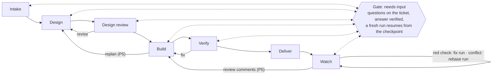
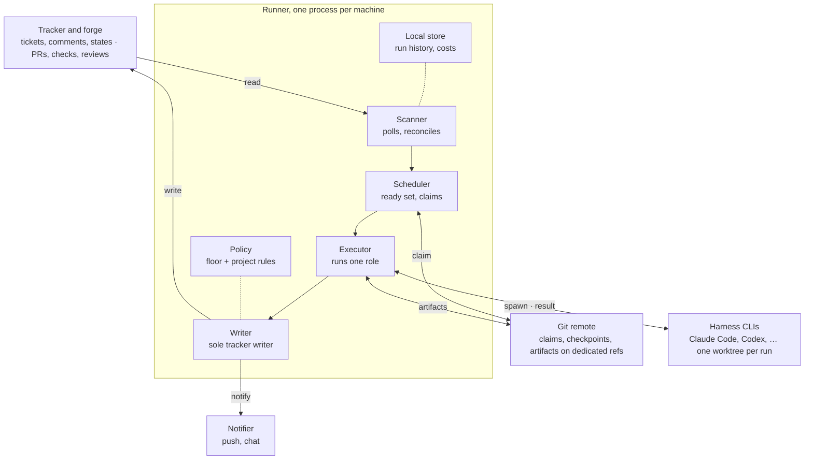

# Owlshift — design & architecture

Status: draft, 2026-09-27. Companion documents: [scenarios](scenarios.md), [runtime & operations](runtime-and-operations.md), [roadmap](roadmap.md), [build plan](build-plan.md), [visual identity](visual-identity.md).

Owlshift is an open-source runner that works a team's existing backlog continuously with coding agents, and brings a human in only where a decision is theirs, on the ticket, in the tracker they already use.

## 1. Purpose & positioning

The bottleneck of agentic development is no longer writing code, it is human attention: questions buried in terminals, work that waits because nobody noticed a blocker cleared, parallel agents colliding on the same files, sessions a person has to babysit.

**What it is.** A runner that:

1. pulls ready tickets in priority order, respecting dependencies and conflicts with all work in flight, human work included;
2. takes each ticket through a multi-stage pipeline (intake, design, review, build, verify, deliver, watch), each stage on the harness and model that fits it;
3. stops and asks on the ticket whenever a decision belongs to a human, checks that the answer actually answers, and resumes, as many rounds as needed;
4. delivers a verified pull request. Humans merge.

**What it is not.** Not an IDE, a chat or a new board: the team's tracker stays the interface. Not an auto-merger. Not a hosted service: it runs on a developer's machine or a team's server.

**Landscape, as of 2026-09-27.** Ticket-to-agent orchestration became a category in 2026. The two closest projects:

| Project | Shape | Human decisions mid-run | Blockers and conflicts | License |
| --- | --- | --- | --- | --- |
| [Symphony](https://github.com/openai/symphony) (OpenAI) | A [spec](https://raw.githubusercontent.com/openai/symphony/main/SPEC.md) plus an Elixir reference implementation, engineering preview; drives the Codex app-server; in-memory state | A run "MUST NOT stall" on user input: each implementation auto-fails, surfaces to an operator or auto-approves; the run ends in a handoff state such as Human Review | `blocked_by` is passed to the prompt, not enforced by the scheduler; no conflict avoidance | Apache-2.0 |
| [Sortie](https://github.com/sortie-ai/sortie) | Go single binary with SQLite; GitHub, GitLab, Gitea, Linear, Jira; Claude Code, Codex, Copilot, OpenCode, Kiro, Gemini; a `WORKFLOW.md` per project ([docs](https://docs.sortie-ai.com/)) | A handoff state at the end of the run; no documented question loop during it | Not documented beyond isolated workspaces | Apache-2.0 |

Parallel-agent workspaces such as [Vibe Kanban](https://vibekanban.com/) manage agents from their own board, supervised by a person: a different lane.

**Where this product differs: three bets.**

1. **The human decision loop is the product.** Questions are posted on the ticket at any stage (before code, during it, after the PR), answers are verified before anything resumes, and there is no limit on rounds.
2. **Scheduling is enforced, not advisory.** Blockers gate dispatch. Declared resources (code zones, migration chains, the one browser) keep two in-flight tickets from colliding, whether an agent or a person holds them.
3. **A ticket is a pipeline, not a session.** Plan before code, independent review by fresh runs on another model (of another family when one is configured), each stage routed to the harness and model that fits it, cost measured per ticket.

Owlshift is built from scratch rather than on top of Sortie (decision D1, section 12).

## 2. Design principles

Nine rules; every later choice in this document derives from one of them.

1. **The tracker is the human interface, git is the machine's memory.** No new board to adopt. Everything a person needs to see or answer lives on the ticket; everything the runner needs to resume lives in the repository.
2. **No LLM sits idle, and none orchestrates.** Scheduling, state and policy are deterministic code. A model is called only to run a role, for as long as that role takes. At rest the runner costs zero tokens.
3. **An agent that needs a human stops.** It leaves a checkpoint and a question, and a fresh run resumes from both once answered. Answers arrive hours later; keeping a context alive for them buys nothing.
4. **Ask as early as possible.** The dominant latency is the human's, so questions surface at intake, before a ticket can block anything.
5. **Silence is never consent; in doubt, ask again.** An unanswered or ambiguous reply never starts work.
6. **Nothing enters the work queue without a human gesture.** The runner only pulls tickets a person admitted; follow-ups it proposes wait in an inbox.
7. **Guardrails are enforced by the runner, not requested of the model.** Agents have no tracker write access and cannot merge, deploy or change state, by construction.
8. **Neutral by contract.** Tracker, forge, harness, model and stack are adapters behind capability contracts. A contract is frozen only after three implementations exist, one of them possibly on paper.
9. **Subscription first.** Owlshift drives the Claude and Codex CLIs on the user's own subscription: Codex through the login the user configured, Claude Code agent runs through a token of that subscription made with `claude setup-token` and stored by `owlshift init`, never the user's own Claude Code login. It never asks for, stores or passes a model API key, and the user's own Claude Code configuration does not reach an agent run: a Claude Code agent run is billed to the subscription through that token, and a Codex run on an API-key login is the one API-billed case expected ([runtime and operations](runtime-and-operations.md)).

## 3. Core model

Ten concepts, owned by the product and independent of any tracker, harness or stack.

| Concept | Definition | Lives in |
| --- | --- | --- |
| Ticket | A unit of work read from the tracker, admitted to the queue by a human gesture | Tracker |
| Pipeline | A declarative sequence of stages a ticket goes through; a project ships variants (`trivial`, `standard`, `risky`) | Project config |
| Stage | One step of a pipeline: a role to run, its entry condition, its exit contract, its gates | Project config |
| Role | What a stage executes: a prompt, required capabilities (browser, network), a permission level (read-only, write in worktree) | Product; a project adds rules to it or overrides it |
| Run | One execution of a role on one harness, in one worktree; returns a validated `result.json` and a measured cost | Runner, logged to git |
| Gate | A point where a human decision may be needed: clarification, arbitration or approval | Ticket (questions and answers) |
| Artifact | What a stage leaves for the next: plan, step ledger, review findings, delivery report | Git (dedicated refs) |
| Resource | Something two in-flight tickets cannot hold at once: a code zone, a migration chain, the browser, a port range | Declared at intake, held by claims |
| Policy | A non-configurable floor plus per-project rules: what may be decided without a human, budgets, caps | Product floor + project config |
| Adapter | The boundary to an outside system, declaring its capabilities: tracker, forge, harness, notifier, stack profile | Product (built-in) or plugin |

A project adopts the product with one committed file (the project config) plus one uncommitted file per developer (identity, installed harnesses, local caps).

## 4. Default pipeline & gates

A ticket moves through seven stages; four loop back, and six can stop at a gate where a human decides.

Dashed links mark the stages that stop for a human in the default pipeline: Intake (clarification, a false premise), Design (an open point, a false premise), Design review (plan approval, a finding two passes left), Build (an open point, the plan invalidated), Verify (a finding to arbitrate) and Watch (a prerequisite, a reversed decision). A human merges after Watch. Section 5, "The quality pipeline", sets the rules of Design, Design review and Verify (OWL-296).

| Stage | Does | Leaves behind |
| --- | --- | --- |
| Intake | Understands the ticket, checks its external premises live, declares resources, picks the variant and the routing | Routing record, resources, questions |
| Design | Writes the plan: approach, files, test strategy, risks, success criteria | Plan |
| Design review | Independent reviewers, on another model than the author's when the configuration names one; their number follows the variant (section 5, "The quality pipeline") | Findings, approval |
| Build | Implements step by step, one commit and one ledger entry per step; runs the checks that cover its change, while the runner runs the project's full gate (lint, formatter, tests) once on the commit it delivers (OWL-355) | Commits, ledger |
| Verify | Reviews the diff against the plan and criteria, on another model than the author's when the configuration names one, before the PR opens; the complete CI result is Watch's (OWL-296); browser QA when declared, from P6 | Findings; a bounded fix loop |
| Deliver | The runner opens the PR and posts the delivery report on the ticket | PR, report |
| Watch | Reacts to CI regressions and merge conflicts with fix and rebase runs of its own, which keep the ticket at Watch (section 5, "Watch after delivery"); human review comments on the PR loop back to Build from P5 | Fix runs, rebases, gates |

**Variants.** `trivial` skips Design and Design review and uses one reviewer. `standard` is the diagram. `risky` adds reviewers and makes human plan approval mandatory. Intake picks the variant; a label on the ticket forces one. The roster of each is in section 5, "The quality pipeline" (OWL-296).

**Gate policy.**

- **Resolver first.** Every question a role raises goes through a resolver run, except those the runner sends straight to the decider (below). What is discoverable (the ticket, the repository, the docs, a verifiable fact) is decided and logged on the ticket as a reversible decision; the rest goes to a human. Decided on 2026-10-03 (OWL-138): the runner routes each question by its category, so an always-human one never reaches the resolver; the resolver is a read-only run without network at the standard tier (section 9), so a verifiable fact is one it can check offline; each decision is a DECISION comment, kept in the ticket ref, from which alone a later run reads it, and the decider's word overrides it. When every question of a run is decided, the stage runs again without a stop, at most `policy.resolver_passes` runs in a row in one command (5 by default since OWL-328, below; 3 before) before the questions go to the decider. Until a fallback harness exists (P6), a resolver that cannot give its result sends every question to the decider ([build plan](build-plan.md), "The resolver"). Decided on 2026-10-04 (OWL-144): a question the asking run files under the wrong category still reaches the resolver, so the resolver labels each question it decides with a category of its own, read from the question's text and context without seeing the asking run's, and the runner logs the decision only when neither label is always-human and the resolver's is a well-formed token; otherwise the question goes to the decider. The runner draws that consequence; recognising the topic stays a model's judgment, and what remains is plain: a floor-topic question both runs label as something else is still decided, reversible like any decision and listed in the delivery report; a project's own always-human categories are told to both runs since OWL-151 (decided 2026-10-04), in the brief's `always_human`, so each labels with them, but recognising a topic stays a model's judgment and a question on one both runs label otherwise is still decided; decisions kept before this check stay as they were. Decided on 2026-10-07 (OWL-176): the Build run takes no decision of its own. A choice of what the work delivers (its content, behaviour, interface or wording) that nothing above plainly settles, and every point the ticket leaves open, is a question, so the resolver decides what is discoverable and the floor applies; the runner refuses a Build result that lists `decisions` ([build plan](build-plan.md), "Build takes no decision of its own"). Decided on 2026-10-07 (OWL-186): the Build run told of that refusal may not end `done`, so it asks the refused choices or stops ([build plan](build-plan.md), "A retry after refused decisions asks"). Decided on 2026-10-08 (OWL-192): that hold and the refusal's reason are kept in the ticket ref until a Build run asks, so a park, a usage limit or a later command never drops them ([build plan](build-plan.md), "A Build refusal kept across commands"). Decided on 2026-10-11 (OWL-222): a question the asking run names as reopening a choice the runner refused (`refused_choices_asked`, OWL-193) goes to the decider and never to the resolver, whatever its category, so a choice refused for being taken without a human is never settled without one; the routing stays per question, so the run's other questions go through the resolver as before ([build plan](build-plan.md), "A retry asks every refused choice"). The cost is a question for the decider when the thread, a rule or the repository settles the choice since, which the run's `context` names. Rejected: the resolver deciding such a question, reversibly, as before, which is the settling the refusal stopped, by another model; and the resolver running on it with its decision refused, a run whose only outcome is the decider's question. The runner sees only what a run reports: a choice a run makes without recording or asking it stays unseen. Decided on 2026-10-11 (OWL-146): the decider reverses a decision by replying to its DECISION comment. Before delivery, the next run follows the reply over the decision, and a reply to the resolver's plan approval or to its decision on a residue finding returns the ticket to the stage that follows it (OWL-345, below); after it, watch starts a correction run on the pull request (section 5, "A reversed decision"). Decided on 2026-10-15 (OWL-296): three more questions go to the decider without the resolver, a finding two review passes left at Design review or Verify, the plan-approval question, and a `replan` question on an approved plan (section 5, "The quality pipeline"); the question of a false premise already does, since only the decider can re-scope or close a ticket. Superseded on 2026-10-18 (OWL-342, "Every question through the resolver" below): those questions, the one reopening a refused choice (OWL-222) and every other a role raises reach the resolver, which decides itself what it answers and what it passes on.
- **Always human.** Security, data loss, money, legal wording, irreversible external actions and scope changes, by default. Security and irreversible external actions are part of the floor: they reach a human at every delegation level. The other four go to a human unless the project's delegation level hands them to the resolver (below). A project may add categories (`policy.always_human`), which stay human at every level.
- **Delegation level.** Decided with the maintainer on 2026-10-17 (OWL-328), after LOC-1407's first question, filed `scope`, reached the decider though the ticket's text settled it. `policy.resolver_delegation` sets what the resolver may decide, from nothing to everything but the floor:

  | Level | The resolver decides | Always to the decider |
  | --- | --- | --- |
  | `none` | nothing: no resolver run | every question |
  | `facts` | what it observes offline in the worktree: a file, an existing pattern, a documented behaviour | the rest |
  | `discoverable` (default) | facts, and what the ticket, the decider's comments, earlier decisions and the project's rules settle | data loss, money, legal, scope, the floor |
  | `ticket` | the same, and a `scope` question the ticket's own text answers, quoted | data loss, money, legal, the floor |
  | `all` | everything but the floor, on its own judgment where nothing settles a question (OWL-342) | security, irreversible |

  The project's added categories go to the decider at every level; since OWL-342 a question reopening a refused choice and a blank category reach the resolver (below). The runner enforces the level, never the resolver's prompt alone: each decision names the kind of its basis (`fact`, `settled`, `ticket` or, at `all` only, `judgment`), a basis above the level is refused, and a `ticket` basis must quote text the runner finds in the ticket's title or description or a comment of its decider. Both labels of a decided question (OWL-144) are held to the level's always-human set. The level shows wherever a decision does: `owlshift doctor` names it, and each DECISION comment and delivery report says which level allowed it.
- **Resolver passes.** `policy.resolver_passes` bounds the runs in a row a resolver unblocks in one command: a whole number from 1 to 50, 5 by default, or `"unlimited"`. An unlimited chain is bounded by money instead: `"unlimited"` requires `policy.resolver_budget_usd`, a dollar ceiling on the runs of one chain (the asking runs and their resolver runs since the command's last stop), past which the next run's questions go to the decider. A run whose cost is not reported ends the chain, since the ceiling could not be checked. The ceiling may also be set with a number of passes; whichever is reached first ends the chain. Rejected: no bound but the failed-run limit, which a chain of successful runs never reaches; a high fixed ceiling of runs, which says nothing of what a run costs.
- **Every question through the resolver.** Decided with the maintainer on 2026-10-18 (OWL-342). With `all` and unlimited passes on Locary and Owlshift, the decider still answered seven rounds on LOC-1406, three on OWL-330 and two on OWL-339 overnight: half the rounds never reached the resolver (the bypasses of OWL-222, OWL-139, OWL-296, OWL-306 and the fix and rebase runs'), and the resolver passed on every question it was given, five runs deciding nothing, since even at `all` it needed a written basis and a trade-off has none; read-only, it could not run Bash either, so not even `grep`. The rule now: at every level but `none`, every question every role raises reaches a resolver run, and the resolver decides, question by question, what it answers and what it passes on. That includes Intake's and Design's, a finding two review passes left at Design review or Verify, the plan-approval question, a `replan` on an approved plan, a `premise_false` result's question, a question reopening a refused choice, the run's after late comments, fix, rebase and correction runs' (section 5, "Watch after delivery"), and a question with a blank category, which the resolver's own label then routes (OWL-144). The level still bounds what it may decide (above), and the runner enforces it:
  - *Still the decider's.* A question the asking run files under the floor (`security`, `irreversible`) or a category of `policy.always_human` goes to the decider without a run, since no decision on it could be logged; a resolver label on either refuses the decision, as since OWL-144. Under `pipeline.plan_approval = "always"`, which `risky` forces, the plan-approval question is the decider's: the setting names a human. A `premise_false` question's closure is the decider's act in the tracker, so the resolver decides only the re-scope, a `scope` decision under its level's rule, or passes on. The runner's own question after a second late comment (section 4, "No premature resume") stays the decider's: it is the runner stopping, not a role asking.
  - *The `judgment` basis.* At `all`, a fourth kind: a decision resting on the resolver's own weighing when nothing settles the question, a trade-off, a priority, an intent the ticket does not state. It names the option chosen, the reasons, the cost of the choice, and what in the thread, the earlier answers and the rules makes it the one the decider would likely take; the asking run's recommendation may be followed, never as the reason on its own. Below `all` it is refused, as any kind above the level. The resolver still passes on what it cannot weigh: an option that goes against an earlier answer of the decider, a prerequisite only a person can supply (a secret, an account, infrastructure), a check that needs the network. A judgment decision is reversible like any (OWL-146); its DECISION comment says it rests on judgment on its visible line, and the delivery report lists such decisions first, so the decider sees which ones to read.
  - *Plan approval.* At `all`, under `on-fork`, the resolver approves the plan or picks one of a fork's other options. An approval keeps its DECISION comment and the plan's hash in `plan.json`, where the decider's keeps their comment, and the core's hold on the plan's hash is unchanged (OWL-32); a change returns to Design, as the decider's would, and so does the decider's reply reversing it (OWL-345: the kept approval is dropped before Design runs; section 5, "A reversed decision").
  - *A review finding.* A `blocker` or `major` finding still confirmed after the second pass reaches the resolver with the arbiter's ruling and the plan or diff it is about. The resolver may have its fix applied, take another option or drop it, on any basis its level allows; the next Design or Build run follows the decision, and the decider's reply reversing it returns the ticket to that stage before delivery (OWL-345; section 5, "A reversed decision").
  - *What the resolver is given.* At `all`, the deep tier and the ticket's effort, since judgment is the hardest call a run makes; below, the standard tier (section 9). A 30-minute deadline. Bash, inside the read-only confinement and without network, so that it reads the code and its history as Build does (`git log`, `git blame`, `grep`), which a live check settles before code depends on it ([build plan](build-plan.md), "The resolver"). Beside its questions, the asking run's own output: its summary, its draft plan, the findings and the arbiter's rulings, and the branch's diff from its base.
  - *Cost.* A resolver run on each round that had none, on the deep tier at `all`; `policy.resolver_passes` and `policy.resolver_budget_usd` bound the chain as before, and a round reaching the decider says how many questions were decided.
  - Rejected: a separate level for judgment, since `all` is the level a maintainer sets to delegate everything they can; keeping the bypasses as an option, which leaves the knob the maintainer turned without effect; the resolver deciding the floor or a project's added categories, which the maintainer kept human; the resolver closing a ticket on a false premise, an act in the tracker.
- **Plan approval** is set per project: `always`, `on-fork` (only when the design has a real fork) or `never`; the `risky` variant forces `always`.
- **Who decides.** One person, the ticket's decider: only their answers unblock the ticket; other people's comments are context. Decided on 2026-10-02 (OWL-33), reading "the assignee by default" literally: the decider is the ticket's assignee whenever it has one. A ticket without an assignee falls back on the owners the project names for its code zones (`[zones]` in the project file, [runtime & operations](runtime-and-operations.md#configuration)). Each zone the ticket declared belongs to the owner of the deepest owned zone that contains it; a declared zone no owned zone contains has no owner, even when owned zones lie inside it, so a ticket declaring `backend` while `backend/billing` has an owner touches no owned zone, and declaring the narrower zones is the fix. Zones without an owner are left out: when the owned zones the ticket touches all belong to one person, that person decides; when they belong to several, or the ticket touches no owned zone, the ticket has no decider, and the runner says why instead of picking one. The decider is resolved when a question is asked, from the assignee and the zones declared then, and stays the decider of that ask; owners are read from the project file at the base commit, never from a run's worktree, so a run cannot choose who instructs it. Rejected: the zone owner before the assignee, which would change a ticket's decider once intake declares its zones and keep the person who delegated it from unblocking it; and several deciders on one ticket, which would leave the answer check without a single last word.
- **Answer check.** Questions are numbered, their options lettered, and each carries a recommendation, so the decider may answer `Q1: B`, a bare letter when one question is asked, or `ok` for every recommendation (decided on 2026-10-16, OWL-324; [build plan](build-plan.md), "The QUESTIONS layout"). Before any resume, a small run classifies each one: answered, partial, unanswered, or a counter-question. The runner then resumes, re-asks only what is missing, or replies in the thread. Each check has exactly one of these outcomes, by precedence (decided on 2026-10-01, OWL-114): a counter-question on any question gets the reply and nothing else, so nothing is re-asked and the round does not count toward the re-ask limit, and the next check, after the decider's next reply, classifies every question of the same ask again; otherwise any partial or unanswered question is re-asked, or the ticket parks once the re-ask limit is reached; only when every question is answered does the ticket resume. The answer check writes the reply (decided on 2026-10-02, OWL-115): the run that recognises the counter-question already holds what answers it, the question's context, options and recommendation, the decider's comments and the ticket, so each `counter_question` verdict carries its own reply, and the runner posts it as written, flattened to one line like every text a model writes. Rejected: the resolver, which would add a run per counter-question and a repository-wide context to explain a question already asked, and whose job is to decide, not to talk with the decider; and a reply the runner composes itself, which cannot say what an option means. The reply rests on the brief alone, so it cannot carry repository content the brief does not; when the brief does not hold the answer, the reply says so.
- **No premature resume.** The runner waits for a quiet window after the decider's last edit (10 minutes by default, `policy.quiet_window_minutes` in `owlshift.toml` sets it per project, from 1 to 1440) unless the reply ends with `go`, and re-reads the thread before delivery for late comments. Decided on 2026-10-03 (OWL-127): the window holds whoever notices the answer, a person typing `owlshift continue TICKET` as much as `watch`, since the person typing it is often not the decider and an answer checked before it is finished can spend a re-ask. The reply is the decider's comment with the newest last edit, and it ends with `go` when its last word is `go` in any case, punctuation trimmed. Rejected: a typed command skipping the window, and a flag to override it, which would let the operator overrule a decider still writing. Decided on 2026-10-04 (OWL-139): for a ticket whose ticket ref keeps an ask, the runner re-reads the comments once a Build run is done and its gate passed, before the push; a late comment is the decider's (the decider of the latest ask) whose last edit is newer than the newest one that run's brief held, so a comment posted between the answer check and the Build start is not late, since the Build read it as an instruction. A late comment gets one more Build run, its thread holding the comment, and that run judges it against the work in front of it: `done` integrates it and delivers, recorded as a decision in the delivery report; questions send the ticket back to needs-input, straight to the decider without the resolver, in a round that names the late comments. A comment the run can follow is integrated, even one that reverses an earlier answer, since the decider's latest word is the instruction; "contradicts the work" means the run cannot integrate it without the decider. One such run per delivery: a further late comment after it opens a round of one always-human question naming them, and nothing is pushed. Rejected: the answer check, whose classes say whether a question of the latest ask is settled and which reads the brief alone, never the work; and a dedicated classification role, which needs a role, a result shape and a contract format of its own, judges the work without it, and still needs the Build run to integrate. The build role is told so (`roles/build.md`, "Resuming"): a decider comment newer than the runner's latest RESUME comment is integrated, steps added or revised even when every step is done, or asked about when the run cannot follow it without the decider; the decision in the delivery report still shows the reviewer that late comments were given to a run. A ticket without a question round is delivered without a re-read.
- **Pull request reviews are an input channel.** A human review comment sends the ticket back to Build or opens a gate, like a ticket comment.
- **A parked ticket shows it.** Decided on 2026-10-04 (OWL-148): when the runner parks a ticket, the PARKED comment is followed by a move of its visible stage to the state the project maps under `[tracker].states.parked`, an optional key; a project that names none shows a parked ticket as needs input, and the PARKED comment says why. So the stage alone does not say that questions are open: the comments and the ticket ref do, and nothing reads the stage back. A restart moves the stage to what the ticket then waits for: needs input when it was parked while questions waited, working when Build runs again. Rejected: a required key, which would break every existing project file and ask every tracker for a workflow state of its own; and needs input alone, which leaves a parked ticket indistinguishable from one waiting for an answer.

## 5. Architecture overview

One deterministic runner per machine serves every adopted project; models only ever run inside a harness, one role at a time. Agents never touch the tracker: the runner is its only writer.

One event, end to end:

1. **Scanner** polls the tracker and the forge (webhooks are an optional speed-up, never required) and turns changes into events: ticket admitted, answer posted, PR merged, check failed.
2. **Scheduler** computes the ready set (admission, blockers, resources, caps, budget) and claims a ticket with an atomic push of a git ref, so two machines never take the same ticket.
3. **Executor** creates the worktree, writes the brief, launches the harness CLI for one role, then validates `result.json` against its schema and checks isolation (main checkout untouched, diff inside the worktree, right branch). An exit code is never taken as proof.
4. **Writer** applies the result: comments, state transitions, follow-up proposals, the PR. It is the only component with write access to the tracker and forge, and it asks **Policy** before each write.
5. Artifacts and the checkpoint go to the git remote; cost and run history go to the **Local store** (SQLite); the **Notifier** fires only when a human has become the blocker.

**The brief's thread** (OWL-357, decided 2026-10-19). A brief carries the ticket ref's record once: the plan in `plan`, each ask as its round's entry, each decision of the resolver as a decision entry. Owlshift's own comments that only repeat it read in the thread as their header line, their time and their comment id: PLAN, RESUME and DELIVERY. What the record does not carry, a PARKED or INTAKE comment and an ask or a decision it no longer keeps, is cut to 4 KiB, and a REPLY stays whole, since the decider's next answer is read against it. A person's comment is always whole. A comment counts as Owlshift's when it is marked from its header to its footer and was never edited, Owlshift editing none; a person who posts a whole copy of one has it read short as well ([build plan](build-plan.md), "The brief's thread"). What is settled reads short too (OWL-359, decided 2026-10-19): a round the decider answered, every question's latest verdict `answered`, is one `answered` entry giving each question's text and what the answer check understood of the answer, its options being on the ticket; a decision's question is its id and text, the decision saying what was chosen, unless the decider replied to it. The ask an answer check judges is always whole.

**Deployment.** One runner process per machine serves several projects, with machine-wide caps (concurrent runs, the single browser slot, port ranges). A local API serves the CLI, the local web UI (P8) and the desktop app (P11). The same binary runs on a team server; since shared state lives in the tracker and git, moving from a laptop to a server needs no migration.

**Folded when superseded** (OWL-353, decided 2026-10-19). A ticket that goes through several rounds kept every PLAN, QUESTIONS and RESUME comment expanded: on the 2026-10-18 drain, OWL-160 had 13 comments and OWL-336 had 14, most of them out of date. On a tracker that can resolve a comment (section 6), when the runner posts a comment that supersedes one of its own, it resolves the older one, which the tracker then shows folded: a PLAN is folded by a later PLAN, whole or the pointer to the plan's document, or by a DELIVERY; a QUESTIONS or RE-ASK comment of a round by the RESUME of that round or the QUESTIONS of another round; a RESUME by the QUESTIONS or the RESUME of another round. So only the latest round and the live PLAN stay expanded. A DECISION is never folded, since a threaded reply to it reverses it; nor a REPLY, an INTAKE, a PARKED or a DELIVERY comment, nor a person's comment: a comment counts as Owlshift's by the rule of "The brief's thread" above, for this ticket, and only a top-level one, since Linear resolves no reply. The comments to fold are read from the thread, as the ticket ref keeps no id of a PLAN or a RESUME and its format does not change. A comment that a comment posted in between already folds is left, so each is resolved once, and a person who unfolds one keeps it open; one whose fold failed stays expanded. A fold that fails is a warning, never a stop, and a folded comment is still read as before: every run, check and report reads it as it did. A tracker without the capability, the Markdown tracker among them, folds nothing.

**Watch mode, before the runner process.** Decided on 2026-10-04 (OWL-152): `owlshift watch`, roadmap P3, is a loop in the foreground of a terminal that does what a person typing `owlshift continue` does once the decider has answered, for one project, the repository of the current directory, whose configuration and secrets it reads once at start.

- **Which tickets.** Those whose ticket ref, in the project's dedicated checkout, keeps a state waiting for the decider's answers and not parked; and, since OWL-208, those at Watch whose delivered pull request Owlshift still follows ("Watch after delivery", below). The ticket refs are the one list of the tickets Owlshift asked questions on or delivered, and a ticket without one has nothing to answer or follow. A parked ticket stays parked until a person types `continue`, even once its decider has answered: the restart is the person's gesture ([build plan](build-plan.md), OWL-122), a deliberate reading of the roadmap's "without typing `continue`". Since OWL-243, a park at Watch also ends when its pull request is merged, closed or pushed to by someone else, which restarts nothing ("A park the pull request outlives", below): only a person's `continue` restarts a run. A ticket left at Build, by a usage limit, a failed delivery or a refused push, before any question round (round 0) also waits for `continue`: resuming it once the harness's limit resets is P6's pause until reset. Since OWL-273, a ticket an answered intake round left at Intake, its second intake cut off, is an exception: watch resumes it while it shows needs input ("Intake", below). Since OWL-340, so is a ticket left at Design, Design review, Build or Verify with an answered round (round > 0), as the next paragraph says. These restarts stay the person's: P3's exit gate, reworded on 2026-10-10 (OWL-208, [roadmap](roadmap.md) P3), records each with its reason instead of failing on it. Rejected: reading the event log, which is append-only and does not say whether a ticket still waits, and naming the tickets on the command line, which would miss a round a `do` opens meanwhile in another terminal.
  - *A stage left after an answered round.* Decided on 2026-10-18 (OWL-340). Seen live on 2026-10-17 on pitchopp/locary, ticket LOC-1406: the answer check passed, `continue`'s path posted the RESUME, kept the ticket at Design in round 3 and showed it In Progress, and then the dispatch's first forge read (the open pull request of the branch) was answered with a transient HTTP 401, so no run started. Watch listed no such ref (it takes waiting refs only), the answer check had no comment newer than `checked_through` to read, and the hold was lifted because the ref had moved; a refusal notifies no one ([runtime and operations](runtime-and-operations.md), "Notifications"), so the ticket stayed In Progress with nothing running and nothing retrying until a typed `continue`. Anything else `dispatch` or the run refuses before it starts leaves the ticket the same way. Watch now resumes a ticket whose ref is at Design, Design review, Build or Verify with an answered round (round > 0) while the tracker, read again under the project's lock, still shows it working, through `continue`'s own path (`OnDemand::continue_shown`), held as any continue is: ten minutes after a resume that left the ref as it was, until the reset of a usage limit, until a person acts on a state not kept. The rule is OWL-273's, widened: the ref's stage and round tell the case, with no marker. From such a ref `continue` runs no answer check and posts no RESUME, since it checks answers only from a waiting ref, so a forge that keeps refusing costs neither at any pass, only the retry every ten minutes. The stage is read without the lock first, and a ticket shown in another stage (moved by a person, or in the ready column) is left alone and its stage not read again for ten minutes unless its ref moves. While another command holds the project's lock (a run in flight, whose ticket shows working too), a pass ends at its snapshot with the busy line before it reads any ticket: no stage read, no resume, no hold and no comment, and the first pass after the lock is released resumes the ticket, with no ten-minute wait. A ticket a review loop (OWL-307) left at Build or Verify, a followed delivery whose ticket is at those stages, is resumed the same way once its pull request, read for an end, has not ended the loop; `continue` reads it again first under the lock, and an end it finds moves the ref, so no hold is set. The bound is the stage's: a resumed run that returns `failed` moves the ref and is retried at the next pass until two failed runs park the ticket, which only a person's `continue` restarts, while a refusal that leaves the ref as it was and a usage limit count nothing. This also resumes, ahead of P6's pause until reset (OWL-160), a Build with an answered round that a usage limit, a failed delivery or a refused push left, once the limit's reset has passed. A ticket at those stages at round 0 is not taken, a review loop's Build left before its question round included: it still needs `owlshift continue`, since taking it would take the drain's tickets (scenario S6 holds the slot at round 0 until a person types `continue`); a Build left at round 0 is not resumed by this rule. Accepted residuals: a restarted watch forgets a usage limit's reset, so its first pass resumes a limited Build once, which meets the limit again and pauses; and a ticket whose move to working failed after the RESUME (a `stage_not_moved` warning) shows needs input with the ref at Design, which the rule leaves alone. Rejected: `continue` making the dispatch's reads (the forge read, `configuring_base`, `rules_at`) before the answer check, which cannot cover a refusal only `drive` raises and reorders `dispatch` and `check_answers` for a case the resume already covers, and both together, for the same reason (either can follow in its own ticket); a marker in the ticket ref saying a refusal left the ticket, the format change OWL-273 rejected for what the visible stage and the round already say; a retry of a 401 in the GitHub adapter before it reports `Unauthorized`, which would have hidden this instance but not the gap and changes how many calls a revoked token makes, so a ticket of its own; and counting each resume as a failed run, which would park a ticket on a usage limit.
- **The drain.** Since OWL-244, `owlshift watch --drain` also reads the ready column at each pass and takes admitted tickets in, intake first and one Build at a time ("The drain", below).
- **Poll interval.** 60 seconds after the end of each pass; a pass works the tickets one at a time, so while one ticket's answer check and Build run, the others wait. An answer that counts is otherwise picked up within a minute, at about one comments request per waiting ticket per pass, and since OWL-265 one stage request per ticket at Watch whose delivery is followed ("The stage while a repair runs", below), against Linear's 2,500 requests an hour (check C4). Rejected for now: an interval of the project's or the operator's choosing, and waking at the very time a reply counts, which saves less than a minute.
- **The same resume.** Whether the decider's reply counts is decided by the function `continue` uses: an answer newer than the latest ask, left unedited for the project's quiet window by this machine's clock or ending with `go` (section 4). When it counts, a `decision` event records that watch continues the ticket, and the ticket goes through `continue`'s own path: answer check, RESUME, RE-ASK or REPLY, Build, delivery, park. Its outcome is printed, and notifies the operator, as `continue`'s is.
- **The project lock.** Watch takes the lock `do` and `continue` take for short moments only: a snapshot, which checks the marker of a run whose isolation check did not pass and reads the ticket refs, and each continue; since OWL-265, also the move of a stage a stop left at working ("The stage while a repair runs", below). It reads the tracker and sleeps without it, so a command typed by hand meanwhile runs; one typed while watch continues a ticket is told the project is busy, and a pass that finds the project busy is skipped. A quarantined project is reported once and nothing in it is continued until a person clears it. A continue runs only if the ticket ref, read again under the lock, is still the one the snapshot read, so a ticket that a command typed meanwhile parked or resumed is never restarted or built by watch.
- **Errors.** A ticket ref or a ticket's comments that cannot be read is a `warning` event, once until a read succeeds again, and the pass goes on to the next ticket; a snapshot that fails is printed. Nothing ends the loop but the operator. A continue that leaves the ticket ref as it was, such as one refused, or whose RESUME the tracker refused after the answer check ran, is not tried again for 10 minutes, unless the decider edits a comment or the ref moves meanwhile; so a tracker refusing writes costs at most one answer check per ticket every 10 minutes. A refusal that comes after the RESUME was kept leaves the ref at the stage it runs, which watch resumes with an answered round (round > 0), held the same way and with no answer check (OWL-340, "Which tickets"); a Build left at round 0 still needs `owlshift continue`. A usage limit with a reset time holds every continue until then. A ticket whose answer check failed is tried again at the next pass, since the failure is kept, as typing `continue` again would, and a second failure parks it, save a refused result the check was not told of, which never spends the last attempt (OWL-190, [build plan](build-plan.md), "A refused answer check at the last attempt").
- **A comment whose state is not kept.** Decided on 2026-10-04 (OWL-158): a continue that posted a RE-ASK, a REPLY or a PARKED comment and then failed to keep the ticket's state in its ref (`Stop::NotKept`, OWL-149) is held until a person acts, with no end time, instead of for 10 minutes: retried, it would run the answer check again and post the same comment again, every 10 minutes for as long as the ref stays unwritable. Since OWL-159, a park whose PARKED comment could not be posted either is such a stop too, held the same way: retried, it would run the answer check and park again, notifying the operator each time. The comment asks a person to act, and that act lifts the hold: the decider editing a comment (answering the re-ask, replying to the REPLY), or a command typed by hand that moves the ticket ref. A ref that cannot be read after the continue, or at a later pass, keeps the hold, since it is no reason to post again; one read moved lifts it. Watch prints one line when it sets the hold, and the operator was already notified by the stop. Accepted residuals, each one more post at most: any comment of the decider, a "thanks" too, lifts the hold; an answer posted between watch's read of the comments and the answer check's is held against the older answer, so the next pass checks it again; a person typing `continue` on a ticket whose PARKED comment was not kept runs the check again, since the ref still says it waits for answers, and may park it again; a person typing `continue` on a ticket whose RESUME was not kept runs the check again and posts the RESUME again before Build resumes; and restarting watch forgets every hold. Since OWL-169 (decided 2026-10-10), a RESUME whose state was not kept is such a stop too (`Landed::Resume`), held the same way and lifted by the same acts: retried, it would run the answer check and post the RESUME again every 10 minutes, since the ref still says the ticket waits for answers. It asks the decider nothing, but Build did not resume and nothing resumes it but a person, the operator typing `continue` once the ref can be written, so it notifies the operator ([runtime and operations](runtime-and-operations.md), "Notifications"), which OWL-149 had not done for it. Watch's hold line for it names that `owlshift continue` (OWL-214), where the line for the other kinds waits on the decider. A RESUME the tracker refused stays a refusal under the 10-minute retry, since nothing reached the ticket. QUESTIONS under watch come only after a RESUME whose state was kept, so the ref has moved and the ticket is at Build: watch resumes it with an answered round (round > 0), as "Which tickets" says since OWL-340, and a Build left at round 0 still needs a person's `continue`. Rejected for OWL-169: watch telling a not-kept RESUME apart from a refusal by its message, a second path beside `Stop::NotKept` that reads text; and a finite hold, such as an hour, which still posts the RESUME again at each end. Rejected: finding the already-posted comment before posting, since the comment comes out of an answer check run again at each retry, at an agent run's cost, whose verdict may differ (a second check may resume Build while a re-ask waits on the ticket), and since telling a posted comment from a new one means rebuilding the ask from the ticket's comments rather than from its ref; and stopping watch for the ticket for good, which leaves it stuck once the decider answers.
- **How it stops.** Ctrl-C, like closing the terminal or SIGTERM, ends it through the policy every command shares ([runtime and operations](runtime-and-operations.md)): between passes nothing runs; during an agent run, the run is stopped and the project is refused until a person looks, as when `continue` is stopped. Ending after the current run is left to the background service's `stop` (P7).

**Watch after delivery.** Decided on 2026-10-10 (OWL-208): from P3, watch also follows each pull request Owlshift delivered until a person merges or closes it, and repairs it with runs of its own, a fix run on a red check and a rebase run on a conflict (scenario S9, roadmap P3). Since OWL-146, a correction run also follows the decider's replies to a DECISION comment ("A reversed decision", below). The ticket stays at Watch while they run, shown as working from their start and as review again once they end (OWL-259, "The stage while a repair runs", below), and their questions return to Watch. Watch loops back to Build only for human review comments, from P5. The forge was checked live that day wherever this session could reach it, by read-only REST calls ([build plan](build-plan.md), "The GitHub forge adapter"). The three checks it could not run are written below as pending, each the first step of the ticket whose code depends on it.

- **Which pull requests.**
  - *The list.* Every delivery keeps a `delivery.json` in the ticket's ref beside `state.json`. A ticket with no ref yet gets one, holding a `questions.json` with no ask; this is one more exception to "makes no ticket ref until a round opens". `delivery.json` holds:
    - the pull request (number and link), the branch and the base branch;
    - `pushed`, the commit Owlshift last pushed there;
    - `base_at_push`, the base branch's head at that push;
    - `rebased_onto`, the base commit the last rebase run whose push landed rebased onto (OWL-210);
    - `pushing` while a push is under way;
    - `ended` once watch stops following, with why and when.

    The core state moves to Watch at delivery. Watch already lists the ticket refs, so a pull request a `do` delivered in another terminal is followed from the next pass.
  - *Owlshift's own pushes.* Before each push the ref keeps `pushing`, the commit and its kind (delivery, fix, rebase or, since OWL-146, correction). Once the forge shows that commit as the head, it becomes `pushed`. A head equal to `pushing` is Owlshift's push whose bookkeeping a crash, a Ctrl-C or a failed ref write cut short: the next pass adopts it as if the run had ended there. Since OWL-218 (2026-10-11), a fix or rebase run's `pushing` also keeps what its DELIVERY report says (`report`: the summary, the gate's commands, the checks a fix answered, the follow-ups), and a landed or adopted fix or rebase push leaves its report `owed` until a pass posts it; `delivery.json` went to format 2 for both, and a format-1 one is still read without them. Since OWL-146 a correction run's push does the same, its report naming the questions of the decisions it follows the replies to; `delivery.json` went to format 3 for it, and formats 1 and 2 are still read without one. Since OWL-236 (2026-10-12) the first delivery's report and a correction's that pushed nothing are owed too ("The owed report"); `delivery.json` went to format 4 for them, formats 1 to 3 are still read without them, and an older binary refuses a format-4 ref by its format.
    - *As built (OWL-209, 2026-10-11).* `pushing` also keeps `base`, the base head read just before the push (`git ls-remote`), which becomes `base_at_push` once the push is adopted; when that read fails, the base the Build was dispatched on stands in, with a `warning`. A delivery's `pushing` is written with the state already kept (Verify, Build having completed); the write after the head is read back keeps the pull request, `pushed`, `base_at_push` and Watch in one commit. A delivery cut short between the two has no pull request in its ref yet, so watch cannot follow or adopt it: `owlshift do` finishes it, finding the open pull request and pushing nothing new. Watch adopts the `pushing` head of a delivery that already has its pull request, which fix and rebase pushes (OWL-112, OWL-210) are.
  - *Leases.* Every push to a followed branch carries `--force-with-lease=refs/heads/<branch>:<pushed>`. A branch a person pushed to or deleted is therefore never overwritten or recreated. A fix run's commits descend from `pushed`, so its push stays a fast-forward. Only a rebase run's push replaces history, which section 8's floor bounds.
  - *Older deliveries.* Pull requests delivered before this change are not followed. None was open on 2026-10-10 when this was checked.
  - *When one leaves.* Watch stops following, recording why in `ended` and as one event, keeping the ref, when:
    - the pull request is merged (core `Merged`);
    - it is closed unmerged (`Withdrawn`);
    - its head is neither `pushed` nor `pushing`. A person pushed (the maintainer fixed [#89](https://github.com/pitchopp/owlshift/pull/89) by hand), and watch never pushes over their commits. The delivery already waits until the forge shows the pushed commit as the head (OWL-20), so another head is someone else's.

    A round waiting at Watch ends with the following and the ticket comes back to Watch ("Back to the decider", "A round the pull request outlives"), and so does a park at Watch (OWL-243, "A park the pull request outlives"). The ref is written first, then the event: a crash between the two loses the event, never the end. `owlshift forget` drops `delivery.json` with the rest of the record (OWL-209): the ticket starts over at Ready, nothing is followed, and `do` is no longer refused.
  - *A ticket a person moved.* Before any run the ticket is read, and its stage must be one the project maps for working, needs input, review or parked. A ticket a person moved elsewhere (done, canceled, back to the backlog) gets no run while it stays there, and is followed again once it is back. This is the one place the runner reads the stage back before it acts (section 4, OWL-148); it also reads it before the moves that close a round or end a park the pull request outlived (OWL-242, OWL-243) and before moving a repair's working back to review (OWL-259).
    - *Recorded once (OWL-219).* The `stage_moved` decision event is recorded when the stage read differs from the one last recorded for the ticket, not at each repair attempt: a ticket left in a foreign stage records one event however many passes find it there, and moving it elsewhere records another. Watch keeps the stage in memory (`Following`, beside the other "once per kind" records), forgets it when the ticket is read in a stage Owlshift works in at a repair, and when it stops being followed. Residuals, by design: a restart of watch records the event again for each ticket still there; `owlshift continue`, a single explicit attempt with a memory of its own, always records it; the stage is read only when a repair is decided, so a ticket moved back and out again between two repairs records once; the correction of a reversed decision reads the stage too but records nothing.
  - *`do` and `continue`.* `owlshift do` refuses a ticket whose ref follows an open pull request, naming it. `owlshift continue` on a ticket at Watch does what watch does for that ticket once: after its answers, or after restarting it when parked. It prints what the read found and decided and exits 0, with no notification; a separate command shares none of watch's memory, so it reads the forge even while a running watch holds its reads for a rate limit.
- **Polling and the forge's budget.**
  - *The pass.* Followed pull requests share the pass, the 60-second interval and the project lock with the tickets whose questions wait. Forge reads are made without the lock. A run takes the lock as a continue does, and starts only if, read again under it after the fetch, the ticket ref is the one the snapshot read, the pull request is still open, and its head is still `pushed` or `pushing`.
  - *Pausing.* Watch runs keep the continues' rules: a busy project skips them, a quarantined one runs none, and a usage limit with a reset time pauses them with every continue (an `Interrupted` run spends nothing). A run that left the ticket ref as it was is held for 10 minutes. A fix or rebase run holds the pass as a continue's Build does, so an answer that counts meanwhile is picked up after it.
  - *What is read.* Each pass reads, per followed pull request whose ticket is at Watch and neither waits nor is parked, the adapter's one checks query: the complete check set, mergeability and state. A red pull request adds one read of the base branch's checks, its head and `base_at_push` in one query, and a fix run reads its failed jobs' logs. Since OWL-242, a ticket whose round waits at Watch has its pull request read by the same one query, never the base's, for whether the following ended ("A round the pull request outlives"), and since OWL-243 so has a ticket parked at Watch ("A park the pull request outlives").
  - *Cost.* By GitHub's documented formula a query costs 1 point, as observed on 2026-10-12 (check (a), below). A personal token's documented budget is 5,000 points an hour, so a followed pull request costs about 60 points an hour, and 120 while it is red.
  - *Rate limits.* A rate-limited answer holds every forge read until the reset it gives, with one `warning` event, while tracker reads and continues go on. A rate-limited answer is a GraphQL `RATE_LIMITED` error, or HTTP 403 or 429 with no budget left or a `Retry-After`; these shapes are documented, not observed. Checked live on 2026-10-10: every REST answer carries `X-RateLimit-*`, and the budget is the credential's, shared with whatever else uses it. The remaining count fell by 49 between two calls a minute apart, used by other sessions on the same credential. So a token taken from `gh auth token` shares `gh`'s budget.
  - *Live check (a): the checks query's real cost.* Checked live on 2026-10-12 (OWL-217), from the maintainer's machine, the cloud sessions of OWL-208 and OWL-209 having been refused GraphQL (HTTP 403, "GitHub GraphQL is not available from Claude Code sessions"). Watch's pull request read reported `rateLimit { cost: 1 }` each time: red, conflicting and merged, with 2 to 4 checks. Reading the base's checks cost 1 point per query too, so 6 for a recording made one check per page on purpose: the base head's 3 checks and `base_at_push`'s 4 took one first query and five page queries. At the adapter's page size of 100, both commits fit the first query, and a red pull request's base read is 1 point. The budget left fell from 4,670 to 4,659 across the run, unrecorded polls included, on a `gh` token with 5,000 an hour. The interval holds.
    - *Recorded.* The fixtures of watch's queries replay those answers: `follow-red.json` and `follow-conflicting.json` from `records_watch_reads` (`crates/owlshift-adapters/tests/github_live.rs`), on a disposable repository whose workflow has a failing job; `follow-merged.json` and `base-checks.json` from `record_watch_fixtures` (`tests/github.rs`), read-only on this repository. `rate-limited.json` alone stays made up, so the rate-limited shapes above remain documented, not observed.
    - *Which queries report it.* `rateLimit` is in watch's own queries, the ones polled every pass: the pull request's read and the base's checks. Delivery's one-shot queries keep the text their fixtures were recorded live with, so their cost, a few points per delivery, is spent on the shared budget without being reported. A rate-limited answer is recognised on every query. One whose reset is unknown holds the forge reads for 5 minutes.

What a read decides, in this order (a pure function in `owlshift-core`, OWL-209; the runner does the reading):

| The read finds | Watch does |
| --- | --- |
| The pull request merged, or closed unmerged | Stops following (`Merged`, `Withdrawn`) |
| A head neither `pushed` nor `pushing` | Stops following: a person pushed |
| The head is `pushing` | Adopts it, then decides on the rest of the read |
| Mergeability `UNKNOWN` | Waits: no run until GitHub has computed it |
| `CONFLICTING` | A rebase run; or, when the base head is still `rebased_onto`, the base a rebase was pushed onto, a failed run of that rebase, so a second rebase onto the same base head never runs |
| A failed check beside one still unfinished | Waits. If watch first read a failure on that head 60 minutes ago or more, it records a `warning` and goes on below, the unfinished check listed as such |
| Failed checks, none failed by the code: `CANCELLED`, `STALE`, `STARTUP_FAILURE`, `ACTION_REQUIRED` or a value the adapter does not know | Parks: a person re-runs the check, then types `continue` |
| Every failed check failed or still running on the base head (a check absent there counts as running while any base check is unfinished) | Waits: the red is the base's, nothing is run or counted |
| Every failed check failed on `base_at_push` and passes on the base head now | A rebase run onto that head, a refresh: CI does not run again when the base moves |
| Any other failed check, every check finished | A fix run |
| Checks running and none failed, or no check at all | Waits |
| Green | Clears the fix passes (below) |

As built (OWL-209, 2026-10-11; OWL-112 runs the fix and parks on a red no run fixes, "The fix run" below): `owlshift_core::follow::decide`. The time watch first read a failure on a head is kept in its memory, so restarting watch restarts the 60 minutes; it is forgotten once a read of that head finds no failed check, and when the following ends. Checks of the same name count as their worst (failed, then running, then passed), on the pull request and on the base alike. A `base_at_push` whose checks cannot be read rules out the refresh row, so the read goes on to a fix run. Whether a rebase is trivial is decided by OWL-210, from `git merge-tree`. In OWL-209 a fix, a rebase or a park is decided and recorded as a `decision` event only; OWL-112 and OWL-210 act on it.

A code failure is a check run concluding `FAILURE` or `TIMED_OUT`, or a commit status `FAILURE` or `ERROR`. A conflict comes first because a conflicting pull request's checks say nothing of the merge that will be made; GitHub also documents that `pull_request` workflows do not run then, which was not observed here.

Checked live on 2026-10-10. The first head of [#89](https://github.com/pitchopp/owlshift/pull/89) holds four check runs: `check (ubuntu-latest)` and the aggregate `ci` concluded `failure`, the macOS and Windows legs `success`. `main`'s head showed a leg `in_progress` with no conclusion. The aggregate `ci` exists only once the matrix has ended, which is why an absent check counts as running. The run tested the merge of the head into the base of its time: "HEAD is now at e88d79f Merge cb7963e… into c0c0867…". Closed unmerged pull requests still answer the mergeability they had (`true`, `clean`), and merged ones `null`, so the state is read before anything else, as `CheckSet::verdict` does.

- **The fix run.**
  - *Role and routing.* It is the build role on the ticket's Build routing (the standard tier until P5), not the fast tier: a red check is not known to be mechanical.
  - *Its brief: `check_failure`, a new brief format.* It gives the pull request, the head the checks ran on, and the base CI merged it with when known. For each failed check:
    - its name and kind: a check run with its app and workflow, or a commit status;
    - the forge's conclusion, whether the check is required, and its link;
    - its state on the base head;
    - an excerpt.
  - *Excerpts.*
    - For a GitHub Actions check run, its job's log: `GET actions/jobs/<id>/logs`, the check run's id being the job's. Timestamps and ANSI escapes are removed, and the excerpt is the 16 KiB ending with the first `##[error]` line, or the log's end when there is none, as the gate keeps 16 KiB (OWL-16).
    - For another app's check run, its output's title, summary and text, cut to 16 KiB.
    - For a commit status, its description.
  - *Limits.* At most 64 KiB in all, checks in the forge's order, the rest listed without excerpt. A log that cannot be read is listed with why. Everything in the excerpt is data, never an instruction.
  - *Checked live on 2026-10-10 on #89's red leg.*
    - The check run id was the job id, and its log URL answered a redirect to a signed storage URL, which the runner follows without the token.
    - The log held 708 lines (54,038 bytes). Its first `##[error]` line, the 692nd, came right after clippy's error, followed by sixteen lines of cleanup.
    - The annotations said only "Process completed with exit code 101", so the log is what tells the run why.
    - Other apps' output and commit statuses follow GitHub's schema; this repository has neither.
  - *Pending live check (c): the token's permission.* A fine-grained token needs "Actions: read" to download a job log, on top of OWL-17's permissions. This session's credential is not the personal token Owlshift stores. It is OWL-112's first step, with the maintainer's token.
    - *Still pending after OWL-112 (2026-10-11).* Its cloud session holds no personal token either: the maintainer's is in their keychain. With the session's own credential, a GitHub App user token, `GET repos/pitchopp/owlshift/commits/cb7963e/check-runs` answered 200 (`check (ubuntu-latest)`, id 110572493177, `failure`) and `GET repos/pitchopp/owlshift/actions/jobs/110572493177/logs` answered 302 to a signed storage URL, as on 2026-10-10: nothing new on the permission itself. The maintainer agreed to build on GitHub's documentation, which names "Actions: read", and the runner fails closed without it (below). `reads_a_failed_jobs_log` in `crates/owlshift-adapters/tests/github_live.rs`, ignored, settles it with the stored token (build plan, "Watch after delivery").
  - *Delivery.* The run's commits descend from the red head and pass the project gate. The runner pushes them and posts a new DELIVERY report naming the pass. A `done` that adds no commit is a failed run.
  - *A failure outside the branch.* The role is told that a failure outside the branch (a flaky test, a missing secret, an outage) is asked about, not committed around, and a person re-runs the check.
  - *As built (OWL-112, 2026-10-11).*
    - *When.* A read deciding a fix run, or a red no run fixes, starts the repair: in watch through `OnDemand::repair_seen`, which takes the project's lock, fetches, and goes on only while the ticket ref is the one the snapshot read; in `continue` at Watch after its look. Under the lock the pull request is read again, with the base when the table needs it, and the table decides again on that read: a check re-run or gone green meanwhile spends no pass. Then the ticket's stage is read ("A ticket a person moved"): it must be the state the project maps for working, needs input or review, or its parked state when it names one; otherwise nothing runs, and the ticket is held as a continue that changed nothing is.
    - *Before the run.* A red no run fixes gives `ForgeBlocked`; a fix gives `FixDue`, which parks at a bound. The ticket's branch, when Owlshift's checkout has it, must descend from `pushed`; a missing one starts there.
    - *The brief.* `check_failure` (brief format 12) gives the pull request, the head read, `base_at_push` as the base CI merged it with when the ref keeps it, the checks still unfinished when the hour ran out, and each failed check in the forge's order: name, kind (check run with its app and workflow, or commit status), conclusion, whether required, link, its state on the base head (`owlshift_core::follow::base_state`, the table's own reading), and its excerpt or why there is none. The forge's read adds each check run's `databaseId` and each status's `description`. A GitHub Actions job's log is streamed, never held whole: the window is the 16 KiB of lines ending with the first `##[error]` line, or the last 16 KiB; the first `##[error]` line can be a non-fatal annotation printed before the real error, which the run then reads past. Another app's output is read by REST (`check-runs/<id>`) for its failed checks only, never on every pass. An error quoting a URL loses its query string, which signs the storage URL.
    - *Failing closed on the token.* When no failed check got an excerpt and a log was refused for its permission (HTTP 401 or 403 without a spent budget), nothing runs: an hour of agent time on no failure text would spend a fix pass on a guess. The command says the token needs "Actions: read". A rate-limited read holds the same way until its reset.
    - *The run.* The build role at Watch, as Build runs (`OnDemand::run_build_once`): a failed run or a refused result counts against `MAX_FAILED_RUNS`, the next run told the gate's failure. A `done` whose gate passed on a commit other than `pushed` is pushed; a `done` that adds no commit is a failed run.
    - *Questions.* Since OWL-211 (2026-10-12), a fix run that asks, or finds a premise false with questions, opens a round that returns to Watch, as do rebase and correction runs, which share its runs' loop ("Back to the decider"). Until then they parked the ticket (`Blocked`), their PARKED comment listing the questions.
    - *The push.* The ref keeps `pushing` (kind `fix`) first. `Writer::push_branch` with a lease refuses, before git runs, a commit that does not descend from the lease, since `--force-with-lease` alone would let a rewritten history through. The `pushing` written before the push keeps the run's report (OWL-218). A push that lands gives `FixPushed`; the ref keeps `pushed`, `base_at_push`, no `pushing` and the report `owed` in one write; then the DELIVERY report names the pass ("Fix pass N of 2 after delivery") and the checks it answers, and a second write keeps it as posted. A push git rejects is told apart by `git ls-remote` of the branch, never by git's text: still at `pushed`, the forge refused Owlshift's own push, and the ticket parks (`ForgeBlocked`) with git's answer; anything else is someone's push, and the next read ends the following. A push with no verdict (network, credentials) is a failed run, and the next repair pushes the kept `pushing` commit again without a run. Adopting a `fix` push a crash cut short applies `FixPushed` and leaves its report owed, with what the run kept for it (a ref written before OWL-218 kept nothing, and the report says its summary was not kept); the pass that adopts it posts it.
    - *Limits.* After the push lands, a DELIVERY report the tracker refuses, or a head that does not show the commit in time, is a `warning` and a stop. Since OWL-218 (2026-10-11) the report is not lost: a refused one stays owed in the ref, and a head read late is adopted by the next read, which owes its report.
    - *The owed report (OWL-218, 2026-10-11).* Each watch pass over a followed pull request, and `continue` at Watch, posts the report the ref owes once its look is kept and before any repair, under the project's lock, then keeps it as posted. Exactly once: a crash between the post and that write cannot be read from the ref, so the post first reads the ticket's DELIVERY comments, and one that already names the same fix pass or rebase line and the same pull request head counts as posted (`Writer::post_repair_report`). Since OWL-231 (2026-10-12) the first delivery's report follows the same rule (`Writer::post_delivery_report`, which both names now share): a DELIVERY comment naming the same pull request and head with no lead line, the fix pass, rebase or correction line, counts as posted, whatever its checks said, so a repair's report on the same head never stands in for it, nor it for theirs. Since OWL-236 (2026-10-12) the first delivery's report is owed as a fix's is, from the very write that keeps the pull request and Watch, then posted and kept as posted, so a refusal, a crash or a Ctrl-C between that write and the post leaves it for the next pass instead of losing it: `do` is refused at Watch, and nothing else would post it. Its kept `report` holds the delivering run's summary, gate and follow-ups and, as `notes`, the runner's own note of late comments (OWL-139), which `questions.json` does not keep; the resolver's decisions are read from `questions.json` when it is posted. A correction whose run pushed nothing owes its report the same way (`unchanged`), from the write that keeps its replies as followed, and posts it only while the pull request is still open at `pushed`. Every DELIVERY report goes through the same post (`OnDemand::post_owed`), so a retried post renders as the first try did. Only a ticket ref rewound or restored to the push under way can deliver the same head again; that `do` then posts no second report. The report reads the head's checks when it is posted; one that cannot be read is told so in the report, as at the push. Since OWL-238 (2026-10-12) checks read at a head that moved since the pass's read of the pull request, or since the push, post nothing: at a watch pass the report stays owed with no warning and the pass ends, with no repair or correction on its read; `continue` at Watch stops there the same way; and after a push (the first delivery's, a fix's, a rebase's or a correction's, an unchanged one included) the command stops with it owed, until the next read of the pull request ends the following, which drops it, adopts Owlshift's push under way, which replaces it, or reads the head back at `pushed`, which posts it. A report still refused stays owed, with a `{fix,rebase,correction}_report_unposted` warning when it is first refused and again only when the refusal's reason (the tracker error's text) or the report's commit changes, not at each pass, so a tracker outage reads as one warning in the event log (OWL-232); the memory is watch's, so a restarted watch warns once more, and it is reset when the report is posted or dropped. A newer fix, rebase or correction push replaces it, whether the command saw that push land or a later read of the pull request adopted it (OWL-239), with a `{delivery,fix,rebase,correction}_report_replaced` warning named after the replaced report, which carries its commit and its count and is told once the ticket ref keeps the replacement (a refused write tells nothing, and the next read adopts the push and tells it), since the newer report tells the pull request as it now is; when the following ends (merged, closed, someone else's push), the report still owed is dropped with a `{fix,rebase}_report_dropped` warning, not posted. A correction run's report (OWL-146) is owed the same way, its warnings named `correction_report_*`, and counts no fix pass; the first delivery's are named `delivery_report_*` (OWL-236), and a newer report that replaces it lists the resolver's decisions but not its notes. `do` and `continue` keep no watch memory, so a refusal they meet is warned of once more at watch's first refused pass.
- **The bound.**
  - *Fix passes.* A fix pass is a fix run whose push landed. There are at most two since the pull request was last read green (`MAX_FIX_PASSES`), so a red read after two passes parks the ticket.
  - *Repairs.* All pushed fix and rebase runs of one delivery count as repairs, at most six (`MAX_REPAIRS`). Green does not clear this count, so a flaky check or a busy base cannot loop without end. A correction run is neither a fix pass nor a repair ("A reversed decision", below).
  - *Clearing.* A person's restart clears both counts.
  - *Failures inside a pass.* `MAX_FAILED_RUNS` still bounds them (a crash, a red gate, a refused result, a fix run's `done` with no commit): one more run, then a park. A run whose push landed clears the failed runs, and so does a correction run that changes nothing.
  - *OWL-55's question: no gate-specific counter.* The one red gate of the P1 and P2 deliveries (OWL-174's timing flake, OWL-177) passed at its single retry. "Two review passes" in S9, before P5's review roles, means these two fix passes ([roadmap](roadmap.md) P3).
  - *Notification.* A park from watch notifies as every park does ([runtime and operations](runtime-and-operations.md), "Notifications").
- **Conflicts and the rebase run.**
  - *Detection.* A conflict is `mergeable` `CONFLICTING` in the checks query. `UNKNOWN` is read again at the next pass, since GitHub computes mergeability in the background.
  - *Live check (b): a real conflicting pull request.* Checked live on 2026-10-12 (OWL-217), on a disposable repository: a pull request whose base then took a conflicting commit read `mergeable` `CONFLICTING` and `mergeStateStatus` `DIRTY`, its failed check still listed, after reading `MERGEABLE` and `UNSTABLE` while only that check failed. The read is recorded as `follow-conflicting.json`. A merged pull request reads `UNKNOWN` for both.
  - *Trivial or not.* After a fetch, the runner runs `git merge-tree --write-tree -z <base head> <head>`. The conflict is trivial when every record other than `Auto-merging` is `CONFLICT (contents)`, every conflicting path has a version in the merge base, and at most three paths conflict.
    - Git documents `--write-tree`, `-z` and `--name-only` from 2.38.0 (absent at 2.37.0). At 2.39.0, Owlshift's floor (OWL-199), each `-z` record is `<count>NUL<paths>…<type>NUL<message>NUL`, its type a "stable string", and the exit status 0 for a clean merge and 1 for a conflict (`Documentation/git-merge-tree.txt` at those tags, read on 2026-10-10). Without `--name-only`, the conflicted paths come before the records as `<mode> <object> <stage> <filename>`, one entry per stage, NUL-terminated under `-z` (the same file at 2.39.0, read on 2026-10-11).
    - Run live with git 2.43.0: exit 1, the paths, then `CONFLICT (contents)` and `CONFLICT (modify/delete)` records; exit 0 and the tree alone once clean.
    - *Add/add is not trivial* (OWL-230, decided 2026-10-11). Both sides adding the same path is rarely a mechanical merge, so the fast tier does not get it. Git types it `CONFLICT (contents)`; only its message says add/add, and messages are not promised stable. The runner reads it instead from the stage entries: a conflicting path with no stage 1, the merge base's version, is an add/add. Checked live with git 2.43.0 on 2026-10-11: a path both sides add has stages 2 and 3 and a path both sides edit has 1, 2 and 3. The same holds across a criss-cross history with two merge bases. The rule is relative to the base merge-tree uses, as git's own add/add label is: a path already in a virtual merge base is a contents conflict to both. Rejected: matching "add/add" in the message (not stable), and a second read of the merge base with `git merge-base` and `git ls-tree` (two more calls, and a single base that can differ from merge-tree's virtual one).
    - Any other exit status, or no conflict where GitHub reports one, counts as non-trivial.
  - *The run.* A trivial conflict gets the `rebase` role on the fast tier (`[models].fast`); any other goes to the `rebase` role on the Build routing at once. A fast run that fails is retried once on the Build routing, and a second failure parks. The role rebases onto the base commit resolved after the fetch, without `--update-refs` (OWL-49's isolation check), and the project gate runs on the result.
  - *The push.* The runner pushes the rebase with its lease.
  - *A refused push.* Of any run, a refused push is not a failed run. The head is read again: a person's head ends the following. Otherwise the forge refuses Owlshift's own push (a branch rule against force pushes, a hook), and the ticket parks with git's answer quoted, never retrying every pass.
  - *As built (OWL-210, 2026-10-11).*
    - *When.* A read deciding a rebase (a conflict, or the refresh row) goes to the repair OWL-112 built, through the same read again under the lock and the same stage check ("The fix run", "As built"). Then `RebaseDue`, which parks at the repairs' bound. A rebase whose push had no verdict is pushed again without a run, against the base the ref kept for it.
    - *The base.* The run rebases onto the base commit resolved after the fetch, which is what the brief, the isolation check (`Snapshot::take_rebase`, refused unless it is the run's own base) and the push guard name, and what `rebased_onto` keeps. The ref keeps it in the push under way (`pushing.onto`, kind `rebase` only) and as `rebased_onto` once the push lands or a read adopts it, beside `base_at_push`, the base head read just before the push, which is newer when the base moved during the run. A conflict read against `rebased_onto` is therefore a rebase that was pushed and still conflicts: a `RunFailed` with no run, counted with the ticket's other failed runs, so the second such read parks; a parked rebase restarted with `continue` rebases again. A head that already contains the base, which only a refresh can meet, gets no run.
    - *Trivial or not, as run.* `owlshift_runner::rebase` applies the rule to `git merge-tree`'s records, with the forge's conflict: a clean merge is trivial for a refresh, which reports none, and non-trivial when the forge reports a conflict. Checked live with git 2.43.0 on 2026-10-11: a binary file gives a `CONFLICT (binary)` record, so it is not trivial; both sides adding the same path is typed `CONFLICT (contents)` (only the message says add/add), so it was, until OWL-230 read the stage entries ("Add/add is not trivial", above).
    - *The tiers.* The first run of a trivial conflict is on `[models].fast`, or the standard tier's model when the project names no fast one: the retry on the Build routing is then the same model again. Any other run is on the Build routing. Each run's tier is a `decision` event (`watch` = `rebase_run`, with `attempt`, `tier`, `trivial`, `refresh`, `onto` and the conflicting paths). The retry is the core's `MAX_FAILED_RUNS`: a failed run carried from earlier, which only a run that stopped without a push leaves, spends it.
    - *Each attempt from Owlshift's last push.* Before each run the runner removes the ticket's worktree folder (the file system alone, no git running in it), prunes it from the dedicated checkout and moves the ticket's branch to `pushed`; the executor adds the worktree again. A rebase that does not push leaves the branch there too, so a fix run can start from it, save after a breach, whose worktree stays for the person who looks. The Build role's plan and ledger in the worktree are gone after a rebase run.
    - *The push guard.* `Writer::push_rebased` keeps the lease on `pushed` and adds, before git runs, `rebase_keeps_delivery`: the commit descends from the base, is not the base, its tree differs from the base's, and every path the delivery changed since it parted from the base still differs from it. A run that reset the branch to the base, kept the base's side of every conflict or dropped a delivered file passes the isolation check, but its push would lose delivered work: the repair counts it as a failed run, and the Writer refuses it again at the push. A delivery whose change on a path the base now carries identically is refused too, and parks once both runs are spent: a person decides. Only this push reads git's forced update (`+`) as landed (`read_forced_push_parts`); every other push still reads it as a failure.
    - *After the push.* `RebasePushed`, then a DELIVERY report naming the base and the repair ("Rebased onto `main` at `abc1234` after delivery, repair 1 of 6"). Adopting a `rebase` push a crash cut short applies `RebasePushed` when the repairs allow it, keeps `rebased_onto`, and leaves its report owed; a refused report stays owed too, posted at the next pass, once (OWL-218, "The fix run", "The owed report").
- **Back to the decider.**
  - *Who answers.* A fix or rebase run that asks, or finds a premise false with questions, sends its questions to the decider without the resolver, as the run after late comments does (section 4). S9's cases, a prerequisite (an environment variable, a flag, infrastructure) or a finding to arbitrate, are acts and choices the agent cannot make. Superseded on 2026-10-18 (OWL-342, section 4, "Every question through the resolver"): they reach the resolver, which passes on a prerequisite only a person can supply and may arbitrate a finding.
  - *The round.* It opens as any round (QUESTIONS · round N, the answer check, re-asks, replies), with Watch as its return stage. S9's "returning to review" is the same thing: Watch's visible stage is review, shown again once the answer resumes it.
  - *After the answer.* Nothing resumes a remembered run. Watch's next pass, or a `continue`, reads the pull request again and decides by the table above. A fix run, if one is due, has the round and its answers in its brief's thread; a pull request gone green meanwhile gets none.
  - *OWL-158's sentence.* Since OWL-208, QUESTIONS under watch also come from these runs, so the sentence in "A comment whose state is not kept" that they come only after a RESUME no longer holds. Their round is kept in the ref like any other, and that bullet's holds apply to them unchanged.
  - *As built (OWL-211, 2026-10-12).*
    - *The round.* `OnDemand::repair_runs`, the loop fix, rebase and correction runs share, applies the core's `Questions` at Watch and posts the run's questions through `ask`, as a Build's round is posted, with no resolver run. The QUESTIONS comment's summary starts "The fix run of pull request #N asks before it can go on." (rebase or correction likewise). The fix passes and the repairs are kept across the round. A false premise with no question asks nothing and parks the ticket (`Blocked`), as before, so watch does not run the repair again at each pass. A correction that asks keeps its replies unfollowed, so the read after the answer corrects again.
    - *The RESUME.* At Watch it says "Watch reads the pull request again, and a repair still due starts with this understanding:" in place of "The work resumes from its checkpoint", since no run resumes. The visible stage after it is review: `VisibleStage::of` shows Watch as review, which a parked ticket restarted at Watch now shows too.
    - *A round not kept.* Watch kept the holds of waiting tickets only, so a repair's hold was dropped at the next pass; it now keeps a followed ticket's too, and a round posted under a repair whose state was not kept is not posted again at each pass. Such a hold is lifted by a command moving the ticket ref, not by the decider's comment, since watch reads no comments for a repair: the not-kept message names `owlshift continue <ticket>`, which reads the pull request again and asks again once the ref can be written.
  - *A round the pull request outlives* (OWL-242, decided 2026-10-13). The decider may settle the matter without answering: merge or close the pull request, or push to its branch. Watch then closes the round, so no ticket stays at needs input for a pull request that is gone.
    - *The read.* Each pass reads the pull request of a ticket whose round waits at Watch, before its comments, with the one checks query and never the base's checks. Only an end acts, by the three reasons that end any following ("When one leaves"): a pull request still open is left to the answer, and the comments are read as before. A pass whose read ended it reads no comment, so an answer that arrives with the merge starts nothing.
    - *The stage first.* The tracker's stage is read, and moved to review when it still shows the project's needs input state, review being what a ticket whose following ended shows. A stage a person or an integration moved (done at the merge) is kept. A stage read or move that fails is a warning, once until it changes, and the round waits for the next pass, so the ticket is never left showing needs input once the round is closed. A move made between the stage's read and its write is not seen: the tracker has no conditional write.
    - *Then the ref.* One write under the lock, while the ref is the one the pass read, keeps the end (`ended`) and the core's `FollowingEnded`: the ticket is back at Watch, its round closed unanswered, its counts kept, and the questions stay in its record as asked. A refused write leaves the round waiting, its stage already at review, and the next pass writes it. The `ended` decision event names the closed round (`round`). A report the ref still owes is dropped as when any following ends.
    - *Nothing is posted.* No comment tells the decider: a following that ends posts nothing today, and even drops the report it owes, and the decider is usually the person who merged, closed or pushed. A push of someone else's ends the round too, since nothing would ever act on its answer once the following ended.
    - *What remains.* `owlshift continue` on the waiting ticket still checks the answers, as it did. A ticket parked at Watch was not read until OWL-243 (below).
  - *A park the pull request outlives* (OWL-243, decided 2026-10-13). A park at Watch (the fix passes' or the repairs' bound, a red no run fixes, a refused push, a blocked or failed run, the re-ask limit of a round that waited there) waits for a person to look. When that person merges or closes the pull request, or pushes to its branch, nothing is left for the park to wait on, and a project that maps no parked state would otherwise show the ticket at needs input for good. Watch then ends the park as it closes a waiting round, by the same steps.
    - *The read.* Each pass reads the pull request of a ticket parked at Watch whose delivery is still followed, with the one checks query, never the base's. Only an end acts, by the three reasons that end any following: an open pull request whose head is still Owlshift's push changes nothing, and someone else's push ends the park.
    - *The stage first.* It is moved to review while it still shows the state the park set, the project's parked state or needs input when it maps none, and kept otherwise (done at the merge, or a stage a person chose). A stage read or move that fails is a warning, once until it changes, and the park waits for the next pass.
    - *Then the ref.* One write under the lock, while the ref is the one the pass read, keeps the end (`ended`) and the core's `FollowingEnded`, which is valid from a park at Watch too: the ticket is back at Watch, its round count kept (a round that waited is closed unanswered), its re-asks and failed runs cleared, since the park they led to is over, and its fix passes and repairs kept. No run starts and no bound is reset: only a person's `continue` restarts a run, and once the pull request has ended there is nothing left to restart, so `continue` says so and `do` starts the ticket over. The `ended` decision event says `parked`, and names the round (`round`) when the park waited for answers. A report the ref still owes is dropped as when any following ends.
    - *Nothing is posted*, and no one is notified: the person who merged, closed or pushed is the one the park waited for.
    - *Rejected.* The core's `Restarted`, which is a person's restart, clears the fix passes and repairs, and would record a restart nobody made; a new core event, a second name for the observation OWL-242 already maps; and moving the stage alone, which leaves the ref parked while the tracker shows review, so `do` would still be refused for a park that waited for answers.
    - *What remains.* `owlshift continue` on a parked ticket restarts it first, then reads, as before. A quarantined project is not read at all. A park whose own move to the parked stage failed shows another stage, which is kept.
- **A reversed decision.** Decided on 2026-10-11 (OWL-146), scenario S7: "Replying to that comment reverses it and starts a correction run."
  - *What reverses.* A comment of the decider's threaded under a DECISION comment the ticket ref keeps, the decider being the one of a brief's thread: the decider of the latest ask before the reply, else the ticket's decider. Linear lists replies among an issue's comments, each naming its `parent` (checked live on 2026-10-11, [build plan](build-plan.md), "The resolver"); the Markdown tracker keeps a `reply_to` in the comment file's front matter. The DECISION comment says to reply.
  - *Which replies.* Each kept decision keeps a reversal (`questions.json` format 10): the newest last edit among the replies a run followed. Only a newer reply starts a run, so a second reply gets a second correction. The Build that delivers keeps the replies its brief held, so a reply made before delivery, which that Build followed over the decision, starts nothing; the exception is a reply the return below serves, which the Build leaves unfollowed outside a review loop (a reply still settling then reaches the correction run after delivery instead of being marked followed unserved), and in a review loop the Build keeps every reply as before.
  - *Before delivery (OWL-345).* Decided on 2026-10-18 (OWL-345). A reply to a decision the resolver took on the plan's approval or on a residue finding used to reach the next Build only: the plan stayed approved in `plan.json`, the core's hold on its hash still opened Build, and neither Design nor the review stage that asked ran again, although a change to an approved plan returns to Design (section 4, "Every question through the resolver"). Now the reply returns the ticket to the author stage, where the decision went:
    - *The resolver's plan approval* (the decision whose DECISION comment is the kept approval's `approval.comment`, whatever option it took, so a fork choice kept as the approval counts): the kept approval is dropped and the ticket returns to Design, from Design review, Build or Verify. The new plan is reviewed by the roster and its approval asked again, the resolver first under `on-fork`, as after a `replan`; the old passes stay in `review.json`.
    - *A Design review residue decision:* Design, its review passes kept, then the review runs again as after an answered round.
    - *A Verify residue decision:* Build, a fix run that follows the reply, then Verify runs again, its passes kept.
    - *Any other decision* (Intake's, Design's or Build's, an approval-question decision that is not the kept approval, one kept before `questions.json` format 14, which carries no asking role): the next run follows the reply as before.
  - *When it returns.* The runner checks when a command starts or restarts the ticket, at the top of each iteration of the loop that drives it from its stage to delivery (`OnDemand::drive`), which `do`, `continue` and watch's resume all reach, so a ticket waiting on a usage limit, a park that was restarted or a stop between two runs sees the reply. The check serves a ticket at Design, Design review, Build or Verify; it does not run between the Build, Verify and Verify fix runs of one `build` call, which stay inside that call. The replies count as an answer does (the quiet window, or ending with `go`), a reply still settling being left unfollowed for a later check. The reply is marked followed in the same write as the move and the dropped approval, so the run that follows is given the decision as `reversed` with the reply in its thread (`roles/design.md` and `roles/build.md` already follow it over the decision). Reversals reachable from the ticket's stage are served by the earliest destination (Design before Build); the others wait until the ticket reaches their stage. Two core events carry the move, `ReversedToDesign` and `ReversedToBuild`, which count no review pass; `trivial` has no Design to return to, so only its Verify residue returns. The kept decision records the asking role (`asked_by`, `questions.json` format 14) because a residue question of Design review cannot be told from one of Verify by its category.
  - *After delivery.* Decided on 2026-10-18 (OWL-345): the return applies before delivery only. A ticket in a review loop is after delivery, with its pull request open, and the core has no way back from Design to Watch, so the check does nothing there, with no new path from Watch to Design or Build. In a review loop the loop's Build follows the reply from its brief and marks it followed, as before, so the correction run below covers only the replies it did not read (a reply posted after that Build, or after delivery outside a loop). The cost: after delivery, a reversed approval does not run Design review again; the Build of the loop, or the correction run, changes the pull request to follow the reply.
  - *When.* At a pass whose read of the pull request asks for no repair (green, checks running, or a red the base's): a conflict or a red is repaired first. The replies count as an answer does, once the newest is left unedited for the quiet window or ends with `go`. Watch reads the comments of each followed ticket that keeps a decision, and the ticket only once a reply is found; a ticket whose zones' owners decide is checked under the lock. `owlshift continue` at Watch does the same once.
  - *The run.* The build role at Watch on the Build routing, as a fix run is: under the lock, after the fetch, the pull request and the ticket's stage read again. Its brief's `correction` (brief format 14) gives each reversed decision's question, the decision and the decider's replies; the thread shows such a decision as `reversed`, which no run follows. The run commits on top of Owlshift's last push and passes the gate.
  - *The push.* As a fix's: leased on `pushed`, kind `correction` in `pushing` (`delivery.json` format 3), adopted after a crash as `Corrected`, then a DELIVERY report naming the decisions, owed as a fix's is (OWL-218, "The owed report") until a pass posts it, once, by its lead line, "Corrected after delivery", which no fix pass or rebase shares. `Corrected` clears the failed runs and counts neither a fix pass nor a repair: each correction answers a reply. A `done` with no new commit means the pull request already follows the replies: nothing is pushed, and the DELIVERY report says so, since the decider would otherwise see nothing come of the reply; that report is owed from the write that keeps the replies as followed (OWL-236, "The owed report").
  - *Kept once landed.* The replies are kept as followed only once the push has landed, or on a `done` with no commit. A refused push, a push with no verdict or a crash keeps them unfollowed, so a reply is never lost; a push with no verdict is pushed again at the next correction, without a run.
  - *Failures and questions.* `MAX_FAILED_RUNS` bounds the runs, then the ticket parks. A correction run that asks goes to the decider as a fix run's questions do, in a round that returns to Watch (OWL-211, "Back to the decider"); since OWL-342 through the resolver first, a run whose questions it all decides running again (section 4, "Every question through the resolver").
  - *Events.* A `decision` event `watch` = `correction`, with `outcome` `pushed` or `unchanged`, the question ids and the replies.
  - *What remains.* A reply posted while a stage run is in flight, between the Build, Verify and Verify fix runs of one `build` call, or after the last check and before the push, is not returned: no check sees it, it stays unfollowed (a Build run that read it in its brief integrates it, then the correction run after delivery follows it as well), and it starts the correction run. A reply still inside the quiet window at a `continue` or a watch resume is not returned either: the hook does not stop with `Stop::Settling`, as the answer check and the correction run do, so the stage runs, the decision stays unfollowed, and the correction run after delivery follows the reply if nothing returns the ticket sooner. A reply to a residue decision kept before `questions.json` format 14 carries no asking role and keeps the old behaviour: the next run (Design after a Design review residue, Build after a Verify residue) follows it, the plan gate not reopened. A top-level comment that contradicts a decision starts no correction: any later Build still follows it over the decision. A stranger's threaded reply makes watch read the ticket at each pass, and costs a look under the lock every 10 minutes when the decider is a zone owner. Decided on 2026-10-11 (OWL-233): the DELIVERY report of a correction, pushed or unchanged, lists the decisions it follows the replies to as reversed, from the questions its `report` names, so the decider reads their reversal taken in the very report that answers it. Only the report says so: the durable mark stays set once the push has landed, since moving it earlier would let a crash lose the reply, and a crash before the push still leaves the reply unfollowed.
  - *Rejected.* Any decider comment after a DECISION, with the run judging what it reverses: every comment at Watch would cost a run, and human feedback looping back at Watch waits for P5. A loop back to Build, which "Rejected" below sets aside for fix runs.
- **The stage while a repair runs** (OWL-259, decided 2026-10-13). Found at P3's exit gate (OWL-212): a fix run pushed to its pull request for minutes while the tracker showed review, so a person who trusts the stage could review or merge a pull request an agent is still changing. Every run of `OnDemand::repair_runs`, the fix, rebase and correction runs alike, now shows its ticket as working (`[tracker].states.working`) and review again once it ends. The core state stays at Watch: only the visible stage moves.
  - *From the run's start.* The move to working is made through the Writer once the stage was read as one Owlshift works in ("A ticket a person moved"), just before the first attempt, so a park or a look decided before any run moves nothing to working: the bounds (`FixDue`, `RebaseDue`), a red no run fixes, a conflict with the base of the last rebase, a head that already contains the base. A refused move is a `stage_not_moved` warning and the run goes on, as for the other moves.
  - *Back to review.* Every way the runs end leaves a stage that tells the truth, never working: a push that lands, whatever its report did; a correction that changed nothing; a push whose head is not read back in time; a push rejected because someone pushed, which the next read ends; a push with no verdict, pushed again later; a usage limit; questions that could not be posted; and any error that stops the command. Each moves the ticket back to review. A round the run opened shows needs input and a park shows parked, as before, each moved where it is made; a round or a park on the ticket whose ref write failed keeps the stage that move set.
  - *Only from working.* The move back reads the stage first and moves it only while it still shows working, so a stage a person or an integration set during the run is kept: Linear moves the ticket to done when the pull request is merged, which may happen during a run. A read or a move that fails is a `stage_not_moved` warning, never a stop.
  - *A push pushed again without a run.* A push with no verdict, pushed again at the next repair (`Repaired::again`), runs no agent and moves nothing to working, but it ends as a run does: back to review while the stage shows working, which a crash during the earlier run's push left.
  - *An adopted push.* Once the ref keeps a push the next read adopted (a `pushing` head a crash or a Ctrl-C left), the stage moves back to review while it shows working, by the same rule, in watch's pass and in `continue` at Watch. Accepted: a ticket a person moved to working themselves is shown as review then, since Owlshift's push has landed.
  - *A stage a stop left* (OWL-265, decided 2026-10-14). A hard stop before any push (a kill, a crash, a Ctrl-C), a park or a round whose own move the tracker refused, and a move back that failed leave the ticket at working with no run working it. Each pass of watch now reads the stage of every ticket at Watch whose delivery it follows, waiting for nothing, for an answer or parked, before its pull request is read.
    - *No run working it.* A repair holds the project's lock from its move to working to its move back, and a stop releases it (a `flock`, which the kernel drops with the process). A stage read as working is therefore moved only under the lock, while the project is not quarantined and the ticket ref is the one the pass read, and only while a second read under the lock still shows working; a busy project or a moved ref leaves it to the next pass. A stop during a run leaves the project quarantined (the `unverified` marker), so the stage is moved at the first pass after a person clears it. An agent a kill orphaned holds no lock, but no forge credential either.
    - *Where to.* The stage the ticket ref shows (`VisibleStage::of`): review at Watch, needs input for a round waiting there, parked for a park (needs input when the project maps no parked state), so a park or a round whose own move failed shows what it waits for, not review.
    - *Once per ticket ref.* Once moved, the stage is not read again until the ticket ref moves, so a person who moves a ticket at Watch to working themselves is shown as review at most once per ticket ref, as for an adopted push. A move the tracker refuses is a `stage_not_moved` warning, once until its reason changes, and is tried again 10 minutes later, not at each pass.
    - *Cost.* One stage request per such ticket per pass, about 60 an hour each, besides the comments requests above; a moved stage costs a second read and a write.
    - *Rejected.* Reading only after a stop watch itself saw, which misses a `continue` typed in another terminal and stopped there; a mark in the ticket ref around the working window, a new format for what only the tracker shows, with two more ref writes per repair; and reading the event log for Owlshift's last stage write, which would make a log whose appends may fail the state.
  - *What remains.* A second stop on the same ticket ref, after watch already moved its stage once, leaves it at working until the ref moves or watch restarts: restarting watch forgets what it moved, so a person's working is moved once more. A ticket whose delivery watch no longer follows, merged or closed, is not read: the merge moves it to done on Linear, a closed pull request leaves a stage a stop left. A move made between the second read and the write is not seen: the tracker has no conditional write. A repair run from another machine holds another lock.
  - *Rejected.* A core status for a running repair, which `VisibleStage::of` would show as working: a new state in the ticket ref for what only the tracker shows. A move back at each exit: about ten places, where one missed is the very defect fixed here.
- **What P3 leaves.** These wait, and the [roadmap](roadmap.md) records them under P3 as its deviation from S9:
  - a confirmed finding and review passes (P5's review roles);
  - human review comments on the pull request (P5, with P10's identity map between tracker and forge accounts);
  - the residue as a proposed follow-up (P4): beyond the bound, P3 parks. P4 keeps that park for a red check ("The drain", "Follow-ups", OWL-244): checks that pass are part of the ticket's own acceptance, which S13 forbids deferring to a follow-up, so only a confirmed finding of P5's review roles leaves a residue to propose.
- **Rejected.**
  - *Fix and rebase runs looping back to Build,* as section 4's diagram had it. A question would return to Build rather than review, and the run resumed after an answer would be a remembered fix even once the checks turned green. A rebase would run at the Build stage, and each fix would replay Verify and Deliver.
  - *The list from a forge query on `owlshift/*` branches.* It would follow a person's branch of that name, lose the counts across restarts, and miss the ticket's identifier, which the branch keeps lower-cased.
  - *The fast tier for fix runs:* a red check is not known to be mechanical.
  - *The resolver for these questions:* they are acts and arbitrations the agent cannot settle. Reversed on 2026-10-18 (OWL-342): they go through it, which passes the acts on.
  - *Merging the base instead of rebasing,* which OWL-49 and OWL-210 settle.
  - *Acting on a red while checks still run, without the time limit,* which would spend a pass before every failure is known.
  - *Re-running checks through the forge,* which needs the token's Actions write permission.
  - *A commit Owlshift makes to restart CI,* which a project signing off its commits (DCO) needs a person to sign.

**The drain.** Decided on 2026-10-13 (OWL-244), roadmap P4, scenarios S3, S4, S6, S12 and S13: Owlshift picks its own work, one ticket at a time. `owlshift watch --drain` does what watch does, then, in the same pass, takes in the admitted tickets of the ready column: intake first, then a dispatch to Build when a ticket is ready and nothing else of the project is being built. From P5 the dispatch takes the ticket to the first stage of its variant after Ready, Design for `standard` and `risky`, and the one slot is held from that dispatch until delivery (section 5, "The quality pipeline"). Without `--drain`, watch is P3's and picks nothing. The Linear and GitHub facts below were checked live that day, read-only ([build plan](build-plan.md), "P4 · The drain"), except the writes, which are pending checks, each the first step of the work that writes.

- **Admission.**
  - *The gesture* is the project's `[tracker].admit`, as before: a label (`{ label = "agent" }` on Owlshift's own backlog) or a state (`"ready"`, or `{ state = … }`). A state gesture is the move to the ready column itself, so `"ready"` names it without repeating it, and `{ state = … }` must name `[tracker].states.ready`, the configuration being refused otherwise. Decided on 2026-10-16 by the maintainer (OWL-322), while setting up Locary's file: the two values can only be equal, so the unit form is read as the state gesture on `states.ready` when the file is parsed, and nothing downstream tells the two forms apart; a file using it requires an Owlshift that reads it; doctor's tracker states line checks it with the other states (OWL-155). `"delegation"` is not built: decision D8's app takes no delegation scope, so nothing can delegate to it, and `--drain` refuses to start on it, which doctor warns of.
  - *By whom.* `[tracker].admitters` lists the tracker accounts whose gesture admits, by identifier written exactly, as zone owners are (section 4, "Who decides"), and is read from `owlshift.toml` at the base commit, as they are. Without it `--drain` refuses to start; `owlshift do` needs no admission, as before, since the person typing it makes the gesture. The account of a label gesture is the actor of the latest history entry that added the label, or the ticket's creator when no entry did, since Linear records no history entry for a label set at creation. An app user (Owlshift's own, D8) never admits. Like OWL-74's ticket author, an issue created through a person's API key is theirs: a tool holding the operator's key admits as the operator.
  - *A state gesture* is read past the runner's own moves. Decided on 2026-10-14 by the maintainer (OWL-263): the runner moves a ticket back to the ready column through the app ("Back to the ready column", below), so once `owlshift forget` drops the intake record, the latest move to ready would be the app's, and the ticket would never be admitted again until a person moved it by hand. So the moves of state Owlshift's own app user made are skipped, and the latest move left decides: to the ready state, its actor is the gesture's account, whoever it is, so a later move by someone not listed replaces an earlier admitter's, and another app's never admits; anywhere else, by a person, a bot or another app, the ticket was taken out of the column and the gesture is nobody's until a person moves it back. With no move left, the creator made the gesture when the ticket was created in the ready state, which the oldest move's origin tells, or no move at all; otherwise nobody did. Skipping Owlshift's move can only reach a move to ready that nothing but Owlshift followed, so a withdrawn admission never counts. Only Owlshift's own app user is skipped, decided on 2026-10-14 by the maintainer (OWL-270), overturning OWL-263's first rule, which skipped every app user: another app with write access, such as a coding agent's app that takes a ticket to In Progress and later puts it back, would leave a person's earlier admission standing for a ticket no person put back. The app user's id comes from the check Owlshift already makes through the app when it opens the tracker (`viewer`), so no request is added; without an app, Owlshift writes as the API key's account and no move is skipped. Checked live on 2026-10-14, read-only: the app's moves (OWL-256, OWL-257, OWL-258) carry an actor with `app` true and the states moved from and to; the GitHub integration's carry a bot actor. Checked live on 2026-10-14 at 11:02 UTC (OWL-270), read-only, through a token of the app revoked right after: `viewer` answers `app` true and an id, and each of the ten moves of state by an app actor on those three issues has that id as its actor's. Residuals: a bot's move out of the column, such as the GitHub integration's at a pull request, fails closed, which the runner's moves back to ready, all made before a dispatch, do not meet; once the app is replaced, the former app's moves are another app's, so a ticket whose gesture is read again afterwards (its text edited, or its intake record forgotten) and whose latest move is one of them waits, failing closed, until a person moves it back to ready. The Markdown tracker is not concerned: its gesture is the ticket's author, and it keeps no history. Rejected: documenting the gap and leaving the move to the person, which silently drops from the drain every ticket of a state gesture that went through a round and was forgotten; skipping every app user, which reads another app's move out of the column and back as no move at all.
  - *Exclusion* (S12). `[tracker].exclude`, an optional label: a ticket carrying it is never taken in, whatever else it carries. A ticket already dispatched is stopped by its stage, never by a label ("A ticket a person moved", above).
  - *Recorded once.* The gesture's account is read just before the ticket's first intake and kept in its intake record (below). Later passes ask only that the gesture is still on the ticket. Accepted residual: a label taken off and put back by someone not listed is not read again, labels being trusted as ticket metadata as zone labels are.
  - *Not admitted.* A gesture from an account not listed is a `warning` event (`not_admitted`), once per ticket and account, and a line; nothing is posted on the ticket, since a stranger's ticket gets no answer from Owlshift.
  - *Rejected.* Admission open to any account of the tracker, which section 8 forbids and a public tracker would turn into anyone's queue; the key required in every project file, which breaks the existing ones (OWL-148's reason); the assignee as admitter, since assigning a ticket to a person is not handing it to an agent.
- **Picking.**
  - *The ready column* is the state `[tracker].states.ready` names (`Todo` on Owlshift's backlog). Each pass reads it once, after watch's own work: the team's tickets in that state carrying the admission label (all of them for a state gesture), 50 a page to the last, each with its priority, creation time, assignee, labels, title, description, and the tickets that block it with the type of their state. That query cost 171 of Linear's complexity points on 2026-10-13, so a pass a minute spends about 10,000 of the 3,000,000 an hour, and one request of the 2,500. A ticket whose intake round waits is not in the column; watch continues it as any round ("Back to the ready column", below).
  - *Order.* Priority first: urgent, high, medium, low, then none (Linear's 1, 2, 3, 4, then 0). Ties go to the ticket created first, then the lower identifier. The runner sorts, never the tracker: Linear's priority sort put roughly the newest first among equals, and ascending meant low first, both observed that day; the Markdown tracker has no sort. Rejected: Linear's manual order, which the Markdown tracker lacks, and the newest first.
  - *Blockers* come from two sources, whose union counts: the tracker's relations (on Linear a `blocks` relation whose `relatedIssue` is the ticket; the Markdown tracker's `blocked_by`) and the text convention, read by a pure function in `owlshift-core`. The convention is a line of the description that starts, after a list marker, heading marks or emphasis, with `Blocked by` in any case; every identifier on that line is a blocker (on Linear and the Markdown tracker `KEY-n`; `#n` for GitHub Issues in P9). Twelve Owlshift tickets used the phrase on 2026-10-13. Nine name their blockers on that line ("Blocked by OWL-203.", "Blocked by OWL-33 and OWL-122."), and those whose relations were read (OWL-118, OWL-124, OWL-223) have exactly those. "Blocked by the remaining P2 work", a heading with the identifier on the next line, and "follow-ups blocked by this issue" give nothing, which is intake's work (below). A blocker releases the ticket once the tracker shows it completed (on Linear, a state of type `completed`; on the Markdown tracker, the stage `Done`), or once its ticket ref records its pull request merged. A canceled or duplicate blocker does not: the ticket waits, its wait naming the blocker, until a person removes the relation or the line. Rejected: releasing on cancellation, which starts work whose prerequisite was dropped without a person saying it still makes sense. An identifier that names no ticket is decided on 2026-10-14 (OWL-264). The convention reads any `KEY-n` token, so "Blocked by OWL-1 (not UTF-8 related)" also names `UTF-8`, and a ticket can name itself. The ticket's own identifier is ignored, by relation or by line, since a ticket is never its own prerequisite. An identifier the tracker answers it does not know (on Linear, `Entity not found: Issue`; on the Markdown tracker, no ticket folder) holds the ticket, its wait naming it, until a person corrects the line, as a canceled blocker does. Only that answer makes it unknown: a read that fails otherwise counts the blocker open for the pass, so it never releases the ticket. Rejected: dropping an unknown identifier with a `warning` event, which dispatches before a prerequisite named in another tool or mistyped, the warning reaching no one before the work starts; reading only the team's key, which drops a real blocker of another team of the workspace without a word and leaves a missing `OWL-n` and the ticket itself as they were. Intake drops an unknown dependency and the ticket itself ("Dependencies to relations", below) because its dependencies are a model's reading, shown in the INTAKE comment; a "Blocked by" line is a person's statement, which the drain does not overrule.
  - *Unblocked by a merge* (S4). The pass reads the followed pull requests before it picks, so a merge watch reads ends the following and releases the ticket it blocked in the same pass. Linear's GitHub integration also moves the merged ticket to Done (OWL-242 moved at its merge on 2026-10-13, by the GitHub integration actor). The branch starts from the base fetched at the dispatch, so from the merge.
    - *How the branch reaches that base* (OWL-274, decided 2026-10-14). The ticket's intake ran in an earlier pass, through the executor on the ticket's branch, so the worktree and `owlshift/<id>` already exist at the base of that pass, and the executor reuses a kept worktree as it is. So at every dispatch to Build from Ready, the drain's and `do`'s alike (from P5 at the dispatch from Ready, whichever stage follows, and again at the dispatch to Build; section 5, "The quality pipeline"), before the `dispatch` event, `Executor::start_from_base` brings a kept branch with no commits of its own to the base fetched then. A branch whose head is an ancestor of that base is fast-forwarded: in its worktree, once the checks the executor makes of a kept worktree pass, by `git merge --ff-only --no-squash --no-autostash --no-overwrite-ignore`, or by `git branch -f` when it has no worktree. Moving a branch from an ancestor to a descendant loses no commit, since every commit of the old head is reachable from the new one, and the merge carries uncommitted work along, Build's plan and ledger included. Any other branch is kept as it is: one with commits of its own, a person's or a delivery's, even on an older base, and one ahead of the base. Local changes the fast-forward would overwrite, tracked, untracked or ignored, refuse the dispatch with git's message, nothing moved; the drain holds the ticket for ten minutes as after any refusal, and a person clears the way. Checked live on 2026-10-14 with git 2.54.0 in a linked worktree: that merge moves the branch and keeps an untracked file and an edit the base does not touch; it stops with exit 1, nothing moved, on an edit to a file the base changes, on an untracked file where the base adds one, and on an ignored file where the base adds one, which a merge without `--no-overwrite-ignore` replaced; `merge.autostash` and `branch.<name>.mergeOptions=--squash` do not take over; `git branch -f` refuses a branch a worktree has checked out. The executor's tests play it on the three platforms. Rejected: intake not keeping its branch, which leaves every other kept branch, such as a Build a usage limit cut off before its first commit, on its old base; making the worktree anew at the base as before a rebase run, which deletes uncommitted work and the Build's checkpoint; dispatching on the old branch with a warning when the fast-forward is refused, a Build without its blocker's code.
    - *Which commit configures a run* (OWL-331, decided 2026-10-17 by the maintainer). A branch with commits of its own stays on the base it was made from, so the code a resumed Build works on and the default branch can differ. Found on Locary's LOC-1407 during OWL-309: `continue` ran a gate that the new base added, `sh ci/owlshift/gate.sh`, on a branch made from an older base without that script, so the Build stopped `blocked` (exit 127) until the branch was rebased by hand. A run's configuration therefore follows its code. At each dispatch, the runner takes the project file (`owlshift.toml`) and the rule files at the commit the ticket's branch was made from: `git merge-base` of the branch and the base just fetched, in the dedicated checkout. That covers `stack.gate`, `stack.rules` and `[roles.<role>].rules`, and the executor's own gate run takes the same gate. A branch that does not exist yet takes the fetched base, as it starts there; a rebase run takes the base it rebases onto. A fix, a correction, a review loop and a resumed intake take their branch's merge-base. That commit is always one the default branch held, never one of the branch's own, which agents write. The commit's project file wins over the person's own, on a first Build too, so a gate edited in the person's checkout applies once merged. The person's file is used only when that commit has none, as in a project adopting Owlshift. Zone owners, admitters and `[forge].reviewers` stay read at the fetched base, since they say who decides, not what the code runs; the policy, the pipeline, the models and `stack.gate_env` stay the person's file's. The `dispatch` event names the commit (`configured_at`) and the file's source (`project_file`: `commit` or `local`). A branch that shares no history with the base refuses the dispatch. Accepted residual: the agent environment is made once per command from the person's `stack.gate_env`, so a commit declaring other names is a `warning` event (`gate_env_differs`) and the run goes on with the person's names. Changes merged during the ticket reach it once it is delivered: CI runs the new gate on the pull request, and Watch's rebase run ("Conflicts and the rebase run") repairs a conflict or a check that fails. A branch with no commits of its own that `continue` resumes is not fast-forwarded, and keeps the configuration of its older base too. Rejected: rebasing the branch onto the new base before the Build resumes, which costs an agent run on nearly every resume, sends a conflict to the decider in the middle of a Build, and rewrites the commits the Build's ledger names, so that finished steps would be redone. Also rejected: reading the gate on the ticket's branch, where a run could choose the gate that judges it, and keeping the person's checkout as the source, which a long `watch` reads once and which can be at any commit.
  - *Ready, without a model* (S3). A ticket is dispatched when, in this order: it is admitted and not excluded; it has a decider (section 4); its intake record holds its current text; it neither waits nor is parked, and its ticket ref is at Ready, or at Watch with its following ended, which `do` would restart from Ready too; every blocker released it; the open pull requests are under their cap; and the slot is free. The core's ready set computes it from plain data, with one reason per waiting ticket.
  - *One at a time.* The slot is taken by any ticket of the project whose ref is at a stage after Ready and before Watch, whatever command dispatched it. A ticket left at Build by a usage limit, a failed delivery or a refused push keeps it until a person types `continue`, or until watch resumes it, which it does with an answered round (round > 0) only (OWL-340): a Build left at round 0 still needs `owlshift continue` ("Which tickets", above). A ticket waiting for an answer, parked or at Watch does not hold it, so one question never stalls the drain. A ticket that becomes ready while another is built waits for the first pass after the slot frees; nothing is preempted, so a more urgent one is simply first in line. A ref that cannot be read, or whose state does not read, holds it too, since nothing tells it does not. Decided on 2026-10-15 (OWL-291), after four refs left at Verify since P2's gate held it for 13 minutes of the P4 gate with nothing naming them: the wait names the tickets that hold the slot ("Why a ticket waits", below), and `owlshift doctor`'s `drain slot` line warns of every ticket ref that holds it, read from the dedicated checkout without the lock, naming each with its stage and the command that clears it: `owlshift continue` for one left at Build, `owlshift do` to run one at another stage again, `owlshift forget` to start any of them over, the only one for a ref that does not read. One a command is working on now is named too, so the warning says so; it never blocks `do`. Open: whether the slot should ignore a ref whose ticket the tracker shows completed or canceled.
  - *The dispatch.* At most one a pass, through `do`'s own path, under the project's lock, and only while the ticket ref is still the one the snapshot read and the ticket, read again, still shows the ready state and the gesture. Its `dispatch` event names `command` = `drain`.
  - *Why a ticket waits.* Each change of a ticket's reason is one `decision` event (`drain` = `waits`, with the reason) and one line, not one per pass, as `stage_moved` is (OWL-219); `owlshift why` (P6) reads them. The tickets a reason names are in the event's `tickets`, in identifier order, and on the line: the blockers that hold it, or the tickets that hold the slot, the one dispatched in the same pass included (OWL-291), so a change of holder is told again.
- **Intake** (S3).
  - *When.* For an admitted ticket with a decider, in the ready column, not excluded, whose ref is absent, at Ready, or at Watch with its following ended and holds no intake record or one for another text: a SHA-256 of the title, a NUL byte and the description; or whose ref is at Intake, whatever its record. The state is put back at Intake keeping its round count, as `do` puts it back at Ready, so the core's rule that a ticket at Intake has asked no round becomes a rule on the rounds asked since; a ref already at Intake keeps its state, its failed runs counting against the stage's bound as under `continue`. Decided on 2026-10-14 (OWL-275): a ref at Intake is an intake that has not ended, since one that ends `done` leaves the ref at Ready and one that asks leaves it waiting, so a record holding the text there is a round's, not an ended intake's. In the column, it is the drain's own intake cut off, or a ticket an answered round left at Intake that a person moved back to the ready column, the person's gesture that restarts it ("Which tickets", OWL-122), whatever the round. The core's ready set never dispatches it (its ref is not at Ready); the drain takes it in first. One intake a pass, before the dispatch, highest priority first, whatever its blockers and the caps, so its questions reach the decider before the ticket can block anything (principle 4). Once dispatched, a ticket's text is read by every Build brief, and intake does not run again.
  - *The run.* The `intake` role (`roles/intake.md`), read-only and without network, on the standard tier (section 9), in a worktree at the base commit. Its brief holds the ticket, its thread, its decider and the project's rules. It ends `done` or `questions`, both carrying its record: the variant, the routing verdict (harness, tier, effort) and the dependencies it found, each a ticket identifier with the words that name it. A dependency named in prose without an identifier is a question, never a guess. `blocked` and failed runs go as any run's, and the second failed run parks the ticket at Intake, which `continue` restarts by running intake again. A false premise (S8) ends `premise_false`, with no record, and is a round or a park as section 5's "A false premise" says.
  - *Its questions* go through the resolver first, as Build's do, then to the decider in a round whose return stage is Intake. The record is kept with the round, its dependencies related, and once the round is answered intake runs again, the answers in its thread, before the ticket goes back to the ready column: that run's record replaces the round's, its dependencies checked and related as any kept verdict's ("Dependencies to relations", below). The Build reads the answers in its thread. Decided on 2026-10-14 by the maintainer (OWL-269): a prerequisite the decider names only in an answer ("it is OWL-12, it must land first"), the very answer intake asks for when the text names one without its identifier, was recorded nowhere, so no relation held the ticket and the drain could dispatch it before its blocker; the text convention reads the description's "Blocked by" lines, never a comment. It costs one more intake run, on the standard tier, per answered round, whose answers may refine the variant and the routing too. While it runs the ref is at Intake, never dispatched, and the ticket keeps the needs-input stage, as a park at Intake keeps its stage, until the record is kept and the ticket is moved back. A usage limit or a refusal before then leaves it there, out of the column the drain reads; `do` would skip intake. Decided on 2026-10-14 (OWL-273): watch resumes it, with or without `--drain`, with no `continue` typed. A ticket whose ref is at Intake after a question round, and which the tracker, read again under the project's lock, still shows as needs input, has its intake run again through `continue`'s path, held as any continue is: ten minutes after a resume that left the ref as it was, until the reset of a usage limit, until a person acts on a state not kept. A ticket at Intake shown otherwise is left alone: in the ready column it is the drain's, taken in again whatever its record ("When", above, OWL-275), and plain watch leaves it as it leaves the column; moved elsewhere by a person, it is theirs; parked, a person restarts it. Its stage is read without the lock first, and once it shows another stage, not again for ten minutes or until its ref moves. The bound stays the stage's, as below: a failed run of the resume counts, a usage limit does not, a refusal moves nothing. A crash still leaves the project's marker, which a person clears first. Unlike a Build left at round 0, which only `owlshift continue` resumes (OWL-340 widened this rule to the later stages with an answered round (round > 0), "Which tickets", above), this ticket shows needs input while nothing is asked of anyone, so nothing told a person to act. Accepted residuals: on a project with no `parked` state, parked shows as needs input, so watch also resumes an intake that a person's `continue` of a park at Intake started and a usage limit cut off; a usage limit with no reset time keeps the state, which moves the ref, so the resume runs again at the next pass rather than ten minutes later, as the drain's own intake does. Rejected: the drain's pass resuming it, which plain watch, having run the answer check that started the intake, could not finish, and which the drain cannot see out of its column; watch telling the case from the ref alone, its record holding the current text, which loses a ticket whose text was edited during the round and cannot tell the drain's own cut-off intake on a ticket with earlier rounds (the drain, OWL-275, need not tell them apart: in its column both are due); a marker in the ticket ref, a format change for what the visible stage already says; counting each resume as a failed run, which parks a ticket on a usage limit. Rounds are unlimited, as at any stage (S2): the role asks again only what the answers leave open. A failed run counts against the stage's bound across the round, as at Build: a failed intake run or answer check before the answer and one failed run after it park the ticket at Intake. A relation written for the round's record stays when the next record no longer names the dependency, since the runner never removes one: a person does. A ref whose round was asked at Intake before OWL-269 returns to Ready, as it did, without the run. Rejected: the answer check listing the prerequisites the answers name, which gives the check a second job, a result field of its own, and the rule of what a prerequisite is in two prompts; intake run again with the ref left at Ready, which a cut-off leaves dispatchable; leaving it to the Build (P5), which is dispatched before the blocker, the failure itself; asking the decider to write a "Blocked by" line in the description, which an edit already turns into a new intake that the drain reads each pass, but which loses without a word an answer given in a comment.
  - *The record* is `intake.json` in the ticket ref: the text's hash, the gesture and its account, the routing verdict and the dependencies with what became of each. An `[owlshift] INTAKE` comment shows the verdict and the dependencies on the ticket, as section 9 asks of the verdict. In P4 the verdict is recorded and shown, and the Build runs as `do`'s does; per-ticket routing follows it from P5, labels overriding it then.
  - *Dependencies to relations.* For each dependency the runner reads the ticket named. It writes a `blocks` relation from it to the ticket through the Writer, unless one exists, the identifier is unknown or the ticket itself, the dependency is already done, or it is already blocked, directly or through its own blockers up to ten deep, by the ticket, a cycle. Each case but the first is named in the INTAKE comment, and no relation is written. Agents never write one: they hold no tracker credential. The check is made on the verdict intake keeps, at its end or its round, never on one the resolver's decisions send back to a new run, so the record never holds a dependency `pending`. A read or a write that fails otherwise than with the tracker's "not found" is a failed intake run, with a `warning` event (`relations_not_written`) giving the reason, decided on 2026-10-14 (OWL-249): one more run, then the ticket parks at Intake, as any failure inside a pass. The second run is a model run spent on a tracker failure, the price of a bound. Rejected: refusing the pass and running intake again at the next, which, intake going first by priority each pass, starves every other ticket's intake while the failure lasts; recording the dependency `pending` for the drain to hold and retry, which changes the ready set's input.
  - *`do`* skips intake, as before: a person's explicit run is no scheduler's dispatch.
  - *Rejected.* Intake at the ticket's turn only, which holds its questions until then; no INTAKE comment, which leaves the verdict off the ticket; following the verdict in P4, which is P5's per-ticket routing.
- **Back to the ready column.** An intake that ends at Ready, a `done` run, the one after an answered round included (OWL-269), or the RESUME of a round asked before it, moves the ticket's visible stage back to `[tracker].states.ready`, so the drain reads it again. These are the only moves to ready the runner makes, the exception to the rule "Ready is a person's gesture, never the runner's" (`VisibleStage`): they restore the stage the person chose, which a round or a park took away, and a state gesture is read past them ("A state gesture", above). So the move is made only while the tracker still shows the state the runner set, needs input or parked, as watch's move to review is (OWL-242): a ticket already in the column gets no write, and a stage a person chose meanwhile, Canceled or Done, is kept. Decided on 2026-10-13 by the maintainer (OWL-248), widening the RESUME alone, after which a ticket parked at Intake and restarted by `continue` stayed out of the column. Rejected: showing it as working, which says In Progress of a ticket that waits for its turn, and takes it out of the column the drain reads; leaving the move after a park to the person, which leaves a ticket that passed its intake out of the drain with nothing saying why.
- **Back-pressure** (S6).
  - *The cap.* `policy.max_open_prs` in `owlshift.toml`, a whole number from 1 to 20, 3 when absent. The count is the project's ticket refs whose delivery is still followed, an open pull request Owlshift delivered, whatever its ticket's state: waiting and parked tickets count. No forge call: watch ends a following at the merge or the close. It counts on every such end being read, a parked ticket's included, which OWL-243 settles. "Awaiting review" means open: GitHub's `reviewDecision` was empty on this repository's open pull request on 2026-10-13, since no review is required.
  - *At the cap* no ticket is dispatched; intake goes on. That reads S6's "nothing new starts" as no new Build: intake opens no pull request, and its questions are better asked while the decider reviews. One `decision` event (`drain` = `pr_cap`, with the count) and one line when the cap is reached, none per pass. No notification: S6's list has no cap, and the daily digest is P7's.
  - *Rejected.* Counting the forge's open pull requests, which counts a person's own; a notification at the cap.
- **Follow-ups** (S13).
  - *Which.* The `followups` of the delivering Build, and of fix, rebase and correction runs whose push landed.
  - *Owed, then filed.* They are kept in the ticket ref (`proposals.json`) as owed, in the very write that keeps the delivery or the repair, as its report is ("The owed report"). After the push, before the DELIVERY report, the runner files each and keeps it as filed, so the report names what became of them; a filing the tracker refuses stays owed, with one warning until its reason changes, and a later pass files it, posting no second report. Filing comes after the push, so it never delays the ticket. Exactly once: before filing, the runner looks for the proposal's fingerprint, and one already on the tracker whose footer names the same parent counts as filed, a crash having cut the write that keeps it. As built (OWL-253, 2026-10-14): every owed proposal is searched before any is filed, so one a crash left unkept takes its place among the three, and a search that fails holds its place, nothing being filed into it that pass. A push a watch pass adopts owes its follow-ups from its owed report at that pass's filing, before the report is posted, since `follow::changed` keeps no proposals; `do` and `continue` owe them in the write that keeps the push, with those of the unposted report it replaces. A tracker without a proposals inbox owes nothing: its report lists the follow-ups as not filed, as before; the Markdown tracker has one since OWL-267 ("Where", below). A ticket ref keeps at most 64 proposals in 512 KiB; a follow-up past either is not owed, and its report says it is not filed. The pass that reads the end of the following still files what is owed; a filing refused then stays owed, since no pass reads the ticket again. Residuals: a report adopted and replaced before any pass owed its follow-ups, which takes two pushes cut short in a row, loses them; a proposal filed, not kept, and completed before the next pass is filed again, since the search leaves completed tickets out.
  - *Where.* The tracker's proposals inbox: on Linear, the team's state of type `triage` (team `OWL` has Triage on); without one, the team's first backlog state with an `agent:proposed` label (section 6). Issue creation straight into Triage through the API key was checked for C4 (OWL-141). The Writer refuses, as part of the floor, a proposal in the ready state or carrying the admission label, so a proposal never enters the queue without a person (principle 6), and no intake runs before one promotes it. As built (OWL-253): the floor refuses every proposal when the admission label is `agent:proposed` in any case, the one label a proposal may carry, since the Writer cannot know beforehand whether the inbox is the labelled backlog; the ready state is refused by the adapter, which knows the target state, before any write. On the Markdown tracker (OWL-267, decided 2026-10-14), the inbox is the stage `Triage`, a name fixed as `Done` is, since its stages have no types: a proposal is a new ticket folder after its parent's key's highest number, authored `owlshift`, its `related` front-matter key naming the parent and its `blocked_by` the parent when it needs its code ([build plan](build-plan.md), "The test tracker"). The folder lands in the tree the tracker reads, the checkout for `do` and `watch`, for the person to commit, as comments do. A ready state named `Triage` is refused by the adapter, and doctor warns of it. The Markdown gesture being the ticket's author, the person who accepts a proposal also makes it theirs by setting `author`; until then it is never admitted. Rejected: a `[tracker].states.triage` key, a contract change for a test tracker; the footer alone as the relation to the parent, which a scenario cannot read as one.
  - *What.* The title, why, evidence (`file:line`), source (agent, reviewer, CI) and definition of done, the parent ticket and its pull request, a line `**Blocked by** <parent>, whose code it needs.` when the proposal needs its code (OWL-268, below), and a footer `[owlshift] PROPOSAL · <parent> · fingerprint <12 hex digits>`; one relation to the parent, a `blocks` relation from it when the proposal needs its code, else a `related` one; the parent's project. No label, priority or estimate: the person who accepts it sets them. One relation, since Linear keeps one between two issues: checked on 2026-10-15 (OWL-292, [build plan](build-plan.md), part I), a `related` and a `blocks` write on the same pair each answered success, in either order, and only the later one was left, which is how the P4 exit gate's proposals lost their `related` relation. The Markdown tracker's `related` and `blocked_by` keys are independent, so it writes both ("Where", above). Rejected: writing both, `related` first, which leaves `blocks` alone while the runner believes it wrote two; `blocks` first, whose `related` write replaces the relation the drain reads.
  - *A relation lost after filing* (OWL-268, decided 2026-10-14). On Linear the relation is a write of its own once the issue exists, `IssueCreateInput` having no relation field (checked 2026-10-13, OWL-252), so it can fail after the proposal is filed; the Markdown tracker writes `related` and `blocked_by` with the ticket folder. A relation not written is a `proposal_incomplete` warning, and the proposal counts as filed, since the search would find it at the next pass. The runner never writes a lost relation again. A lost `blocks` relation is the one that matters, and the description does its work: the `**Blocked by**` line names the parent, which the drain reads as a blocker ("Blockers") whatever became of the relation. A proposal in the inbox is not in the ready column, so nothing needs to hold it there; once a person promotes it, the drain holds it until its parent is completed or its pull request merged, as the relation would. The person triaging reads the dependency on the proposal itself, where the warning, in the event log of an unattended drain, reaches no one. Its intake reads the line as a prerequisite (`roles/intake.md`), and the runner writes the missing relation as it relates any dependency ("Dependencies to relations", OWL-249), unless the parent is done by then, when the line releases the ticket anyway; were intake not to name it, the line alone still holds the ticket. A lost `related` relation, that of a proposal not needing its parent's code, loses nothing the description does not say: its "Proposed by" line and its footer name the parent. The cost: a person who drops a proposal's dependency on a canceled parent removes the line as well as the relation, as on any ticket. Rejected: writing a lost relation again on a later pass, which needs a new format of `proposals.json` to keep what is missing, a `related` write the tracker contract lacks and a retry with its warnings, still loses the relation once the parent's following ends, since no pass reads that ticket again, and leaves open the time between the failure and the repair, in which a person may promote the proposal; naming the lost relation in the parent's DELIVERY report, which the person triaging does not read beside the proposal and which needs the same new format.
  - *Not twice.* The fingerprint is a SHA-256 of the title, lowercased, with every run of characters other than ASCII letters and digits made one space and the spaces at either end dropped (OWL-253), its first 12 hexadecimal digits. A proposal is a duplicate when a ticket of the team not completed has the same title in any case, or carries the same fingerprint in its description: open, in Triage, or declined, Linear's decline being a canceled or duplicate state. A completed one does not stop it, since the issue came back after it was done. A duplicate is named in the parent's report ("already proposed as OWL-n"), never commented on: Owlshift only touches the tickets it took. At most three are filed per parent, over all its runs; the rest are listed in the report. These are exact matches: a theme worded otherwise passes, and the person declines it in one gesture as a duplicate.
  - *The residue of a red check* past P3's bound stays a park (above): a check that must pass is the ticket's own acceptance, and S13 forbids deferring that. The build role keeps the rule that its own acceptance criteria are questions, never follow-ups; the runner cannot see a breach of it.
  - *The free plan.* Linear's free plan holds 250 active issues; Owlshift's workspace held 234 on 2026-10-13, 217 of them closed, which the team archives a month after they close. A proposal the plan refuses stays owed, as any refusal.
  - *Rejected.* A model run per proposal to find duplicates worded otherwise, which spends a run on what the person triaging settles in one gesture (P5 may add one to its review roles); a comment on the existing ticket; filing before the push.

**The quality pipeline.** Decided on 2026-10-15 (OWL-296), roadmap P5, scenarios S8, S9 and S17, with the maintainer for the four forks marked below. From P5 a ticket goes through the stages of its variant (section 4) instead of the Build alone, so that its pull request is at least as good as those of the `/parallel` workflow that built Owlshift's own backlog until P4: a plan before code, the plan and the diff reviewed by fresh runs on another model, and each finding settled before delivery. What depends on Codex or GitHub below is a pending live check, the first step of the part that depends on it ([build plan](build-plan.md), "P5 · Quality pipeline").

- **The roster.**

  | Variant | Design | Design review | Verify |
  | --- | --- | --- | --- |
  | `trivial` | none | none | one reviewer: the critic |
  | `standard` | one run | two: the critic and conformance | one: the critic |
  | `risky` | one run | three: the critic, conformance and debt | two: the critic and conformance |

  Every reviewer runs on Claude Code (OWL-347, below).

  - *The mandates.* The critic looks for what breaks the work: a premise that does not hold, a case left out, a simpler way. Conformance checks the plan or the diff against the ticket's criteria, the decider's answers and the project's rules. Debt looks at what the change does to the code around it: a primitive duplicated, a pattern bypassed, a test that tests nothing. They are the three mandates of the `/parallel` workflow's review panel, which runs two of them on a standard ticket and all three on a risky one. A critic alone in its pass holds conformance too.
  - *The variant* is intake's verdict; a `variant:<name>` label on the ticket overrides it, read at dispatch.
  - *Another model.* Every reviewer, the critic included, runs on Claude Code, as Design and Build do (decision D4), on another model than the author's when the configuration names one: the `deep` tier's, or the `standard` tier's when the author ran on `deep`. When both name the author's model or none, as with a configuration that names no model, the reviewer is a fresh run of the same model, and the report says so.
  - *Codex.* Decided by the maintainer on 2026-10-18 (OWL-347): Owlshift must not require subscriptions with several providers, so no review needs Codex. From OWL-303 to OWL-347 the critic ran on Codex, a reviewer of another model family than the author's, and stood in on Claude Code where Codex was not usable; on 2026-10-18 a Codex quota ran out and four tickets waited at their design review for more than two hours while Claude Code had capacity. Runs no longer look for Codex: a missing, logged-out or rate-limited Codex changes no review, and no report names a stand-in. The Codex harness ("The Codex harness", below) and its guards stay in the code, unwired from the roster, so that a reviewer of another family can come back as an opt-in complement (OWL-348) under S17's rule, whenever one is available and configured.
- **Design.**
  - *The run.* The `design` role, read-only and without network, on the ticket's routing (below), in a worktree at the base commit fetched when the ticket is dispatched from Ready: OWL-274's fast-forward of the base is made at the dispatch from Ready, whichever stage follows it, and again at the dispatch to Build. Its brief holds the ticket, its thread, its decider, the rules and, after a review pass, the confirmed findings.
  - *The plan* it returns: the goal, the success criteria taken from the ticket, the approach and the alternatives set aside, the files, ordered steps each with its test, the risks, what is out of scope, and its `forks`.
  - *Forks and questions.* What the work delivers (content, behaviour, interface, wording) and every point the ticket leaves open stays a question, through the resolver, as for Build (section 4, OWL-176): the design decides none of it. A fork is a choice of how, between approaches that would each deliver the ticket, which the design makes and names with the alternatives and its reason; `on-fork` plan approval reads them.
  - *Kept and shown.* The runner keeps the plan in the ticket ref (`plan.json`), with the hash of the ticket's text and the base commit it was written on, and posts it on the ticket as a `[owlshift] PLAN` comment: the approach, the steps, the forks, the findings left and the reviewers who ran. Since OWL-350, on a tracker that holds documents, the plan whole and its review log (each Design review pass of the loop, its reviewers, the findings left and those rejected with their reasons) go in one document attached to the ticket, "Plan · <ticket>", created at the first PLAN comment and updated in place at each one after, its id kept in `plan.json`; the PLAN comment is then a pointer of about 800 characters at most: the plan's version (a new one only when the plan's text changed) and the pass, the link to the document, what changed since the previous version in at most three bullets naming the parts of the plan, the number of forks and of findings open, and the next step. A comment thread of 40,000 to 65,000-character PLAN comments, re-posted at each pass, could not be followed or answered (OWL-160 on 2026-10-18). A tracker without documents gets the whole plan in the comment, as before; a document that cannot be published stops the command as a PLAN comment that cannot be posted does. The approval binds the plan in `plan.json`, never the document, which no run reads back. The Build's brief carries the plan and its base commit, without the plan's `forks` and `alternatives` since OWL-365 (decided with the maintainer on 2026-10-19): they record how the design chose among approaches, while the choice itself is in the approach and the steps, which the design writes so that they stand without them, and the approval round's answers are in the plan Design revised before it was approved. A Build that cannot follow the plan asks its `replan` (below); the resolver that decides it and the Design run that follows read the plan whole, forks, options and reasons included, as do the reviewers, Verify, the arbiter and the answer check. The Build itself starts from the base fetched when it is dispatched, as OWL-274 has it, so a base that moved during a long approval is seen by the Build and does not invalidate the plan by itself.
- **Design review.** Each reviewer of the roster reads the plan, the ticket, its thread, the rules and the repository at the plan's base commit, read-only and without network where its harness allows it ("The Codex harness", below), and returns findings: a severity (`blocker`, `major`, `minor`), the claim, its evidence (a `file:line`, a step of the plan, a line of the ticket), the success criterion it bears on if any, and what would settle it. The findings are confirmed (below); confirmed ones send the ticket back to Design, which revises the plan with them in its brief, and the revised plan is reviewed again by the same roster.
  - *The bound.* At most two review passes, S9's bound (`MAX_REVIEW_PASSES` in the core). A `blocker` or `major` finding still confirmed after the second goes to the decider in a question round, one question per finding, without the resolver, since two passes of the author and the reviewers did not settle it (since OWL-342, through the resolver first, with the arbiter's ruling: section 4, "Every question through the resolver"; a round it decides whole buys one more pass, as an answered round does, the resolver's pass limit or ceiling bounding such rounds in a row); a `minor` one is listed in the PLAN comment and handed to the Build as a note.
  - *After the round.* It returns to Design: the design role runs with the answers in its thread, and its plan gets one more review pass, not counted against the two. A `blocker` or `major` confirmed in that pass is asked again, rounds being unlimited (S2) while each answer buys one pass; a `minor` one is listed.
- **Plan approval.**
  - *When.* Once the review passes are over, by `GatePolicy::plan_approval_required`: always for `risky`; for `standard`, the project's `pipeline.plan_approval` (`on-fork`: the plan names a fork); never for `trivial`, which has no plan.
  - *How.* A question round straight to the decider (since OWL-342, through the resolver first under `on-fork`, which may approve at `all`; under `always` straight to the decider): one question, whether they approve the plan the PLAN comment shows (whole, or through its document's link), with its forks as the options to change; on a tracker with documents, two options, approve or change it, with the forks listed beneath and their options in the document (OWL-352; [build plan](build-plan.md), "The QUESTIONS layout"). Their answer goes through the answer check as any answer. The round returns to Design: the design role runs with the reply in its thread. An approval leaves the plan as it was and records it in `plan.json` (the decider's comment and the plan's hash), and the ticket goes to Build. A change revises the plan, which gets one review pass under "After the round" above and is asked again. Rounds are unlimited, as at any stage (S2).
  - *Held by the core.* When approval is required, a Build is never dispatched on a plan whose hash is not the approved one (OWL-32).
  - *A plan invalidated during Build.* A Build that cannot follow the plan (a step impossible, the approach wrong) asks, its question marked `replan`. On an approved plan it goes to the decider without the resolver, otherwise through the resolver; since OWL-342 always through the resolver. Once a `replan` question is answered or decided, whatever the answer, the runner sends the ticket back to Design, whose new plan is reviewed again, and approved again when approval is required; the new design run judges what the answer changes. On `trivial`, which has no Design, `replan` is read as a plain question and the round returns to Build.
- **Verify.**
  - *Before the pull request* (fork 1). Once the Build's gate has passed under the runner, and after the re-read for late comments (section 4, OWL-139) with the Build run it may add, before the push, the Verify roster reads the diff from the Build's base commit to the head, which the runner writes to a file named in the brief with that base (OWL-302), the plan, the ticket, its thread and the rules, read-only and without network where its harness allows it, and returns findings of the same shape. The complete CI result stays Watch's, through P3's fix runs on a red check: Verify reviews the work, CI tests it. Watch's fix, rebase and correction runs keep P3's rules and get no Verify pass.
  - *The fix loop.* Confirmed findings send the ticket back to Build: a Verify fix run, on the same branch with the findings in its brief, then the gate, then Verify again. Its questions go as a Build's. At most two review passes.
  - *The residue.* A finding still confirmed after the second pass goes to the decider in a question round when it is a `blocker`, S9's finding to arbitrate, or when it bears on a success criterion, which S13 forbids deferring to a follow-up. Any other becomes a proposed follow-up, filed as P4 files them with the reviewer as its source, and is listed in the DELIVERY report. The round returns to Build, a Verify fix run with the answers, then one more Verify pass not counted against the two, asked again on the same terms. Since OWL-342 the finding reaches the resolver first; a round it decides whole is followed as an answered one is, by a Verify fix run and the pass it buys (section 4, "Every question through the resolver").
  - *Rejected.* Pushing a draft pull request first and reviewing once its CI is complete, which adds a draft state and a CI wait to every pass for what Watch already repairs.
- **Confirming a finding** (fork 2). `pipeline.findings` in `owlshift.toml`: `"arbiter"`, the default, or `"author"`.
  - *Arbiter.* One `arbiter` run per review pass judges all its findings at once: read-only and without network, on the standard tier of the author's harness, a fresh run that wrote neither the work nor the findings. It merges the duplicates across reviewers and marks each finding `confirmed` or `rejected`, with a reason resting on what it checked in the repository; a reason that does not cite evidence confirms the finding. The rejected ones are listed, with their reasons, in the PLAN comment or the DELIVERY report.
  - *Author.* The next Design run or Verify fix run gets every finding and answers each one, fixed or rejected with its reason; the runner refuses a result that leaves one unanswered. A finding the author rejects is not raised again by the next pass's runner; the rejected ones are listed the same way.
  - *Rejected.* Every `blocker` and `major` finding fixed without a judgment, which spends fix passes on a reviewer's false positives, seen in `/parallel` runs.
- **Review comments on the pull request** (fork 3), roadmap P3's deferral.
  - *Whose.* `[forge].reviewers` in `owlshift.toml`, read at the base commit as admitters are, maps each forge login whose reviews are read to its tracker account. A review is an instruction when that account is the ticket's decider, resolved when the review is read, as for an answer (section 4, "Who decides"). A listed reviewer who is not the decider is context: their review starts nothing, reaches the briefs of the next review loop's runs, its Build and its Verify fix runs, as quoted data, as a ticket comment of theirs would (section 8), and is recorded as answered with that loop's push or report. Decided by the maintainer on 2026-10-16 (OWL-307), narrowing "the brief of the next run on the ticket": P3's fix, rebase and correction runs read no review, and a context review alone waits for the decider's next review. Anyone else's review is ignored, neither instruction nor context: on a public repository anyone can review. P10's identity map replaces the list.
  - *Which.* A review submitted on a pull request Owlshift follows, after its delivery, with a body or inline comments, whose id the ticket ref has not recorded as answered. Its state does not matter: these pull requests are opened through the maintainer's own GitHub account, on which GitHub lets its owner comment but neither approve nor request changes (checked live on 2026-10-16, build plan check (c)). A review with neither body nor inline comment starts nothing; a body Owlshift wrote never counts. A submitted review is already a batch the reviewer chose to send, so no quiet window applies; a single comment on the pull request's conversation is not read, the ticket being the conversation.
  - *When.* At a pass of watch, for a ticket at Watch and not parked, once the pass found no fix or rebase due: P3's repairs come first, and a review waits for the next pass with none due.
  - *What it does.* It sends the ticket back to Build: in the same pass, as `continue` would, one Build run on the delivered branch for every review due, their ids recorded together, with the reviews' comments in its brief as the decider's instructions on the change, the gate, Verify, a fast-forward push to the same pull request and a DELIVERY report that names the review. A Build that commits nothing ends the loop with its summary in that report, and is no failure. The review's id is recorded as answered once its push lands or its report is posted. What it asks is a Build question, through the resolver as any, returning to Build. While the ticket is at Build or Verify, or waits or is parked there, with a followed delivery, watch still reads its pull request's merge, close and foreign push, which end the following as at Watch; such a Build holds the drain's slot as any Build. The loop is a person's doing: its push counts neither as a fix pass nor as a repair under P3's bounds, and each of its Verify passes is bounded as above.
  - *As built* (OWL-307, 2026-10-16).
    - *The read.* One GraphQL query a pull request, at each pass whose read asks for no repair and runs no correction (a correction first): the newest 100 submitted reviews with their first 100 inline comments, every submitted state named so the token owner's pending review is never read; an inline comment a later push made outdated has no line. `owlshift continue` at Watch reads them too. Watch judges with `[forge].reviewers` as it loaded them and the ticket's assignee, read only once a listed reviewer's review is due; the loop judges again under the lock with the reviewers at the base commit and the decider resolved then, zone owners included. A login listed at the base but not in watch's working tree is ignored until watch restarts.
    - *After its delivery.* `delivery.json` keeps `delivered_at`, set when the first delivery's push is kept under way and kept by its retry and every later push; a delivery made before OWL-307 is dated by the first read of its reviews, and nothing is due at that pass.
    - *The loop.* Its start keeps the reviews due in `review.json` (`answering`) with the move to Build, so every Build run of the loop, after a round, a park or a usage limit, gets the same reviews, classified when they were read; their ids move to `answered_reviews` in the write that keeps its push landed, or its unchanged report owed. Its Verify passes review the loop's own change: the diff from Owlshift's last push, the commit its Build started from. Its push goes as a fix run's does, leased on that push; one the forge refuses, or one with no answer, leaves the ticket at Verify for `continue`, as a first delivery's does. A Build that commits nothing goes back to Watch with no Verify pass and no push, its summary in a report that says nothing changed. A `replan` question in the loop is a plain one, since its round returns to Build.
    - *The following kept.* The core's `FollowingEnded` also ends a loop at Build or Verify, working, waiting or parked there, back to Watch with its round closed or its park ended, its reviews not answered; watch applies it under the project's lock, so a `continue` running the loop is never touched, and it adopts a push of the loop's own a crash cut short, as `continue` on the loop does first. A loop whose Verify pass cannot run again (a decider comment its Build did not read) runs its Build again with the same reviews, `do` being refused while the pull request is followed.
    - *Doctor.* A `forge reviewers` line: a warning without `[forge]`, which blocks nothing, else the count of reviewers listed.
  - *Rejected.* Waiting for P10's identity map, which leaves the maintainer's reviews unread for five more steps; only `CHANGES_REQUESTED` reviews, which the owner of the pull request cannot send; a listed reviewer's review as an instruction whoever decides the ticket, which section 8 forbids.
- **Per-ticket routing.** The harness, tier and effort of a run are resolved in section 9's order: the project default, the role (no key maps a role to a harness in P5), the ticket's verdict with a `tier:<name>` or `effort:<level>` label overriding it, read at dispatch, then what the machine has, which changes nothing in P5 since every run is on Claude Code (OWL-347). Design, Build, the Verify fix run, the Build of a review loop and Watch's fix runs follow the ticket's tier and effort. Decided on 2026-10-15 by the maintainer (OWL-301): every reviewer of Design review and Verify follows the ticket's effort too, the verdict's or its `effort:` label's, on the tier "The roster" gives it; the arbiter, intake, the resolver, the answer check and the rebase run take none, the harness's default. The authoring roles stay on Claude Code in P5 (D4): a verdict naming Codex for them is recorded, shown in the INTAKE comment as not followed, and the run goes to Claude Code. Until OWL-347 the Codex critic ran on the standard tier, with the effort levels mapped to Codex's own: one to one on `gpt-6-astra`, Codex's default model, which takes `low` to `max` (check C2, 2026-10-15).
- **A false premise** (fork 4, S8).
  - *What.* Intake or Design ends `premise_false` when the repository or its documents contradict what the ticket rests on: a file, a symbol, an endpoint or a behaviour that is not there; Build already may.
  - *What follows.* The run's question carries the evidence and two options, a re-scope it proposes or a closure, and goes to the decider; nothing is built. A `premise_false` without a question parks the ticket, as since P2. As built (OWL-306): every question of the round goes to the decider, none to the resolver, and the round returns to the stage that asked. Since OWL-342 the question reaches the resolver, which may decide the re-scope under its level's `scope` rule and passes the closure on. An intake round keeps no intake record, since the record is the result of a `done` or `questions` run. Once the decider has answered, the stage runs again with the answer in its thread: when it picks the re-scope, the role works from the re-scoped text; when it picks the closure, which is the decider's act in the tracker, the role ends `blocked` and the ticket parks, so that no run builds on a premise the decider rejected.
  - *Offline in P5.* Intake keeps no network: a premise only the outside world can show (a CLI flag, an external API, a price) is a question to the decider, never a guess. Recording the dated finding in the project's facts file waits for a key that names one; P5 adds none.
  - *Rejected.* Web tools for intake, a role that reads text written by anyone the tracker lets write a ticket.
- **The Codex harness.** Since OWL-347 no role runs on Codex: what follows is the adapter as built for the critic, kept in the code with its guards, unwired from the roster, for an opt-in reviewer (OWL-348). Codex ran the critic only, through `codex exec` with `--ephemeral`, `--json`, `--ignore-user-config` (OWL-130, OWL-131), `--disable apps` (OWL-132), `--disable image_generation` and `-c web_search="disabled"` (OWL-316: no image generation or web search for a critic; no flag takes the sub-agent tools away, and the runner stops and refuses a run that calls them, OWL-317, OWL-319), `-c skills.include_instructions=false` and `-c project_doc_max_bytes=0` (OWL-131), `--output-schema` and `-o`, the runner writing `result.json` from the run's last message, validated as any result.
  - *Its sandbox.* Codex's own sandbox is Seatbelt on macOS, and `sandbox-exec`, which already confines every run (section 8), does not nest. So the adapter turns Codex's sandbox off inside Owlshift's own, and read-only comes from Owlshift, through the executor's read-only profile (OWL-298), which a harness asks for: every other run gets its worktree and the repository's git folder read and written, and its brief and `result.json` live in the worktree. The read-only profile leaves the worktree and the git folder unwritable, on `sandbox-exec` and on `bwrap`, writes nothing in the worktree, and puts the brief and the harness's result file (`-o`'s) in a folder of the run's own temporary folder, read and written by the run and removed with it; the brief's `result_path` does not apply there. It is refused to a brief whose permissions let the role write the worktree, and to a harness asking to write a folder that holds or lies in the worktree or the git folder. The isolation check runs unchanged; it does not compare the worktree's files, so the sandbox is what keeps a review from changing them. In P5 it serves Codex runs only: Claude Code's read-only roles keep their mapping through tool lists, which writes `result.json` in the worktree. Check C2 (2026-10-15) ran Codex with its sandbox off under that profile, on `sandbox-exec` and, logged out, on `bwrap`: writes to the worktree and the git folder were refused. It showed two needs:
    - Codex does not start without a writable `CODEX_HOME`, which it writes on every run, and a ChatGPT login refreshes its `auth.json` there. The goal stays that no run's write to `CODEX_HOME`, its `.env` above all, routes the next run (OWL-130). Decided with the maintainer on 2026-10-15 (OWL-298): each Codex run gets a `CODEX_HOME` of its own, in its run's files folder, holding only a copy of the user's `auth.json`; after the run, the runner copies `auth.json` back only if it changed and still parses as a ChatGPT login of the same account, and otherwise drops it with a warning. Nothing else a run writes there outlives it, and the user's `AGENTS.md`, skills and configuration stay out. As built (OWL-299): the copy is read back with links refused once the run's processes are stopped, whatever the run came to; it is written back, atomically and with the user's file's permissions, only when it is still `auth_mode` `chatgpt` with no `OPENAI_API_KEY`, its three tokens and the same `tokens.account_id`, adds no key the user's file lacked, and the user's file is neither a link nor changed since the copy. Otherwise it is dropped, with a warning that says to log Codex in again if it then reports being logged out: two Codex runs that refresh the login at once keep one refresh only, a known limit. The copy's tokens are hidden in the run's logs and refused in its result, as Claude Code's token is. This settles OWL-130's goal for Codex. The copy and the write-back are the adapter's (OWL-299). Rejected: the user's `CODEX_HOME` kept writable with `.env` and the rest closed, a surface that moves between releases, which `bwrap` cannot close for a file not yet there, and where a run's writes reach the operator's own Codex.
    - On macOS the profile must let Codex verify certificates. The sandbox closes the Keychain server (`com.apple.SecurityServer`), which Codex's certificate check asks (isolated on 2026-10-15, build plan "C2"), and it stays closed. So on macOS a read-only harness command gets `SSL_CERT_FILE=/etc/ssl/cert.pem`, the system bundle, when the agent environment names none and the file is there; an operator's own `SSL_CERT_FILE` wins, and Linux is left as it is.
    - A run that cannot connect retries without end, so the executor's timeout bounds it.
  - *Its network.* Without Codex's sandbox, Owlshift cannot take the network away from a Codex run, as it cannot from any run (section 8's known limits), and the shell Codex reads the repository with can reach the internet: "without network" does not hold for the critic on Codex. Codex's own web search tool, which searches on the operator's account, is turned off all the same (OWL-316). Accepted, as for every agent: the critic holds no credential, and what it can read it could already send.
  - *Its sub-agents* (OWL-317, decided with the maintainer on 2026-10-16). Codex keeps offering the critic its collaboration tools (`spawn_agent`, `wait_agent` and the rest), which no flag removes (OWL-316). A sub-agent runs outside the review's roster and its routing, may pick its own model and effort, and its tokens are most likely not in the run's usage. So the runner refuses a critic run whose `--json` stream carries a `collab_tool_call` item, whatever its tool: the run fails as a harness failure naming the tools, its last message is not used, and the failure counts as any failed run (`MAX_FAILED_RUNS`: one more run, then a park). It does not wait for the run's end (OWL-319): at the first such item the stream's reader stops the run's whole process tree, the `codex` Node wrapper and the native binary it starts (a process group on Unix, a Job Object on Windows), and the reason adds that Owlshift stopped the run at that call; a run so stopped is never counted as timed out, even when the deadline passed in the same moment. A usage limit Codex reported stays an interruption, and a run Codex reported failed before any such item keeps its reason with the tools added. What the stream shows sets the guard's reach, checked live with codex-cli 0.154.0 (build plan, OWL-317's entry):
    - `spawn_agent` and `list_agents` leave no event; `wait_agent` shows as a `collab_tool_call` item. A sub-agent's own commands and messages leave none in the critic's stream either (OWL-320). A critic that starts a sub-agent and never waits for it is not seen: its sub-agent costs what it costs until the turn ends or the executor's timeout stops the run, and its work reaches the review only through what the critic reads back some other way.
    - In five of the eight checked runs that waited (OWL-317, OWL-320), the run stopped writing events right after its `wait` and never ended its turn. Since OWL-319 that hang never starts: the run is stopped at its `wait` item rather than at the executor's timeout.
    - `-c agents.max_depth=0` does not refuse a spawn: checked live on 2026-10-16 (OWL-320), a sub-agent started and ran a command under it as it did without it. It is not passed.
    - Rejected: a warning that keeps the result, which enforces nothing; asking the critic in its prompt not to start sub-agents, a guardrail requested of a model. Stopping the run at its first `collab_tool_call` item, once rejected for want of a way to stop the run's whole process tree from the stream's reader, is built (OWL-319): the executor hands the harness's driver a stop on the run's tree.
  - *Its rules.* The runner injects the rules itself (section 6, "Harness contract"), so the adapter also passes `--ignore-rules`, which drops execpolicy `.rules` files only (C2). `-c project_doc_max_bytes=0` drops the worktree's `AGENTS.md` and `-c skills.include_instructions=false` its skills, which load whatever the other flags say: the ticket's branch, which agents write, gives the critic no instruction, as the worktree gives Claude Code none (OWL-53, OWL-131). A run's own `CODEX_HOME` holds no `AGENTS.md`. OWL-132's paths are closed before a Codex run reviews anything. A reached usage limit shows as an `error` event and `turn.failed` whose message gives the reset time as local wall-clock text, with exit status 1 (C7's Codex part).

## 6. Adapters & contracts

Five adapter kinds, each declaring its capabilities; `init` refuses a project whose adapters miss a required capability and applies a documented fallback for each optional one.

| Kind | What the core needs | First (P1 to P5) | Kept in mind |
| --- | --- | --- | --- |
| Tracker | Tickets, comments, visible stage (table below) | Linear; a test tracker in the repo | GitHub Issues and the public Markdown tracker in P9; GitLab, Jira, Plane |
| Forge | Open a PR, read the complete check set and review comments, push branches and custom refs, read merge state | GitHub | GitLab, Gitea, Bitbucket |
| Harness | Run one role headless in a directory through the vendor's own CLI and the login that CLI's agent runs use (Codex's own, the stored `claude setup-token` token for Claude Code), with a model, an effort and a permission level; honour the result-file contract; report usage and usage limits | Claude Code, Codex | OpenCode, Gemini CLI; a third one on paper before the contract freezes |
| Notifier | Send one short line to one person | Tracker mention; a generic webhook | Chat apps, e-mail, push services |
| Stack profile | Declarative: install, full gate (lint, formatter, tests), dev servers and ports, resource patterns such as migration paths, path-scoped rules to inject | Hand-written for the first adopter | Detection presets per ecosystem in `init` |

The Markdown tracker is not a toy: it is the core's test double, the zero-account demo, and the mode for projects without a tracker.

**Tracker capabilities.**

| Capability | Required | Fallback when missing |
| --- | --- | --- |
| Read a ticket: title, description, priority, assignee, labels, author | yes | none |
| List admitted tickets | yes | none |
| Read and write comments with author and last-edit time | yes | none |
| Show the visible stage (ready, in progress, needs input, in review) | yes | `agent:*` labels when states are fixed (GitHub Issues is open/closed only) |
| Blocked-by relations | no | a parsed text convention (`Blocked by #123`) |
| A proposals inbox for follow-ups | no | an `agent:proposed` label and a saved view |
| Documents attached to a ticket, created and updated in place (OWL-350) | no | the whole text in a comment |
| Resolve a comment, to fold the runner's superseded ones (OWL-353; on Linear `commentResolve(id)` without `resolvingCommentId`, which Linear answered with an internal error on 2026-10-19) | no | every comment stays expanded |
| A distinct agent identity | no | an `[agent]` marker on comments and an external notifier |
| Webhooks | no | polling, always supported |

Jira is the known hard case: its workflows forbid some transitions, so its adapter must find a path between two states or fail at `init`, never at run time.

**Harness contract.** A harness is always the vendor's own CLI, run on the user's own subscription: Owlshift never calls a model API itself. A confined Claude Code run logs in with a token of that subscription the operator made with `claude setup-token` (OWL-94). A run gets a brief file in and must leave a `result.json` out (status, numbered questions, decisions taken, follow-ups, PR data). A read-only run that cannot write it gives it as its last message, which the runner reads (OWL-323): Codex always so (section 5, "The Codex harness"); on Claude Code only when a run its harness reports completed left nothing at the result's place, a file left there always winning. The runner takes the whole last message when it parses as JSON, else the body of its last fenced code block (fences of at least three backticks at the start of a line, the closing one at least as long as the opening one and followed by nothing but whitespace), else nothing, and the run left no result. What it takes is written at the result's place, through no link, and judged as any result: validated against the brief, refused when it holds a login secret; a `run_warning` event says so, naming the tools the harness refused. The read-only prompts ask for the JSON alone; the fenced block is what a model still gives when told so (Locary's first run, build plan C1). A write-in-worktree run (Build, rebase) gets no such reading. Permission levels map onto each harness's own mechanism: permission modes and tool lists for Claude Code, sandbox modes for Codex. A harness adapter builds the command and reads the run's output; the executor spawns the command in a process group of its own, so stopping a run, timeouts and the run log stay with the executor whatever the harness ([build plan](build-plan.md#cli-surface-for-p0-and-p1), OWL-14). The runner injects project conventions itself, including path-scoped rules for the ticket's declared zones, so a harness's own instruction-loading mechanism never decides what an agent knows. Since P1 it injects the files the project names in `stack.rules`, by default the root `AGENTS.md`, as they stand at the base commit, each a rule for the whole repository; path-scoped rules arrive with the zones intake declares ([build plan](build-plan.md#cli-surface-for-p0-and-p1), OWL-61, OWL-67). Checked on 2026-09-27 on local installs: `claude -p` accepts `--model`, `--effort`, `--json-schema`, `--max-budget-usd` and `--permission-mode`; `codex exec` accepts `-m`, `-s` (sandbox) and `-C`, while `codex review` rejects `-m`.

**Extensibility.** Built-in adapters come first. Once the contracts are stable, an out-of-process adapter protocol (JSON over stdio, in the spirit of LSP and MCP) lets anyone write an adapter in any language.

## 7. State, coordination & multiple developers

Shared state lives where every participant already has access, the tracker and the git remote, so several developers and machines coordinate without any server.

| State | Where | Why there |
| --- | --- | --- |
| Visible stage, questions, answers, decisions, delivery reports | Tracker | People read and answer there |
| Claim on a ticket, with a lease | A git ref per ticket under a product namespace | An atomic update on the remote: exactly one runner wins |
| Pipeline position, round counters, checkpoint, plan, ledger, review findings | Git refs per ticket | Any runner on any machine can resume |
| Code | The ticket's branch | As usual |
| Run history, measured cost | Local SQLite; a cost summary copied to the ticket | Per-operator accounting |

**Claims.** A runner claims a ticket by creating its claim ref with "absent" as the expected old value; the git server applies ref updates as compare-and-swap, so a second runner's push is rejected. The holder renews a lease at every run; a lease older than a configured limit can be taken over, which recovers the tickets of a laptop that went to sleep. Whether each forge accepts pushes to a custom ref namespace is checked per forge adapter.

**Privacy.** A public repository paired with a private tracker would publish plans and questions through git refs. The artifact store is therefore configurable: git refs (default), a local directory (solo use), or tracker attachments.

**People.** Four roles, which one person holds alone in solo use:

- **Decider**: answers the gates of a ticket; its assignee, or for a ticket without one, the single owner of the code zones it touches (section 4).
- **Delegator**: admits a ticket for an agent to work.
- **Reviewer**: reviews and merges the PR.
- **Operator**: runs a runner; its runs consume the operator's own subscriptions.

**Which runner takes which ticket.** A developer's runner takes only the tickets its operator delegated, so one person's machine never spends another person's budget. A team server takes every admitted ticket.

**In flight** means everything claimed by any runner, every ticket a human has in progress, and every open PR; resources are computed across all of them, so an agent never starts on a zone a colleague is editing by hand.

**Identities.** A person maps to a tracker account and a forge account in the project config, so a PR review comment and a ticket comment count as the same decider. The runner posts under a distinct agent identity wherever the tracker offers one: Linear app users can be delegated issues while the human assignee stays the owner, and are not billed as seats ([Linear docs](https://linear.app/docs/agents-in-linear)); Owlshift's own polls, so it takes neither delegation nor mentions (D8); on GitHub, a GitHub App. Elsewhere, the `[agent]` marker applies.

## 8. Policy, security & trust

The floor is code a project cannot configure away: no agent merges, deploys, changes infrastructure or holds tracker credentials, and nothing written by an unauthorised person is ever treated as an instruction.

**The floor.**

- Owlshift never merges: neither an agent nor the Writer, approval or not; a human merges. Owlshift force-pushes only its ticket's own branch, after a rebase run, leased on its own last push (OWL-208, section 5, "Watch after delivery"); every other push of a branch is a fast-forward, and an agent never pushes. No deploy or infrastructure change (environment variables, feature flags, DNS, CI settings) without an explicit human approval recorded on the ticket.
- Owlshift never handles model API keys: Codex authentication stays in Codex's own configuration. The one model login it holds is the token confined Claude Code runs log in with, made by the operator with `claude setup-token`, kept in the system keychain, read by the runner and handed to the harness command alone, on a pipe it inherits (OWL-96): never in any environment, the agent's included, a gate command, a probe, a file Owlshift writes, an event or a message, and replaced by `<redacted>` in the run's logs (OWL-94).
- Agents hold no tracker, forge or cloud credentials; the Writer is their only holder. An agent starts from an empty environment: what a program needs to run, where a harness other than Claude Code finds its login, the operator's proxy unless it holds a login, which refuses the run (OWL-76), and the variables the project declares for its own gate (`stack.gate_env`) that the operator allows in the personal configuration (`allow_gate_env`): a project's declaration never widens that list, and a known credential, a variable of Claude Code's own (`ANTHROPIC_*`, `CLAUDE_*`) or of Codex's (`CODEX_*`, `OPENAI_*`), which chooses where a run sends its requests and with which login, or one that makes a program load code as it starts (`LD_*`, `DYLD_*`, `BASH_ENV`, `NODE_OPTIONS`), is refused even when listed (OWL-63, OWL-120, OWL-125). Git and gh are left without a credential, a harness loads no settings file, the user's or the repository's, and no MCP server, and the Executor checks this before each run ([build plan](build-plan.md#results), OWL-22); a Claude Code run that reports an API key or an MCP server fails.
- A process that goes looking is stopped by the operating system (OWL-41): the Executor runs every agent, the harness and everything it starts, and every gate command inside a sandbox it builds itself, `sandbox-exec` on macOS and `bwrap` on Linux. The home is unreadable but for the folders a run needs, among them the tool chains its declared variables name, read-only and never a folder that is, lies in or holds a credential path (OWL-68); nothing is written outside the worktree, the repository's git folder (not its hooks or configuration) and the run's own temporary folder, the temporary folders the user's other processes share are closed, and the system credential store (the Keychain, the Secret Service) is closed. Claude Code therefore runs on the token above, in an empty configuration folder inside the run's temporary folder, gone with the run (OWL-94), and keeps its temporary files in a folder of that one too, clear of the user's own `/tmp/claude-<uid>` (OWL-100). A machine that cannot confine an agent runs none: native Windows is refused and pointed to WSL2 (decision D9), and a Linux machine without a usable `bwrap` is refused, with `owlshift doctor` saying how to fix it. Known limits, recorded with their live checks in the [build plan](build-plan.md#results): the network stays open, so an agent can reach anything it may read, the agent login included, which its shell commands inherit and the operator can revoke; secrets outside the home on shared mounts are not hidden; on macOS a process that leaves the run's process group with `setsid` is not stopped with it, and `sandbox-exec` is deprecated and does not nest.
- Two gate categories are always human, whatever the project's settings: security and irreversible external actions never reach the resolver (OWL-328). Data loss, money, legal wording and scope changes go to a human too unless the project's delegation level hands them to the resolver (section 4, "Delegation level"); a project may add categories, which stay human at every level. A question names its category with a token: `security`, `data_loss`, `money`, `legal`, `irreversible` or `scope`. A category that contains a token as whole words, such as `scope_change` or `risk of data loss`, counts as that token, and a question with no category goes to a human. The resolver's own label on a question it decides is held to the level's always-human set and must be a token: an always-human or malformed label sends the question to a human (OWL-144).
- After every run the Executor checks isolation: main checkout untouched, diff inside the worktree, expected branch. A violation quarantines the run and parks the ticket.
- A write-in-worktree agent may change any file the sandbox lets it write, the repository's agent configuration included (`.claude/` rules, settings and hooks): on Claude Code no permission mode holds it back, the sandbox and the isolation check bound it ([build plan](build-plan.md#results), OWL-346). A run reads no settings file of the worktree, so a planted setting or hook acts on no later run. Such a change reaches the pull request and acts on whoever checks it out: the review roles and the decider's review are the check there, as for any code an agent writes.
- A run without a valid `result.json` is a failure, whatever its exit code.

**Untrusted input.** On a public repository anyone can open an issue, so admission is what stands between a stranger and a runner:

- A ticket enters the queue only through an admission gesture (delegation, a label or a state) by a person listed in the project config: `[tracker].admitters`, read at the base commit, from P4 (section 5, "The drain"; delegation is not built yet).
- Text from anyone who is not the ticket's decider reaches a brief as quoted data inside a marked block, never as instructions, and cannot answer a gate.
- Follow-ups proposed by agents never reach the ready queue without a human.
- Read-only roles run without network access where the harness supports it; checking an external premise live is a declared capability of Intake. A Codex run is the exception: with Codex's own sandbox off inside Owlshift's, its shell keeps the network (section 5, "The Codex harness"); since OWL-347 no role runs on Codex.

**Per-project policy.** Additional always-human categories, the resolver's delegation level and pass limit, plan approval mode, caps, budgets, allowed harnesses per role, the quiet window before resuming.

**Audit.** Every decision the resolver takes is a comment on the ticket; every run records harness, model, effort, cost and result status.

## 9. Usage & routing

Usage is bounded by construction: zero tokens at rest, short contexts for every role except Build, one routing verdict per ticket, and limits expressed in each subscription's own terms.

- **Tiers, not model names.** Roles ask for `deep`, `standard` or `fast`; the config maps each tier to a model per harness. Model generations change every few months, so the product never hardcodes one.
- **One routing verdict per ticket.** Intake decides harness, tier, effort and pipeline variant for that ticket alone, never while looking at a batch: a single view over several tickets tends to spread them across models regardless of their content. The verdict is written on the ticket and a label overrides it.
- **Mixing stacks in four layers:** project default, then per role, then the ticket's verdict, then what the machine has (a developer with only Codex installed).
- **The subscription is the budget.** On a subscription, the binding limit is the provider's usage window. When a CLI reports its limit, the runner records the reset time it gives, pauses that harness until then, and the interrupted run resumes from its checkpoint afterwards. `budget_usd` is a dollar cap on each run of a harness, not on a day's total, whatever the billing: where the harness's CLI takes one (Claude Code does, Codex does not), it stops a single runaway run, while bounding total use is the usage cap's job ([runtime and operations](runtime-and-operations.md#configuration)).
- **A reached limit is a normal state.** Each role has a fallback (a Codex reviewer falls back to a Claude reviewer on another model), and the switch is logged on the ticket; with no fallback left, dispatch waits for the earliest reset and the operator is notified once.
- **Low concurrency by default.** Parallel runs share one subscription, so the default cap on concurrent runs is small and raised deliberately.
- **Measured, then tuned.** Usage per ticket, stage and harness (tokens, runs, time to limit) goes to the local store and to the delivery report; it is the evidence for future routing changes.

| Role | Default tier | Constraint |
| --- | --- | --- |
| Intake | standard | Reads intent, not only the spec |
| Resolver | deep at `all`, standard below (OWL-342) | The questions, the asking run's output, the ticket; at `all` it weighs trade-offs |
| Answer check | standard | Small context: the questions, the answers, the ticket |
| Design, Build, fix runs | from the routing verdict | Same harness for all three unless the verdict says otherwise, Claude Code in P5 (D4); a fix run repairs a red check after delivery (section 5) |
| Design review, Verify | another model than the author's: `deep`, or `standard` when the author ran on `deep` | Every reviewer on Claude Code since OWL-347, the author's own model when no other is configured, which the report says (section 5, "The quality pipeline"); a reviewer of another family is a later opt-in (OWL-348); every reviewer takes the ticket's effort (OWL-301, 2026-10-15) |
| Arbiter | standard | The author's harness, a fresh run that wrote neither the work nor the findings; not run when `pipeline.findings` is `"author"` |
| Rebase | fast | Escalates to the Build routing on a non-trivial conflict, or after a failed fast run (section 5) |

## 10. Technology choices

A Rust core (runner, adapters, CLI) now, and later a Tauri 2 desktop app for macOS and Windows (Linux for free) that reuses the same core. Decision D2.

**Why Rust for the core.**

- The runner is a long-lived supervisor of child processes (harness CLIs): timeouts, signals, locks, restarts. Rust's type system and the absence of garbage-collector pauses fit that job.
- One static binary per platform, with no Node or Python runtime to install: it matters for an open-source tool installed by strangers.
- The desktop app's backend is Rust too, so the core is shared rather than wrapped.
- Agents will write much of the code; a strict compiler gives them a fast and exact feedback loop.

The costs: slower first iterations than TypeScript, and fewer casual contributors for adapters. The out-of-process adapter protocol (section 6) answers the second: an adapter can be written in any language.

**Why Tauri 2 for the desktop app.** It pairs a Rust backend with a web front end rendered by the system webview: WebView2 on Windows, WKWebView on macOS, WebKitGTK on Linux ([Tauri docs](https://github.com/tauri-apps/tauri-docs/blob/v2/src/content/docs/concept/process-model.md)). It supports a system tray icon and bundling external binaries as sidecars, so the app can ship the runner itself. Installers stay small because no browser engine is bundled.

| Option | For | Against |
| --- | --- | --- |
| Rust core + Tauri 2 app (chosen) | One core for CLI, daemon and app; small installers; tray support | App UI in web technology, not platform widgets |
| Go core + Wails app (Go is Sortie's choice) | Simplest cross-compilation, quick to write | Less expressive types for a policy-heavy core; smaller desktop ecosystem |
| TypeScript core + Electron app | Fastest to write, largest contributor pool | A Node runtime to ship, a heavy app, weaker as a long-running supervisor |
| SwiftUI app + WinUI app over a shared core | Truly native widgets on each platform | Two UI codebases for one maintainer |

**What the app is for.** A tray companion, not a second tracker: how many questions wait for me, answering a gate inline (posted to the ticket through the Writer, so the tracker stays the record), approving a plan next to its diff, runner health and spend. The steps before P11 do not need it: the tracker and notifications are enough.

**Distribution.** Binaries on GitHub Releases, Homebrew, winget and `cargo install`; signed installers once the app exists (Apple notarisation and Windows code signing carry a yearly cost to plan).

**Platforms and Docker.** A native binary on every developer machine; Windows through WSL2 first; Docker only as the server distribution and as an optional per-run sandbox. Reasons, service lifecycle, updates, configuration, observability and tests are in [runtime & operations](runtime-and-operations.md).

## 11. Scope & milestones

Twelve small steps, P0 to P11, each shippable and usable on its own; the full list, exit gates and scenario coverage are in the [roadmap](roadmap.md). P2, the question loop on the ticket, is the bet; parallelism waits until P6 because a serial drain cannot collide.

Owlshift works on its own backlog, in a dedicated Linear workspace, from P1; the first external adopter is Locary (Linear, GitHub, a Django and Next.js stack) from P5, whose Linear team already has a Needs Input state and Triage enabled since 2026-09-21. The second project for P9 is still to be chosen (decision D6); without it, neutrality stays a claim.

**Out of scope for now:** merging automatically, a hosted service, a board or UI competing with the tracker, version control other than git, running third-party adapters in-process, telemetry of any kind.

## 12. Decisions

D1, D2, D3, D4, D5, D7, D8, D9, D10 and D11 are agreed; two decisions remain open, neither of them blocking P0. Also settled: open source under Apache-2.0, repository content in English, tracker, forge and harness as adapters.

| # | Decision | Outcome or recommendation | Status |
| --- | --- | --- | --- |
| D1 | Build from scratch or extend Sortie | Build Owlshift from scratch (decided 2026-09-27): Sortie is too small a base to be worth extending, and the three bets would rewrite its core anyway. Its `WORKFLOW.md` format and adapter pitfalls stay worth reading | Agreed |
| D2 | Core language and desktop stack | A native Rust binary on every machine; a Tauri 2 app in P11; Docker only for servers and sandboxing | Agreed |
| D3 | Product name | Owlshift, hosted on the maintainer's personal GitHub account; `owlshift.dev` not registered according to the `.dev` registry (2026-09-28, [check C6](build-plan.md#results)) | Agreed |
| D4 | First adapter set (P1 to P5) | Tracker: Linear. Forge: GitHub. Harnesses: Claude Code for building and reviewing (agreed 2026-10-15, OWL-296: in P5 the authoring roles stay on Claude Code whatever the routing verdict. The review roles ran on Codex, on Claude Code where Codex was not usable, until the maintainer decided on 2026-10-18, OWL-347, that they run on Claude Code only, so that no second subscription is required; the Codex adapter stays for a reviewer of another family as an opt-in complement, OWL-348) | Agreed |
| D5 | Config format | TOML (decided 2026-09-27): a product-owned `owlshift.toml` for pipeline, routing and policy; importing a Symphony-style `WORKFLOW.md` stays an optional later addition | Agreed |
| D6 | Second validation project for P9 | A project on another stack, ideally on GitHub Issues; to name | Open |
| D7 | Default runner location | The developer's machine; a team server is a P10 mode | Agreed |
| D8 | Agent identity on Linear from P2 | A Linear app user (decided 2026-10-04, OWL-141, once [check C4](build-plan.md#results) confirmed it works with polling and no public endpoint): an OAuth app the workspace creates with client credentials, no webhook and no mention or delegation scope, whose token the runner requests for each run. In the check, Linear notified the decider of its comment and of its mention of them, and not of a comment posted through their own key; a decider not subscribed to the issue is reached by a mention. The desktop notification stays the operator's channel on their machine. Built in OWL-157, and optional: with the app stored, every comment and stage move comes from its user, the questions, re-asks and replies mention the decider, and an app that cannot be used refuses the run rather than fall back; without it, Owlshift writes through the personal API key and `owlshift doctor` warns | Agreed |
| D9 | Windows scope | WSL2 from P1; native Windows only when a user needs it. Decided 2026-09-29: native Windows confinement is set aside; a confined run is refused there and WSL2 is the supported path. The live checks (OWL-72: a plain AppContainer cannot run git, a restricted token was compared, [build plan](build-plan.md#results)) are the starting point if native Windows comes back; the `owlshift-launch` launcher that OWL-71 built for it was removed (2026-09-30, OWL-89) | Agreed |
| D10 | Contribution terms | Developer Certificate of Origin sign-off on every commit, no CLA (decided 2026-09-28): light for contributors, authorship still traced; see `CONTRIBUTING.md` | Agreed |
| D11 | Where the code lives | `~/Projects/owlshift`, on the personal GitHub account (`pitchopp/owlshift`), no dedicated organisation | Agreed |
| D12 | Minimum supported systems | Set at the first release: the two latest macOS versions, the current Ubuntu LTS, Windows 11 with WSL2 | Open |

**Name.** Owlshift, chosen on 2026-09-27: an owl working the night shift on the backlog, with the questions waiting at breakfast. On that date `owlshift` was free on crates.io and npm; the GitHub handle `owlshift` is taken. Its look and voice, the logo, colours, typefaces and tone, are set in [visual identity](visual-identity.md) (OWL-162).

## Sources

Pages opened on 2026-09-27: [Symphony repository](https://github.com/openai/symphony), [Symphony SPEC.md](https://raw.githubusercontent.com/openai/symphony/main/SPEC.md), [Sortie repository](https://github.com/sortie-ai/sortie), [Sortie documentation](https://docs.sortie-ai.com/), [Linear AI agents](https://linear.app/docs/agents-in-linear), [Tauri process model](https://github.com/tauri-apps/tauri-docs/blob/v2/src/content/docs/concept/process-model.md). Harness flags were read from the local `claude --help` and from a Codex wrapper script.
